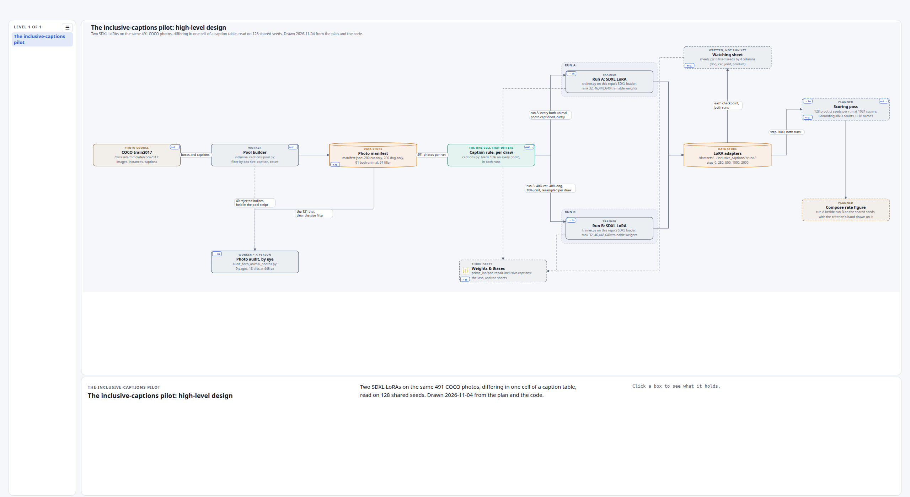

# The inclusive-captions pilot: the high-level design, explained

This is the companion to [the live scene](https://claude.ai/artifact/Uhp9tJfqpgHYHnQCfVaDNc), the page that opens every part of the design into its inside. It walks the same 1 levels in order, from the people who use the system down to code and database rows, one section a level, with a still of each that links to the same place on the live page. The words name the parts the way the code and the runbook do, and each links to where the idea is taught.

## Level 1 of 1: The inclusive-captions pilot: high-level design

**COCO train2017**. scripts/census/inclusive_captions_pool.py:69-71 reads instances_train2017.json and captions_train2017.json under /datasets/mmolefe/coco2017, with the images found at :81.

**Pool builder**. scripts/census/inclusive_captions_pool.py. The wanted counts are WANT at :105; the caption per photo is the shortest of each photo's five, at read_captions(), :128.

**Photo audit, by eye**. scripts/census/audit_both_animal_photos.py, 16 tiles a page at 448 pixels, nine pages for the 131. Its verdicts are committed at artifacts/results/the-inclusive-captions-photo-pool/audit-verdicts.json. The plan's instruction 8 owns the judging.

**Photo manifest**. /datasets/mmolefe/poe_repair_min/outputs/inclusive_captions_pool/manifest.json, written at inclusive_captions_pool.py:291. The four set sizes are the audited ones.

**Caption rule, per draw**. poe_repair/experiments/inclusive_captions/captions.py. The four caption strings are at :54-57, the 10% blank rate at :65, and the per-run shares on the both-animal photos at BOTH_SHARES, :69.

**Run A: SDXL LoRA**. trainer.py on this repo's SDXL loader; rank 32, 46,448,640 trainable weights

**Run B: SDXL LoRA**. trainer.py on this repo's SDXL loader; rank 32, 46,448,640 trainable weights

**LoRA adapters**. trainer.py:60 and :188-189 write step_/ under /datasets/mmolefe/poe_repair_min/outputs/inclusive_captions//, loadable with PeftModel.from_pretrained.

**Watching sheet**. sheets.py: 8 fixed seeds by 4 columns (dog, cat, joint, product)

**Weights & Biases**. trainer.py:138-139 and :179-181, project prime_lab/poe-repair-inclusive-captions. The project was chosen new rather than as a group inside the animals-compose sweeps, per the walk map's decision table.

**Scoring pass**. 128 product seeds per run at 1024 square; GroundingDINO counts, CLIP names

**Compose-rate figure**. run A beside run B on the shared seeds, with the criterion's band drawn on it

