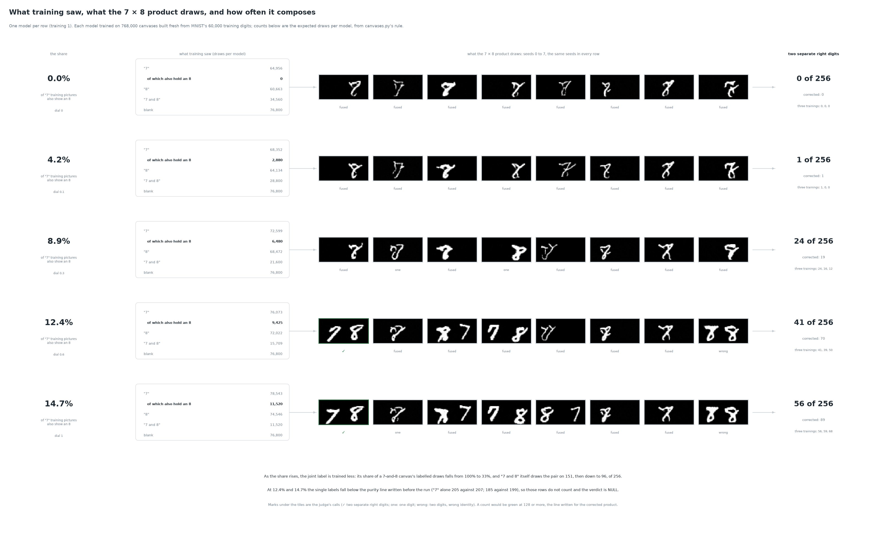
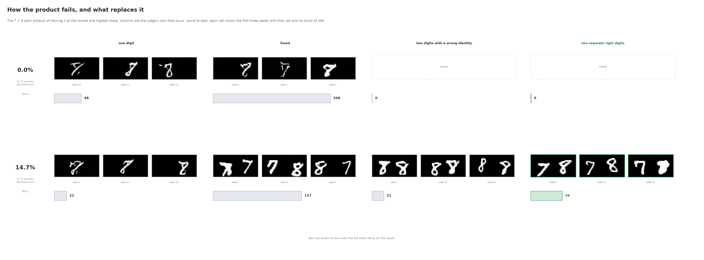
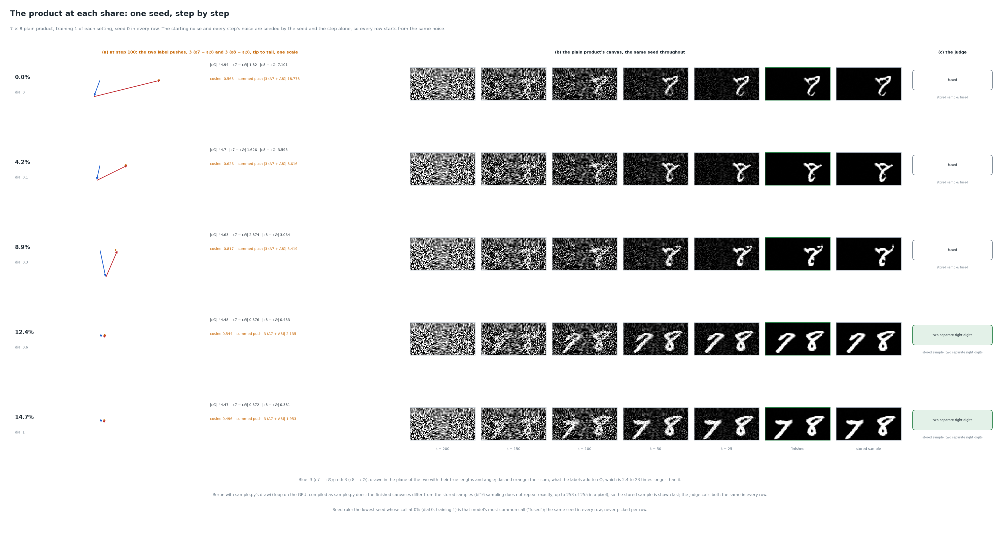
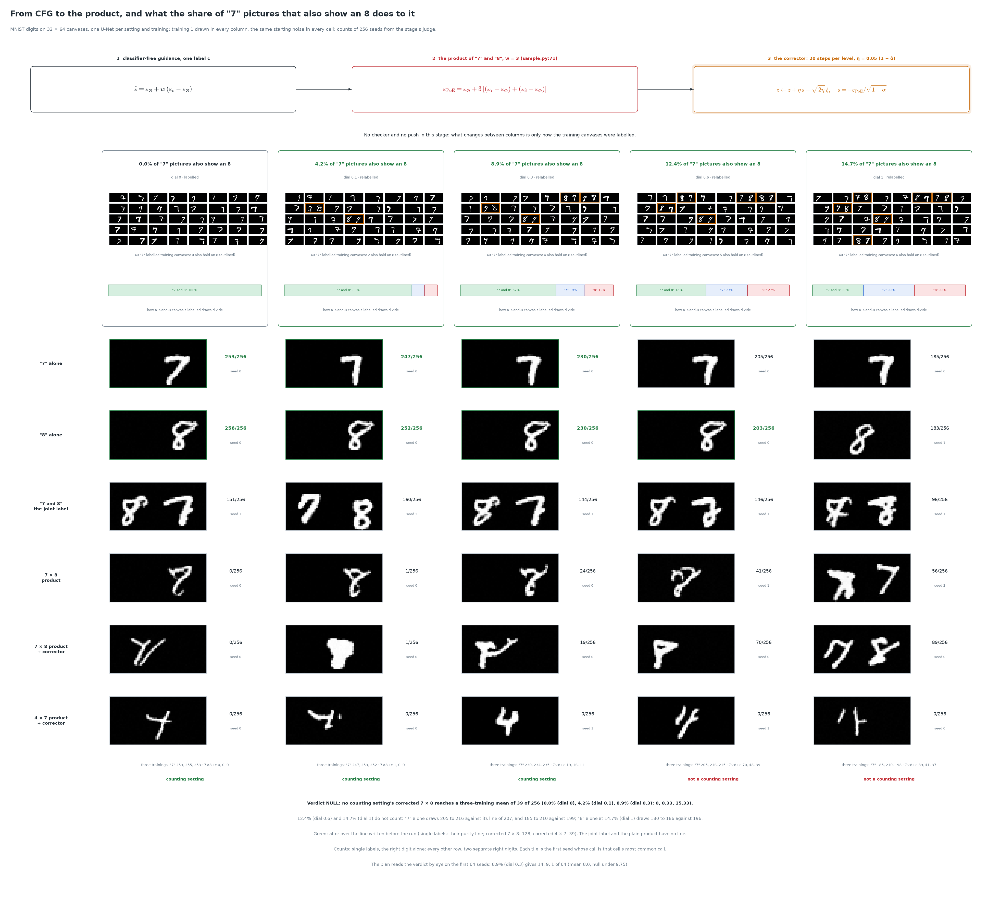
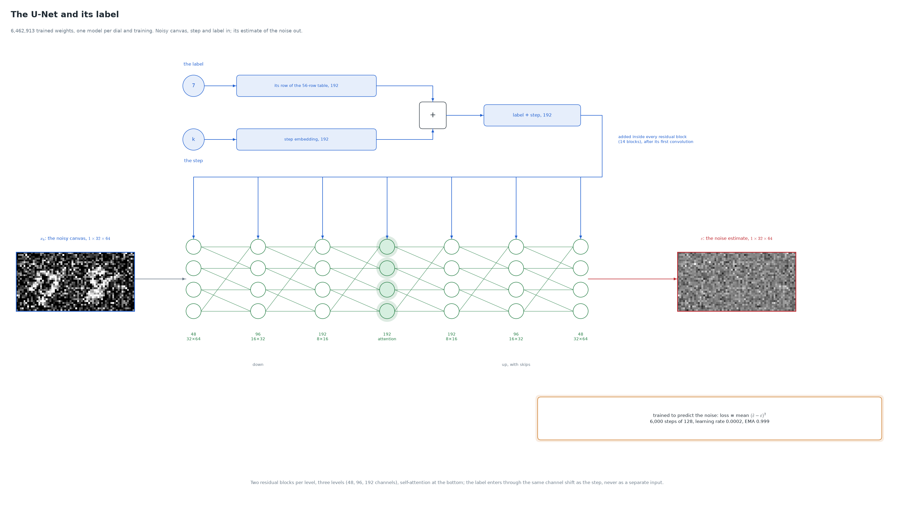
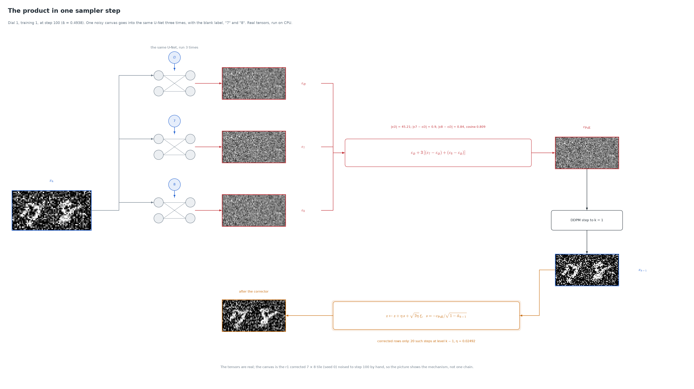
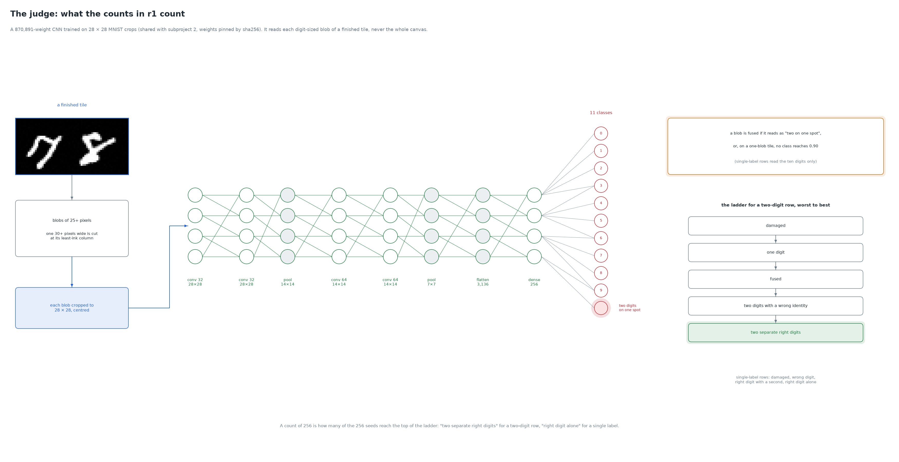

# How the inclusive-labels MNIST stage works

Figures that take a reader from the guidance equation to the counts. The question the stage asks: if
some of the training canvases filed under "7" also show an 8, does the product of "7" and "8" draw two
separate digits?

Every number comes from [the numbers file](../mnist_stage_numbers.json), written by
`make_mnist_stage_numbers.py` from the stage's code, checkpoints, samples and result files. Every
picture is a real tile or a real tensor.

**The settings are named by their share.** A setting's share is the share of "7"-labelled (non-blank)
training draws whose canvas also shows an 8: 0%, 4.2%, 8.9%, 12.4% and 14.7%. These are the settings
the code calls dial 0, 0.1, 0.3, 0.6 and 1, and the dial is given in brackets where it is needed. The
share counting any second digit beside the 7 is higher, 0%, 5.0%, 10.5%, 14.6% and 17.3%, because
15% of two-digit canvases holding a 7 pair it with another digit. That is why 17.3% does not appear.

Marks: `verified` means read from the code or a result file and checked on the figure; `stated` means
taken from the plan or the walk without rerunning; `inferred` means a reading of the picture.

**Read first:** r6, then r7 and r5. r1 to r4 show how the stage works.

## r6. One row per share (the main results figure)

Each row reads left to right: the share, what training saw, what the 7 × 8 product draws, and the
result.

**What training saw.** Each model trained on 768,000 canvases (6,000 steps of 128), built fresh every
batch from MNIST's 60,000 training digits. The table gives expected draws per model from
`canvases.py`'s rule. For example, at 14.7% there are 78,543 "7" draws, of which 11,520 also hold an
8, plus 74,546 "8", 11,520 "7 and 8" and 76,800 blank.

**The product's draws.** Seeds 0 to 7 of training 1's plain product, the same seeds in every row, each
marked with the judge's call from `scores.csv`.

**The result.** The only emphasis. Two separate right digits out of 256: 0, 1, 24, 41 and 56 plain,
with the corrected count and the three trainings' plain counts beneath.

The footer gives the second change and the verdict. The joint label's share of a 7-and-8 canvas's
labelled draws falls from 100% to 33%, and "7 and 8" draws the pair on 151 then 96 of 256. At 12.4%
and 14.7% the single labels fall below their purity lines, so the verdict is NULL. `verified`

## r7. How the product fails, and what replaces it

Two rows, 0% (dial 0) and 14.7% (dial 1). The columns are the judge's calls that occur, worst to best.
"Damaged" occurs in neither row, so it has no column. Each cell shows the first three seeds with that
call and a bar of its count, to one scale.

At 0% every seed is fused (208) or one digit (48). At 14.7%, two separate right digits (56) and two
digits with a wrong identity (21) appear, fused falls to 157 and one digit to 22. `verified`

## r5. The product at each share: one seed, step by step

Seed 0 in every row, chosen as the lowest seed whose call at 0% is that model's most common call
("fused").

**The same starting noise.** `sample.py` seeds the starting noise by the seed and each step's noise by
the step alone, so every row starts from the same noise. The figure verifies the starting canvas.

**(a) The two label pushes at step 100.** 3 (ε7 − ε∅) and 3 (ε8 − ε∅), tip to tail, with their true
lengths and angle, turned so their sum points right, all on one scale.

| Share | Size of ε7 − ε∅, size of ε8 − ε∅ | Cosine | Size of the summed push, 3 (Δ7 + Δ8) |
|---|---|---|---|
| 0% | 1.82, 7.10 | −0.56 | 18.8 |
| 4.2% | 1.63, 3.60 | −0.63 | 8.6 |
| 8.9% | 2.87, 3.06 | −0.82 | 5.4 |
| 12.4% | 0.38, 0.43 | 0.54 | 2.1 |
| 14.7% | 0.37, 0.38 | 0.50 | 2.0 |

So the label pushes are larger and point against each other at the low shares, and small and in the
same direction at the high ones. |ε∅| is about 44.5 throughout, 2.4 to 23 times the summed push.

**(b) The canvas.** The plain product at k = 200, 150, 100, 50 and 25, the finished canvas, and the
stored sample.

**(c) The judge.** The call on the recaptured canvas, with the stored sample's call beneath. They
agree in every row: fused at 0%, 4.2% and 8.9%, two separate right digits at 12.4% and 14.7%.

**Not an exact replay.** The chain was rerun with `sample.py`'s loop on the GPU, compiled as
`sample.py` does. The finished canvases still differ from the stored samples by up to 253 of 255 in a
pixel, because bf16 sampling does not repeat exactly; the stored sample is shown last for that reason.
`verified`

## r1. From CFG to the product, and what the share does to it

**The equations.** Classifier-free guidance; the product of "7" and "8" with weight 3 (`sample.py:71`);
the corrector, 20 Langevin steps per level with η = 0.05 (1 − ᾱ).

**The column headers.** Each header names its share, "4.2% of '7' pictures also show an 8", with the
dial in small grey print.

**The grid.** 40 real "7"-labelled training canvases drawn with `canvases.py`. round(share × 40) of
them hold a 7 and an 8 and are outlined: 0, 2, 4, 5 and 6. The grid is composed so that the outlined
count matches the share, as the toy's figure 05b did. "7" canvases with a second digit other than 8
are left out of the grid.

**The bar.** How a 7-and-8 canvas's labelled draws divide, from `canvases.py`: "7 and 8" 1/(1 + 2d), and
"7" and "8" d/(1 + 2d) each. That is 100% joint at 0% and a third each at 14.7%.

**The rows.** "7" alone, "8" alone, the joint label, the 7 × 8 product, the product with the
corrector, and the 4 × 7 product with the corrector. One tile per cell from training 1, the first seed
whose call is that cell's most common call. Counts of 256; green at or over the line written before
the run.

**The verdict, `verified`.** NULL. The counting settings are 0%, 4.2% and 8.9% (dial 0, 0.1, 0.3), with
corrected means of 0, 0.33 and 15.33, all under 39. 12.4% (dial 0.6) and 14.7% (dial 1) fall below
the purity lines.

**The eye calls, `stated`.** The plan's eye calls at 8.9% give 14, 9 and 1 of 64, also null.

## r2. The U-Net and its label

Three levels (48 channels at 32 × 64, 96 at 16 × 32, 192 at 8 × 16) with self-attention at the bottom,
and 6,462,913 weights. The label's row of the 56 × 192 table is added to the step embedding and enters
all 14 residual blocks. The network is trained to predict the noise, for 6,000 steps of 128.
`verified`

## r3. The product in one sampler step

The dial-1 (14.7%) model at step 100, on CPU. The canvas is a finished tile noised by hand, so this
shows the mechanism. r5 shows real chains. |ε∅| = 45.21, |ε7 − ε∅| = 0.90, |ε8 − ε∅| = 0.84, and the
cosine between the two label differences is 0.809. `verified`

## r4. The judge

**The network.** The pinned judge, 870,891 weights; its sha256 matches `counts.json`. Layers: conv
32, conv 32, pool, conv 64, conv 64, pool, 3,136, 256, then 11 classes.

**The rules.** Blobs of 25 or more pixels; a blob 30 or more pixels wide is split; the 0.90 confidence
line applies on one-blob tiles only.

**The ladder.** Damaged, one digit, fused, two digits with a wrong identity, two separate right
digits. `verified`

## Earlier versions

[`earlier/`](earlier/) holds the first r6, a grid of the 7 × 8 product's calls at every share. r6 and r7
replace it, because it was hard to talk through.

<b>How it was made</b>

**The numbers.** `make_mnist_stage_numbers.py` imports the stage's modules unchanged, checks every
per-cell count against `counts.json`, computes the shares and the expected draws from `canvases.py`'s
rule, draws the header grids with `CanvasMaker` on CPU, and judges r5's recaptured canvases with the
pinned judge.

**The chains.** `make_r5_trajectories.py` reruns `sample.py`'s draw loop on the GPU with
`torch.compile`, over the full 256-seed batch so the step noise matches.

**The figures.** `make_mnist_stage_figures.py` draws everything. Its `Fig`, `node`, `column` and `fan`
helpers are copied from the classifier-guidance stage's `make_results_figures.py`, not edited. Each
figure refuses to save if a line crosses a box, circle or label it does not connect.

<b>What it cannot say</b>

**One training.** The figures show training 1; the other trainings appear only as counts.

**Single examples.** The step figures (r3, r5) take one canvas and one step.

**Expected counts.** The draw counts in r6 are expected values from the rule, not counts of the draws
actually made.

**The training line.** `score.py`'s hard-coded training line differs from the computed share by up to
0.3 points.

## Cross-references

- The mention of **pinned judge** in [the MNIST share run's environment facts](../../../../plans/11-do-inclusive-captions-help-poe-compose/plans/03-the-mnist-share-run.md#environment-facts-this-plan-depends-on).
- The mention of **two separate right digits** in [the MNIST stage's success and failure outcomes](../../../../plans/11-do-inclusive-captions-help-poe-compose/plans/02-the-mnist-stage.md#success-and-failure-outcomes).
- The mention of **three-level pixel U-Net** in [the MNIST stage's network and smoke run task](../../../../plans/11-do-inclusive-captions-help-poe-compose/plans/02-the-mnist-stage.md#2--the-network-and-the-smoke-run).
- The mention of **width-48 U-Net** in [the MNIST share run's quick context](../../../../plans/11-do-inclusive-captions-help-poe-compose/plans/03-the-mnist-share-run.md#quick-context).
