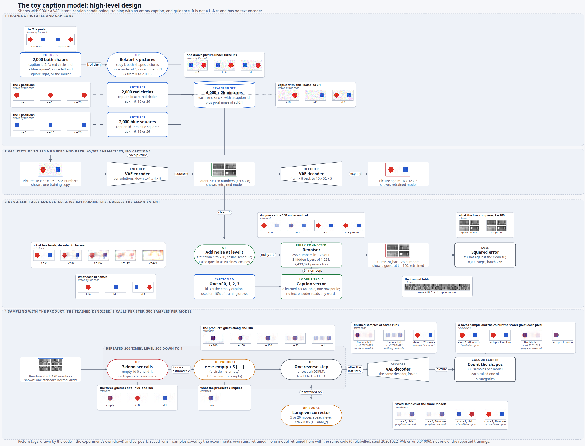

# How does the toy relabelling experiment work?

A ladder of pictures of one experiment: both-shapes training pictures also captioned with each single
caption, and whether the product of the two single captions then draws both shapes. Each rung goes one
level deeper. [The ladder file](ladder.json) holds the colour key, the notation and the state of every rung,
and every number on every rung is read from `toy_relabelling_numbers.json`, written by
`make_toy_relabelling_numbers.py`.

## Rung 0: the toy caption model, with a real picture on every part

**What it shows**

The model in four lanes read top to bottom, with 23 boxes and 21 arrows. Lane 1 is the training data:
2,000 pictures per caption and the relabelling step that adds k both-shapes pictures under ids 0 and 1.
Lane 2 is the VAE (45,707 parameters, a 16 x 32 x 3 picture to a 4 x 4 x 8 latent of 128 numbers and
back). Lane 3 is the fully connected denoiser (3 hidden layers of 1,024, 2,493,824 parameters), which reads
the noisy latent, 64 time features and a row of a 4 x 64 caption table, and guesses the clean latent. Lane 4
is sampling: three denoiser calls per step turned into noise estimates e and added up as the product
e_empty + 3 [(e_circle − e_empty) + (e_square − e_empty)], 200 reverse steps, the optional Langevin
corrector, the frozen decoder and the colour scorer.

**The pictures**

Sixteen boxes carry a card of real pictures and five tensor boxes show their picture in place of the grid
glyph. The relabel card shows one drawn both-shapes picture under ids 2, 0 and 1 (training copies 5249, 6000
and 6020 of the k = 20 set). The decoder in lane 4 shows the product at 0 relabelled (a purple hybrid and a
faint one) beside the product with 20 corrector moves at share 1 (red and blue apart). The corrector's card
compares plain and corrected samples within one share model at a time, so only the corrector differs inside
each pair. Every card carries a tag: drawn by the code, saved runs, or retrained.

**How we got it**

`make_rung0_pictures.py` draws every picture: training pictures with the experiment's own `draw`, `PAIRS`
and `corpus_k`; sample strips from the saved `toy-caption-threshold-samples.npz` and
`toy-caption-dial-corrector-samples.npz` in subproject 3, each called by `toy_blob_scorer.read`; and the
per-step pictures from one model retrained with the same code (0 relabelled, seed 20261022, VAE error
0.01006, the same as the reported training with that seed). The `hld-pictures` agent chose which picture
goes on which box and wrote `the-toy-caption-model-pictures/pictures.json`. `make_rung0_spec.py` writes the
spec from the numbers file, and `draw_rung0.py` lays the boxes out with the hld-diagram skill's `draw_hld.py`
and puts the pictures on them. Grown from version 1 in
`3-understanding-compositionality/artifacts/scenes/how-the-caption-model-works/`, which had no pictures; the
box set and the arrows are the same. Published as a private page at
https://claude.ai/artifact/Jp5BkFGCGoQV7d25oa7vha; its closed sections list every picture box by box with its
caption, and the file and function behind every box.

**What it lets you say**

What each part takes in and gives out, how big it is, and what that looks like on a real picture: a caption
is a row number and never words, relabelling puts one picture under three ids, the denoiser guesses the
clean latent, the three calls at one step guess a purple blob, a red circle and a blue square, and their sum
implies one purple square.

**What it cannot say**

Any compose count. The per-step pictures come from a retrained model, not from the reported trainings
(its final 8 product samples are all called nothing readable, as most of the reported seed 20261022
samples are). The VAE encoder and decoder boxes in lane 2 carry no picture, because the tensors on either
side show their input and output. The saved corrector samples of one model are nearly identical to one
another, so one sample stands for each.

### Versions

- `the-toy-caption-model-high-level-design-explainer__2026-11-18.svg`: version 2, the first with pictures:
  16 picture cards and 5 tensor pictures added to version 1's 23 boxes and 21 arrows.

**Held since 2026-11-18.** The referrer lines are owed: `ladder.json`'s rung 0 row (the conductor writes it)
and a link from `4-inclusive-captions/report/` once that page exists.
