# How the toy relabelling experiment works: the network views

One figure for each question about how the toy experiment is set up: the data, the networks, how
they are trained, how a sample is drawn, how the two captions are combined, and how a sample is
counted. They are in zoom order, from the pictures to the count. Every number on them comes from
[the numbers file](../toy_relabelling_numbers.json), and every picture is a real picture from the
experiment's code or from the reference models.

The main design is replacing: each single caption keeps exactly 2,000 pictures, and k of its lone
shapes are replaced by both-shapes pictures, so only the share holding both shapes changes. The
adding design (each single caption grows to 2,000 + k) is kept as the check. Figures that depend on
the design or on a reference model are drawn from replacing, and their adding-design versions are
kept in [the adding-design folder](adding-design/README.md).

Marks: `verified` means read from the code or a result file and checked on the figure; `stated`
means taken from the write-up without rerunning; `inferred` means a reading of the picture.

## 1. The training pictures

<a href="01-the-training-pictures.png">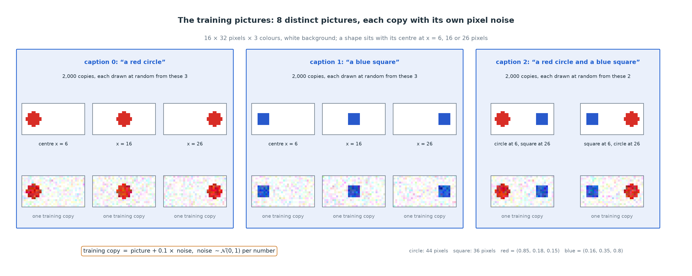</a>

There are only 8 distinct pictures: three circles and three squares (centres at x = 6, 16 and 26) and
two layouts of the pair. Each caption gets 2,000 copies drawn from its bank, and every copy gets its
own pixel noise of standard deviation 0.1. `verified`

## 2. What relabelling does to each caption's pool

<a href="02-what-relabelling-adds-to-each-caption.png">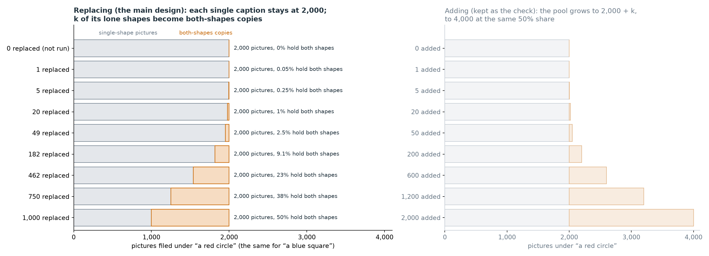</a>

Left, replacing: the pictures filed under "a red circle" at each replaced count (x: pictures, 0 to
4,000). The pool stays at 2,000; the grey part is the single-shape pictures and the orange part the
both-shapes copies that replaced them, so the share runs from 0.05% (1 replaced) to 50% (1,000
replaced). Right, faded, on the same scale: adding, where the pool grows to 2,000 + k, up to 4,000 at
the same 50% share. The pictures in each pool are
[figure 05b of the toy write-up](../../../../../3-understanding-compositionality/artifacts/results/the-exact-toy/how-much-co-occurrence-the-product-needs/plain-figures/05b-the-training-set-with-and-without-relabelling.png),
linked rather than redrawn. `verified`

## 3. How long each network trains

<a href="03-how-long-each-network-trains.png">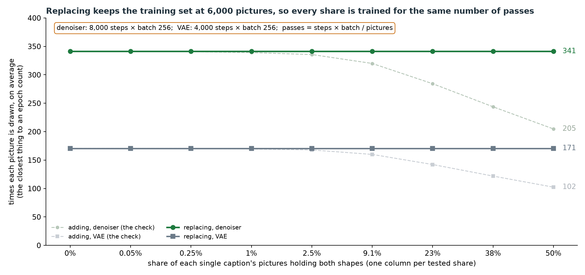</a>

y: how many times each training picture is drawn on average, the closest thing to an epoch count;
x: share holding both shapes, one column per tested share. Replacing keeps the training set at
6,000 pictures, so the denoiser (8,000 steps of 256) sees each picture about 341 times and the VAE
(4,000 steps of 256) about 171 times at every share. Adding, faded, falls to 205 and 102 at 50%.
Batches draw with replacement. `verified`

## 4. The VAE

<a href="04-the-vae.png">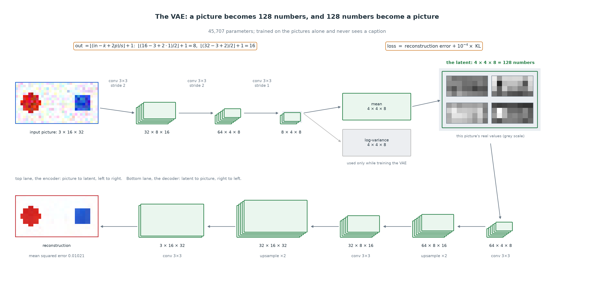</a>

Top lane, the encoder: 3 × 16 × 32 → 32 × 8 × 16 → 64 × 4 × 8 → 8 × 4 × 8, split into a mean and a
log-variance of 4 × 4 × 8 each, with the size arithmetic boxed. The mean is the 128-number latent,
shown as this picture's real values. Bottom lane, the decoder: back up to a 3 × 16 × 32
reconstruction. 45,707 parameters. The picture is a both-shapes copy under "a red circle" in the
replacing 1,000 model's training set; that VAE's reconstruction error is 0.01021. `verified`

## 5. The denoiser

<a href="05-the-denoiser.png">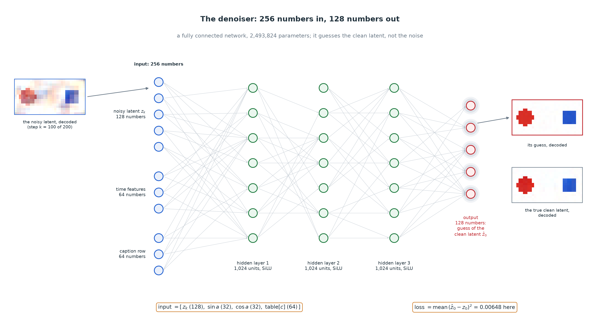</a>

Inputs: 128 noisy-latent numbers, 64 time features and a 64-number caption row (256 in all). Then three
hidden layers of 1,024 with SiLU, and 128 outputs, which are a guess of the clean latent. On the
example shown (replacing 1,000 model, step 100, a both-shapes picture under "a red circle") the loss
is 0.00648. A sample of the connections is drawn, not every edge. `verified`

## 6. The time features

<a href="06-the-time-features.png">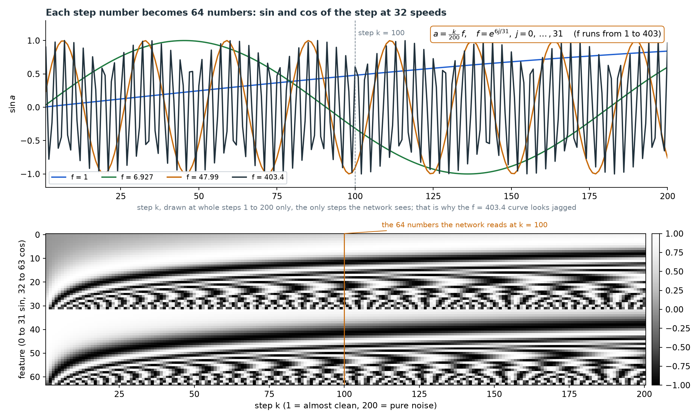</a>

Top, y: sin a for 4 of the 32 frequencies; x: step k from 1 to 200. Bottom: all 64 features (rows)
at every step (columns). a = (k / 200) × f, with f = e^(6j/31), so f runs from 1 to 403. The curves
are drawn at whole steps only, the only steps the network sees, which is why the f = 403.4 curve
looks jagged. The same in both designs. `verified`

## 7. The caption

<a href="07-the-caption.png">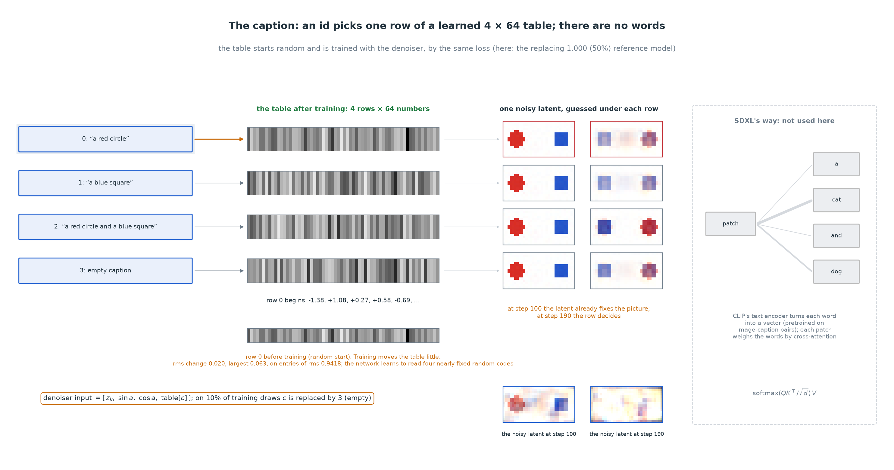</a>

Each caption is an id that picks one row of a 4 × 64 table, and that row is concatenated into the
denoiser's input. In the replacing 1,000 model, training moves the table little: the change has an
rms of 0.020 (largest 0.063) against entries of rms 0.94, so the network learns to read four nearly
fixed random codes. Under the four rows, one noisy latent gives the same guess at step 100. At step
190 row 2 (the joint caption) gives the pair and the other rows faint purple. SDXL's cross-attention
over CLIP word vectors is drawn faded, as the thing this model does not have. `verified`; the
reading of the step-190 guesses is `inferred` from one latent.

## 7b. The caption is a number

<a href="07b-the-caption-is-a-number.png">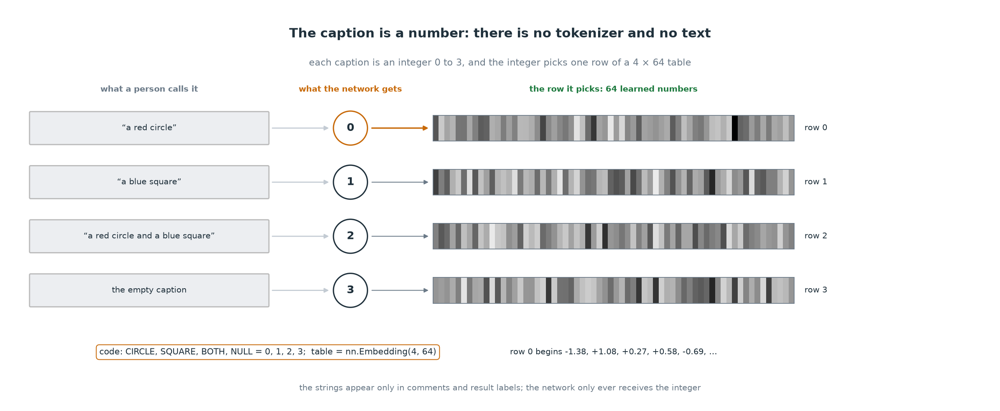</a>

There is no tokenizer and no text. Each caption is an integer (`CIRCLE, SQUARE, BOTH, NULL = 0, 1,
2, 3`), and the integer picks one row of `nn.Embedding(4, 64)`. In the replacing 1,000 model row 0
begins −1.38, +1.08, +0.27, +0.58, −0.69. The caption strings appear only in comments and result
labels; the network only ever receives the integer. `verified`

## 7c. Everything enters at the first layer

<a href="07c-everything-enters-at-the-first-layer.png">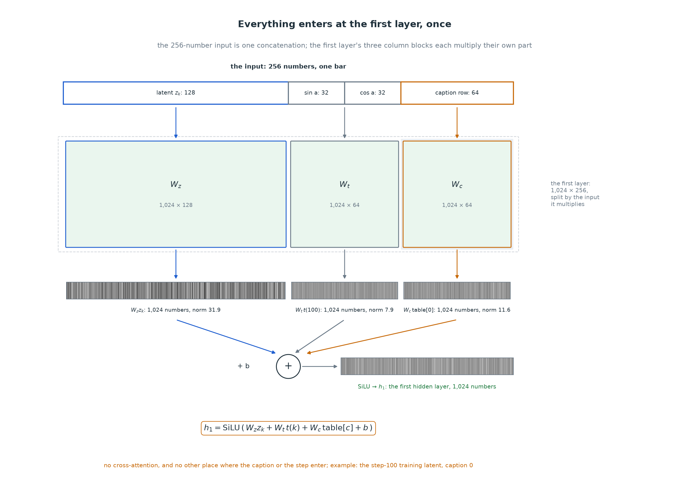</a>

The input is one 256-number bar: the latent (128), sin a (32), cos a (32) and the caption row (64).
The 1,024 × 256 first layer splits into three column blocks, W_z, W_t and W_c, each multiplying its
own part. The three 1,024-number products are summed with the bias, then SiLU gives the first hidden
layer: h₁ = SiLU(W_z z_k + W_t t(k) + W_c table[c] + b). For the replacing 1,000 model's step-100
training latent under caption 0 the products have norms 31.9, 7.9 and 11.6. There is no
cross-attention, and the caption and the step enter nowhere else. `verified`

## 7d. What is learned and what is fixed

<a href="07d-what-is-learned-and-what-is-fixed.png">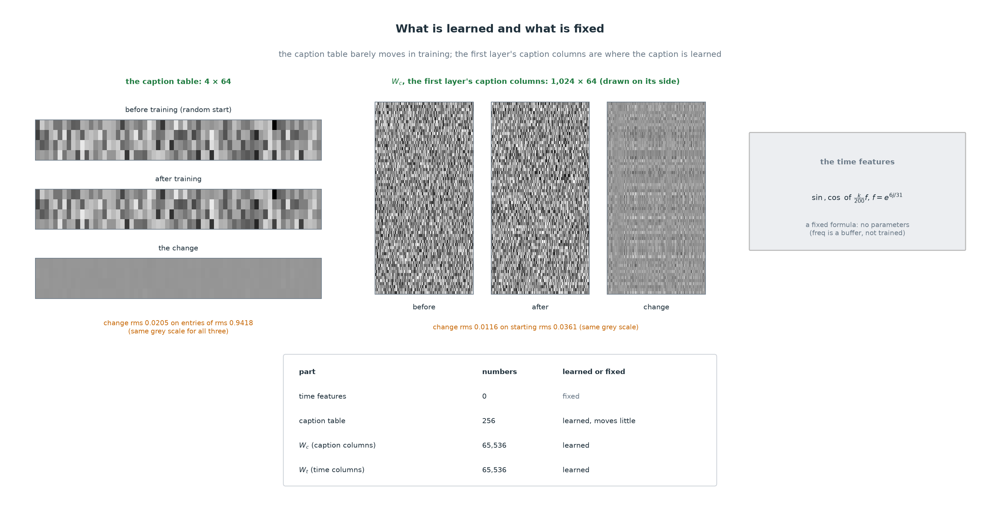</a>

The caption table before and after training, and the change, on one grey scale. In the replacing
1,000 model it moves by 0.0205 rms on entries of 0.9418. Beside it, W_c, the first layer's caption
columns, moves by 0.0116 on a starting rms of 0.0361, so this is where the caption is learned. The
time features are a fixed formula with no parameters (`freq` is a buffer). Parts: time features 0
numbers, fixed; caption table 256, learned but moves little; W_c 65,536, learned; W_t 65,536,
learned. The first layer's time and latent columns move a little more than W_c (0.0181 and 0.0177
on 0.036). The starting weights are rebuilt exactly, since `train_denoiser` sets the seed and then
builds the network. `verified`

## 7e. How big the caption's push is

<a href="07e-how-big-the-caption-push-is.png">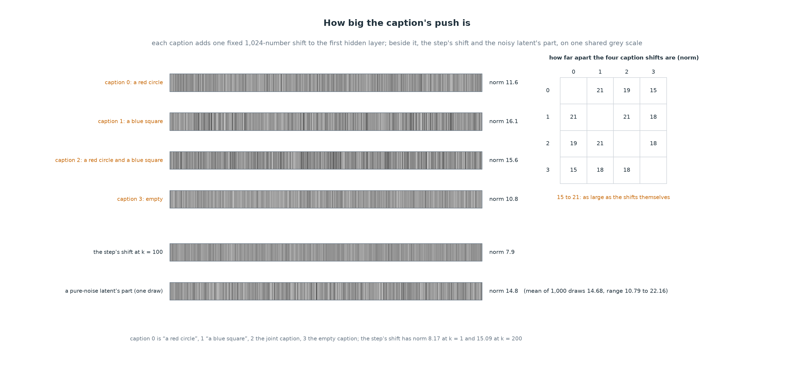</a>

Each caption adds one fixed 1,024-number shift to the first hidden layer, W_c table[c]. In the
replacing 1,000 model the norms are 11.6, 16.1, 15.6 and 10.8 (captions 0 to 3). For scale on the
same grey scale: the step's shift has norm 7.9 at k = 100 (8.17 at k = 1, 15.09 at k = 200), and a
pure-noise latent's part averages 14.68 over 1,000 draws (10.79 to 22.16). The grid gives the
distance between each pair of caption shifts, 14.5 to 20.8, as large as the shifts themselves.
`verified`

## 7f. SDXL against the toy

<a href="07f-sdxl-against-the-toy.png">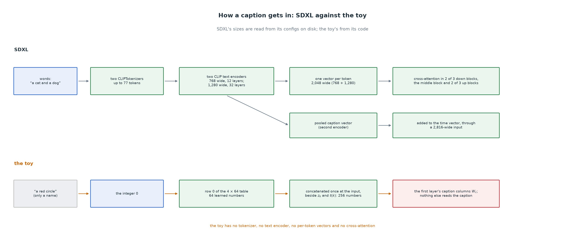</a>

SDXL, from its configs on disk: two CLIP tokenizers of up to 77 tokens, then two CLIP text encoders
(768 wide with 12 layers, 1,280 wide with 32). That gives one vector per token, 2,048 wide (768 +
1,280), read by cross-attention in 2 of 3 down blocks, the middle block and 2 of 3 up blocks. A
pooled caption vector enters through a 2,816-wide input added to the time vector. The toy: a name,
an integer, a table row, concatenated once at the input and read only by W_c. Sizes are `verified`
from `unet/config.json`, `text_encoder*/config.json` and `tokenizer*/tokenizer_config.json`. That
the pooled vector comes from the second encoder is `stated`, from how the SDXL pipeline uses
`CLIPTextModelWithProjection`; the configs do not say it. No reference model is involved.

## 8. Training the denoiser

<a href="08-training-the-denoiser.png">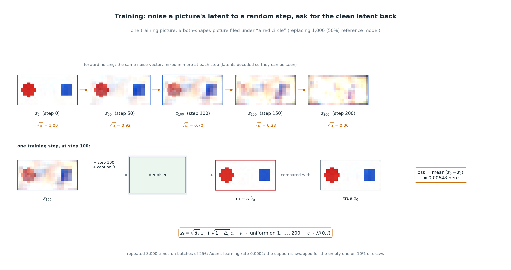</a>

Top: one latent from the replacing 1,000 model's training set noised with the same noise vector at
steps 0 to 200, with how much signal is kept (√ᾱ = 1.00, 0.92, 0.70, 0.38, 0.00). Bottom: one
training step, from z_100 plus step and caption, through the denoiser to a guess compared with the
true clean latent (loss 0.00648). `verified`

## 9. Sampling

<a href="09-sampling.png">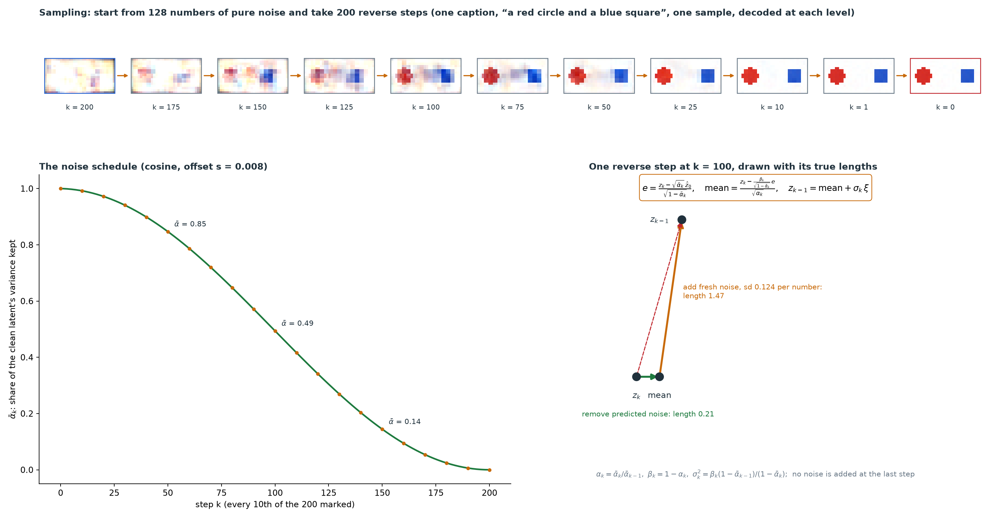</a>

Top: one sample from the replacing 1,000 model under the joint caption, decoded at eleven levels
from pure noise (k = 200) to the finished picture (k = 0). Bottom left, y: ᾱ_k, the share of the
clean latent's variance kept; x: step, every 10th marked. Bottom right: reverse step 100 of the
product run, drawn as a triangle with its true lengths in the 128-number space. Removing the
predicted noise moves the latent 0.21; the fresh noise added moves it 1.47 (sd 0.124 per number).
`verified`

## 10a. The product and the corrector

<a href="10a-the-product-and-the-corrector.png">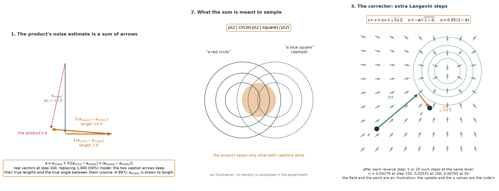</a>

Panel 1: the product's noise estimate at step 100 in the replacing 1,000 model, drawn as arrows
tip to tail. e_empty has length 12.0. The two caption arrows keep their true lengths (7.9 and 10.4
after the factor 3) and the true angle between them, which has cosine −0.997: for this sample at
this step they point almost exactly against each other. In the adding model at 2,000 the same
cosine was −0.761, with lengths 4.6 and 4.7. Panel 2: the product of two densities keeps their
overlap (an illustration; no density is computed). Panel 3: one Langevin corrector step, with
η = 0.0428 at step 150, 0.0253 at 100 and 0.00765 at 50 (the field is an illustration). Panel 1
and the η values are `verified`.

## 10b. The product step by step

<a href="10b-the-product-step-by-step.png">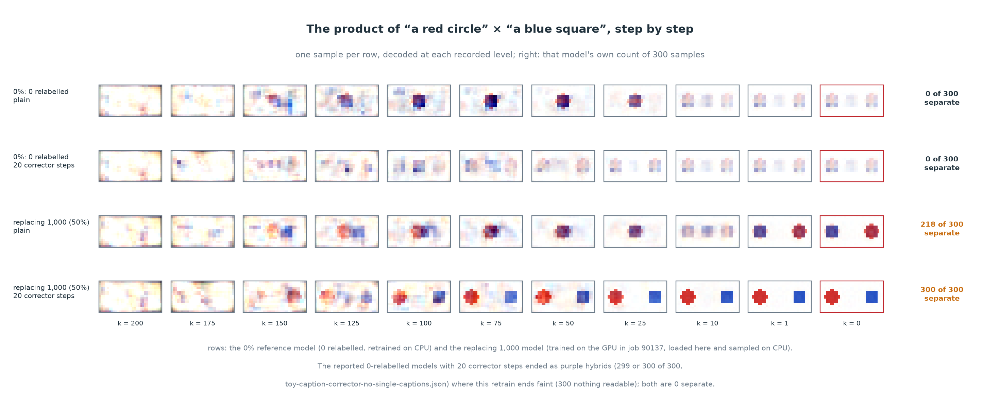</a>

One product sample per row, decoded at eleven levels, beside that model's own count of 300. At 0%
(the 0-relabelled reference, retrained on CPU) the sample fades to a faint smear with or without the
corrector, 0 of 300 separate either way. At replacing 1,000 (50%) it ends as a separate pair: 218 of
300 plain and 300 of 300 with 20 corrector steps. The reported 0-relabelled models with 20
corrector steps ended as purple hybrids (299 or 300 of 300,
`toy-caption-corrector-no-single-captions.json`), where this retrain ends faint (300 "nothing
readable"); both are 0 separate. `verified`

## 11. The scorer

<a href="11-the-scorer.png">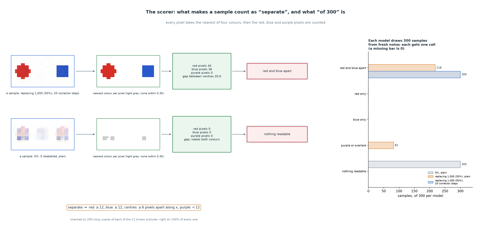</a>

Each pixel takes the nearest of four colours, or none if no colour is within 0.35. A sample is
"separate" when it has at least 12 red and 12 blue pixels, centres at least 6 pixels apart along
x, and fewer than 12 purple pixels. Two samples are walked through: one from replacing 1,000 with
the corrector, one from 0%. On the right, y: the five categories; x: samples out of 300 for 0%
plain (300 nothing readable), replacing 1,000 plain (218 separate, 82 purple) and replacing 1,000
with 20 corrector steps (300 separate). The scorer was right on 100% of 200 noisy copies of each of
the 11 known pictures. `verified`

## 12. Why the pictures carry pixel noise

<a href="12-why-the-pictures-carry-pixel-noise.png">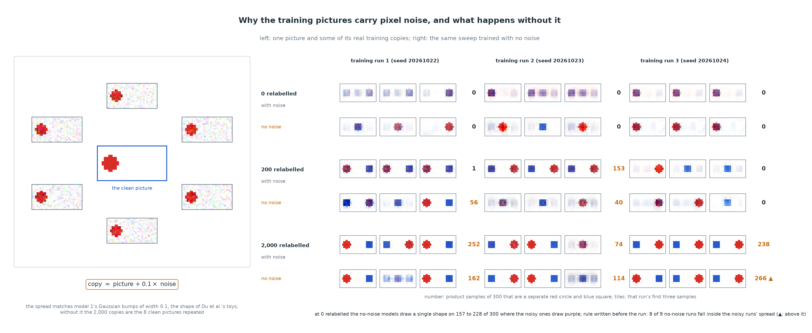</a>

Left: one clean picture and six of its real noisy copies. Without the noise, the 2,000 copies would
be the 8 clean pictures repeated. The spread matches model 1's Gaussian bumps of width 0.1 (the toy
write-up's reason, `stated`). Right: the adding sweep retrained with no noise, separate pairs out of
300 for three runs at each count. With no noise: 0, 0, 0; 56, 40, 0; 162, 114, 266. With noise: 0,
0, 0; 1, 153, 0; 252, 74, 238. At 0 relabelled the no-noise models draw a single shape on 157 to 228
of 300 where the noisy ones draw purple. The rule written before the run asked that each no-noise
count fall within the noisy runs' spread; 8 of 9 do, and the 2,000-relabelled third run (266, marked
▲) is above the noisy maximum of 252. This test was run on the adding design only. `verified`

## 13. Replacing against adding

<a href="13-replacing-against-adding.png">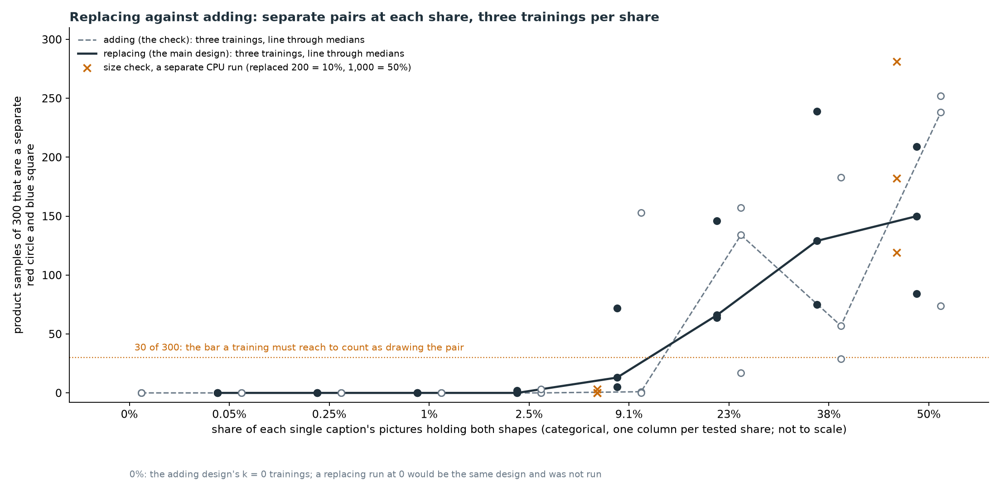</a>

y: product samples of 300 that are a separate red circle and blue square; x: share holding both
shapes, categorical with one column per tested share (not to scale). Filled dots and the solid line
are replacing (the GPU sweep, job 90137, replaced 1, 5, 20, 49, 182, 462, 750 and 1,000); hollow
dots and the dashed line are adding. Lines join the medians of three trainings. The dotted line is
the 30-of-300 bar. Replacing: 0 separate up to 1%, at most 2 at 2.5%, 13, 5 and 72 at 9.1%, 66, 64
and 146 at 23%, 239, 129 and 75 at 38%, and 209, 150 and 84 at 50%. Crosses are the size check, a
separate CPU run with its own rule written before it (replaced 200: 0, 0, 3; replaced 1,000: 119,
281, 182; verdict "share drives it"); it is kept apart from the sweep and only plotted beside it.
The 0% column is the adding design's k = 0, since a replacing run at 0 is the same design and was
not run. `verified`

## 14. What the product draws at each share, replacing

<a href="14-what-the-product-draws-at-each-share-replacing.png">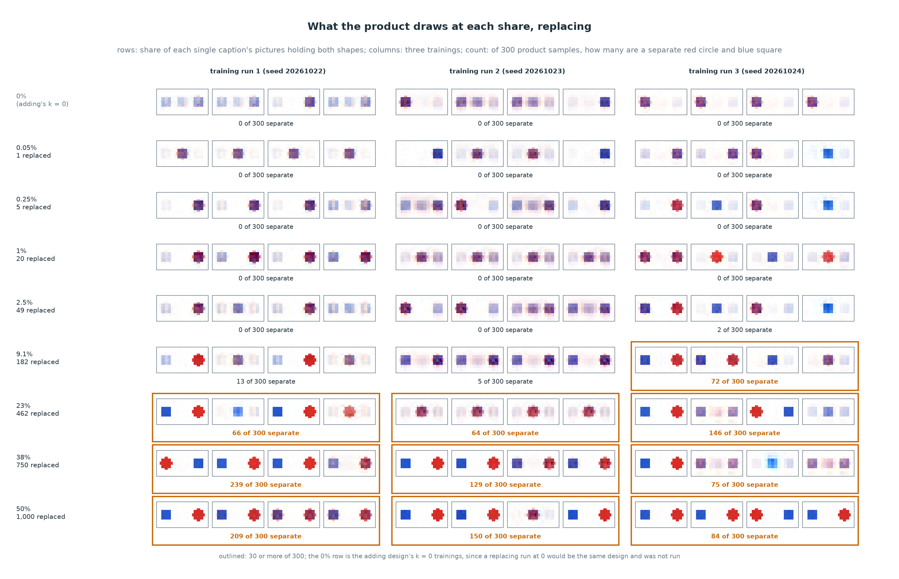</a>

The replacing counterpart of the toy write-up's figure 06. Rows are shares (0% to 50%), columns the
three trainings, and each cell shows the first four product samples and how many of 300 are a
separate pair; cells at 30 or more are outlined. No training reaches 30 below 9.1%; one does at
9.1% (72), and all three do from 23% up. The 0% row is the adding design's k = 0 trainings,
labelled as such. Tiles come from `toy-caption-replace-sweep-samples.npz` and, for 0%, from the toy
write-up's `toy-caption-threshold-samples.npz`. `verified`

## 15. The toy beside Du et al. 2023

<a href="15-du-et-al-side-by-side.png">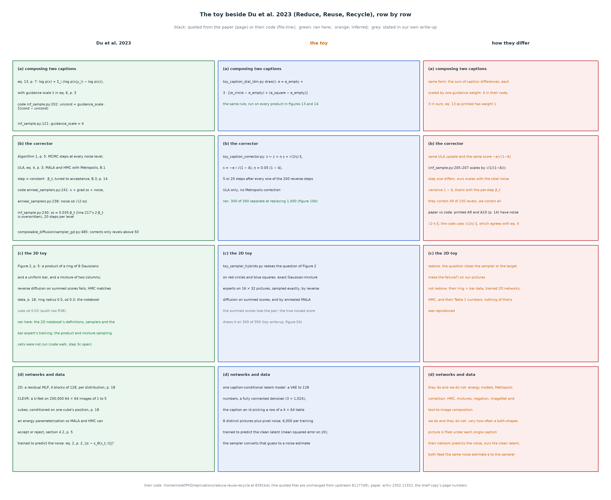</a>

Four rows comparing Du et al. 2023 (Reduce, Reuse, Recycle, arXiv 2302.11552) with the toy. The
three columns are their paper and code, the toy, and how the two differ. Each line is coloured by
its mark.

**(a) The composition rule.** Their eq. 13 (p. 7) and their code `inf_sample.py:202` add up the
caption differences at guidance 4 (line 121). The toy uses the same form at guidance 3.

**(b) The corrector.** Their ULA update (`anneal_samplers.py:238,241`) is ours. Their step size is
0.035·β_t (`inf_sample.py:230`, which overwrites the 2·β_t written at line 217), 20 steps per
level, and they correct only the levels above index 50 (`composable_diffusion/sampler_gd.py:485`).
Ours is 0.05·(1 − ᾱ), 5 or 20 steps, at every level. Their paper and code disagree on the noise:
printed A9 and A10 (p. 14) have √2·η ξ, while the code uses √(2η) ξ, which matches eq. 4.

**(c) The 2D toy.** We redo the question behind their Figure 2 on our own pictures. We do not redo
their ring and bar data, their trained 2D networks, HMC, or their Table 1. Of their notebook, the
laptop walk ran the definitions, the samplers and the bar expert's training. The product and
mixture sampling cells were not run.

**(d) Networks and data.** Their networks are trained to predict the noise (eq. 2, p. 2). Ours is
trained to predict the clean latent, with mean squared error on z0 (`toy_caption_dial_ldm.py`, line
155), and the sampler converts that guess to a noise estimate. Both feed the same noise estimate to
the sampler. They use energy models, Metropolis correction, HMC, mixtures and negation; we use none
of these. We vary how often a both-shapes picture is filed under each single caption; they do not.

Sources: the shelf copy of the paper (pp. 3, 5, 7, 13 to 14, 17 to 18), the read-only clone at
`8391bdc` (the quoted files are unchanged from upstream `81177d9`, checked by `git diff`), the
journey's code-against-paper audit (rows R15, R18, R19, R31, R38, R41, R49), and the clone's code
walk. Every code line on the figure is read into the numbers file from the file itself.

## 16. Every caption side by side, replacing

<a href="16-every-caption-side-by-side-replacing.png">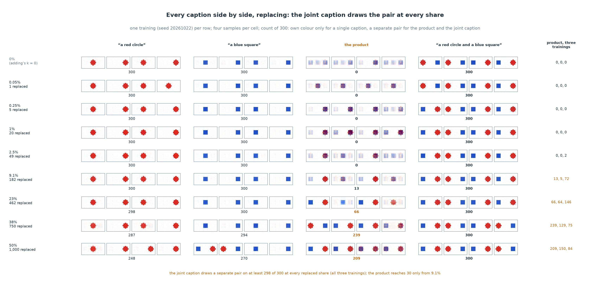</a>

Rows are the shares and the columns are the four captions, for one training per row (seed
20261022). The single-caption counts are own colour only; the product and joint counts are
separate pairs. The side column gives all three trainings' product counts. The joint caption
draws the pair on at least 298 of 300 at every replaced share, and on 300 of 300 at 0%. The
product reaches 30 only from 9.1%. The single captions stay pure (300 of 300) up to 9.1% and fall
to 248 and 270 at 50%. The 0% row is the adding design's k = 0. `verified`

## 17. From the toy to SDXL

<a href="17-from-the-toy-to-sdxl.png">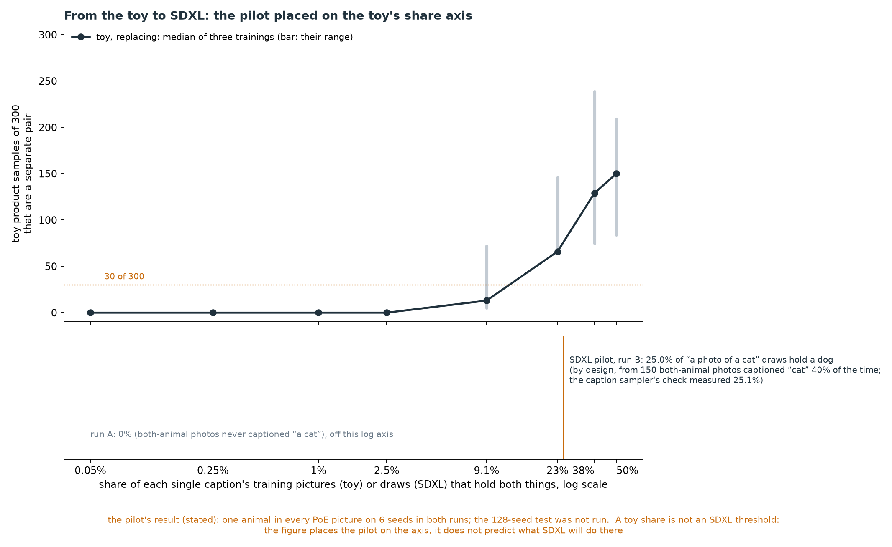</a>

Top, y: the toy product's separate pairs out of 300 under replacing (the median of three trainings,
with a bar for their range); x: the share holding both things, on a log scale. Bottom, the SDXL
pilot on the same axis. In run B, 25.0% of "a photo of a cat" draws hold a dog. That number is
recomputed from the training-set folders (150 both-animal photos captioned "cat" 40% of the time,
200 cat-only photos 90%) and the caption rule in the training-set card. The caption sampler's check
measured 25.1% (`stated`, the pilot plan, line 247). Run A is 0%, off the log axis. The pilot's
result (`stated`, from its card): one animal in every product picture on 6 seeds in both runs, and
the 128-seed test was not run. The figure places the pilot on the axis; a toy share is not an SDXL
threshold, and the figure does not predict what SDXL does at 25%.

## 18. The lookup is a one-hot vector times a matrix

<a href="18-the-lookup-is-one-hot-times-a-matrix.png">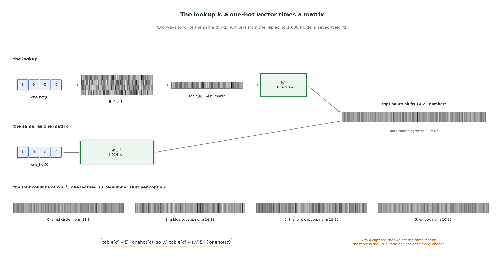</a>

table[c] = Eᵀ one_hot(c), so W_c table[c] = (W_c Eᵀ) one_hot(c), where W_c Eᵀ is a 1,024 × 4
matrix. Either way, each caption gets one learned 1,024-number shift. In the replacing 1,000 model
the four columns have norms 11.6, 16.11, 15.61 and 10.81, equal to the caption shifts of figure 7e.
The two routes agree to 3.6 × 10⁻⁷, and `nn.Embedding` returns exactly one_hot @ E. With 4 captions
the two forms are the same model; the table is the usual form and scales to many classes.
`verified`

<b>How it was made</b>

**The numbers.** `make_toy_relabelling_numbers.py` imports the experiment's own modules from
`3-understanding-compositionality/artifacts/notes/what-poe-loses-when-it-composes/` and
`4-inclusive-captions/scripts/toy_caption_replace.py` unchanged. It writes
`toy_relabelling_numbers.json`. The key `replacing design (main)` holds the replacing training set
at every count, the GPU sweep, the CPU size check (kept separate), the replacing 1,000 reference
model's recorded values and its first-layer measurements. Every key added for these figures was
checked by a diff: every value already in the file came out unchanged.

**The reference models.** The main one is replacing 1,000 (share 50%), seed 20261022, trained on
the GPU in job 90137 (mscluster88) by `scripts/toy_caption_replace.py --save-weights 1000:20261022`.
`train_reference_models.py --replace1000` loads its saved weights without retraining, rebuilds its
training set with the same numpy generator, and records the training example, the caption table
before and after training, the VAE round trip, reverse step 100 taken apart, trajectories with and
without the corrector, and the scorer's reading of the shown samples. The 0% reference (0
relabelled) and the adding 2,000 reference were retrained on CPU by `train_reference_models.py`
with the experiment's own functions. The trajectory recorder is `cr.draw`'s loop copied line for
line, and its final pictures match `cr.draw`'s own output exactly (largest pixel difference 0.0)
for every model.

**The figures.** `draw_network_views.py` draws all of them. Each diagram is checked before it is
saved: no arrow may cross a box, picture or label it does not start or end at, and a figure that
fails is not written. The adding versions of figures 2 and 3 are still drawn by `fig02_adding` and
`fig03_adding`; the other adding-design versions were kept as images before the redraw.

**The templates each figure starts from** (the zoom-ladder's `style_samples.py`, imported, in the
flat-schematic colours on white with glow and fade added):

| Figure | Template | What the template's checklist asks, and whether it is shown |
|---|---|---|
| 1 the training pictures | none fits; drawn in the same palette | |
| 2 what relabelling does to each pool | none fits | |
| 3 how long each network trains | none fits | |
| 4 the VAE | `cnn` joined to `latent-space` | real sizes under each volume and the size arithmetic: shown; the latent's size and that diffusion runs on it: shown |
| 5 the denoiser | `fc` | inputs, layers, output: shown; backward arrows: not drawn (training is figure 8) |
| 6 the time features | none fits (past the templates) | |
| 7 the caption | `embedding`, with `cross-attention` faded beside it | ids picking rows and one row's real first numbers: shown; cosine similarity between rows: not drawn, since the model never uses it; cross-attention's weight numbers: not drawn, since it is shown only as what is absent |
| 7b the caption is a number | `embedding` | ids picking rows and one row's real first numbers: shown |
| 7c everything enters at the first layer | `fc` | inputs, the layer, its output: shown as column blocks and real products |
| 7d learned and fixed | `embedding`, past it for the matrices | |
| 7e how big the caption's push is | none fits | |
| 7f SDXL against the toy | none fits | |
| 8 training | `noising` | the strip with √ᾱ under each and the formula: shown |
| 9 sampling | `reverse`, `schedule`, `sampler-step` | each step removes predicted noise: shown; ᾱ curve with the steps marked: shown; the step's drift, noise and total: shown with true lengths |
| 10a product and corrector | `guidance`, `poe`, `sampler-step` | caption differences tip to tail at s = 3: shown with real vectors; the overlap: shown, illustrative; where a fused sample sits: not marked |
| 10b the product step by step | `reverse` | shown |
| 11 the scorer | none fits | |
| 12 why pixel noise | none fits | |
| 13 replacing against adding | none fits | |
| 14 the product at each share, replacing | none fits | |
| 15 the toy beside Du et al. | none fits; a three-column table in the same palette | |
| 16 every caption side by side, replacing | none fits | |
| 17 from the toy to SDXL | none fits | |
| 18 the lookup as one-hot times a matrix | `embedding` | ids picking rows: shown as one-hot times E; one row's real numbers: shown as strips |

**Colour.** Blue is inputs, green hidden units, red outputs, orange the product and the corrector's
push, grey anything off or fixed. Diagram colours go on outlines, arrows and text only and never
fill a toy shape. The two captions' density contours in 10a are drawn in ink (solid and dashed),
not blue and red, so that they are not read as the square and the circle. In figure 13 the main
design is dark and filled, the check grey and hollow, and the size check orange crosses.

<b>What it cannot say</b>

**The reference models are single models.** The replacing 1,000 model's weights come from the GPU
sweep, but its pictures and counts here are sampled on CPU, so its count differs from the sweep's
for the same weights: 218 separate pairs plain here against 209 in the sweep, from different
sampling noise. The 0% reference is a CPU retrain; at 0 relabelled it gives 300 "nothing readable"
where the reported trainings gave 24 to 276 purple. The figures use the reference models for
pictures and single worked examples only; every count across shares comes from the result files.

**One latent, one step.** Figures 5, 7, 8, 9 and 10a each take one picture or one sample at one
step. They show how the machinery works, not how often a reading holds. The −0.997 cosine in 10a is
one sample at one step.

**The 0% row was not run under replacing.** At 0 replaced the two designs are the same training
set, so figures 13 and 14 use the adding design's k = 0 trainings there.

**The size check and the sweep are separate runs.** The size check was a CPU run with its own rule
written before it; the sweep was a GPU run judged by nothing. They are plotted side by side in
figure 13 and not pooled.

**Illustrations are marked.** The densities in 10a panel 2 and the field in panel 3 are drawn to
explain, not computed. In panel 1, e_empty is drawn to its true length but in a chosen direction;
only the two caption arrows keep their true angle.

