# The toy relabelling experiment, explained

This page explains the toy relabelling experiment figure by figure, so that each "how" question has
a picture to point at and an answer to say out loud. Every number comes from the experiment's code or
from `toy_relabelling_numbers.json` beside this page. The short index of the same figures is
[the network-views card](network-views/README.md); the counts are on
[the results card](../../results/does-relabelling-both-shapes-pictures-help-the-toy-product-compose/README.md).

**What the experiment asks.** When two captions are multiplied (the product of experts), does the
model draw both things in one picture? The toy multiplies "a red circle" by "a blue square". The one
thing changed is how many of the pictures filed under each single caption actually hold both shapes.
That is the toy version of a photo of a cat beside a dog being captioned "a cat" and "a dog" too.

**Two designs, one main.** In the main design, replacing, each single caption keeps exactly 2,000
pictures and k of its lone shapes are swapped for both-shapes pictures, so only the share changes. The
first design run, adding, put k extra both-shapes copies under each single caption, which also grew
the training set. Adding is kept as the check, and both give the same answer (section 14).

**The whole model on one page.** [The architecture diagram](the-toy-caption-model-high-level-design-explainer-light.png)
([interactive page](https://claude.ai/artifact/Jp5BkFGCGoQV7d25oa7vha)) shows every part with a real
picture on it. Its per-step pictures come from a model retrained at 0 relabelled; the sections below
use the replacing model at a 50% share.

## Words this uses

| Word | Meaning here |
|---|---|
| latent | the 128 numbers the VAE turns a picture into; diffusion runs on these, never on pixels |
| step k | how noisy a latent is, from 0 (clean) to 200 (pure noise) |
| caption id | the caption as an integer: 0 "a red circle", 1 "a blue square", 2 "a red circle and a blue square", 3 the empty caption |
| share | of the pictures filed under "a red circle" (or "a blue square"), the fraction that hold both shapes |
| replaced k | k of a single caption's 2,000 lone-shape pictures swapped for both-shapes pictures; share = k / 2,000 |
| the product | the two single captions combined at sampling time, to ask for a picture both captions accept |
| separate | the scorer's call for a red circle and a blue square apart from each other |

## Contents

1. [The training pictures](#1-the-training-pictures)
2. [Why the pictures carry pixel noise](#2-why-the-pictures-carry-pixel-noise)
3. [What replacing does to each caption](#3-what-replacing-does-to-each-caption)
4. [How long each network trains](#4-how-long-each-network-trains)
5. [The VAE](#5-the-vae)
6. [The denoiser](#6-the-denoiser)
7. [The time features](#7-the-time-features)
8. [The caption](#8-the-caption)
9. [Training the denoiser](#9-training-the-denoiser)
10. [Sampling](#10-sampling)
11. [The product and the corrector](#11-the-product-and-the-corrector)
12. [The product step by step](#12-the-product-step-by-step)
13. [The scorer, and what "of 300" means](#13-the-scorer-and-what-of-300-means)
14. [What the experiment found](#14-what-the-experiment-found)

The reference model on figures 4 to 11 is the replacing model at a 50% share (1,000 replaced, seed
20261022), trained on the cluster's GPU and loaded here. It draws 218 separate pairs of 300 plain and
300 with the corrector; its single captions draw only their own shape on 255 and 275 of 300.

---

## 1. The training pictures

<a href="network-views/01-the-training-pictures.png">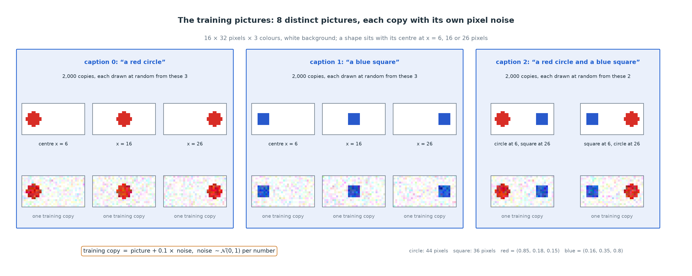</a>

**The question.** How was the dataset set up?

**What you are looking at.** Three panels, one per caption. The top row of each panel is the clean
pictures that caption can show, and the bottom row is one real training copy of each.

Every picture is 16 pixels tall and 32 wide, in colour, on a white background. A red circle has a
radius of 3.6 pixels and covers 44 pixels. A blue square has a half-side of 3.2 pixels and covers 36
pixels. Both sit on row 8.

"A red circle" can show the circle at one of three places, with its centre at x = 6, 16 or 26.
"A blue square" is the same with the square. "A red circle and a blue square" has two layouts: circle
at 6 and square at 26, or the reverse. So the whole dataset is built from 8 distinct pictures.

Each caption gets 2,000 training copies, each drawn at random from that caption's clean pictures,
with its own random pixel noise (section 2): 6,000 pictures in all.

**Say it out loud.** "The data is 8 hand-drawn pictures: three circles, three squares and two
both-shapes layouts, 16 by 32 pixels. Each caption gets 2,000 noisy copies of its pictures, 6,000 in
all."

**Follow-up questions**

*Why so few distinct pictures?* So that every caption's contents are known exactly, and the only
thing that varies between experiments is how many both-shapes pictures each single caption holds.
This is also the shape of the toys in Du et al. (2023): a few centres with many jittered samples
around each.

*Why 2,000 per caption?* The number has no special meaning. Equal pools keep the three captions alike
except for the share. What matters is the share (section 3).

## 2. Why the pictures carry pixel noise

<a href="network-views/12-why-the-pictures-carry-pixel-noise.png">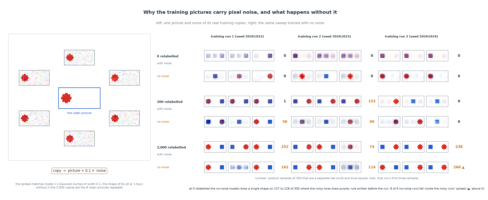</a>

**The question.** Why is there noise in the background of the training images?

**What you are looking at.** Left: one clean picture in the middle and six of its real training copies
around it. Each copy is the clean picture plus random noise with standard deviation 0.1 on the 0-to-1
colour scale, a fresh draw for every number in every copy. Right: a test that trained with the noise
and without it, at 0, 200 and 2,000 both-shapes copies added (the adding design), three trainings
each. Each row shows a training's first three product samples and its count of separate pairs out of
300.

**Say it out loud.** "Each copy is the clean picture plus a little Gaussian noise, so a caption is a
small cloud of pictures around each clean one. That matches the exact formula model we compare
against, where each expert is a set of Gaussian bumps of width 0.1. Without it, the 2,000 copies are
just the 8 clean pictures repeated. We retrained without the noise and the result did not change."

**The numbers on the right.** Separate pairs out of 300, runs 1 to 3 (adding design):

| Added | With noise | Without noise |
|---|---|---|
| 0 | 0, 0, 0 | 0, 0, 0 |
| 200 | 1, 153, 0 | 56, 40, 0 |
| 2,000 | 252, 74, 238 | 162, 114, 266 |

The rule written before the no-noise run was that each no-noise count falls inside the spread of the
noisy runs at the same number. Eight of the nine do; the ninth, 266, is 14 above the noisy maximum of
252. At 0 added, the no-noise models draw a single shape on 157 to 228 of 300 samples where the noisy
ones draw a purple blob; neither draws the pair. This test was run in the adding design only.

## 3. What replacing does to each caption

<a href="network-views/02-what-relabelling-adds-to-each-caption.png">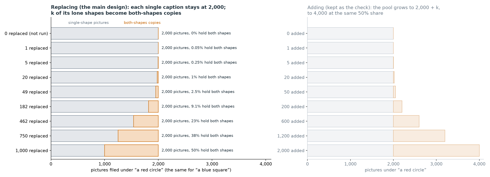</a>

**The question.** How many samples does each caption train on, and what changes between runs?

**What you are looking at.** Left, the main design: one bar per replaced count. Each bar is the 2,000
pictures filed under "a red circle"; the grey part is lone circles and the orange part is both-shapes
pictures. x is the number of pictures ("a blue square" is identical). Right, faded: the adding design,
where the orange part was added on top instead, so the pool grew to 2,000 + k.

Replacing k takes k of the 2,000 both-shapes copies at random and puts the same k pictures under
"a red circle" and under "a blue square", in place of k lone shapes in each. Each copy gets its own
pixel noise. The joint caption's 2,000 stay as they are.

| Replaced k | Under "a red circle": lone circles + both-shapes | Share holding both shapes | Training set |
|---|---|---|---|
| 1 | 1,999 + 1 | 0.05% | 6,000 |
| 5 | 1,995 + 5 | 0.25% | 6,000 |
| 20 | 1,980 + 20 | 1% | 6,000 |
| 49 | 1,951 + 49 | 2.45% | 6,000 |
| 182 | 1,818 + 182 | 9.1% | 6,000 |
| 462 | 1,538 + 462 | 23% | 6,000 |
| 750 | 1,250 + 750 | 37.5% | 6,000 |
| 1,000 | 1,000 + 1,000 | 50% | 6,000 |

These shares match the adding design's exactly, so the two designs can be compared share by share.
Each count was trained three times, with seeds 20261022, 20261023 and 20261024: 24 models. The seed
fixes the data draw, the VAE and the denoiser, so every model has its own VAE.

**Say it out loud.** "Each single caption always has 2,000 pictures. We swap k of its lone shapes for
both-shapes pictures, so the only thing that changes is how often a picture under 'a red circle' also
holds a square, from 0.05% to 50%. The training set stays at 6,000."

**Follow-up questions**

*Why replace rather than add?* Adding k copies also grows the training set, from 6,000 up to 10,000
pictures, and each picture is then seen fewer times (section 4), so a result could come from either.
Replacing changes only the share.

*The first design added pictures. Was that unfair?* It mixed two changes, which is why it was rerun by
replacing. Both designs give the same answer at every share (section 14). A first check at two shares
was run with its rule written beforehand:

<a href="network-views/13b-the-size-check-at-two-shares.png">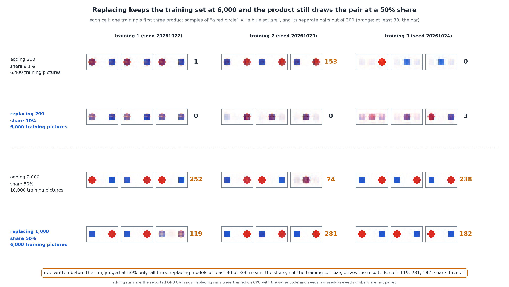</a>

The rule, in `scripts/toy_caption_replace.py`, judged at 50% only: if all three replacing models drew
at least 30 of 300 separate pairs, the share and not the training set size drives the result. They
drew 119, 281 and 182 (trained on CPU). The full sweep on the GPU then confirmed it at every share.

*What does replacing change besides the share?* At 50%, each single caption has 1,000 lone shapes
instead of 2,000, still about 330 copies of each of its 3 positions. The single captions stayed pure:
at least 247 of 300 drew only red and 261 only blue, at every share.

## 4. How long each network trains

<a href="network-views/03-how-long-each-network-trains.png">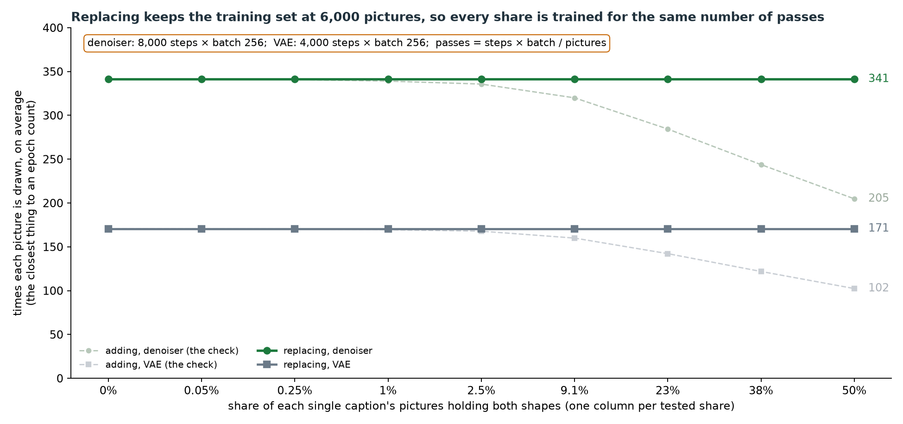</a>

**The question.** How many epochs?

**What you are looking at.** y: how many times each picture is drawn on average during training,
which is the closest thing to an epoch count. x: the share. The solid lines are the replacing design,
flat; the faded lines are the adding design, falling as its set grew.

Training is counted in steps, not epochs. Each step draws a batch of 256 pictures at random with
replacement, so there is no fixed pass over the data. The denoiser trains for 8,000 steps (2,048,000
draws) and the VAE for 4,000 (1,024,000 draws). On a set of 6,000 pictures, that is about 341 passes
for the denoiser and 171 for the VAE, at every share. Under the adding design the set grew to 10,000
and the passes fell to 205 and 102.

**Say it out loud.** "There are no epochs. The denoiser takes 8,000 steps of 256 random pictures,
about 341 passes over the 6,000 pictures, and that is the same at every share."

## 5. The VAE

<a href="network-views/04-the-vae.png">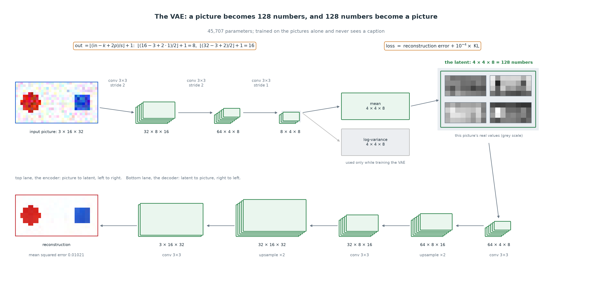</a>

**The question.** What goes into and comes out of the VAE?

**What you are looking at.** Top lane, left to right, the encoder. A 3 × 16 × 32 picture goes
through three 3 × 3 convolutions: stride 2 to 32 × 8 × 16, stride 2 to 64 × 4 × 8, stride 1 to
8 × 4 × 8. The boxed formula is the size arithmetic: out = ⌊(in − k + 2p) / s⌋ + 1, so
⌊(16 − 3 + 2) / 2⌋ + 1 = 8. The 8 channels split in two: 4 × 4 × 8 for the mean and 4 × 4 × 8 for the
log-variance. The mean is the latent, 128 numbers, shown in grey. Bottom lane, right to left, the
decoder: a convolution to 64 × 4 × 8, upsample to 64 × 8 × 16, a convolution to 32 × 8 × 16,
upsample to 32 × 16 × 32, a convolution to 3 × 16 × 32, the picture again. The picture shown is a
both-shapes copy filed under "a red circle".

The VAE has 45,707 parameters. It trains on the pictures alone and never sees a caption: 4,000 steps,
loss = reconstruction error + 0.0001 × KL, Adam at learning rate 0.001 with a cosine decay. If its
reconstruction error is above 0.012 it is retrained on a new seed, up to 5 tries. The reference
model's VAE reached 0.0102.

**Say it out loud.** "The VAE squeezes a 16 by 32 colour picture into 128 numbers, a 4 by 4 by 8
block, and expands it back. It is trained first, on pictures only, and then frozen. The denoiser only
ever sees those 128 numbers."

**Follow-up questions**

*Which latent does the denoiser train on?* The encoder's mean, not a random draw from it, and it is
not rescaled. SDXL rescales its latent by a fixed factor; this toy does not.

*Why a VAE at all, for pictures this small?* To have SDXL's layout: diffusion in a compressed latent,
decoded at the end. It is part of what "built like SDXL" means here.

## 6. The denoiser

<a href="network-views/05-the-denoiser.png">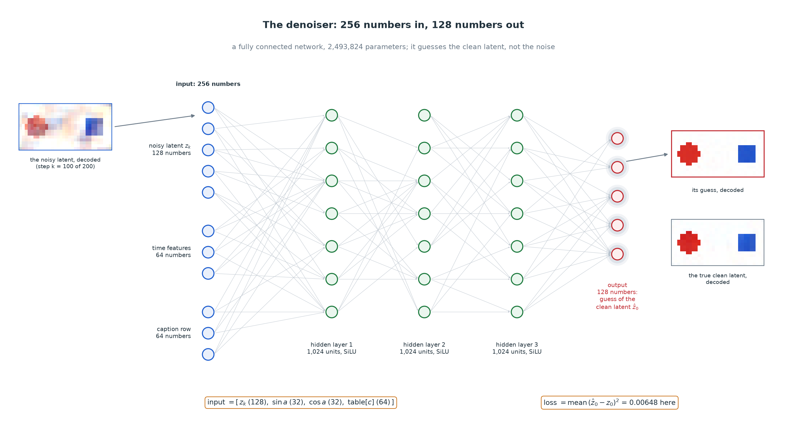</a>

**The question.** What is the input and output of the network?

**What you are looking at.** A fully connected network drawn as circles, with a representative fan of
connections. On the left, its 256 inputs in three groups: the noisy latent (128 numbers), the time
features (64 numbers, section 7) and the caption row (64 numbers, section 8). Three hidden layers of
1,024 units each, with the SiLU activation. On the right, 128 outputs: its guess of the clean latent,
written ẑ₀. The pictures show a noisy latent at step 100, the network's guess and the true clean
latent, each decoded by the VAE so you can see them. The squared error on this example is 0.00648.

The network has 2,493,824 parameters. It guesses the clean latent, not the noise. The sampler turns
the guess into a noise estimate when it needs one (section 10).

**Say it out loud.** "The denoiser is a plain fully connected network: 256 numbers in, which are the
noisy latent, the step and the caption glued side by side; three layers of 1,024; 128 numbers out,
its guess of the clean latent. It is not a U-Net."

**Follow-up questions**

*Why guess the clean latent rather than the noise?* The code does not record a reason. The two carry
the same information: given the noisy latent and the step, one is a fixed formula of the other.

*Why not a U-Net, like SDXL?* The latent is 128 numbers. A small fully connected network is enough to
learn 8 pictures, and one model trains in about 75 seconds on an RTX 3090.

## 7. The time features

<a href="network-views/06-the-time-features.png">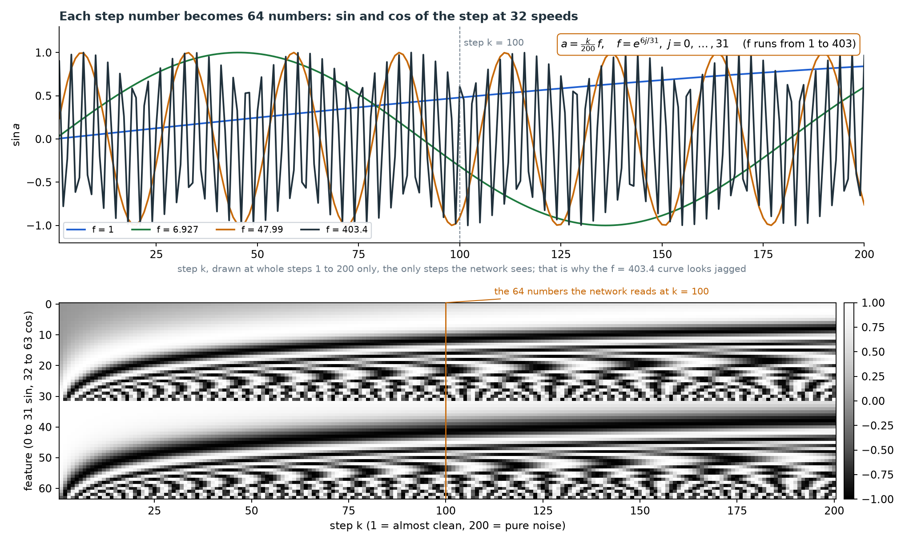</a>

**The question.** How does the network know how noisy its input is?

**What you are looking at.** Top: four of the 32 sine curves the step number is turned into. x is the
step k, y is sin(a), one curve per speed f. Bottom: all 64 features for every step, as a grey map.
y is the feature (0 to 31 are sines, 32 to 63 cosines), x the step; the marked line is the 64 numbers
the network reads at step 100.

For step k, a = (k / 200) × f, for 32 speeds f = e^(6j/31), j = 0 to 31, running from 1 to about
403. The features are sin(a) and cos(a). The curves are only computed at whole steps, the only steps
the network sees, which is why the fastest one looks jagged.

**Say it out loud.** "The step number goes in as 64 numbers: the sine and cosine of the step at 32
speeds. Slow ones change little across the whole run and tell early steps from late ones; fast ones
change between neighbouring steps. The formula is fixed; nothing in it is learned."

## 8. The caption

<a href="network-views/07-the-caption.png">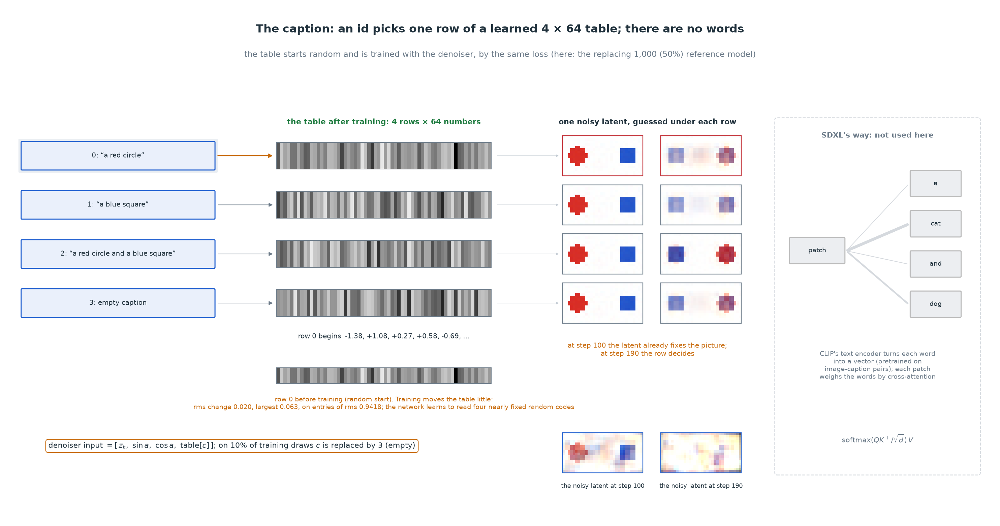</a>

**The question.** How does the caption work, when there is no pretrained CLIP to read words?

**What you are looking at.** Left: the four caption ids, each pointing at one row of a 4 × 64 table,
shown in grey after training. Under it, row 0 before training. Middle: one noisy latent, guessed under
each of the four rows, at step 100 and at step 190. Right, faded: SDXL's way, which this toy does not
use.

The middle panel shows when the caption matters. At step 100 all four rows give the same guess: the
latent is already clean enough to fix the picture. At step 190, near pure noise, the joint caption's
row gives the pair and the other rows give faint purple. The caption decides the picture early in
sampling, while the latent is still mostly noise. (That reading is from one latent.)

The next five figures take the caption and the step apart one point at a time.

**The caption is a number.**

<a href="network-views/07b-the-caption-is-a-number.png">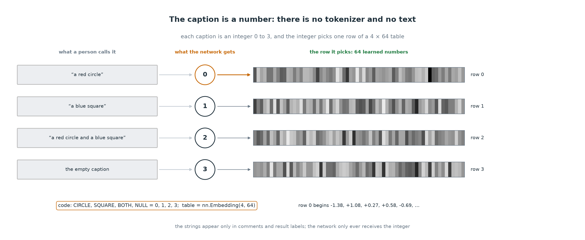</a>

There is no text and no tokenizer. Each caption is an integer from 0 to 3, and the integer picks one
row of a 4 × 64 table (`nn.Embedding(4, 64)` in the code). Row 0 begins −1.38, +1.08, +0.27, +0.58,
−0.69. The caption strings appear only in code comments and result labels; the network only ever
receives the integer. Row 3 is the empty caption, a row like the others, used in place of the real
caption on 10% of training draws.

**Everything enters at the first layer, once.**

<a href="network-views/07c-everything-enters-at-the-first-layer.png">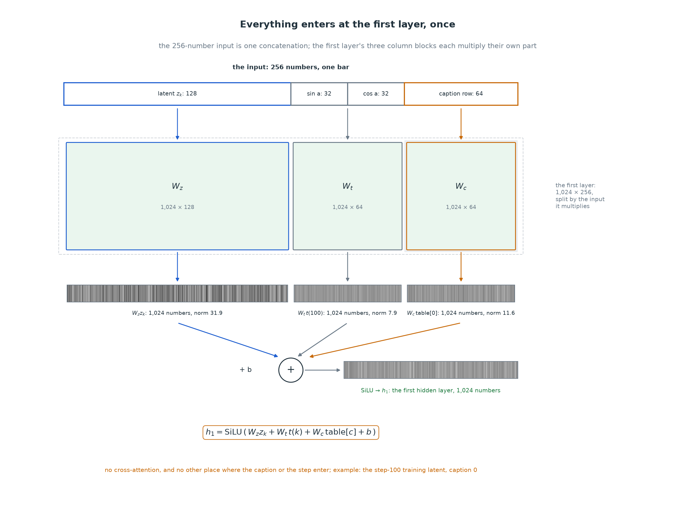</a>

The input is one list of 256 numbers: the noisy latent (128), sin and cos of the step (64), and the
caption's row (64). The first layer is a 1,024 × 256 matrix. Because the inputs sit side by side, the
matrix splits into three blocks of columns, one per input, and their products add up:

h₁ = SiLU(W_z · z_k + W_t · t(k) + W_c · table[c] + b)

So the caption's whole effect on the network is one 1,024-number shift, W_c · table[c], added to the
first hidden layer. The step's effect is another shift, W_t · t(k). There is no cross-attention and no
other place where the caption or the step enter; after the first layer, the three are mixed only by
the network's later layers. In the example on the figure (a training latent at step 100, caption 0),
the three products have sizes 31.9 (latent), 7.9 (step) and 11.6 (caption).

**What is learned and what is fixed.**

<a href="network-views/07d-what-is-learned-and-what-is-fixed.png">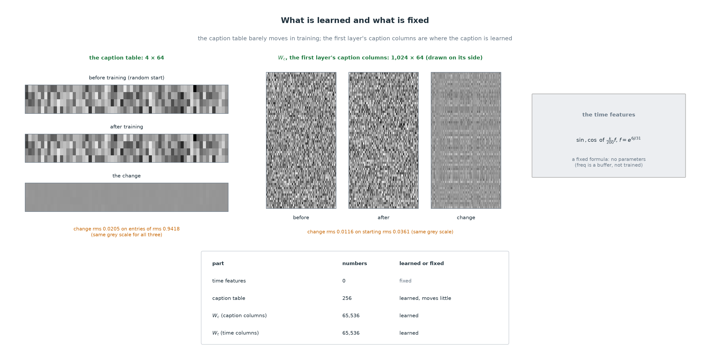</a>

| Part | Numbers | Learned or fixed | Start size (rms) | Change in training (rms) |
|---|---|---|---|---|
| time features | 0 | fixed formula | | |
| caption table | 256 | learned | 0.94 | 0.020 |
| W_c, the caption columns | 65,536 | learned | 0.036 | 0.012 |
| W_t, the step columns | 65,536 | learned | 0.036 | about 0.018 |
| W_z, the latent columns | 131,072 | learned | 0.036 | about 0.018 |

The W_t and W_z changes are the adding reference model's; the others are the replacing model's. The
two models agree to within a few percent on every part measured in both.

The table starts as random numbers and hardly moves, so each caption row is close to a fixed random
code. The meaning of each code is learned in the weights that read it, W_c, which change by about a
third of their starting size. W_t and W_z change by about half of theirs, so W_c is the part that
reads the caption, not the part of the first layer that moves most.

**How big the caption's push is.**

<a href="network-views/07e-how-big-the-caption-push-is.png">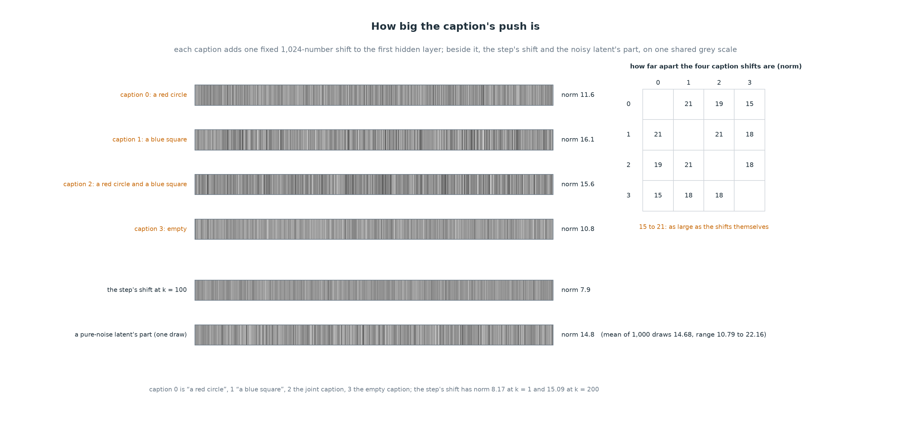</a>

Each caption adds a fixed 1,024-number shift: sizes 11.6 ("a red circle"), 16.1 ("a blue square"),
15.6 (the joint caption) and 10.8 (empty). The step's shift is 7.9 at step 100. A pure-noise latent's
part is about 14.7. So the caption's push is the same size as the latent's own, and the four shifts
differ from each other by 14.5 to 20.8, as much as they differ from zero.

**Say it out loud.** "There are no words. Each caption is an id that picks a row of a small table,
four rows of 64 numbers, and the row is glued onto the network's input. The row barely changes in
training; the first layer learns what each row means. 'A red circle' means nothing beyond the pictures
filed under id 0, and the joint caption has its own row that shares nothing with the single ones."

**Follow-up questions**

*Why not use CLIP?* Because the experiment needs to control exactly what each caption has seen. A
pretrained text encoder brings in what "circle" meant from millions of outside images, which the
share could not control. With an id, the pictures filed under a caption are the only thing that
defines it.

*Is the joint caption built from the two single ones?* No. It is its own row, id 2. "A red circle and
a blue square" shares no words with "a red circle", because there are no words.

*So it is a lookup table? Why not one-hot?*

<a href="network-views/18-the-lookup-is-one-hot-times-a-matrix.png">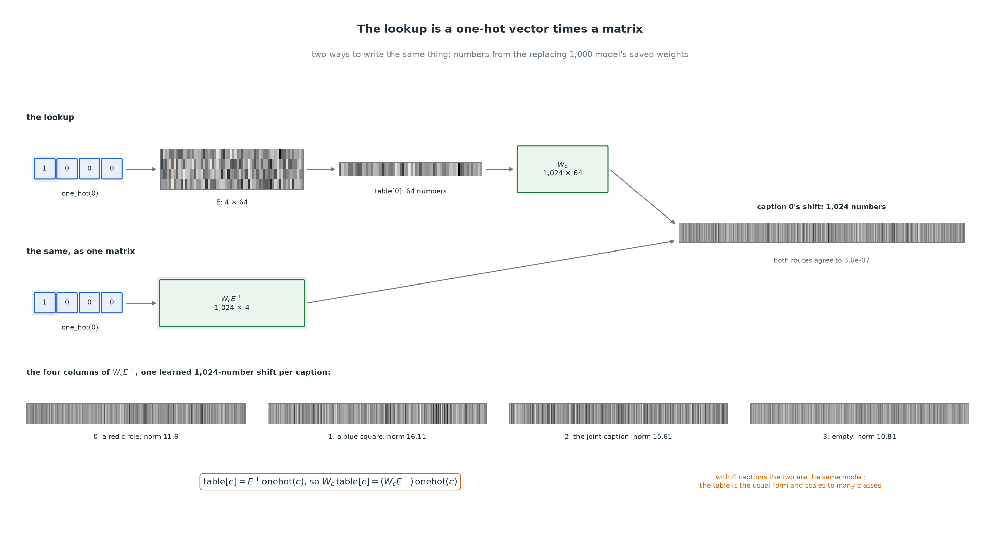</a>

Yes, it works like a lookup table: the id is the key and the 64-number row is the value. A lookup is
exactly a one-hot vector times the table, table[c] = Eᵀ · one_hot(c), so the caption's shift is
W_c · table[c] = (W_c · Eᵀ) · one_hot(c), where W_c · Eᵀ is one 1,024 × 4 matrix. The two ways agree to
within 3.6 × 10⁻⁷ on the saved weights, and the four columns of that matrix are the four caption
shifts (11.6, 16.1, 15.6, 10.8). With four captions, a one-hot input would be the same model. The
table is the standard form for class labels, because it stays small when there are thousands of
classes.

*What plays the role of SDXL's text embedding?* The table row.

<a href="network-views/07f-sdxl-against-the-toy.png">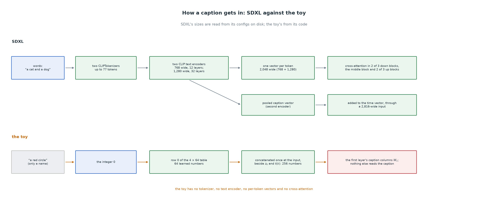</a>

In SDXL, two tokenizers split the caption into up to 77 tokens; two pretrained CLIP text encoders
(768 wide with 12 layers, and 1,280 wide with 32) give one vector per token, 2,048 wide together; and
the U-Net reads those vectors by cross-attention in 2 of its 3 down blocks, its middle block and 2 of
its 3 up blocks. The second encoder's pooled vector also enters beside the time vector, through a
2,816-wide input. In the toy, an integer picks one 64-number row, and the row goes in once, at the
input. SDXL's sizes are read from its configs on disk (`stabilityai/stable-diffusion-xl-base-1.0`).

## 9. Training the denoiser

<a href="network-views/08-training-the-denoiser.png">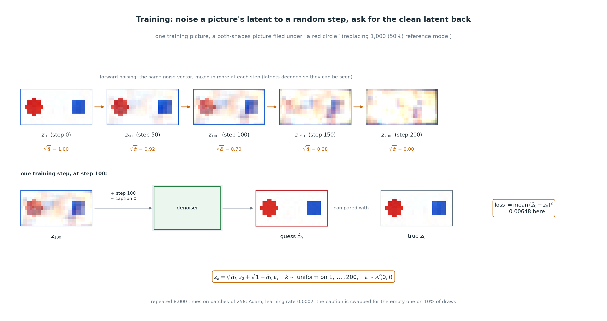</a>

**The question.** How is the diffusion model trained?

**What you are looking at.** Top: one training picture's latent noised to steps 0, 50, 100, 150 and
200 with the same noise. Under each, √ᾱ, how much of the clean latent is left: 1.00, 0.92, 0.70,
0.38, 0.00. Bottom: one training step at step 100. The noisy latent goes in with the step and its
caption; the guess comes out and is compared with the true clean latent (squared error 0.00648).

Each training step does this for a batch of 256 pictures:

1. Pick each picture's latent z₀ and caption.
2. Swap the caption for the empty one with probability 0.1.
3. Pick a step k uniformly from 1 to 200.
4. Noise it: z_k = √ᾱ_k · z₀ + √(1 − ᾱ_k) · ε, where ε is fresh Gaussian noise.
5. The network guesses ẑ₀; the loss is the mean squared error between ẑ₀ and z₀.

8,000 such steps, Adam at learning rate 0.0002. ᾱ_k follows a cosine schedule (section 10).

**Say it out loud.** "Take a picture's latent, add noise to a random level, and train the network to
give back the clean latent. One time in ten its caption is replaced by the empty caption, so the same
network also learns what a picture looks like with no caption."

**Follow-up question**

*Why replace the caption with the empty one?* Guidance and the product both compare the network's
guess under a caption with its guess under no caption. Training on the empty caption 10% of the time
gives that second guess.

## 10. Sampling

<a href="network-views/09-sampling.png">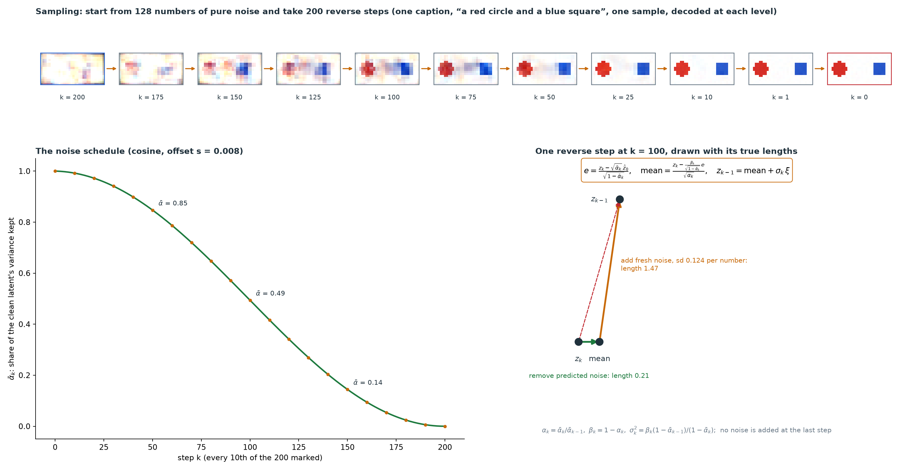</a>

**The question.** How is a picture drawn?

**What you are looking at.** Top: one sample under the joint caption, decoded at eleven levels from
pure noise (k = 200) to the finished picture (k = 0). Bottom left: the noise schedule. y is ᾱ_k, the
share of the clean latent's variance kept at step k; x is the step. ᾱ is 0.85 at step 50, 0.49 at
100 and 0.14 at 150. Bottom right: one reverse step at step 100, drawn with its true lengths in the
128-number space.

Sampling starts from 128 numbers of pure Gaussian noise and takes 200 reverse steps, k = 200 down
to 1. Each step:

1. The network guesses ẑ₀ under the caption and under the empty caption.
2. Each guess becomes a noise estimate: e = (z_k − √ᾱ_k · ẑ₀) / √(1 − ᾱ_k).
3. The estimates are combined: e = e_empty + 3 · (e_caption − e_empty). This is classifier-free
   guidance at strength 3.
4. The standard DDPM step moves to the predicted mean, then adds fresh noise, except at the last
   step.

The final latent is reshaped to 4 × 4 × 8 and decoded by the VAE into a picture.

The bottom right panel shows how small one step is. At step 100, removing the predicted noise moves
the latent by 0.21; the fresh noise added moves it by 1.47 (standard deviation 0.124 per number). The
picture forms because the small corrections add up over 200 steps while the fresh noise does not.

**Say it out loud.** "Start from noise and take 200 small steps. At each step the network guesses the
clean latent, the guess becomes a noise estimate, guidance at strength 3 pushes it toward the
caption, and a standard DDPM step removes a little noise and adds a little back. Decode at the end."

## 11. The product and the corrector

<a href="network-views/10a-the-product-and-the-corrector.png">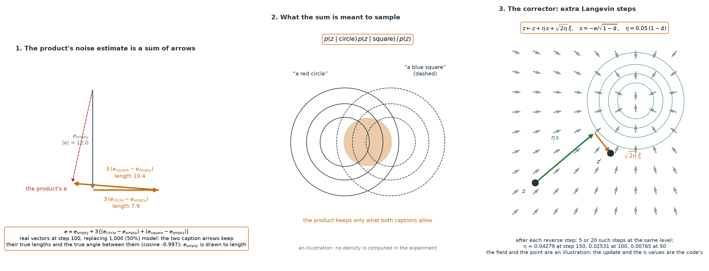</a>

**The question.** How are two captions multiplied, and what is the corrector?

**What you are looking at.** Three panels.

Panel 1 is the product's noise estimate as arrows, tip to tail, for one latent at step 100. The grey
arrow is e_empty, length 12.0. The two orange arrows are 3 × (e_circle − e_empty), length 7.9, and
3 × (e_square − e_empty), length 10.4. The dashed red arrow is their sum, the product's estimate. The
orange arrows keep their true lengths and the true angle between them; e_empty's direction is chosen
for the drawing. For this sample the two caption pushes point almost exactly against each other
(cosine −0.997), so they largely cancel.

Panel 2 is an illustration, not computed: two overlapping densities, and the overlap the product is
meant to keep, p(z | circle) · p(z | square) / p(z).

Panel 3 is the corrector's update, drawn on an illustrative field.

**The product.** It is the same sampler as section 10, with the guidance sum taken over both single
captions:

e = e_empty + 3 · [(e_circle − e_empty) + (e_square − e_empty)]

That takes three network calls per step: empty, "a red circle", "a blue square". This is the rule
Du et al. (2023) use to compose captions in a classifier-free model. Each caption's difference from
the empty caption is one push, and the product adds the pushes.

**The corrector.** After each reverse step lands at level k, it takes 5 or 20 extra steps at that same
level:

z ← z + η · s + √(2η) · ξ, where s = −e / √(1 − ᾱ_k), η = 0.05 · (1 − ᾱ_k), and ξ is fresh noise.

s points toward pictures the product rates more likely, read off the same noise estimate e. η is
larger at high noise: 0.0428 at step 150, 0.0253 at 100, 0.0077 at 50. This is a Langevin corrector,
the remedy Du et al. use for the product's sampler.

**Say it out loud.** "To multiply two captions we add their guidance pushes: the empty caption's
noise estimate, plus three times each caption's difference from it. That is Du et al.'s composition
rule. The corrector adds a few Langevin steps at each noise level that pull the sample toward what the
product prefers, with a little noise each time."

**Follow-up question**

*Why would the plain sampler need correcting?* Adding the two noise estimates is exact only at zero
noise. At high noise the sum is not the noise estimate of the true product, so the plain sampler can
lose the pair. The corrector spends extra steps at each level pulling toward the product.

*How does this relate to Du et al. (2023)? What did you reproduce?*

<a href="network-views/15-du-et-al-side-by-side.png">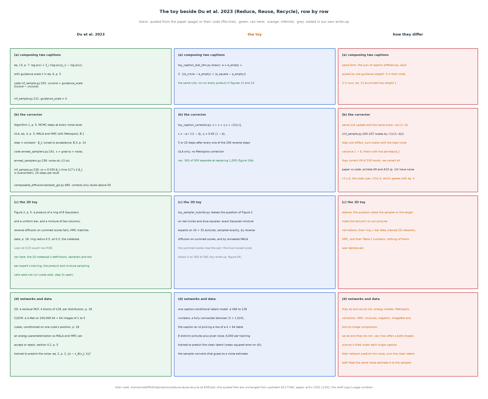</a>

Three columns: Du et al., the toy, and how they differ. Each line is marked as quoted from their paper
(with the page) or their code (with file and line), run here, or inferred. Their code is the read-only
clone at `/home/molef/PhD/replications/reduce-reuse-recycle`.

- **The composition rule is the same.** Their equation 13 (p. 7) and their code
  (`inf_sample.py:202`) add the caption differences to the unconditional estimate, with guidance 4 in
  their code (`inf_sample.py:121`). We use the same rule with guidance 3.
- **The corrector has the same update and a different step size.** Their Langevin step
  (`anneal_samplers.py:238, 241`) is the same as ours. Their step size is 0.035 · β_t
  (`inf_sample.py:230`), with 20 steps per level, applied only to levels above index 50
  (`sampler_gd.py:485`). Ours is 0.05 · (1 − ᾱ), with 5 or 20 steps, at every level. They also use
  samplers with a Metropolis accept-or-reject step (MALA and HMC) on energy-based models; we use the
  plain Langevin step only.
- **Their 2D toy.** Their Figure 2 multiplies a ring of 8 Gaussians by a bar and shows reverse
  diffusion on summed scores failing where HMC succeeds. Our exact toy asks the same question (does the
  sampler or the target cause the failure?) on circles and squares. Their data, trained networks, HMC
  and Table 1 were not reproduced. Their 2D notebook was run here only as far as its definitions,
  samplers and one expert's training.
- **Where their code and paper differ.** The code's step size 0.035 · β_t overwrites the 2 · β_t
  written a few lines earlier (line 217). The printed algorithms A9 and A10 (p. 14) write the noise
  term as √2 · η · ξ, while the code uses √(2η) · ξ, which matches their equation 4.
- **What the networks are trained to predict.** Theirs predict the noise (their equation 2, p. 2).
  Ours predicts the clean latent (`toy_caption_dial_ldm.py`, line 155), and the sampler converts that
  guess into a noise estimate, so both feed the same kind of estimate to the composition rule.
- **What we add.** They do not vary how often a both-shapes picture is filed under each single
  caption. That is this experiment's one variable.

**Say it out loud.** "We use Du et al.'s composition rule and their kind of corrector, the
unadjusted Langevin step, with our own step size. We redid the question behind their 2D figure on our
own pictures, but we did not reproduce their numbers. What we add is the variable they don't touch:
how many both-thing pictures sit under each single caption."

## 12. The product step by step

<a href="network-views/10b-the-product-step-by-step.png">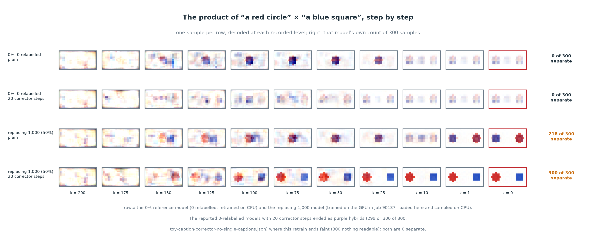</a>

**The question.** What does the product actually do during sampling, with and without both-shapes
pictures under the single captions?

**What you are looking at.** Four rows, one product sample each, decoded from step 200 to the finished
picture. On the right, that model's own count of separate pairs out of 300.

| Row | Finished picture | Count of 300 |
|---|---|---|
| 0%, plain | faint, unreadable | 0 separate |
| 0%, 20 corrector steps | faint, unreadable | 0 separate |
| 50% (replacing 1,000), plain | red circle and blue square apart | 218 separate |
| 50% (replacing 1,000), 20 corrector steps | red circle and blue square apart | 300 separate |

At 0%, a dark purple blob forms around steps 100 to 50 and then fades. At 50% plain, the sample is a
purple blob until about step 10 and splits into two shapes only at the very end; with the corrector,
the two shapes are apart by step 75.

The 0% rows come from a model retrained for these figures on CPU (0 relabelled, seed 20261022). The
reported 0% models with 20 corrector steps ended as purple hybrids on 299 or 300 of 300; this retrain
ends faint on all 300. Both give 0 separate pairs.

**Say it out loud.** "With no both-shapes pictures under the single captions, the product never draws
two shapes, with or without the corrector. At a 50% share it draws them apart on most samples, and
with the corrector on all 300."

## 13. The scorer, and what "of 300" means

<a href="network-views/11-the-scorer.png">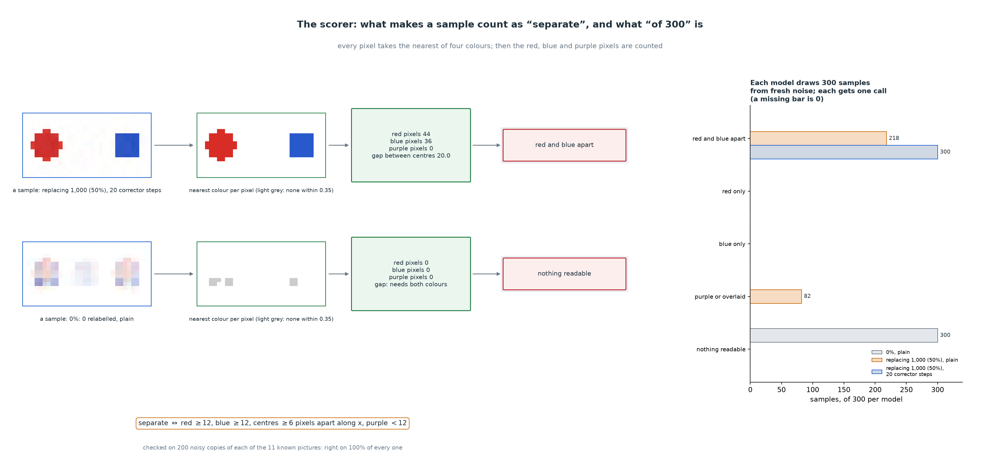</a>

**The question.** What does "0 of 300" or "300 of 300 separate" mean?

**What you are looking at.** Left: two samples, each followed by its nearest-colour map, its pixel
counts and the scorer's call. Right: the five categories counted over 300 samples, for three models:
0% plain (300 nothing readable), 50% plain (218 separate, 82 purple), and 50% with 20 corrector steps
(300 separate). y is the category; x is the number of samples out of 300.

**How one sample is called.** Each pixel takes the nearest of four reference colours (white, the
circle's red, the square's blue, and purple half-way between red and blue), if one is within 0.35;
otherwise it counts as none. Then the red, blue and purple pixels are counted, and the sample gets one
of five calls:

| Call | Rule |
|---|---|
| red and blue apart ("separate") | at least 12 red and 12 blue pixels, their centres at least 6 pixels apart left to right, fewer than 12 purple pixels |
| red only | red present, no blue or purple |
| blue only | blue present, no red or purple |
| purple or overlaid | at least 12 purple pixels, or red and blue with centres closer than 6 pixels |
| nothing readable | none of the above |

The top sample has 44 red pixels, 36 blue, 0 purple, and centres 20 pixels apart: separate. The
bottom sample has no pixel within 0.35 of any reference colour: nothing readable.

**What "of 300" means.** Each model draws 300 samples, each from fresh random noise, and each sample
gets one call. "0 of 300 separate" means none of the 300 met the separate rule. "300 of 300" means all
of them did. A training counts as drawing the pair when at least 30 of its 300 product samples are
separate.

**"0 of 300" hides different failures.** At 0%, the three reported trainings split their 300 product
samples like this:

| Seed | Separate | Purple or overlaid | Nothing readable | Red only | Blue only |
|---|---|---|---|---|---|
| 20261022 | 0 | 24 | 276 | 0 | 0 |
| 20261023 | 0 | 276 | 0 | 12 | 12 |
| 20261024 | 0 | 256 | 14 | 18 | 12 |

**How the scorer was checked.** On 200 noisy copies of each of the 11 known pictures (each single
shape at each position, both layouts, and a red-blue overlay at each position), it gave the right
call on 100% of every one.

**Say it out loud.** "Each model draws 300 pictures from fresh noise. A colour scorer sorts each pixel
into red, blue, purple or background and calls the picture separate only if it has a real red patch
and a real blue patch apart from each other. 0 of 300 means not one did; 300 of 300 means every one
did."

**Follow-up question**

*Does the scorer miss anything?* Yes. A reddish circle beside a bluish square, two shapes with their
colours mixed, fails the separate rule. So the counts undercount two-shape pictures with blended
colours.

## 14. What the experiment found

<a href="network-views/14-what-the-product-draws-at-each-share-replacing.png">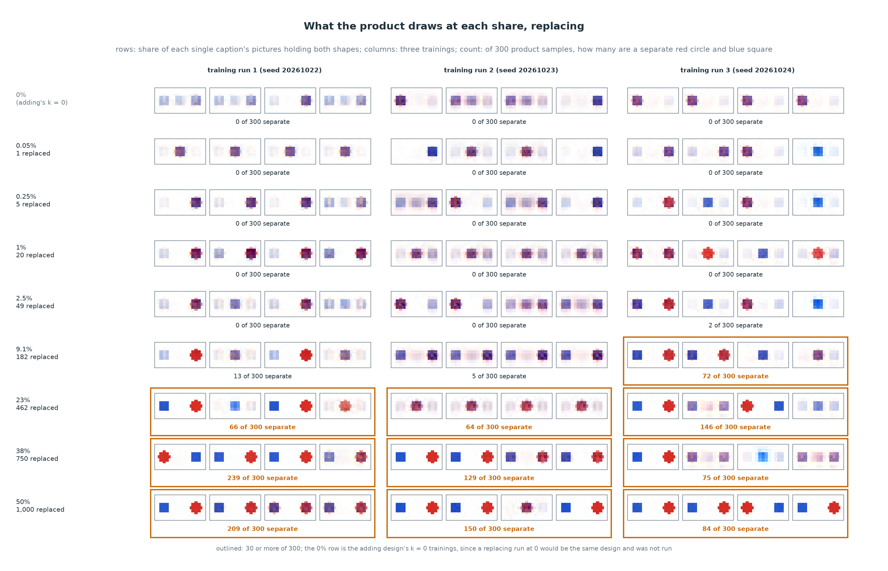</a>

**What you are looking at.** Rows are the shares, columns the three trainings. Each cell shows four
product samples and the count of separate pairs out of 300; outlined cells reach 30 or more. The 0%
row is the adding design's trainings with nothing added, which is the same training set as replacing
none.

<a href="network-views/13-replacing-against-adding.png">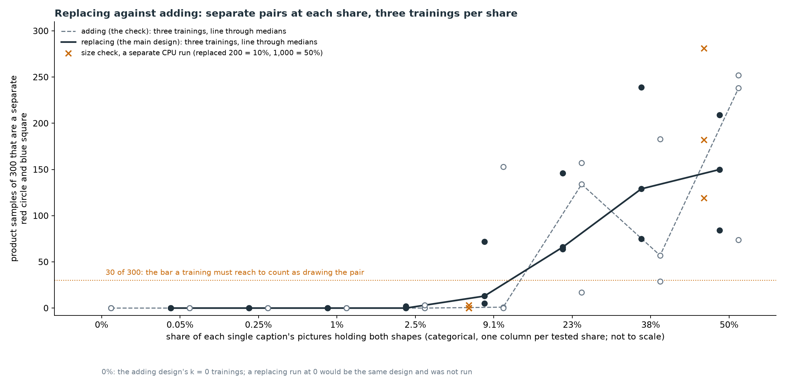</a>

**And both designs together.** y: separate pairs out of 300. x: the share, one column per tested
share and not to scale. Filled dots and the solid line are replacing, hollow dots and the dashed line
adding, three trainings each with a line through the medians. The crosses are the first size check.

| Share | Replacing (training set 6,000) | Adding (training set 6,000 to 10,000) |
|---|---|---|
| 0% | 0, 0, 0 | 0, 0, 0 |
| 0.05% | 0, 0, 0 | 0, 0, 0 |
| 0.25% | 0, 0, 0 | 0, 0, 0 |
| 1% | 0, 0, 0 | 0, 0, 0 |
| 2.45% | 0, 0, 2 | 0, 0, 3 |
| 9.1% | 13, 5, 72 | 1, 153, 0 |
| 23% | 66, 64, 146 | 157, 17, 134 |
| 37.5% | 239, 129, 75 | 183, 29, 57 |
| 50% | 209, 150, 84 | 252, 74, 238 |

Up to 2.45%, no training draws the pair in either design. At 9.1%, one training of three crosses 30
of 300 in each. From 23%, all three replacing trainings do.

<a href="network-views/16-every-caption-side-by-side-replacing.png">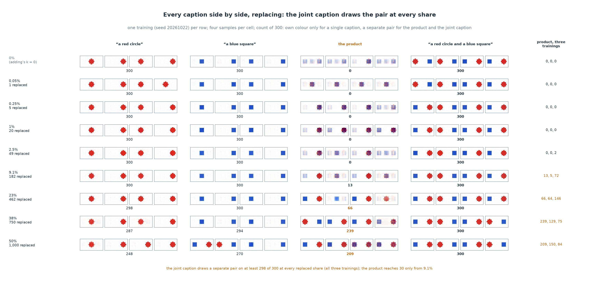</a>

**The model can draw both shapes; the product is what fails.** Rows are the shares, columns the four
ways of asking one training (seed 20261022): "a red circle", "a blue square", the product and the
joint caption, with four samples and the count of 300 per cell. The joint caption draws a separate pair
on at least 298 of 300 at every share, including 0%. The single captions draw only their own shape on
300 of 300 up to 9.1%, falling to 248 and 270 at 50%. The product reaches 30 only from 9.1%.

**With the corrector.** At a share of about 9% or more, 20 corrector steps took every model tested to
300 of 300. At 0% and at 2.4% (50 added), every model tested stayed at 0, the corrector only tidying
their samples into purple blobs. That was tested on eight adding-design models (three at 0 added, one
at 50, one at 200, three at 2,000), on five more at random shares of 0% to 100% (0, 300, 300, 300, 300),
and on the replacing reference model at 50% (218 plain, 300 with the corrector).

**What it means for SDXL.**

<a href="network-views/17-from-the-toy-to-sdxl.png">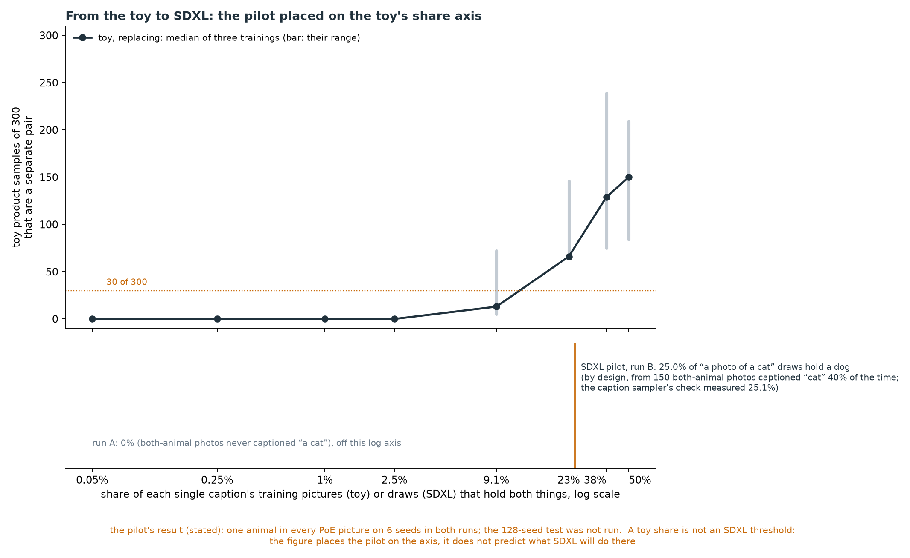</a>

y: the toy's product samples of 300 that are a separate pair, the median of three trainings with their
range. x: the share holding both things, on a log scale. The orange line places the SDXL
inclusive-captions pilot on the same axis. In its run B, 25.0% of "a photo of a cat" training draws
hold a dog, by design (150 both-animal photos captioned "cat" 40% of the time, beside 200 cat-only
photos); the caption sampler's own check measured 25.1%. Run A, with both-animal photos captioned only
"a cat and a dog", is 0%. The pilot's result so far is one animal in every product picture on six
seeds, in both runs; its 128-seed test has not been run.

The figure places the pilot; it does not predict it. A toy caption's pool is a few pictures plus
noise, and a real "a cat" pool varies in breed, pose and background, so 23% in the toy is not a
threshold for SDXL.

**Say it out loud.** "Below about 2.5% of a single caption's pictures holding both shapes, the product
never draws them. From about 9% some trainings do, and from 23% all of them do. It is the share that
matters, not the size of the training set: holding the set fixed gives the same curve."

What this cannot show

- Three trainings per share is few: trainings at one share differ by up to 178 of 300 (74 to 252,
  adding at 50%), so the order between neighbouring shares above 23% is not reliable. The rise from at most
  2.45% to 23% and above is.
- The adding and replacing runs are not paired seed for seed: same seeds, but different training sets
  and, for the first size check, different hardware.
- The corrector was tested on one replacing model only; its full test is in the adding design.
- The pixel-noise test (section 2) was run in the adding design only.
- The scorer misses two shapes with blended colours (section 13).
- A toy caption's pool is a few pictures plus pixel noise. It shows that the share of both-shapes
  pictures under a single caption matters, not what share a real "a cat" pool needs.
- Figures 4 to 11 use one model per share as the example; its counts are one draw from the spread
  above.

