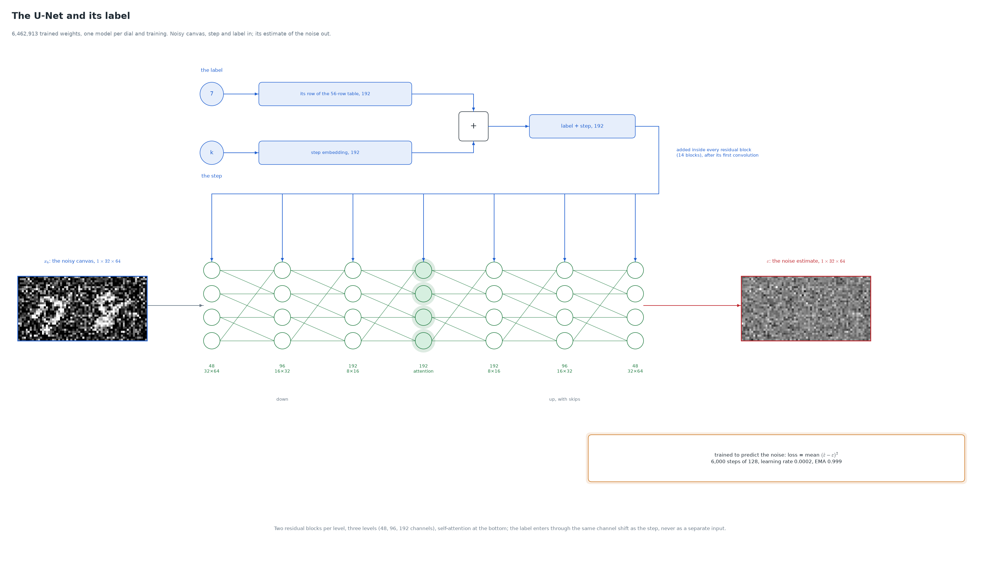
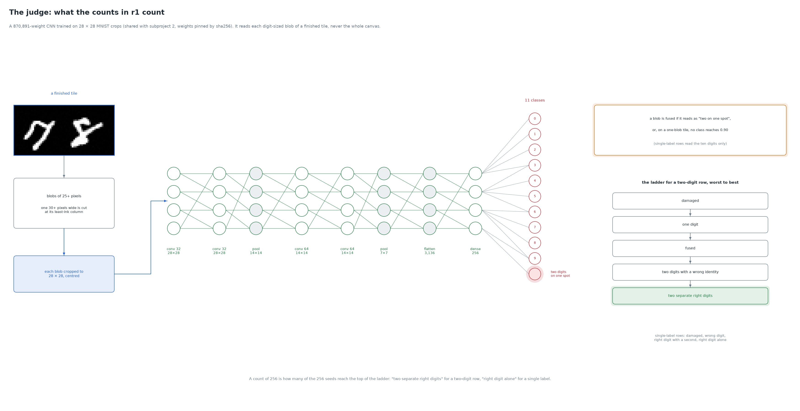

# 🧪 The MNIST stage: do inclusive labels make the product of 7 and 8 draw two digits?

## Recommended prompt

The full prompt is step 4 of [the inclusive-captions route](../../route-inclusive-captions-pilot.md#4--ask-the-same-question-on-mnist-digits),
walked with `/drip-execute-plan --request`. Every design choice and its reason is in
[the route walk](../../../artifacts/drips/route-inclusive-captions-pilot/ROUTE_WALK.md).

## Position in the plan tree

Plan 02 of scope 11, beside [the SDXL pilot](01-the-inclusive-captions-pilot.md). It waits for nothing in
plan 01 and reads nothing from `/datasets`.

## Table of contents

- [Quick context](#quick-context)
- [Environment Facts This Plan Depends On](#environment-facts-this-plan-depends-on)
- [Success and failure outcomes](#success-and-failure-outcomes)
- [Tasks](#tasks)
- [Instructions](#instructions)
- [Outputs](#outputs)
- [Figure Catalog](#figure-catalog)
- [Error Matrix](#error-matrix)
- [Orchestration](#orchestration)
- [References](#references)
- [Next step](#next-step)

## Quick context

Navigation: 📋 [TOC](#table-of-contents) | [Next](#environment-facts-this-plan-depends-on) ➡️

A small label-conditional diffusion model trained from scratch on 32 × 64 canvases of real MNIST digits
sees only the canvases this plan builds. Two-digit canvases are 10% of training; half hold a 7 and an 8.
The dial is how often a two-digit canvas is also trained under each single label (0, 0.1, 0.3, 0.6, 1),
with the joint label "a and b" always trained and the blank label on 10% of every canvas's draws. Fifteen
models (five dial settings × three training seeds) are drawn on 256 shared seeds, and the product of "7"
and "8" is counted. The toy's [caption model](../../../../3-understanding-compositionality/artifacts/results/the-exact-toy/how-much-co-occurrence-the-product-needs/plain-figures/README.md#model-3-one-caption-model-built-like-sdxl) at the same settings drew 0, 110, 103, 51 and 205 separate
pairs of 300 plain, and 0 then 300 at every setting with the corrector; that is the prediction.

## Environment Facts This Plan Depends On

Navigation: ⬅️ [Previous](#quick-context) | 📋 [TOC](#table-of-contents) | [Next](#success-and-failure-outcomes) ➡️

- Runs on the laptop's RTX 4070 (8,188 MiB) with `/home/molef/micromamba/envs/sdxl-local/bin/python`
  (torch 2.5.1, CUDA). The classifier-guidance route's MNIST stage uses the same card; only one of the two
  trains at a time.
- MNIST is unzipped at `/home/molef/PhD/replications/original-superdiff/data/MNIST/raw`.
- Checkpoints and samples go in `data/mnist/`, ignored by git; nothing touches `/datasets`.
- `artifacts/results/` is ignored by git (`.gitignore` line 40); cards there are added with `git add -f`.

## Success and failure outcomes

Navigation: ⬅️ [Previous](#environment-facts-this-plan-depends-on) | 📋 [TOC](#table-of-contents) | [Next](#tasks) ➡️

The bar is written as named constants in `poe_repair/experiments/inclusive_captions/mnist/score.py`
before any model draws.

| Verdict | What it takes |
|---|---|
| counting setting | "7" alone draws a lone 7 on at least 244, 231, 217, 207, 199 of 256 and "8" a lone 8 on at least 244, 230, 214, 203, 196, at dial 0, 0.1, 0.3, 0.6, 1, in all three trainings |
| supported | at a counting setting, the corrected 7 × 8 product draws [two separate right digits](../../../artifacts/scenes/how-the-inclusive-labels-mnist-stage-works/figures/README.md#r4-the-judge) on at least 32 of the first 64 seeds by eye in all three trainings, while dial 0 draws 3 or fewer in all three |
| null | no counting setting reaches 9.75 of 64 by eye on the average of its three trainings |
| inconclusive | anything else |
| stop and show | the plain 7 × 8 product at dial 0 draws more than 12 of 256 |

Reported beside the verdict: the corrector is not needed if the plain product also reaches 128 at the
supported setting; composition reaches an unseen pair if the corrected 4 × 7 product reaches at least 39 of
256 in all three trainings and three times its own dial-0 count.

## Tasks

*For Claude to execute.*

Navigation: ⬅️ [Previous](#success-and-failure-outcomes) | 📋 [TOC](#table-of-contents) | [Next](#instructions) ➡️

### 0. 🔎 Check the plan

- [ ] 0.1 `/verify-plan 4-inclusive-captions/plans/11-do-inclusive-captions-help-poe-compose/plans/02-the-mnist-stage.md`

▶ **Next: [task 1](#1--the-canvas-maker)** (build the training data).

### 1. 🔧 The canvas maker

- [x] 1.1 `poe_repair/experiments/inclusive_captions/mnist/canvases.py` draws canvases and labels on the GPU.
  Check: `python -I poe_repair/experiments/inclusive_captions/mnist/canvases.py` prints, at every dial,
  one-digit 0.90, 7 & 8 0.05, other pairs 0.05, blank 0.10, and asserts no held-out pair reaches a canvas.
  ✓ verified (2026-11-18): 0.9004, 0.0497, 0.0499, 0.0996; "7" draws with a second digit 0.049, 0.105,
  0.146, 0.173 against the design's 0.051, 0.103, 0.145, 0.176

▶ **Next: [task 2](#2--the-network-and-the-smoke-run)**.

### 2. 🔧 The network and the smoke run

- [x] 2.1 `model.py` ([three-level pixel U-Net](../../../artifacts/scenes/how-the-inclusive-labels-mnist-stage-works/figures/README.md#r2-the-u-net-and-its-label), 56-row label table, the toy's 200-step cosine schedule) and
  `train.py` (fresh canvases every batch, EMA weights saved).
  
  Check: `python -I poe_repair/experiments/inclusive_captions/mnist/train.py --smoke --widths 48 64` prints
  a step time per width and the time 15 trainings would take; the width that fits the schedule is chosen.
  ✓ verified (2026-11-18): width 48, 109 ms a step with kernel fusion, card-bound at about 1,150 canvases a
  second; a 6,000-step pilot (dial 0.3, seed 1) drew clean single digits, so every training runs 6,000
  steps (the user's choice, option a)

▶ **Next: [task 3](#3--the-fifteen-trainings)**.

### 3. 🚀 The fifteen trainings

- [x] 3.1 Launch in the background, outside any queue, training and drawing each model in turn, dial 0 first:
  `nohup bash poe_repair/experiments/inclusive_captions/mnist/run_all.sh > data/mnist/run.log 2>&1 &`
  Check: `data/mnist/checkpoints/trainings.jsonl` holds 15 rows, one per dial and seed, each with its time.
  ✓ verified (2026-11-19): 15 rows, 12.4 to 15.5 min each

▶ **Next: [task 4](#4--the-drawing)**.

### 4. 🎨 The drawing

- [x] 4.1 `sample.py` draws the eight rows on seeds 0 to 255 from every model with the toy's sampler.
  Check: `data/mnist/samples/` holds 15 files, each with 8 rows × 256 pictures.
  ✓ verified (2026-11-19): 15 files, 8 rows × 256 each, 1,974 to 2,319 s per model

▶ **Next: [instruction 7](#7--the-eye-calls)** (eye calls for the judge's second check).

### 5. ⚖️ The judge's two checks

◀ **Needs: the shared judge committed in the classifier-guidance route.**

- [x] 5.1 On 500 pasted canvases per call with a known answer, at least 95% of each call right.
  
  ✓ verified (2026-11-18): this step's judge (the shared network and weights at `5bff268f`, its 0.90
  confidence line applied to one-blob tiles only) gets 482 to 500 of 500 on every call
  (`data/mnist/judge/check1.json`)
- [ ] 5.3 On one 64-tile sheet of drawn single-label tiles per check ("7 alone", training 1), at least
  58 of 64 agreeing with blind eye calls. Dial 0: 64 of 64; dial 0.1: 63 of 64; dial 0.3: 63 of 64.
- [ ] 5.2 On one 64-tile sheet per dial setting (plain product, training 1), at least 58 of 64 agreeing
  with the eye calls from [instruction 7](#7--the-eye-calls) on the verdict's call: two separate right
  digits, yes or no. Eye calls of a separate pair are made from full-size tiles. Dial 0: 64 of 64;
  dial 0.1: 64 of 64; dial 0.3: 59 of 64; dials 0.6 and 1 run as their seed-1 models land.

▶ **Next: [task 6](#6--scores-figure-verdict)**.

### 6. 📊 Scores, figure, verdict

- [ ] 6.1 `score.py` calls every tile, writes `scores.csv`, draws the two-panel figure and prints the verdict.
  Check: `python -I poe_repair/experiments/inclusive_captions/mnist/score.py` prints SUPPORTED, NULL or
  INCONCLUSIVE with every setting's counts out of 256.

▶ **Next: [instruction 8](#8--tick-one-verdict-line)**.

## Instructions

*For you to do by hand.*

Navigation: ⬅️ [Previous](#tasks) | 📋 [TOC](#table-of-contents) | [Next](#outputs) ➡️

### 7. 👀 The eye calls

◀ **Needs: [task 4](#4--the-drawing)** done.

- [ ] **Do:** open each of the five 64-tile sheets (plain 7 × 8 product, training 1, one per dial) that task
  4 prints the path of; overrule any of Claude's eye calls you disagree with.
- **Done when:** each sheet's calls are settled and written beside it.

▶ **Next: [task 5](#5--the-judges-two-checks)**.

### 8. ✅ Tick one verdict line

- [ ] **Do:** open the two-panel figure and the scorer's printout side by side and tick supported, null or
  inconclusive in the table above.
- **Done when:** one line is ticked with the deciding counts beside it.

▶ **Next: what has to pass before this runs:** task 6.

## Outputs

Navigation: ⬅️ [Previous](#instructions) | 📋 [TOC](#table-of-contents) | [Next](#figure-catalog) ➡️

| Output | Where |
|---|---|
| code | `poe_repair/experiments/inclusive_captions/mnist/` |
| checkpoints, samples, logs | `data/mnist/` (ignored by git) |
| scores, figure, sidecar, card | `4-inclusive-captions/artifacts/results/do-inclusive-labels-help-the-product-compose-on-mnist/` |

## Figure Catalog

Navigation: ⬅️ [Previous](#outputs) | 📋 [TOC](#table-of-contents) | [Next](#error-matrix) ➡️

### Pending

| Figure | Lane | Save to |
|---|---|---|
| two panels against the dial: product rates on top, single-label purity beside its training line below | subject | `4-inclusive-captions/artifacts/results/do-inclusive-labels-help-the-product-compose-on-mnist/the-leak-read.png` |

### Generated during plan execution

None yet.

### Organization workflow

Each figure is filed with its card entry in the results folder's `README.md`.

## Error Matrix

Navigation: ⬅️ [Previous](#figure-catalog) | 📋 [TOC](#table-of-contents) | [Next](#orchestration) ➡️

### From global catalog

None apply yet.

### From project catalog

| Pattern | What it looks like here | Fix |
|---|---|---|
| a second process on the one GPU | step time doubles or a CUDA out-of-memory error | run one stage's trainings at a time |

## Orchestration

Navigation: ⬅️ [Previous](#error-matrix) | 📋 [TOC](#table-of-contents) | [Next](#references) ➡️

| Command | Triggered by | Outcome |
|---|---|---|
| `/drip-execute-plan --request` with the route's step 4 prompt | the user | this plan walked |
| `/sync-plan-tree 4-inclusive-captions/plans/11-do-inclusive-captions-help-poe-compose/` | the close | statuses aggregated |

## References

Navigation: ⬅️ [Previous](#orchestration) | 📋 [TOC](#table-of-contents) | [Next](#next-step) ➡️

- [The toy's co-occurrence card](../../../../3-understanding-compositionality/artifacts/results/the-exact-toy/how-much-co-occurrence-the-product-needs/README.md)
- [The route walk's figures](../../../artifacts/drips/route-inclusive-captions-pilot/figures/)

## Next step

Navigation: ⬅️ [Previous](#references) | 📋 [TOC](#table-of-contents)

Task 2.1, the smoke run.

## Cross-references

- The mention of **MNIST stage** in [the inclusive-captions route's stage table](../../route-inclusive-captions-pilot.md#what-you-will-achieve).
- The mention of **canvas maker** in [the inclusive-captions route's two-lanes table](../../route-inclusive-captions-pilot.md#the-two-lanes).
- The mention of **eye calls** in [the inclusive-captions route's schedule](../../route-inclusive-captions-pilot.md#schedule).
- The mention of **eye calls** in [the MNIST share run's success and failure outcomes](03-the-mnist-share-run.md#success-and-failure-outcomes).
