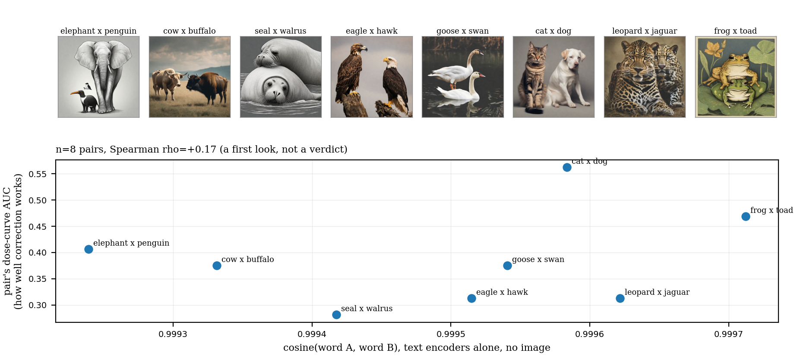

# 📒 Report: what the text already says about one animal or two

**No verdict has been recorded for either picture on this page.** The question is whether SDXL's
[two text encoders](../../../../goal-setting/learning/deep-learning/diffusion-models/latent-diffusion-architecture-rebuilt/plans/01-two-encoders.md),
which turn a prompt into the numbers that steer the drawing, already treat "a cat" as one animal and
"a cat and a dog" as more than one before any image exists.

## Table of contents

- [Where each prompt lands between one and two](#where-each-prompt-lands-between-one-and-two)
- [Whether similar words compose more easily](#whether-similar-words-compose-more-easily)
- [Where the sources disagree](#where-the-sources-disagree)
- [What this cannot tell you](#what-this-cannot-tell-you)
- [Concepts this uses](#concepts-this-uses)
- [Where this came from](#where-this-came-from)
- [Still open](#still-open)

## Where each prompt lands between one and two

Navigation: 📋 [TOC](#table-of-contents) | [Next](#whether-similar-words-compose-more-easily) ➡️

**Single-animal prompts sit around the one-thing band, and "a cat and a dog" sits near the midpoint
between one and two.** Each row is one kind of prompt and each grey dot is one of 49 animal pairs,
with cat and dog in orange. The x-axis is a prompt's position from one thing (blue band, -0.5) to two
things (red band, +0.5). The vertical scatter inside a row carries no value `verified` (the picture
and its [plotting script](../scripts/one_animal_axis.py)).

| Row on the picture | Cat and dog | Median of the 49 pairs |
|---|---|---|
| first animal alone, "a cat" | -0.40 | -0.53 |
| second animal alone, "a dog" | -0.38 | -0.54 |
| the two added, with the empty prompt taken off | -0.66 | -0.95 |
| both named, "a cat and a dog" | +0.05 | +0.11 |

One unit on the x-axis is the average step from a single-thing prompt ("a bear") to its two-thing
prompt ("two bears"), measured on 41 nouns kept out of building the direction. Positions are from
[the prompt positions file](../artifacts/results/what-the-text-already-says/does-one-prompt-already-say-one-animal/where-the-prompts-land.json),
view `pooled_bigG`, the larger encoder's one-vector summary of the prompt `verified`.

**The direction passes its own check at 43.24 times chance.** On those 41 nouns, the step along it
is 43.24 times the step along a random direction of the same shape, averaged over 200 random
directions. The plan required at least 3 times `verified`
([axis check file](../artifacts/results/what-the-text-already-says/does-one-prompt-already-say-one-animal/axis-heldout-check.json)).

> [!IMPORTANT]
> The pass rule can be read two ways, and the choice is still the owner's. [The plan's rule](../../3-understanding-compositionality/plans/10-what-poe-loses-when-it-composes/today-does-one-prompt-already-say-one-animal.md#what-would-count-written-before-anything-ran)
> asks that the joint prompt sit "at least one such margin toward plural".

| How the rule is read | Needed | Measured (median of 49 pairs) | That reading would give |
|---|---|---|---|
| the joint prompt reaches the two-thing position | +0.50 | +0.111 | null |
| the joint prompt's median moves that far from the median of all 98 single-animal positions | 0.50 | +0.643 | supported |

## Whether similar words compose more easily

Navigation: ⬅️ [Previous](#where-each-prompt-lands-between-one-and-two) | 📋 [TOC](#table-of-contents) | [Next](#where-the-sources-disagree) ➡️

**This picture is owed a caption, because its x-axis cannot be traced to one calculation.** It has no
card and no saved numbers beside it. Its own title calls it "a first look, not a verdict", and no
pass rule for it was written down.

| Part of the picture | What is known | Mark |
|---|---|---|
| top row | eight renders, one per pair; the script picks the first seed the instance-count scorer called composed with the correction at full strength | `stated` ([its script](../../scripts/text_orthogonality_probe.py)) |
| y-axis | area under the pair's curve of compose rate against correction strength, on a 0 to 1 scale, from 4 seeds at each of 5 strengths; all eight recomputed from `outputs/interaction_term/dose/dose_curves.json` and match the picture | `verified` |
| x-axis | unclear. Labelled as the cosine between the two words. Its values run 0.9992 to 0.9997, the range the script's notes give for a first run they say was replaced by a standardised cosine. The script committed with the picture computes the standardised one | owed |
| rank correlation, +0.17 | rests on the x-axis order, so it is unclear too | owed |

## Where the sources disagree

Navigation: ⬅️ [Previous](#whether-similar-words-compose-more-easily) | 📋 [TOC](#table-of-contents) | [Next](#what-this-cannot-tell-you) ➡️

**Five recorded facts conflict, and each is shown here unresolved.**

| What | One source | The other source |
|---|---|---|
| the noun on the two bands | the first picture labels them "a zebra" and "two zebras" | the axis check file lists zebra among the 40 nouns that built the direction; the bands average the 41 others |
| how many pairs are in the pool | the first picture's title says 49 pool pairs | the pool file holds 48; the 49th is cat and dog, marked as outside the training pool |
| the check ratio for the three word-by-word views | the plan records 84.69, 118.93 and 148.28 | the axis check file records 109.85, 140.51 and 194.57 |
| whether the first experiment ran | [the walk](../artifacts/drips/does-one-prompt-already-say-one-animal/EXECUTE_WALK.md) says the encoder pass has not run | the plan ticks tasks 1 and 2, and both result files exist |
| the second picture's rank correlation | the picture prints +0.17 | averaging tied ranks gives +0.24 on the picture's left-to-right order; the script breaks two ties by list order, and the possible tie orders give +0.17, +0.24 or +0.31 |

## What this cannot tell you

Navigation: ⬅️ [Previous](#where-the-sources-disagree) | 📋 [TOC](#table-of-contents) | [Next](#concepts-this-uses) ➡️

**The first picture draws one of four ways of reading a prompt, and the joint prompt's position
changes with the view.** Positions are medians over the same 49 pairs, from the prompt positions file.
The move is the joint prompt's median minus the median of all 98 single-animal positions, the
calculation at lines 355 to 357 of [the prompt position script](../scripts/one_animal_axis.py):

| View of the prompt | Joint prompt's position | Its move from the single-animal prompts |
|---|---|---|
| larger encoder, one-vector summary (`pooled_bigG`, drawn) | +0.111 | +0.643 |
| smaller encoder, word by word (`seq_clipL`) | -0.045 | +0.576 |
| larger encoder, word by word (`seq_bigG`) | -0.327 | +0.302 |
| both encoders, word by word (`seq_both`) | -0.219 | +0.422 |

**The added row's distance is mostly arithmetic.** Adding two negative positions lands further left
whatever the prompts mean, so the script's notes say to read its sign against the single prompts and
leave its size alone.

**Nothing here reaches the image.** These numbers read the text encoders only. [Product of experts](../../context/world/poe-composition.md#what-poe-composition-is)
adds the two models' noise predictions during drawing, so a position on this axis cannot show that
adding them yields one animal. What happens when text differences are fed in as a third expert is in
[the text-space third expert finding](can-a-text-space-third-expert-restore-composition.md).

## Concepts this uses

Navigation: ⬅️ [Previous](#what-this-cannot-tell-you) | 📋 [TOC](#table-of-contents) | [Next](#where-this-came-from) ➡️

The toy numbers below are invented. The project numbers are from the two result files.

**A one-vs-many direction**

Give each prompt two numbers: "a cup" (1, 5), "two cups" (4, 5), "a mug" (2, 3), "two mugs" (5, 3).
The step from one to two is (3, 0) both times, so "many" points along the first number. The direction
is the average of E("two X") minus E("a X"), where E is the prompt's list of numbers. Here it is
averaged over 40 nouns with 1,280 numbers each. A prompt's reading along it is its
[projection](../../../../Obsidian/Mathematics/Linear%20Algebra/Projection.md).

**A position in steps from the midpoint**

In the toy, single prompts average 1.5 on the first number and two-thing prompts 4.5, so the midpoint
is 3 and one step is 3. A prompt reading 3.6 sits at (3.6 - 3) / 3 = +0.2. Position is reading minus
midpoint, divided by step. Here the midpoint is -2.94 and the step is 23.26 in the encoder's raw
units.

**A random floor**

If the toy's real direction gives a step of 3 and random directions give 0.2 on average, the real one
is 3 / 0.2 = 15 times chance. The ratio is the real step divided by the average random step. Here it
is 23.2598 / 0.5379 = 43.24.

**The added row**

Two single prompts at -0.5 with an empty prompt at -0.1 add to -0.5 + -0.5 - (-0.1) = -0.9. For cat
and dog the same sum is -0.4002 + -0.3751 - (-0.1107) = -0.6646, the -0.66 on the picture.

## Where this came from

Navigation: ⬅️ [Previous](#concepts-this-uses) | 📋 [TOC](#table-of-contents) | [Next](#still-open) ➡️

| What | Source | Mark |
|---|---|---|
| prompt positions | [prompt positions file](../artifacts/results/what-the-text-already-says/does-one-prompt-already-say-one-animal/where-the-prompts-land.json), read 2026-11-21 | `verified` |
| direction check | [axis check file](../artifacts/results/what-the-text-already-says/does-one-prompt-already-say-one-animal/axis-heldout-check.json), read 2026-11-21 | `verified` |
| how the first picture was made | [the prompt position script](../scripts/one_animal_axis.py), run 2026-11-04 per [the plan](../../3-understanding-compositionality/plans/10-what-poe-loses-when-it-composes/today-does-one-prompt-already-say-one-animal.md) | `stated` |
| how the second picture was made | [the word similarity script](../../scripts/text_orthogonality_probe.py), committed with the picture on 2026-08-18 | `stated` |
| the working record of the first experiment | [the walk on whether one prompt already says one animal](../artifacts/drips/does-one-prompt-already-say-one-animal/EXECUTE_WALK.md), read 2026-11-21 | `stated` |

## Still open

Navigation: ⬅️ [Previous](#where-this-came-from) | 📋 [TOC](#table-of-contents)

- [ ] Choose which reading of the pass rule applies to the first picture. The plan holds this step for the owner.
- [ ] Establish the second picture's x-axis. The script writes its numbers to `outputs/interaction_term/cache_analyses/text_orthogonality_probe.json`, which is absent from this laptop and from git.
- [ ] Run the two remaining reads in the plan: the same axis on a text encoder with no CLIP in it, and how much of the joint prompt lies outside its parts. Neither has an output file.
- [ ] Write the card for each result. The [grouping card](../artifacts/results/what-the-text-already-says/README.md) says "no card yet" on both rows.
- [ ] Write the finding the plan names, which would carry a verdict for each of its two claims.

<!-- built-to: PAGE_LOOK_FORMAT v1 -->
