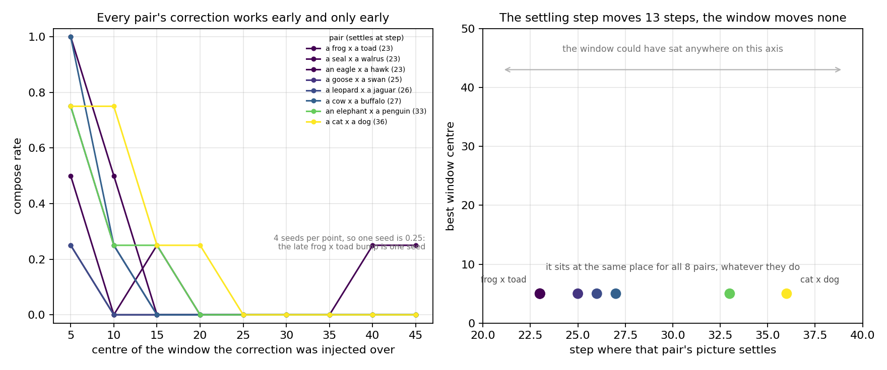
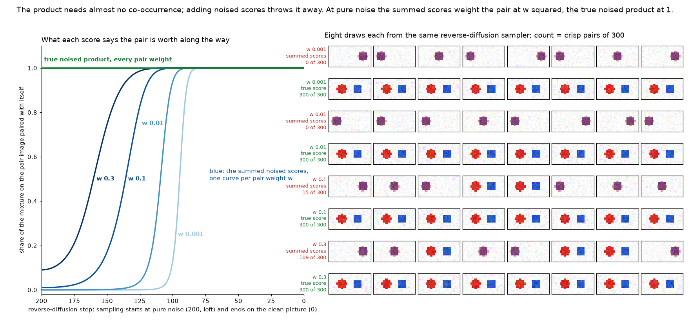

# Where we are stuck

Four lines of work, plus two side lines, have tried to make SDXL draw a cat and a dog when asked for
"a cat" × "a dog" by [product of experts](../../../context/world/poe-composition.md) (`ε_cat + ε_dog − ε_null`,
guidance 7.5, 50 DDIM steps). Each one moved the count. None removed the cause. This file puts every
line on one page, one layer each, so that the walk on this idea starts from what the project has measured and not from
memory. Every number names the file it was read from. Read it top to bottom, one layer per round.

## Words this uses

**Faithful pair.** One whole cat beside one whole dog, both photographic. The strictest call any
layer makes.

**Two bodies.** Two separate animals in the frame, whatever species each turned out to be. A cat and
a dog counts, two dogs counts, a cat and a cat-dog hybrid counts.

**The correction.** The joint prompt's prediction minus the product's, `ε_joint − ε_PoE`, at one
step. It is the [interaction term](../../../context/world/interaction-term.md) the product drops,
scaled by the noise level.

**The push.** A small network's gradient added to the product's prediction at each step, with SDXL
frozen. "Pair-aware" means the network was trained to tell two separate animals from the fused one.

## Contents

- [1. The product](#1-the-product)
- [2. The correction, and the adapter that learns it](#2-the-correction-and-the-adapter-that-learns-it)
- [3. The exact toy](#3-the-exact-toy)
- [4. Inclusive captions](#4-inclusive-captions)
- [5. A third expert in text space](#5-a-third-expert-in-text-space)
- [6. Classifier guidance](#6-classifier-guidance)
- [7. Sampler correctors and search](#7-sampler-correctors-and-search)
- [What the layers add up to](#what-the-layers-add-up-to)
- [What has never been run](#what-has-never-been-run)

## 1. The product

**Best number.** 0 faithful pairs of 128 new seeds (6001 to 6128) for plain product, against the
joint prompt "a cat and a dog", which composes 8 of 8 on the held-out seeds 9 to 16. The control
pair, a butterfly over a meadow, composes 8 of 8 under the product.

**The picture.** Column 5 of the sheet is the product of "cat" and "dog": one animal with a cat's
ears and a dog's muzzle on every seed.

**What it showed about the cause.** The fusion survives two swaps that each remove a suspect.
PixArt-alpha, whose text encoder is Flan-T5 with no CLIP anywhere, fuses on 8 of 8. SDXL sampled at
PixArt's settings (DPM-Solver++ order 2, 20 steps, guidance 4.5) fuses on 8 of 8. So the cause is
neither CLIP nor this sampler configuration. It recurs over 17 animal pairs at 8 seeds each.

**From.** [The project's findings index](../../../report/00-INDEX.md), rungs 1 and 2;
[does a CLIP-free model hybridise](../../../1-lora-correction/report/is-the-gap-the-samplers-or-the-models/does-a-clip-free-model-hybridise.md);
[does SDXL compose at PixArt's settings](../../../1-lora-correction/report/is-the-gap-the-samplers-or-the-models/does-sdxl-compose-at-pixarts-settings.md);
the 128-seed count is in [the checker loop's closing section](../../../2-classifier-guidance/artifacts/drips/rung2-pair-aware-discriminator/checker-loop.md#loop-closed-on-2026-11-19).

## 2. The correction, and the adapter that learns it

**Best number.** Adding the correction back, scaled by λ from 0 upward, takes the
[compose rate](../../../context/world/compose-rate.md), pooled over eight animal pairs, from 3% to
94%, while two controls of the same size pointing elsewhere stay at or below 6% (area under the
rate-against-λ curve on a 0-to-1 scale: 0.387 for the correction, 0.023 and 0.039 for the controls).
Cat × dog alone goes from 0% to 100%, with an area of 0.562. Injected only at steps 0 to 10, the
correction composes 0.656 of 32 runs over the eight pairs (cat × dog alone: 3 of 4 seeds); at steps
20 to 30 it composes 0.000. A rank-32 adapter trained to
predict the correction from the two single prompts composes cat × dog on 7 of 8 held-out seeds
against 0 for plain product.

**The picture.** Left panel: compose rate (y) against the centre of a ten-step injection window (x),
one curve per pair. Every pair peaks at centre 5 and is at zero by centre 25. Right panel: the best
window sits at step 5 for all eight pairs, while the step where each pair's picture settles runs
from 23 (frog × toad) to 36 (cat × dog).

**What it showed about the cause.** The fused animal is what the product draws when one specific
term is missing, and that term matters only in the first fifth of the run, before anything is
visible. The correction is mostly a re-weighting the product could have made itself: 0.374 of its
squared norm lies outside the span of the three predictions the product already has (steps 0 to
10, seeds 9 to 16, inconclusive against bars of 0.25 and 0.5), and the part inside the span weights
each expert at 1 to 3 where the product weights it at 7.5. So a large share of the correction is
the product turning its two experts down early. The adapter is a learned correction, which is what
this walk is looking to do without: its held-out quality decays with training (rank 8 drift from
−0.132 at 30k steps to +0.041 at 280k, weights growing without bound), and the held-out gap is a
property of the pair rather than of fit or drift.

**From.** [More correction, more composition](../../../1-lora-correction/artifacts/plans/completed/03-does-the-correction-cause-composition/review/03-more-correction-more-composition.md);
[when in the run it matters](../../../1-lora-correction/artifacts/plans/completed/03-does-the-correction-cause-composition/review/05-when-in-the-run-it-matters.md);
[what the correction is made of](../../../1-lora-correction/report/when-does-the-outcome-lock-in/what-is-the-correction-made-of.md);
[which checkpoint composes best](../../../3-understanding-compositionality/report/does-training-longer-help-the-pooled-lora/which-checkpoint-composes-best-and-does-more-correction-help.md);
[does training longer help](../../../3-understanding-compositionality/report/does-training-longer-help-the-pooled-lora/does-training-longer-keep-improving-the-held-out-fix.md);
[fit, drift, or pair problem](../../../1-lora-correction/report/does-the-fix-reach-unseen-pairs/is-the-held-out-gap-a-fit-a-drift-or-a-pair-problem.md).

## 3. The exact toy

**Best number.** Reverse diffusion with the true score of the noised product draws a red circle
beside a blue square on 300 of 300 at every pair weight tried (0.001, 0.01, 0.1, 0.3). The same
sampler with the two experts' noised scores added draws 0, 0, 15 and 109 of 300.

**The picture.** Left: the share of the mixture sitting on the pair picture (y, 0 to 1) against the
reverse-diffusion step (x, 200 at pure noise to 0). The green line, the true noised product, is at 1
from the start. The blue curves, the summed noised scores, start at the pair weight squared and
reach 1 only between steps 160 and 95, after the draw has committed. Right: eight draws per row,
purple overlays from the summed scores, a clean pair from the true score.

**What it showed about the cause.** The toy has every density in closed form, so it can say where
the pair is lost, and it finds two separate places.

*The path.* Adding noised scores is not the noised product. At pure noise the sum weights the pair
at `w²` where the true product weights it at 1, so a sampler following the sum commits to one blob
before the pair has any pull. This is the non-commutativity Du et al. 2023 name for diffusion
composition, measured here as a count.

*The target.* When each expert puts even a little mass on the other's shapes, the product stops
holding the pair at all. A leak of 0.00567 per shape undoes a shared pair weight of 0.1 (the exact
product's crisp share falls below half). Competing captions land on that leak without anyone
choosing it, and then the exact product draws one shape on about 296 of 300 and no overlay. The
failure moves from the sampler to the target, and its signature changes from a fused blob to a
single clean object.

**From.** [How much co-occurrence the product needs](../../../3-understanding-compositionality/artifacts/results/the-exact-toy/how-much-co-occurrence-the-product-needs/README.md),
sections "Where the samplers lose the pair", "Competing captions" and "The second dial".

## 4. Inclusive captions

**Best number.** On the toy's trained caption model, relabelling both-shapes pictures under each
single caption (0%, 10%, 30%, 60%, 100% of them) gives plain product 0, 110, 103, 51 and 205
separate pairs of 300, and with 20 Langevin corrector
steps per noise level 0, 300, 300, 300 and 300. With no both-shapes picture under the single captions
the corrector draws 0 of 300 in every model. On SDXL the pilot has no compose rate: 0 of 6 sheet
seeds show two animals in any row (plain, run A, run B), and the planned 128-seed scoring never ran
(run A's renders were discarded at 52 seeds after a contrast bug; run B's never started).

**The picture.** Three rows of the SDXL product on six seeds. Run A (both-animal photos captioned
only jointly) fuses. Run B (each both-animal photo also drawn under "cat" 40% and "dog" 40%) mostly
draws one clean cat or one clean dog.

**What it showed about the cause.** On the toy the fix works in two parts: the captions put the pair
inside each expert, and the corrector then finds it. Either part alone fails. On SDXL run B moved
the failure from a fused animal to a single clean animal, which is the toy's target-side signature
(one object, no overlay). That reading is inferred from six seeds by eye and has not been scored.

**From.** [The SDXL pilot's card](../../../4-inclusive-captions/artifacts/results/does-captioning-both-animal-photos-under-each-name-help-poe-compose/README.md);
the toy counts are `toy-caption-dial-corrector.json` and `toy-caption-corrector-no-single-captions.json`
in [the toy's co-occurrence card](../../../3-understanding-compositionality/artifacts/results/the-exact-toy/how-much-co-occurrence-the-product-needs/README.md);
the design and its unmet criterion are in [the captions idea map](../../../4-inclusive-captions/artifacts/ideas/inclusive-captions-axis/IDEA_MAP.md)
and [the pilot's review file](../../../4-inclusive-captions/plans/11-do-inclusive-captions-help-poe-compose/review/01-does-captioning-widen-the-cat-condition.md).

## 5. A third expert in text space

This line was not in the brief's list. It is here because it ran, has a finding, and repeats the
pattern layer 6 ends on.

**Best number.** Over 7 judgeable cat × dog seeds, two separate animals on 6 of 7 for the best third
expert (`x_pos`) and 5 for the plain phrase "a dog next to a cat", against 0 for plain product. One
whole cat beside one whole dog: 0 of 7 for every one of eight third experts, against a pass mark of
4 written before the renders.

**What it showed about the cause.** Adding a third expert brings back co-occurrence (two animals in
frame) and never identity (which animal each is). The three-expert product was further from the
joint prompt's render than `x_pos` alone (mean absolute pixel difference, 0 to 255: 39.16 against
23.43; plain product 47.05), so the product step itself costs fidelity.

**From.** [Can a text-space third expert restore composition](../../../5-text-embedding-third-expert/report/can-a-text-space-third-expert-restore-composition.md).

## 6. Classifier guidance

**Best number.** On SDXL cat × dog, the kept recipe (a pair-aware checker trained on 243 pairs,
pushing at strength 30, capped at 0.4 of the product prediction's norm, steps 0 to 15, then plain
product) gives 35 faithful pairs and 121 two bodies of 128 new seeds, against 0 and 1 for plain
product and for a random push of the same size. A re-render moves the count by about 2. Lion ×
meerkat gives 0 faithful of 16 under every checker and cap tried. On MNIST the pair-aware push plus a
separate-label push gives two clear, right digits on 285 of 320 seeds of pairs never seen together
(89%), against 1 with no push. On the exact toy the pair-aware push gives 172 of 300 at weight 1
and 300 at weight 2, against 0 unguided.

**The pictures.** Left: cat × dog under the kept push, two rows of faithful pairs and one row of
misses (two cats, a cat beside a sack, a flattened cartoon). Right: lion × meerkat, two bodies on
most seeds, and most of them two meerkats or a lion-meerkat hybrid.

**What it showed about the cause.** The push decides how many things there are and leaves which
thing each becomes to the product's sum, where the stronger expert wins (the meerkat, on most
seeds). Pushes that act on species cost the photograph first: adding a species push on all 50 steps
gave 15 of 32 clean or near-clean against the recipe's 14, with 14 of 32 damaged (burnt colour, flat
paint). On the toy the pair-aware push points along the sampler's own error (cosine 0.85 to 0.96
over steps 190 to 90) and hardly at all along the true correction (at most 0.21), so it repairs the
path, which is the toy's failure. On MNIST a second push names the digits and the pair reaches 89%;
on SDXL the same split does not carry. The checker loop's own closing idea moves the species choice
out of the sum: once the push has made two bodies (about step 10), find the two regions and run each
expert only inside its own region.

**From.** [The checker loop, "Loop closed"](../../../2-classifier-guidance/artifacts/drips/rung2-pair-aware-discriminator/checker-loop.md#loop-closed-on-2026-11-19);
[plan 31's review file](../../../2-classifier-guidance/plans/review/31-bodies-and-species-pushes-on-every-step.md);
[the MNIST review file](../../../2-classifier-guidance/plans/review/a2b-mnist-digits-on-a-canvas.md), loops 4 and 5;
[the route's "What we know so far"](../../../2-classifier-guidance/plans/route-classifier-guided-poe-from-toy-to-animals.md#what-we-know-so-far),
toy rows from plan 19's `diagnosis.json`.

## 7. Sampler correctors and search

**Best number.** A Langevin corrector on all 50 noise levels, adding nothing to the score, leaves cat
× dog at 0 of 8 held-out seeds (joint 8 of 8, plain product 0 of 8), and none of nine ten-step
corrector windows composes on 4 seeds. Search that spends compute without changing the score is
also null: Feynman-Kac steering on the compose scorer 0 of 128 particles, twisted sequential Monte
Carlo 0.0 compose fraction over 12 particles, search over the starting noise 1 of 8 seeds (one body
with two heads).

**The picture.** Three columns on eight seeds: joint prompt, plain product, product with the
corrector. The corrector column is one animal everywhere, and on five seeds it has drifted from a
photograph to a cartoon or a line drawing.

**What it showed about the cause.** On SDXL a corrector settles the latent into what the summed score
describes, and that distribution holds no cat-and-dog pair. On the toy the same corrector reaches
300 of 300 once the captions put the pair inside each expert, and 0 when they do not (layer 4). So
on SDXL the summed-score target itself is short of the pair, as well as the path. That is an
inference from the two results together, not a measurement. The direct measurement, how much of the
correction a corrector removes per step, came back inconclusive at every step size (the two largest
corrector counts differ by 21% against a 5% bar, and the uncorrected cell reads 0.153 to 0.180 on
three GPUs). The corrector journey's falsification line (remove over half of `‖r_t‖` at steps 0 to
10 and under a fifth at 20 to 40 for a sampler verdict) has no verdict yet.

**From.** [Does a corrector alone produce two animals](../../../1-lora-correction/report/is-the-gap-the-samplers-or-the-models/does-a-corrector-alone-produce-two-animals.md);
[does a Langevin corrector remove part of the correction](../../../1-lora-correction/report/is-the-gap-the-samplers-or-the-models/does-a-langevin-corrector-remove-part-of-the-correction.md);
[does steering on the scorer find a composing proposal](../../../1-lora-correction/report/is-the-gap-the-samplers-or-the-models/does-steering-on-the-scorer-find-a-composing-proposal.md);
[does selecting among PoE proposals compose](../../../1-lora-correction/report/is-the-gap-the-samplers-or-the-models/does-selecting-among-poe-proposals-compose.md);
[does searching over the initial noise compose](../../../1-lora-correction/report/is-the-gap-the-samplers-or-the-models/does-searching-over-the-initial-noise-compose.md);
the falsification line is in [the sampler-correctors journey](/home/molef/goal-setting/learning/deep-learning/diffusion-models/02-sampler-correctors-for-composition/MASTER_PLAN.md).

## What the layers add up to

The toy separates two failures that SDXL has not yet been made to separate.

**The path.** Summing noised scores is not the noised product, and the sum gives the pair almost no
weight until the picture has committed. The toy measures this (layer 3), the pair-aware push repairs
it there (layer 6), and the correction's early-only window on SDXL is what a path failure looks like
(layer 2). It does not by itself explain SDXL, because a corrector that follows the summed score's
own target still draws one animal (layer 7).

**The target.** If each expert holds some mass on the other's subject, the product turns into a
mixture and draws one thing. Run B's single clean animals on SDXL (layer 4) carry that signature.
The corrector null on SDXL (layer 7) fits it too.

**Identity, once there are two things.** Three different levers restore two bodies and none of them
restores who each body is: the third expert (6 of 7 two animals, 0 of 7 cat and dog), the pair-aware
push on lion × meerkat (two bodies, mostly two meerkats), and the push's misses on cat × dog (two
cats, two dogs). Every one of them still decides species through the same sum over the whole image.
The only line that has fixed identity is the correction itself, which reads the joint prompt or a
learned copy of it.

Of the brief's five claims, (a) and (b) are aimed at the identity failure, (c) at what the correction
is made of, (d) at the path, and (e) at where the joint prompt's knowledge already sits.

## What has never been run

**Regional composition on SDXL.** [Is the layout the missing piece](../../../3-understanding-compositionality/plans/10-what-poe-loses-when-it-composes/is-the-layout-the-missing-piece.md)
designs it: each expert's difference from the null prediction weighted by a soft mask on the 128 ×
128 latent grid, with oracle boxes from the joint render and a same-prompt-in-both control. The boxes
and the masks were built and checked by eye on 2026-11-04 (8 seeds, two overlap readings). The
composer `poe_repair/composers/poe_regional.py` and the sweep were never run, so the question is
unanswered. One image, `identity/identity_regional_flat_masks.png` in
[the layout folder](../../../3-understanding-compositionality/artifacts/results/what-sdxl-already-knows/what-the-prompts-draw/is-the-layout-the-missing-piece/),
has no card and no record of how it was made, so nothing is read from it.

**A scored inclusive-captions result on SDXL.** No compose rate exists for run A or run B.

**The sampler-or-model verdict.** Criterion written, measurement inconclusive, verdict not delivered.
