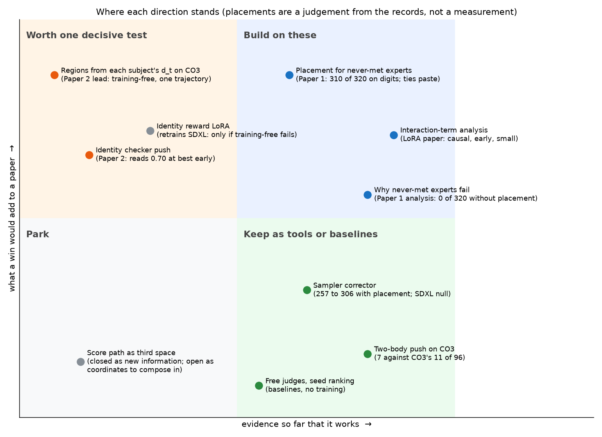

# Which directions have potential, and which to design around next?

Ten directions have come out of Loops 5 to 10 and the projects before them. This page places each one by the evidence it has and by what a win would add to a paper, and names the two worth designing around. It builds on [Where we are stuck](../beyond-the-product-of-experts/where-we-are-stuck.md), which lays out what each line of work found, and does not repeat it.

*Each dot is one direction. Across is how much the records show it works; up is what a win would add to a paper. The placements are a judgement from the records below, not a measurement. Drawn by `draw_directions.py`.*

## Table of contents

- [The ten directions](#the-ten-directions)
- [The two to design around](#the-two-to-design-around)
- [What would change this](#what-would-change-this)

## The ten directions

| Direction | Paper | Best evidence so far | What is open | Call |
|---|---|---|---|---|
| Placement for experts that never met: each expert draws its own region, the side chosen early and held | 1 | 310 of 320 on digits with the side held; 1,200 of 1,280 on unseen pairs, on the void list ([the two-model finding](../../../2-classifier-guidance/report/classifier-guided-poe/can-two-separately-trained-digit-models-compose-while-sampling.md)) | it ties sample-and-paste, 295 against 287 (Loop 6, M1); whether the experts' vote matters (never run); whether it holds where pasting fails | **design around** |
| Why never-met experts fail: the product holds no two-object mass without placement | 1 | 0 of 320 with experts free to draw on either side; the exact toy shows the product depends on overlap ([the overlap finding](../../../3-understanding-compositionality/report/the-exact-toy/what-the-product-of-two-experts-draws-and-what-samplers-lose.md)) | written up as a claim | build on, as Paper 1's analysis section or its fallback paper |
| The interaction term: the correction is causal, early and small | LoRA paper | the correction composes 21 of 32 runs injected at steps 0 to 10 against 3 of 32 at steps 10 to 20 ([what we know](../../notes/progress/what-we-know.md), row 25) | the sampler-or-model verdict is not delivered | build on, in the existing paper |
| Identity reward LoRA: train on the finished picture, where a checker reads 0.90, so the early steps learn identity through the weights | 2 | the only line that has fixed identity is the correction, which a LoRA already learns ([Where we are stuck](../beyond-the-product-of-experts/where-we-are-stuck.md#what-the-layers-add-up-to)); the reward fine-tune was started and never scored | whether an identity reward adds to the correction; CoMat already fine-tunes with a concept loss; it retrains the diffusion model, which the owner allows only with a reason no training-free route can meet | only if the training-free routes fail |
| Regions name each body: each subject's prompt acts only in its own region, the regions read from each subject's own $d_t$ | 2 | Loop 6's M9 rung 1: 8 clear pairs of 8 on the right boxes, every picture damaged; rung 2's masks failed on 11 of 24 reads ([the Loop 6 page](../../notes/progress/score-space/02-the-loops/loop-6-find-the-best-method.md)) | M9's word-attention regions failed 11 of 24 mask reads; a region reader from each subject's $d_t$ is untested ([the independent audit](../../notes/progress/score-space/12-independent-audit.md)) | **design around**: training-free, one trajectory per seed |
| Identity checker push during sampling | 2 | identity reads 0.695 for cat and 0.728 for dog on SDXL features; on digits the best early read is 0.700 | the push must act at steps 0 to 10, where identity cannot yet be read ([the checker loop](../../../2-classifier-guidance/artifacts/drips/rung2-pair-aware-discriminator/checker-loop.md)) | one decisive test, low odds |
| Sampler corrector (Langevin steps) | both | with placement given, 257 to 306 of 320 on digits; on plain SDXL product, 0 of 8 | only helps once the target holds the pair | a component of placement, not a direction |
| Two-body push on CO3 | 2 | two bodies on 121 of 128 seeds on the plain product; on CO3 it lowers faithful pairs from 11 to 7 of 96 | CO3 already draws two bodies | keep for the plain product only |
| Free judges and seed ranking (the model's own caption-swap error, score-path length) | both | seed ranking lifts GenEval two-object on SD1.5 from 0.354 to 0.518 by keeping 4 of 50 seeds ([its note](../../notes/progress/score-space/01-reading/sampling-path-tells-more.md)) | untested here | baselines and evaluation tools |
| Score path as a third space | none | presence 0.700 against a 0.75 bar; it holds no information beyond the canvas ([the Loop 10 verdict](../../notes/progress/score-space/09-verdict.md)) | | closed |

## The two to design around

**Paper 1: does placement beat pasting anywhere?** The method's own records say placement is what makes experts that never met compose, and that it ties pasting on digits by construction. The paper exists only if placement beats pasting on a task where pasting fails: objects that touch, occlude or relate. Two pieces are already designed: [the five-arm digit ablation](../../notes/progress/score-space/10-paper-1-placement-or-sampler.md), which asks whether the experts' vote matters, and Loop 6's CLEVR paste test (M7). The design still needed is the task where pasting fails.

**Paper 2: can each subject's own score difference say where it may act on CO3?** CO3 already places two bodies, and its failures are borrowed parts. Letting each subject's prediction act only inside its own region, with the regions read from $d_t(A)$ and $d_t(B)$, is training-free and stays on one trajectory per seed, as the owner's rules ask. Its cheapest test reruns M9's own mask check with this reader: 24 reads at step 10, failing a read when a region covers at least 80% of the grid or the two overlap at IoU 0.8 or more. Word attention failed 11 of 24 on that rule. Loop 12 measures, at its step Z2, when borrowing commits and whether these maps predict it.

## What would change this

- If the digit ablation finds that a random held side does as well as the experts' vote, Paper 1's claim reduces to holding a side, and only a task where pasting fails can carry it.
- If M7 shows pasting succeeds on CLEVR too, Paper 1 becomes the analysis paper in the second row.
- If the $d_t$ region reader fails M9's mask rule as word attention did, Paper 2's next training-free routes are the checker choosing CO3's settings (board question 80) and attention bounds (Loop 12).
