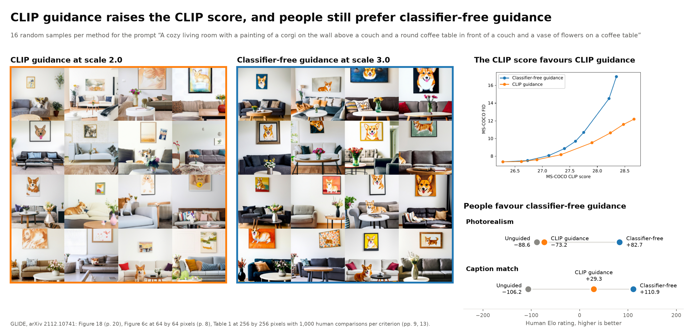

# GLIDE: Towards Photorealistic Image Generation and Editing with Text-Guided Diffusion Models

arXiv 2112.10741, read from the full PDF (20 pages, appendix included). No venue is printed on the PDF.

## What it does

GLIDE trains a 3.5 billion parameter text-conditional pixel diffusion model at 64 by 64 pixels and a 1.5 billion parameter upsampler to 256 by 256 pixels (p. 6). It compares two ways of steering that model toward a caption: the gradient of a CLIP model retrained on noisy images, and classifier-free guidance (pp. 1, 5). Human judges prefer classifier-free guidance for both photorealism and caption match (pp. 1, 9).

## What the classifier or loss reads

**Image side.** The noised CLIP image encoder $f(x_t, t)$ receives the noised pixel image $x_t$ and the timestep $t$ (p. 6). It processes 64 by 64 pixel images with a Vision Transformer using 4 by 4 pixel patches (p. 13). The final guiding model is a ViT-L (pp. 6, 13).

**Text side.** The caption encoder $g(c)$ reads the full prompt, and the guidance score is the dot product $f(x_t) \cdot g(c)$ (p. 5). The model reads no U-Net features, cross-attention maps or decoded image estimate (pp. 5, 6, inferred from the stated inputs).

## What it trained on

**Objective.** The noised CLIP is "otherwise trained with the same objective as the original CLIP model" (p. 6). That objective is a contrastive cross-entropy loss that raises $f(x) \cdot g(c)$ for matched image and caption pairs and lowers it for mismatched pairs (p. 5).

**Data.** Training uses a 50%-50% mixture of the datasets used by Radford et al. (2021) and Ramesh et al. (2021), for 390,000 iterations at batch size 32,000 (p. 13). That is about 12.5 billion image presentations (inferred from 390,000 times 32,000). The final ViT-L uses weight decay 0.0125 and is then fine-tuned for 30,000 iterations on "an even broader dataset of internet images" (p. 13).

**Noise levels.** The models use "the same noise schedule as our base model" (pp. 6, 7). The PDF does not print that schedule or how $t$ is sampled during CLIP training.

## How its gradient enters

The printed guidance equation (p. 5):

$$\hat{\mu}_\theta(x_t|c) = \mu_\theta(x_t|c) + s \cdot \Sigma_\theta(x_t|c)\nabla_{x_t}(f(x_t) \cdot g(c))$$

$\mu_\theta$ and $\Sigma_\theta$ are the reverse-process mean and variance, $s$ is the guidance scale, $f$ is the noised image encoder and $g$ is the caption encoder (pp. 4, 5). The equation writes $f(x_t)$, while Section 4.4 defines the trained encoder as $f(x_t, t)$ (pp. 5, 6).

**Scale.** The main comparison uses CLIP guidance scale 2.0 and classifier-free guidance scale 3.0 (pp. 7, 9). A separate noised ViT-B experiment guiding a public ImageNet model uses a fixed gradient scale of 15.0 (p. 14).

**Steps.** Evaluations sample the base model with 250 diffusion steps, and displayed samples use 150 steps (p. 13). The equation has no step window, and the PDF prints no gradient normalisation or cap. The PDF does not state whether the upsampler is guided by CLIP. The CLIP model takes 64 by 64 inputs, so guidance at the base stage is the supported reading (p. 6, inferred).

## Unseen concepts

This paper does not test held-out concepts.

CLIP guidance is scored on MS-COCO validation prompts (pp. 8, 9). Nothing in the PDF holds a concept or category out of noised CLIP training and then scores it. The statement that GLIDE reaches competitive FID "without ever explicitly training on this dataset" concerns the diffusion model and MS-COCO as a dataset (p. 9).

The nearest related observation runs in the opposite direction. GLIDE (filtered) excludes people from the generator's training data, and an unfiltered public CLIP guiding it produced "some recognizable facial expressions or hateful imagery" (pp. 9, 10). That concept was missing from the generator and present in the classifier. The same CLIP produced roughly the same quality when paired with a public ImageNet diffusion model (p. 10).

## Word leakage and confounds

The classifier sees the caption through $g(c)$ by design, because its score is prompt match (p. 5). The paper does not examine whether the score or gradient relies on particular words.

The confound the paper does address is that a guided method can raise a CLIP metric without better prompt match. CLIP guidance raises the CLIP score more than classifier-free guidance on MS-COCO at 64 by 64 pixels (p. 8, Figure 6c). The authors hypothesise that it is "finding adversarial examples for the evaluation CLIP model" (p. 8), then use human evaluators and report that humans disagree with CLIP score (pp. 8, 9). The evaluation model is CLIP ViT-B/16, a different network from the noised ViT-L used for guidance (pp. 6, 13). The adversarial explanation is a hypothesis that the human result fits, and the paper does not isolate the cause.

## Numbers

Table 1 uses human pairwise preferences, with 1,000 comparisons for each criterion in the final evaluation (pp. 9, 13). Elo is a relative rating scale with no fixed range, and higher is better.

| Metric | Noised CLIP guidance, scale 2.0 | Classifier-free guidance, scale 3.0 | Unguided | Dataset | Model | Page and table |
|---|---:|---:|---:|---|---|---|
| Photorealism Elo | -73.2 | 82.7 | -88.6 | MS-COCO validation prompts, 256 by 256 pixels | GLIDE 3.5 billion parameters | p. 9, Table 1 |
| Caption-match Elo | 29.3 | 110.9 | -106.2 | MS-COCO validation prompts, 256 by 256 pixels | GLIDE 3.5 billion parameters | p. 9, Table 1 |

The scale sweep in Figure 7 is plotted relative to unguided sampling (p. 8). Read from the plot, CLIP guidance peaks near 85 for photorealism at scale 2 and near 135 for caption match at scale 5, while classifier-free guidance reaches about 235 and 245 near scale 3. These plotted values are approximate. Table 1 therefore uses CLIP scale 2.0, which is below the plotted caption-best scale of 5 (pp. 8, 9). The sweep's caption comparisons use 500 judgments (p. 13).

For the overall model with classifier-free guidance at scale 1.5, zero-shot FID (lower is better) on MS-COCO at 256 by 256 pixels is 12.24, against 26.94 for LAFITE and about 28 for DALL-E (p. 9, Table 2).

The figure sets GLIDE's random samples for one prompt (Figure 18c and 18d, p. 20) beside its CLIP score curves (Figure 6c, p. 8) and human ratings (Table 1, p. 9).

What this figure cannot show

The CLIP score curves are at 64 by 64 pixels and the human ratings are at 256 by 256 pixels. The CLIP that scores the images (ViT-B/16) is a different network from the noised ViT-L that steers them (pp. 6, 13), so the gap is not a classifier grading its own output. The paper's adversarial-example explanation is a hypothesis (p. 8). Table 1 uses CLIP scale 2.0, while Figure 7 places CLIP's best caption scale near 5, where classifier-free guidance still leads (read from the plot). One prompt's samples illustrate the ratings and do not prove them.

## What to copy, what to avoid

- Copy timestep conditioning and training on the noisy input the checker will read during sampling. Our CLIP checker on decoded early images reads the pair at chance (balanced accuracy 0.50 at step 0), and GLIDE's noised encoder is the direct response to that kind of input mismatch (inferred).
- Copy GLIDE's evaluation separation. Judge a checker with people or an independent measure, because a guided method can raise a CLIP-like score while people rank it lower (pp. 8, 9) (inferred).
- Avoid assuming that a prompt-match gradient produces composition. GLIDE's CLIP guidance loses to classifier-free guidance on caption match, and the printed test does not measure two-subject composition (p. 9) (inferred).
- Avoid planning to retrain a CLIP-scale model for Paper 2. GLIDE used about 12.5 billion image presentations, and its model reads pixels while ours would need SDXL latents or attention maps (p. 13) (inferred).
- Keep the 0.4 norm cap and early-step design under separate test. GLIDE prints no cap or step window, so it gives no evidence for either choice (p. 5) (inferred).
- Do not cite GLIDE for transfer to unseen concepts, because it has no held-out concept test (inferred).

## Closer work it cites

None. Its CLIP guidance citations use public or noised CLIP for prompt guidance, and none is presented here as a classifier for an abstract property or a test on unseen concepts (pp. 5, 6).
