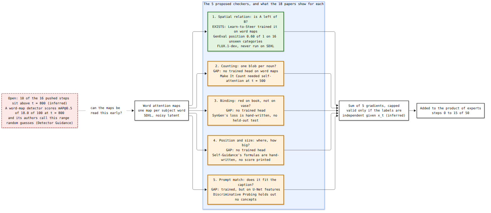

# Reading table: the closest work on abstract checkers

This table holds one row per listed paper, 18 in all, each read from its full PDF with appendices. It answers which of the five proposed checkers (spatial relation, counting, binding, position and size, prompt match) already exists as a trained classifier tested on concepts it never saw. Each row links to that paper's note, which holds the detail.

## Table of contents

- [Which checkers already exist](#which-checkers-already-exist)
- [The table](#the-table)
- [Where sources disagree](#where-sources-disagree)
- [How the rows were checked](#how-the-rows-were-checked)

## Which checkers already exist

| Proposed checker | Trained and tested on unseen concepts? | Closest paper | What is missing |
|---|---|---|---|
| Spatial relation | Yes, on word attention maps | Learn-to-Steer: GenEval position 0.60 of 1 on 16 unseen categories, FLUX.1-dev ([p. 7](https://arxiv.org/pdf/2509.02295#page=7)) | Never run on SDXL. The unseen words were chosen as absent from training, without a planned split |
| Counting | Only for counters that do not steer early sampling | T2ICount: held-out FSC-147 classes, mean error 11.76 objects per image ([p. 6](https://arxiv.org/pdf/2502.20625#page=6)). Iterative Object Count Optimization: one sentence on unseen classes, mean error 8.2 against 7.72 ([p. 7](https://arxiv.org/pdf/2408.11721#page=7)) | No trained counter on word maps, and no count-2 result for two different subjects |
| Binding | No | SynGen's loss is hand-written ([p. 4](https://arxiv.org/pdf/2306.08877#page=4)) | Any trained binding checker |
| Position and size | No | Diffusion Self-Guidance's formulas are hand-written and print no score ([p. 13](https://arxiv.org/pdf/2306.00986#page=13)) | Any trained checker and any number |
| Prompt match | No | Discriminative Probing trains on U-Net features and holds out no concepts ([p. 15](https://arxiv.org/pdf/2403.04321#page=15)) | A held-out test, and an input free of the prompt |

## The table

| Property | Paper | Model | Pages read | What it reads | What it trained on | How its gradient enters | Unseen concepts | Headline number | Copy or avoid (inferred) |
|---|---|---|---:|---|---|---|---|---|---|
| Spatial relations | [Data-Driven Loss Functions for Inference-Time Optimization in Text-to-Image (Learn-to-Steer)](learn-to-steer.md), arXiv 2509.02295 | FLUX.1-schnell / FLUX.1-dev / SD2.1 / SD1.4 (no SDXL) | 26 | All L x H cross-attention maps of the subject word and of the object word, plus the timestep; the relation word's own map is not an input ([p. 15](https://arxiv.org/pdf/2509.02295#page=15)) | Inverted real GQA and synthetic images (Flux 20K+4K, SD 4K+4K), each inverted under the correct and a random wrong relation, both labelled with the true relation; cross-entropy ([p. 4](https://arxiv.org/pdf/2509.02295#page=4)) | Latent update z_t <- z_t - alpha grad L_t with L_t = -log p[r], first 50% of steps, alpha 5 (SD 2.1, Flux) or 7.5 (SD 1.4), 15 iterations per step, no stated cap ([p. 4](https://arxiv.org/pdf/2509.02295#page=4)) | yes: 16 object categories absent from training (6 from T2I-CompBench, 10 from ChatGPT), 200 prompts, 0.60 on FLUX.1-dev; chosen as absent words rather than by a planned split, near relatives such as corgi and tiger possible (inferred) ([p. 7](https://arxiv.org/pdf/2509.02295#page=7)) | GenEval position (fraction of 400 images with correct relation, 0 to 1, higher better): vanilla to Learn-to-Steer 0.07 to 0.54 on SD 2.1 (COMPASS 0.51) and 0.20 to 0.61 on FLUX.1-dev (COMPASS 0.60); on 16 unseen categories 0.60 on FLUX.1-dev (vanilla 0.18, COMPASS 0.58) ([p. 5](https://arxiv.org/pdf/2509.02295#page=5)) | Copy the wrong-word inversion check and two-inversion training; hold out whole families, add a fused label, and test dose because it uses 15 uncapped iterations per step (inferred) |
| Spatial relations | [InfSplign: Inference-Time Spatial Alignment of Text-to-Image Diffusion Models](infsplign.md), arXiv 2512.17851 | SD1.4 / SD2.1, SDXL in one appendix ablation table | 25 | Cross-attention maps of the two object tokens from U-Net decoder blocks 1 and 2 (layers 1 to 3 of each), reduced to centroids and variances ([p. 7](https://arxiv.org/pdf/2512.17851#page=7)) | nothing trained; hand-written loss of centroid margin, attention variance and variance balance, weights chosen by grid search on a VISOR subset ([p. 6](https://arxiv.org/pdf/2512.17851#page=6)) | Added to the CFG noise prediction as eta times grad_z L, eta 1000, on all reverse steps of 50, one gradient per step, no stated cap ([p. 5](https://arxiv.org/pdf/2512.17851#page=5)) | no: nothing is trained, and the weights are tuned on a VISOR subset covering all objects, then scored on full VISOR ([p. 8](https://arxiv.org/pdf/2512.17851#page=8)) | VISOR uncond (% of images with correct relation, higher better): 76.26 on SD 2.1 against 30.25 for plain SD and 62.06 for best baseline CoMPaSS; 78.44 on SDXL against 45.10 with no loss, with no other method compared on SDXL ([p. 8](https://arxiv.org/pdf/2512.17851#page=8)) | Use its centroid-margin loss as the untrained baseline on SDXL, and do not read our 0-of-8 anti-correlation result as showing attention losses cannot move SDXL (inferred) |
| Counting | [Counting Guidance for High Fidelity Text-to-Image Synthesis](counting-guidance.md), arXiv 2306.17567 | SD1.4 / SD2.1 | 17 | Pretrained class-agnostic RCC reads the decoded clean-image estimate at every step, masked by each word's attention map when the prompt has two object types; it never reads noisy features ([p. 4](https://arxiv.org/pdf/2306.17567#page=4)) | nothing trained; RCC is used pretrained with a hand-written squared relative count loss ([p. 4](https://arxiv.org/pdf/2306.17567#page=4)) | epsilon <- epsilon + s_count sqrt(1 - alpha_bar_t) grad_{z_t} L_count on all 50 DDIM steps, s_count = 1 or max(0.01, 0.2N - 1), no cap ([p. 4](https://arxiv.org/pdf/2306.17567#page=4)) | no; 34 prompt classes with no split into classes RCC saw and did not see ([p. 6](https://arxiv.org/pdf/2306.17567#page=6)) | Normalised MAE (count error divided by target, lower is better) 0.567 against 0.599 for vanilla Stable Diffusion on 680 prompts; at count 2 the plotted error rises from about 0.47 unguided to about 0.54 at s_count 1.0 ([p. 8](https://arxiv.org/pdf/2306.17567#page=8)) | Avoid a decoded-image counter at early steps and a strong push at count 2, where this paper's error rises with guidance strength (inferred) |
| Counting | [Detection-Driven Object Count Optimization for Text-to-Image Diffusion Models](iterative-object-count-optimization.md), arXiv 2408.11721 | SD-Turbo in tables; SDXL-Turbo in the appendix | 15 | Pretrained CLIP-Count density map on the fully generated image and class word, scaled by a pretrained YOLO or DETR count that is excluded from backpropagation; no early noisy steps ([p. 4](https://arxiv.org/pdf/2408.11721#page=4)) | No counter trained; one text token embedding is optimised for about 30 iterations per class and count against pretrained counters ([p. 12](https://arxiv.org/pdf/2408.11721#page=12)) | Updates the counting token embedding between whole generations through the final denoising step only; it never enters the noise prediction ([p. 4](https://arxiv.org/pdf/2408.11721#page=4)) | partly; token reused across classes at count 10 (MAE 6.11 in-domain, 6.61 out-of-domain), and one sentence reports MAE 8.2 on classes unseen by CLIP-Count against 7.72, with no class list or sample size ([p. 7](https://arxiv.org/pdf/2408.11721#page=7)) | Count accuracy with a margin of one above count 2: 45.61% against 26.9% for SD-Turbo on up to 9 objects; at count 2 the plotted YOLO MAE is about 1.0 object against about 1.8 for SD ([p. 6](https://arxiv.org/pdf/2408.11721#page=6)) | Avoid gradients through decoded images without a guard against adversarial changes, and score with a counter that did not steer (inferred) |
| Counting | [CountDiffusion: Text-to-Image Synthesis with Training-Free Counting-Guidance Diffusion](countdiffusion.md), arXiv 2505.04347 | SDXL / PixArt-Sigma | 8 | Pretrained Grounded SAM reads a decoded one-step image at t_mid (after 10 of 40 steps) with the object tags; a hand-written loss then reads masked attention maps ([p. 4](https://arxiv.org/pdf/2505.04347#page=4)) | nothing trained; Grounded SAM is pretrained and the loss is a signed top-P% mean of masked attention ([p. 1](https://arxiv.org/pdf/2505.04347#page=1)) | Second pass from the same noise updates z_t on steps T to t_mid using the attention loss inside a mask, keeping the background from the first pass; no gradient through the counter ([p. 4](https://arxiv.org/pdf/2505.04347#page=4)) | no; both self-built datasets use the same 25 categories and no held-out split exists ([p. 4](https://arxiv.org/pdf/2505.04347#page=4)) | Count accuracy 59% against 34% for SDXL on CoCoCount (51% for CountGen), scored by the same Grounded SAM that steers; at count 2 the plotted accuracy is about 76% against about 43% for SDXL ([p. 5](https://arxiv.org/pdf/2505.04347#page=5)) | Copy reading at a mid step then restarting from the same noise; avoid scoring with the model that steers (inferred) |
| Counting | [Make It Count: Text-to-Image Generation with an Accurate Number of Objects](make-it-count.md), arXiv 2406.10210 | SDXL | 17 | Untrained clustering (DBSCAN) of noisy SDXL self-attention features from layer up-52 at t = 500, inside a foreground mask from the object's cross-attention; no decoded image ([p. 4](https://arxiv.org/pdf/2406.10210#page=4)) | Counter untrained; ReLayout U-Net trained on about 10,000 SDXL image pairs differing by one object, mapping binary instance masks with k objects to k + 1, Dice plus overlap loss ([p. 5](https://arxiv.org/pdf/2406.10210#page=5)) | Weighted cross-entropy between cross-attention and the target layout at t in [1000, 500], plus self-attention masking at t in [1000, 900]; no update equation or step size printed ([p. 13](https://arxiv.org/pdf/2406.10210#page=13)) | no; ReLayout's training classes are not listed and no held-out classes are tested ([p. 9](https://arxiv.org/pdf/2406.10210#page=9)) | Human-rated count accuracy 54% against 26% for SDXL on CoCoCount; at count 2, 30 of 34 images (88%) against about 62% for SDXL, for one repeated class ([p. 8](https://arxiv.org/pdf/2406.10210#page=8)) | Copy reading the layout mid-sampling then steering from t = 1000 toward a spatial target; test whether word maps alone can separate instances (inferred) |
| Counting | [T2ICount: Enhancing Cross-modal Understanding for Zero-Shot Counting](t2icount.md), arXiv 2502.20625 | SD1.5 | 10 | Four U-Net decoder feature maps from one denoising step at t=1 plus class-name text features; cross-attention maps at 12x12, 24x24, 48x48 only build the training background mask ([p. 3](https://arxiv.org/pdf/2502.20625#page=3)) | FSC-147 training split (3,659 images, point labels turned into density maps); fine-tunes the SD1.5 U-Net at 1/10 learning rate and trains a correction module and counter for 400 epochs ([p. 6](https://arxiv.org/pdf/2502.20625#page=6)) | No gradient enters a generator; the model is an image counter trained with L = L_reg + gamma L_RRC ([p. 5](https://arxiv.org/pdf/2502.20625#page=5)) | yes for the FSC-147 test split, whose classes do not overlap training (MAE 11.76 objects per image); the split behind the 196-image FSC-147-S is not stated, and the counter is never used for guidance ([p. 5](https://arxiv.org/pdf/2502.20625#page=5)) | FSC-147 test (held-out classes) MAE 11.76 objects per image against 13.30 for GeCo; on 196 less-frequent-class images MAE 4.69 against 31.30 for CounTX; SD1.5, lower is better ([p. 6](https://arxiv.org/pdf/2502.20625#page=6)) | Copy the category-disjoint split and the test on the less dominant class; do not cite it as proof that word attention alone can count, because attention only supplies a background mask and was weak on category at t=1 (inferred) |
| Attribute binding | [Linguistic Binding in Diffusion Models: Enhancing Attribute Correspondence through Attention Map Alignment](syngen-linguistic-binding.md), arXiv 2306.08877 | SD1.4 | 24 | SD1.4 cross-attention maps of nouns, their parsed modifiers and unrelated words, each normalised to sum to 1 over patches; the map resolution is not printed in the PDF ([p. 13](https://arxiv.org/pdf/2306.08877#page=13)) | nothing trained; hand-written loss L = L_pos + L_neg using symmetric KL between attention maps ([p. 4](https://arxiv.org/pdf/2306.08877#page=4)) | z_t' = z_t - alpha grad_{z_t} L with alpha = 20, one update in each of the first 25 of 50 steps, no normalisation or cap described, U-Net then denoises the moved latent ([p. 5](https://arxiv.org/pdf/2306.08877#page=5)) | no: nothing is trained, so no category is held out ([p. 1](https://arxiv.org/pdf/2306.08877#page=1)) | ABC-6K human concept separation, share of 3-rater majority votes: 28.00 for SynGen against 11.17 for A&E, 50.17 no majority winner; push-only loss 3 against 4 for plain SD on 100 DVMP prompts; SD1.4 ([p. 7](https://arxiv.org/pdf/2306.08877#page=7)) | Its update is zero on 'a cat and a dog' because no modifier exists, and its push-only variant won 3% of votes against 4% for plain SD, so it does not support a push-apart loss for two animals (inferred) |
| Missing subjects | [Attend-and-Excite: Attention-Based Semantic Guidance for Text-to-Image Diffusion Models](attend-and-excite.md), arXiv 2301.13826 | SD1.4 | 24 | SD1.4 cross-attention averaged over all 16x16 layers and heads, Softmax across tokens without start-of-text, Gaussian-smoothed map of each subject token ([p. 4](https://arxiv.org/pdf/2301.13826#page=4)) | nothing trained; hand-written loss L = max_s (1 - max A_t^s) ([p. 4](https://arxiv.org/pdf/2301.13826#page=4)) | z_t' = z_t - alpha_t grad_{z_t} L, alpha_t 20 decaying to 10, first 25 of 50 steps, refinement to peaks 0.05, 0.5, 0.8 with at most 20 updates, no normalisation or cap described ([p. 4](https://arxiv.org/pdf/2301.13826#page=4)) | no: nothing is trained, so no category is held out ([p. 2](https://arxiv.org/pdf/2301.13826#page=2)) | Animal-Animal CLIP text-text similarity between prompt and BLIP caption (cosine, higher better): 0.806 for Attend-and-Excite against 0.767 for SD and 0.692 for Composable Diffusion; SD1.4 ([p. 7](https://arxiv.org/pdf/2301.13826#page=7)) | Measure and raise the weakest word's attention peak before separating maps, because its loss works through word strength and our correlation push has no term for it (inferred) |
| Position, size, shape | [Diffusion Self-Guidance for Controllable Image Generation](diffusion-self-guidance.md), arXiv 2306.00986 | Imagen | 17 | Softmax-normalized word cross-attention maps from all 36 Imagen layers at 8x8, 16x16 and 32x32; appearance also reads U-Net activations inside the soft mask ([p. 13](https://arxiv.org/pdf/2306.00986#page=13)) | nothing trained; hand-written L1 energies on centroid, thresholded size, thresholded shape and masked activations ([p. 1](https://arxiv.org/pdf/2306.00986#page=1)) | eps_hat = (1+s) eps(z;t,y) - s eps(z;t,null) + v sigma_t grad_z g, with v = 7500 on the first 3N/16 DDPM steps and alternating steps until the last N/32 ([p. 3](https://arxiv.org/pdf/2306.00986#page=3)) | no: nothing is learned, so no concept is held out ([p. 4](https://arxiv.org/pdf/2306.00986#page=4)) | No quantitative metric or baseline score is reported; qualitative Imagen 1024 x 1024 results use v = 7500 and N = 1024 DDPM steps ([p. 13](https://arxiv.org/pdf/2306.00986#page=13)) | Copy the centroid and soft-threshold formulas but add an absolute attention signal, because min-max normalization can make a missing subject look present; test maps for species leakage (inferred) |
| Learned heads on diffusion features | [Readout Guidance: Learning Control from Diffusion Features](readout-guidance.md), arXiv 2312.02150 | SD1.5 / SDXL | 27 | Frozen U-Net decoder feature maps from the unconditional branch (empty prompt), weighted across layers, with timestep conditioning ([p. 4](https://arxiv.org/pdf/2312.02150#page=4)) | Pose, depth, edge on PascalVOC with pseudo labels (pose tested at 100, 1k, 8.5k images); correspondence and appearance on DAVIS; identity on CelebA-HQ ([p. 4](https://arxiv.org/pdf/2312.02150#page=4)) | Added to the noise prediction as w times grad_x d(r, f(x_t)), with a normalised gradient at alpha 0.02, on a set span of 100 steps such as the first half ([p. 4](https://arxiv.org/pdf/2312.02150#page=4)) | no: no head is scored on held-out categories; pose is scored on unseen MSCOCO validation images of humans, the same category it reads ([p. 15](https://arxiv.org/pdf/2312.02150#page=15)) | Pose PCK at alpha 0.05 (% correct keypoints, higher better) on SDXL: 24.29 with 8.5k training images and 15.24 with 100, against 24.06 for T2I-Adapter trained on 3M images and 1.19 with no control ([p. 15](https://arxiv.org/pdf/2312.02150#page=15)) | Copy timestep conditioning and gradient normalisation; do not cite it for transfer across concepts, and plan for more than 100 examples (inferred) |
| Overall prompt match | [Discriminative Probing and Tuning for Text-to-Image Generation](discriminative-probing-and-tuning.md), arXiv 2403.04321 | SD1.4 / SD2.1 | 22 | Text-conditioned SD U-Net feature F_t = UNet_l(z_t, CLIP(y), t), default medium block 1280x8x8, plus position and timestep embeddings; match score compares the result with CLIP(y) ([p. 3](https://arxiv.org/pdf/2403.04321#page=3)) | Real COCO2014 images noised to sampled t (82,783 images, 414,113 captions) plus RefCOCO family (28,158 images, 321,327 expressions), with OpenCLIP-mined hard negatives; contrastive plus grounding losses; 60k adapter steps, then 6k LoRA steps ([p. 13](https://arxiv.org/pdf/2403.04321#page=13)) | z_hat_t = z_t + eta ds(z_t,y)/dz_t before the U-Net noise prediction, eta = 0.5, no sigma_t factor, no printed cap or step window, only reported on a LoRA-tuned SD ([p. 5](https://arxiv.org/pdf/2403.04321#page=5)) | no: OOD means a different prompt distribution (CC-500 templates); no concept is held out and printed CC-500 nouns are COCO categories ([p. 15](https://arxiv.org/pdf/2403.04321#page=15)) | On CC-500 with SD-v2.1, DPT+SC scores BLIP-ITM 91.33 (printed scale, higher better) against 90.03 for Attend-and-Excite and 85.45 for SD; self-correction adds 0.61 over DPT 90.72 and leaves GLIP at 53.29 ([p. 6](https://arxiv.org/pdf/2403.04321#page=6)) | Copy its hard negatives and per-noise measurement; avoid its prompt-conditioned U-Net input, and hold out whole species because its OOD test does not (inferred) |
| Guidance from any classifier | [Universal Guidance for Diffusion Models](universal-guidance.md), arXiv 2302.07121 | Stable Diffusion (version not printed) / unconditional ImageNet diffusion | 15 | Off-the-shelf network reads the one-step clean estimate z0_hat, decoded to an image on Stable Diffusion ([p. 5](https://arxiv.org/pdf/2302.07121#page=5)) | nothing trained; pre-trained guidance networks with hand-written losses, frozen diffusion model ([p. 2](https://arxiv.org/pdf/2302.07121#page=2)) | Forward: eps_hat = eps + s(t) grad_zt loss(c, f(z0_hat)); backward: eps_tilde = eps - sqrt(alpha_t/(1-alpha_t)) Delta_z0; each step repeats k times by re-noising z_{t-1} to level t ([p. 4](https://arxiv.org/pdf/2302.07121#page=4)) | no: guidance networks are used as supplied and no category is held out ([p. 1](https://arxiv.org/pdf/2302.07121#page=1)) | No quantitative metric or baseline score is reported; qualitative Stable Diffusion results use segmentation at s(t) = 400 sqrt(1-alpha_t), k = 10 and detection at s(t) = 100 sqrt(1-alpha_t), k = 3, both with m = 0 ([p. 6](https://arxiv.org/pdf/2302.07121#page=6)) | Copy self-recurrence as the next test of our decoded-image checker; avoid assuming z0_hat is readable at early steps, which this paper never measures and our 0.50 balanced accuracy contradicts (inferred) |
| Guidance from a detector | [Detector Guidance for Multi-Object Text-to-Image Generation](detector-guidance.md), arXiv 2306.02236 | SD1.4 / SD2.1 | 17 | Five middle U-Net cross-attention maps for one core noun, stacked as 20 x 16 x 16, averaged over heads ([p. 14](https://arxiv.org/pdf/2306.02236#page=14)) | YOLOv1 with ResNet backbone on noised COCO images with object labels as prompts; box and confidence loss, no class loss; 100k steps ([p. 14](https://arxiv.org/pdf/2306.02236#page=14)) | No gradient: detector boxes mask rival words in later cross-attention maps (replaced by unconditional attention) and rescale the rest, for t <= 800 ([p. 6](https://arxiv.org/pdf/2306.02236#page=6)) | no: claims good generalization to unseen categories and shows demos, but holds out no category and reports no seen-versus-unseen number ([p. 8](https://arxiv.org/pdf/2306.02236#page=8)) | Human-judged better alignment 35.3% for DG against 13.0% for SD 2.1 (0 to 100%, higher better, rest tied) on the 30-prompt MRO benchmark; detector mAP@0.5 falls from 58.4 at t=200 to 18.0 at t=800 ([p. 7](https://arxiv.org/pdf/2306.02236#page=7)) | Copy the per-word map input with no class head; avoid assuming maps carry layout above t=800, where its detector guesses and 10 of our 16 push steps would fall under even spacing (inferred) |
| Detector and discriminator signals | [Correcting Diffusion Generation through Resampling](correcting-diffusion-through-resampling.md), arXiv 2312.06038 | SD2.1-base (SD1.5 in Appendix C.7) | 24 | DETR-ResNet-50 on the one-step clean estimate f(X_t); discriminator on noisy X_t through SD 2.1-base U-Net down and middle blocks ([p. 5](https://arxiv.org/pdf/2312.06038#page=5)) | Detector pretrained; discriminators on 1M LAION Aesthetics real and 1M generated images, noised at uniform t, 2 epochs ([p. 14](https://arxiv.org/pdf/2312.06038#page=14)) | Proposed method uses no gradient: particles resampled by phi_t/phi_{t+1} six times at sigma <= 1.09; the D-Guidance baseline adds grad log(p/q) to the score only when sigma(t) < 5 ([p. 14](https://arxiv.org/pdf/2312.06038#page=14)) | no: every scored object belongs to the COCO categories the detector knows ([p. 6](https://arxiv.org/pdf/2312.06038#page=6)) | Object occurrence (0 to 1, higher better) on GPT-Synthetic, SD 2.1-base: plain SD 0.551, gradient D-Guidance 0.558, PF-Hybrid 0.744 at K=15 images, and detector-only best-of-15 also 0.744 ([p. 6](https://arxiv.org/pdf/2312.06038#page=6)) | Put a best-of-K seed selection baseline in every comparison, because selection alone matches resampling at 0.744; do not cite this as proof gradients fail, since the gradient was off at sigma >= 5 (inferred) |
| Evaluators on noisy latents | [Dynamic Classifier-Free Diffusion Guidance via Online Feedback](dynamic-cfg-online-feedback.md), arXiv 2509.16131 | LDM (Stable Diffusion variant, 865M and 2B parameters), Imagen 3 | 19 | Noisy diffusion latent plus timestep through a latent CLIP ViT-B (256 tokens on LDM); four of five evaluators also read the prompt, visual quality does not. ([p. 4](https://arxiv.org/pdf/2509.16131#page=4)) | Alignment: WebLI noisy latents, contrastive, 90k steps. Others fine-tuned about 10k steps on real/generated COCO, human preferences, OCR scores, or 100K count-recaptioned pairs. ([p. 15](https://arxiv.org/pdf/2509.16131#page=15)) | No evaluator gradient in the proposed method: at each step the combined score selects the CFG scale by arg max (LDM scales 1, 3, 7.5, 11, 15). ([p. 5](https://arxiv.org/pdf/2509.16131#page=5)) | no: evaluators are scored on prompt benchmarks with no category withheld from training. ([p. 6](https://arxiv.org/pdf/2509.16131#page=6)) | On Imagen 3, alignment + reward won 53.6% (Gecko) and 53.8% (GenAI-Bench) of human comparisons against default; on LDM 2B, Gecko score 47.2 against 43.8 and FID 24.8 against 25.6 for default CFG. ([p. 8](https://arxiv.org/pdf/2509.16131#page=8)) | Copy the seed-filtering test of early signal; avoid assuming summed gradients help, since CLIP + discriminator gradients scored 45.3 Gecko against 46.1 for CLIP alone (inferred). |
| Classifier gradients on noisy inputs | [GradCheck: Analyzing classifier guidance gradients for conditional diffusion sampling](gradcheck.md), arXiv 2406.17399 | custom unconditional pixel DDPM (SportBalls, 64x64) | 9 | MobileNetV3 small on the 3x64x64 noisy image x_t or on its one-step denoised estimate ([p. 2](https://arxiv.org/pdf/2406.17399#page=2)) | SportBalls synthetic images: one classifier on clean images, one on noisy images at uniformly sampled DDPM timesteps ([p. 2](https://arxiv.org/pdf/2406.17399#page=2)) | Mean shift mu' = mu + s Sigma \|\|mu\|\| g/\|\|g\|\|, with g = grad log p(y\|x_t), s = 0.04, through all sampling steps of an unconditional pixel DDPM ([p. 2](https://arxiv.org/pdf/2406.17399#page=2)) | no: all four classes are in classifier training and every run targets the class baseball ([p. 6](https://arxiv.org/pdf/2406.17399#page=6)) | Target accuracy (0 to 100%, higher better) and FID (lower better) on 64 images: noise-trained classifier 96.88% and 26.641; clean-trained 15.63% and 126.526; clean-trained read through x0-hat plus ADAM 85.94% and 24.348; pixel DDPM on SportBalls ([p. 3](https://arxiv.org/pdf/2406.17399#page=3)) | Train checkers on noisy inputs at the steps they push; do not treat a steady gradient as a meaningful one, since ADAM alone gave high cosine and no gain, and test early steps with a step-window ablation (inferred) |
| Latent classifiers for composition | [Exploring Compositional Visual Generation with Latent Classifier Guidance](latent-classifier-guidance.md), arXiv 2304.12536 | StyleGAN2 W_s with latent DDIM; Diffusion Autoencoder | 10 | One global semantic latent vector (StyleGAN2 w_s or Diffusion Autoencoder semantic latent) through a linear classifier, with no text, spatial map or image. ([p. 5](https://arxiv.org/pdf/2304.12536#page=5)) | Latent DDIM on 100,000 w_s vectors; linear classifiers on clean w_s with StyleFlow latent-label pairs; Diffusion Autoencoder models reused pre-trained. ([p. 5](https://arxiv.org/pdf/2304.12536#page=5)) | Unconditional latent score plus a weighted sum of classifier log-probability gradients, justified by assuming the conditions are independent; weights are not printed. ([p. 3](https://arxiv.org/pdf/2304.12536#page=3)) | no: a new attribute needs a newly trained classifier, and unseen classes are future work. ([p. 8](https://arxiv.org/pdf/2304.12536#page=8)) | For gender + smile + age on StyleGAN2, FID (lower is better) is 22.46 linear and 26.49 diffusion against 22.03 for LACE-ODE; age accuracy is 0.863 against 0.925. ([p. 7](https://arxiv.org/pdf/2304.12536#page=7)) | Avoid citing it as proof of the summed-log design: the printed proof covers one condition and needs independence given x_t; copy its linear baseline and pairwise correlation check (inferred). |

## Where sources disagree

Each row quotes the claim, where it came from and what the paper's page says. No result was changed.

| Paper | Claim | Claim's source | What the page says | Page |
|---|---|---|---|---|
| [Counting Guidance for High Fidelity Text-to-Image Synthesis](counting-guidance.md) | Counting Guidance optimises the latent using a density map | iterative-object-count-optimization p. 3 | The counter is RCC, which retrieves the count directly by regression, in contrast to most heatmap-based counters | [p. 1](https://arxiv.org/pdf/2306.17567#page=1) |
| [Counting Guidance for High Fidelity Text-to-Image Synthesis](counting-guidance.md) | Counting Guidance requires an additional U-Net in every denoising step | make-it-count p. 3 | Algorithm 1 calls the denoising network once per step, then the decoder and RCC; no second U-Net appears | [p. 4](https://arxiv.org/pdf/2306.17567#page=4) |
| [Counting Guidance for High Fidelity Text-to-Image Synthesis](counting-guidance.md) | Object masks come from self-attention maps | this paper, Section 4.2.1, p. 5 | Section 4.2.2 builds one map per object word and excludes the sot token as Attend-and-Excite does, which describes cross-attention (inferred) | [p. 5](https://arxiv.org/pdf/2306.17567#page=5) |
| [Detection-Driven Object Count Optimization for Text-to-Image Diffusion Models](iterative-object-count-optimization.md) | The method was preferred for naturalness in 79.7% of cases with 18% no difference | this paper, text on p. 7 | Fig. 9b prints Ours 61.5%, SD 18.2%, The same 20.3%; 79.7 equals Ours plus SD | [p. 7](https://arxiv.org/pdf/2408.11721#page=7) |
| [Detection-Driven Object Count Optimization for Text-to-Image Diffusion Models](iterative-object-count-optimization.md) | The learning rate is set to 0.05 | this paper, Appendix A, p. 12 | Appendix E on the same page says a learning rate of 0.01 yielded the best results | [p. 12](https://arxiv.org/pdf/2408.11721#page=12) |
| [Detection-Driven Object Count Optimization for Text-to-Image Diffusion Models](iterative-object-count-optimization.md) | Counting-Guidance is Binyamin et al. 2024 and CountGen is Kang et al. 2025 | this paper, Appendix B, p. 12 | The reference list and p. 3 give the opposite: CountGen is Binyamin et al. and Counting Guidance is Kang et al. | [p. 12](https://arxiv.org/pdf/2408.11721#page=12) |
| [Detection-Driven Object Count Optimization for Text-to-Image Diffusion Models](iterative-object-count-optimization.md) | The backbone is SD-Turbo | this paper, Table 1, p. 6 | Appendix A says tokens are trained using SDXL-Turbo and Fig. 15 labels the bars SD-XL-TURBO | [p. 12](https://arxiv.org/pdf/2408.11721#page=12) |
| [CountDiffusion: Text-to-Image Synthesis with Training-Free Counting-Guidance Diffusion](countdiffusion.md) | After about 15 steps (t_mid = 25) the one-step image is informative | this paper, Fig. 3 caption, p. 4 | The experiments use T = 40 and t_mid = 30, which is after 10 steps | [p. 5](https://arxiv.org/pdf/2505.04347#page=5) |
| [CountDiffusion: Text-to-Image Synthesis with Training-Free Counting-Guidance Diffusion](countdiffusion.md) | The correction uses universal guidance | this paper, p. 4 | Eq. 13 prints z_t' as an element-wise product of z_t, the gradient and sigma, while universal guidance is additive; probably a typo (inferred) | [p. 4](https://arxiv.org/pdf/2505.04347#page=4) |
| [CountDiffusion: Text-to-Image Synthesis with Training-Free Counting-Guidance Diffusion](countdiffusion.md) | Table III analyses the guidance steps used | this paper, p. 6 | No row has 10 guidance steps out of 40 total, the setting implied by T = 40 and t_mid = 30 (inferred) | [p. 6](https://arxiv.org/pdf/2505.04347#page=6) |
| [Make It Count: Text-to-Image Generation with an Accurate Number of Objects](make-it-count.md) | CountGen-Layout improves human accuracy by 14 points (30 to 44) and CountGen-Image by 12 | this paper, text on p. 8 | Table 2 gives 44 for Random layout with CountGen image and 42 for CountGen layout with Bounded Attention, so the attributions are swapped | [p. 9](https://arxiv.org/pdf/2406.10210#page=9) |
| [Make It Count: Text-to-Image Generation with an Accurate Number of Objects](make-it-count.md) | The two components together improve accuracy by 21 points | this paper, text on p. 8 | Human accuracy moves from 30 to 54, a gain of 24 points; 21 points is the YOLOv9 gain from 29 to 50 | [p. 9](https://arxiv.org/pdf/2406.10210#page=9) |
| [Make It Count: Text-to-Image Generation with an Accurate Number of Objects](make-it-count.md) | CountGen is on par with DALL-E 3 for 2 and 3 objects | this paper, Fig. 8 caption, p. 9 | The plot shows DALL-E 3 at about 94 against 88 at count 2, and about 79 against 62 at count 3 | [p. 9](https://arxiv.org/pdf/2406.10210#page=9) |
| [Make It Count: Text-to-Image Generation with an Accurate Number of Objects](make-it-count.md) | CountGen outperforms all methods under YOLOv9 | this paper, Fig. 10 caption, p. 14 | At count 10 the plot shows SDXL at about 9% and CountGen at about 6% | [p. 14](https://arxiv.org/pdf/2406.10210#page=14) |
| [Discriminative Probing and Tuning for Text-to-Image Generation](discriminative-probing-and-tuning.md) | DPT uses the medium U-Net block by default | paper text, p. 3 footnote and p. 16 | Headline DPT values 35.83, 78.58, 41.14 equal Table 6 row up1; row middle is 35.90, 79.25, 41.11 | [p. 13](https://arxiv.org/pdf/2403.04321#page=13) |
| [Discriminative Probing and Tuning for Text-to-Image Generation](discriminative-probing-and-tuning.md) | Self-correction consistently improves alignment | paper text, p. 7 | From DPT to DPT+SC on SD-v2.1, 10 of 17 alignment scores rise, 2 are unchanged and 5 fall (counted from Tables 1 and 2); COCO-NSS1K CLIP falls 35.83 to 35.75, ABC-6K BLIP-ITM falls 86.19 to 85.63, T2I-CompBench texture falls 58.24 to 57.60, and CC-500 GLIP stays 53.29 | [p. 6](https://arxiv.org/pdf/2403.04321#page=6) |
| [Discriminative Probing and Tuning for Text-to-Image Generation](discriminative-probing-and-tuning.md) | DPT achieves the best generation performance consistently | paper text, p. 6 | On SD-v1.4 T2I-CompBench spatial, LayoutGPT scores 35.06 and DPT+SC scores 15.45 | [p. 6](https://arxiv.org/pdf/2403.04321#page=6) |
| [Discriminative Probing and Tuning for Text-to-Image Generation](discriminative-probing-and-tuning.md) | Stage 2 tuning length | paper text, p. 16 | Stage 2 is 6k steps on p. 16, generation saturates at 8k on p. 8, and the best validation step is 700 on p. 14 | [p. 14](https://arxiv.org/pdf/2403.04321#page=14) |
| [Universal Guidance for Diffusion Models](universal-guidance.md) | A checker read through the decoded image estimate changed texture and left layout alone | reader brief, What we already measured | Decoded-estimate segmentation and detection guidance on Stable Diffusion is shown matching layouts, using k = 10 and k = 3 self-recurrence steps; evidence is qualitative and the checker differs from ours | [p. 6](https://arxiv.org/pdf/2302.07121#page=6) |
| [Universal Guidance for Diffusion Models](universal-guidance.md) | On decoded early images a CLIP checker reads the pair at chance | reader brief, What we already measured | The paper calls the reconstructed clean image still appropriate for informative guidance, as an empirical observation, and reports no per-step accuracy | [p. 3](https://arxiv.org/pdf/2302.07121#page=3) |
| [Correcting Diffusion Generation through Resampling](correcting-diffusion-through-resampling.md) | Resampling with the same signal reaches about 0.74 | project claim on Figure 4 | The 0.74 holds only at K=15 (0.689 at K=5, 0.733 at K=10). Object Select, which keeps the best of 15 finished images by detector score with no resampling, also reaches 0.744, and Table 2 gives best-of-K without resampling 67.16% against 72.96% with it. Most of the gain over plain SD comes from choosing among K images. | [p. 6](https://arxiv.org/pdf/2312.06038#page=6) |
| [Correcting Diffusion Generation through Resampling](correcting-diffusion-through-resampling.md) | The test used a clean-image detector at low noise | project claim | The detector reads the one-step clean estimate f(X_t). The gradient runs for sigma(t) < 5, which on the paper's Eq. (24) schedule reaches t about 0.80 on a 0-to-1 scale, where x_t is about 0.196 x_0 + 0.981 noise (inferred arithmetic), so this is high noise. Low noise describes the resampling steps at sigma <= 1.09. The discriminator half of the signal is trained on noisy images. | [p. 14](https://arxiv.org/pdf/2312.06038#page=14) |
| [Dynamic Classifier-Free Diffusion Guidance via Online Feedback](dynamic-cfg-online-feedback.md) | Combining alignment and reward with adaptive weighting achieves the best results across all prompt sets. | the paper's own text on p. 8, checked against Table 3 | On GeckoNum, Reward alone is 53.8 and Alignment + Reward is 53.6. | [p. 9](https://arxiv.org/pdf/2509.16131#page=9) |
| [Dynamic Classifier-Free Diffusion Guidance via Online Feedback](dynamic-cfg-online-feedback.md) | A pixel-space evaluator costs a 400% increase in computation. | the paper's own text on p. 5, checked against Table 5 | Table 5 gives 493,239 against 115,489 billion FLOPs, a 327% increase or 4.27 times the baseline. | [p. 16](https://arxiv.org/pdf/2509.16131#page=16) |
| [Dynamic Classifier-Free Diffusion Guidance via Online Feedback](dynamic-cfg-online-feedback.md) | Combining the CLIP and discriminator gradients has no effect. | the paper's own text on p. 7, checked against Table 2 | Alignment + VQ gradient guidance scores Gecko 45.3 against 43.8 for default, and 46.1 for alignment alone. | [p. 8](https://arxiv.org/pdf/2509.16131#page=8) |
| [Exploring Compositional Visual Generation with Latent Classifier Guidance](latent-classifier-guidance.md) | The summed-log design can rely on this paper's proof for adding several classifiers. | the design equation in the reader brief | The printed proof is for a single condition and says the multi-condition case can be easily extended. | [p. 4](https://arxiv.org/pdf/2304.12536#page=4) |
| [Exploring Compositional Visual Generation with Latent Classifier Guidance](latent-classifier-guidance.md) | Equation 8 yields the analytic solution in Equation 7. | the paper's own Lemma 3 | Equation 8 as printed solves to a minus sign on the classifier term, while Equation 7 prints a plus sign. | [p. 4](https://arxiv.org/pdf/2304.12536#page=4) |

## How the rows were checked

The quote check, and what it cannot catch

Each row carries word-for-word quotes for its claims and numbers. A script found all 306 quotes on their stated PDF pages. Eleven values come from figures or page images, and each is marked as read from an image in the paper's row and note. The script confirms that a quote is on its page. It cannot confirm that a reader interpreted the quote correctly, so anything a reader concluded is marked inferred.

