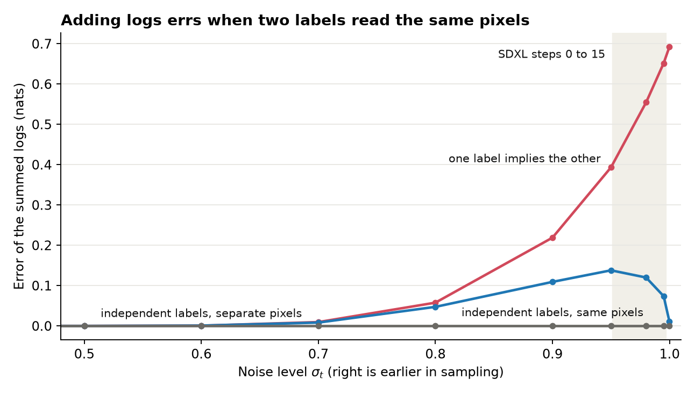

# The score view: what adding checker gradients does to the sampler

This page works out what the sampler does when several checkers' gradients are added to the product of experts. The design in step U3 depends on when that sum means what it says. Every number comes from [the check script](01-reading/tools/check_score_view.py), which runs on CPU with no model and compares each gradient formula with a finite difference. Its output is [the saved numbers](01-reading/tools/score_view_numbers.json).

## Table of contents

- [What the derivation shows](#what-the-derivation-shows)
- [Words this uses](#words-this-uses)
- [The derivation](#the-derivation)
- [Worked example with small numbers](#worked-example-with-small-numbers)
- [What step U3 has to carry](#what-step-u3-has-to-carry)
- [What this page cannot say](#what-this-page-cannot-say)

## What the derivation shows

**Adding two checkers' logs needs their labels to be independent given the noisy picture.** Labels that are independent in the clean data can still fail this, because one noisy picture is compatible with many clean ones.

**Our five properties fail it.** "A is left of B" can only hold when two subjects exist, so one label implies the other. In the worked example the summed gradient is 2.619 where the true gradient is 2.048, which is 27.9% too large.

**Training each checker only on pictures that pass the earlier checkers removes the error.** The chain rule then makes the sum exact with no independence assumption. It also separates the checkers' jobs, which the remove-one-checker experiment needs.

**A shared cap ties the checkers together.** With five equal orthogonal pushes under one cap, removing one raises each remaining push by 11.8%. Giving each checker its own fixed norm removes this.

**Log-probability and log-odds pushes point the same way.** They differ only in length, by a factor of $1-p$. The kept code uses log-odds while the design equation writes $\log C$, and fixing each checker's norm makes the two identical.

## Words this uses

**Checker.** A small trained classifier $C_k$ that reads the noisy latent $x_t$, or something computed from it, and gives the probability that property $k$ holds.

**Label.** The yes-or-no answer $y_k$ for property $k$ on a finished picture.

**Push.** The term subtracted from the noise prediction at one sampling step.

**Log-odds.** $\ell = \log\frac{p}{1-p}$, the raw output of a checker before the sigmoid.

**Nat.** The unit of a natural logarithm. An error of 0.69 nats means a probability is off by a factor of 2.

## The derivation

### Step 1: a noise prediction is a score

For the forward process $x_t = \sqrt{\bar\alpha_t}\,x_0 + \sigma_t\,\epsilon$ with $\sigma_t = \sqrt{1-\bar\alpha_t}$, the noise prediction and the score are the same quantity up to a scale:

$$
\epsilon_t(x_t) = -\sigma_t \nabla_{x_t}\log p_t(x_t)
$$

Subtracting $\sigma_t g$ from the noise prediction therefore adds $g$ to the score. This is what `poe_repair/methods/_classifier_guided.py:228` and `:232` do, with $g$ the checker's gradient and a strength $s$ in front.

### Step 2: the product is a tilt of the unconditional model

Each expert is first guided at scale $w$, $\tilde\epsilon_k = \epsilon_\varnothing + w(\epsilon_k - \epsilon_\varnothing)$, and the product is $\tilde\epsilon_A + \tilde\epsilon_B - \epsilon_\varnothing$ (`poe_repair/_sdxl/metrics.py:12` to `:17`). By Step 1 its score is

$$
\nabla_{x_t}\log\Big[p_{t,\varnothing}(x_t)\,\Big(\frac{p_{t,A}(x_t)}{p_{t,\varnothing}(x_t)}\Big)^{w}\Big(\frac{p_{t,B}(x_t)}{p_{t,\varnothing}(x_t)}\Big)^{w}\Big]
$$

This is a product of noised densities. Noising a product of clean densities gives a different function, because an integral of a product differs from a product of integrals. So the product prediction has no single clean distribution whose noised score it equals.

### Step 3: what a classifier's gradient adds

For a model $q$ and a label $y$, Bayes' rule gives

$$
\nabla_{x_t}\log q_t(x_t\mid y) = \nabla_{x_t}\log q_t(x_t) + \nabla_{x_t}\log q_t(y\mid x_t)
$$

The last term is the gradient of the noisy label probability:

$$
q_t(y\mid x_t) = \int q(y\mid x_0)\,q(x_0\mid x_t)\,dx_0
$$

A checker trained on noised pictures estimates this for **its own training distribution**. The formula is exact only when the model being steered is that same distribution. Our checkers train on labelled renders and steer the product, which by Step 2 is a different object. So the push is a useful tilt with no exactness guarantee. Discriminator Guidance has the same limit in its own setting: its Theorem 2 "does not guarantee that the gain is strictly positive" ([p. 4](https://arxiv.org/pdf/2211.17091#page=4)).

### Step 4: where the gradient points

Writing $\nabla\log q_t(y\mid x_t) = \nabla\log q_t(x_t\mid y) - \nabla\log q_t(x_t)$ and using Tweedie's formula, $\nabla\log q_t(x_t) = (\sqrt{\bar\alpha_t}\,\mathbb{E}[x_0\mid x_t] - x_t)/\sigma_t^2$, on each term cancels $x_t$:

$$
\nabla_{x_t}\log q_t(y\mid x_t) = \frac{\sqrt{\bar\alpha_t}}{\sigma_t^2}\Big(\mathbb{E}[x_0\mid y, x_t] - \mathbb{E}[x_0\mid x_t]\Big)
$$

An ideal checker pushes $x_t$ from the average clean picture this $x_t$ could become toward the average one that has the label. The applied push is $s\,\sigma_t$ times this, so its size scales with $\sqrt{\bar\alpha_t}/\sigma_t$. On SDXL's schedule that ratio is 0.076 at step 0 ($t = 981$) and 0.323 at step 15 ($t = 681$), assuming 50 evenly spaced steps (inferred). An ideal checker's push is therefore small at the first steps, and a large one at step 0 is more likely to come from the network than from the data (inferred).

### Step 5: log-probability against log-odds

With $p = q_t(y{=}1\mid x_t)$ and $\ell$ its log-odds:

$$
\nabla\log p = (1-p)\,\nabla\ell, \qquad \nabla\ell = \frac{\sqrt{\bar\alpha_t}}{\sigma_t^2}\Big(\mathbb{E}[x_0\mid y{=}1, x_t] - \mathbb{E}[x_0\mid y{=}0, x_t]\Big)
$$

The two gradients are parallel. The log-probability form fades as the checker becomes sure, and the log-odds form keeps its length. The kept code uses log-odds on purpose: `2-classifier-guidance/scripts/rung2/discriminator.py:12` records it, and `train_readout_pair.py:91` sums the raw outputs. The design equation's $\log C_k$ and the code are therefore different pushes unless their lengths are fixed (Step 8).

### Step 6: when logs may be added

For two labels, write the joint probability given $x_t$ as the product plus a covariance:

$$
p(y_1, y_2\mid x_t) = p(y_1\mid x_t)\,p(y_2\mid x_t) + \mathrm{Cov}(y_1, y_2\mid x_t)
$$

Taking logs:

$$
\log p(y_1, y_2\mid x_t) = \log p(y_1\mid x_t) + \log p(y_2\mid x_t) + \log\Big(1 + \frac{\mathrm{Cov}(y_1, y_2\mid x_t)}{p(y_1\mid x_t)\,p(y_2\mid x_t)}\Big)
$$

The sum of logs is exact when the covariance given $x_t$ is zero. One sufficient condition is that the two labels read separate coordinates of $x_0$, the prior factorises across those coordinates, and the noise is independent per coordinate. The posterior $q(x_0\mid x_t)$ then factorises, and so do the labels.

Our five checkers read the same pixels, and several of their labels depend on each other (inferred):

| Pair of properties | How they depend |
|---|---|
| Spatial relation and counting | "A left of B" needs two subjects |
| Attribute binding and counting | A colour on a noun needs that noun to be drawn |
| Spatial relation and position | The relation is a function of the two positions |
| Counting and size | Separate blobs and their sizes come from the same map pixels |
| Prompt match and all four others | A picture matching the prompt has the right count, binding and relation |

Latent Classifier Guidance assumes independent conditions and proves the single-condition case ([pp. 3, 4](https://arxiv.org/pdf/2304.12536#page=4)). The kept checker's three outputs (clean pair, first subject present, second subject present) are also nested, because a clean pair implies both subjects are present (inferred).

### Step 7: the chain rule removes the assumption

With no independence assumption:

$$
\log p(y_1,\dots,y_K\mid x_t) = \sum_{k=1}^{K} \log p(y_k\mid y_1,\dots,y_{k-1}, x_t)
$$

So the sum is exact if checker $k$ is trained only on pictures where the earlier labels hold. This also shows what an unconditional checker contains. For "right order" and "two subjects":

$$
\nabla\log p(\text{right order}\mid x_t) = \nabla\log p(\text{right order}\mid \text{two}, x_t) + \nabla\log p(\text{two}\mid x_t)
$$

An unconditional spatial checker's gradient **already includes the counting gradient**. If we remove the counting checker and leave an unconditional spatial checker, counting still receives a push, and the removal test would understate what counting contributes. A spatial checker trained only on two-subject pictures drops that shared part in the worked example (2.048 falls to 1.477).

A weight $\lambda_k \neq 1$ raises a checker to a power, $C_k^{\lambda_k}$, so a weighted sum is a tilt and no longer an exact posterior even with the chain rule.

### Step 8: the cap couples the checkers

The current push is scaled by one factor when its total norm exceeds $c\,\lVert\epsilon\rVert$:

$$
\text{push} = \min\Big(1,\ \frac{c\,\lVert\epsilon\rVert}{\lVert\sum_j \lambda_j\sigma_t g_j\rVert}\Big)\sum_k \lambda_k \sigma_t g_k
$$

Removing checker $j$ shrinks the denominator, so **every remaining checker's push grows**. The removal experiment would then change two things at once. Giving each checker its own length removes the coupling:

$$
\text{push} = \sum_k c_k\,\lVert\epsilon\rVert\,\frac{g_k}{\lVert g_k\rVert}
$$

With $\sum_k c_k \le c$, the triangle inequality keeps the total within the cap for any directions. Normalising also removes the factor $1-p$ from Step 5, so log-probability and log-odds checkers give the same push.

### Step 9: what a checker on attention maps differentiates through

A checker that reads word maps is a composition $C(M(x_t))$, where $M$ is the map computed by the frozen U-Net. Its gradient is

$$
\nabla_{x_t}\log C(M(x_t)) = J_M(x_t)^\top\,\nabla_M\log C(M)
$$

$J_M$ is the Jacobian of the maps with respect to $x_t$. Four things follow.

**The gradient passes through every U-Net layer before the attention layer read.** The existing attention push reads all cross-attention layers at 32 by 32, averaged over heads and layers (`2-classifier-guidance/scripts/rung2/attention_push.py:42` and `:77`), with one U-Net forward and backward pass over a batch of two, one entry per expert, on each pushed step.

**The push can only move $x_t$ in directions that change the maps.** Any direction outside the row space of $J_M$ receives no push.

**The softmax damps saturated positions.** Attention at one position is a softmax over tokens, and renormalising over the word tokens is a softmax over those tokens. Its derivative is $\partial p_i/\partial l_i = p_i(1-p_i)$, which is 0.25 at $p_i = 0.5$ and 0.0475 at $p_i = 0.95$.

**A map that holds no information gives an ideal checker nothing to push.** If $M$ at some step says nothing about $y$, the best checker is a constant and its gradient is zero. A trained network's nonzero gradient there is noise from the network. Detector Guidance's word-map detector falls to mAP@0.5 of 18.0 of 100 at $t = 800$ ([p. 14](https://arxiv.org/pdf/2306.02236#page=14)), and 10 of our 16 pushed steps sit above $t = 800$ (inferred). Reading accuracy per step therefore has to be measured before any push runs.

## Worked example with small numbers

Take four clean "images" on a line, equally likely, with a label for "two subjects" and a label for "right order". Set $\sqrt{\bar\alpha_t} = 0.6$, $\sigma_t = 0.8$, and observe $x_t = 0.5$.

| Clean value $x_0$ | What it stands for | Two subjects | Right order | $p(x_0\mid x_t)$ |
|---:|---|:---:|:---:|---:|
| −3 | fused | no | no | 0.010 |
| −1 | one subject | no | no | 0.234 |
| 1 | two, wrong order | yes | no | 0.596 |
| 3 | two, right order | yes | yes | 0.161 |

**The label probabilities.** $p(\text{two}) = 0.596 + 0.161 = 0.757$ and $p(\text{right}) = 0.161$. Right order implies two, so the joint is also 0.161.

**What the sum of logs gets wrong.** The product of the two is $0.757 \times 0.161 = 0.121$, against a true joint of 0.161. The sum of logs is off by $\log(0.161 / 0.121) = 0.279$ nats.

| Gradient at $x_t = 0.5$ | Value |
|---|---:|
| $\nabla\log p(\text{two})$ | 0.571 |
| $\nabla\log p(\text{right})$, also the true joint | 2.048 |
| Sum of the two logs | 2.619 |
| $\nabla\log p(\text{right}\mid\text{two})$ | 1.477 |
| Chain rule, $0.571 + 1.477$ | 2.048 |

The sum overshoots the true gradient by 27.9%, and the chain rule recovers it exactly.

**The other two label pairs.** Two labels that are independent in the clean data but read the same coordinate ($x_0 > 0$ and $|x_0| > 2$) have a joint of 0.161 against a product of 0.129, an error of 0.220 nats. Two labels on separate coordinates of a 2D grid have a joint and product both equal to 0.259, an error of 0.

**Log-odds.** For "two subjects", $\nabla\log p = 0.571$ and $\nabla\ell = 2.347$. Their ratio is $1 - p = 0.243$.

**The cap.** Take five orthogonal pushes of norm 3 under a limit of $0.4 \times 10 = 4$. Each is applied at 1.789. Remove one, and each of the other four is applied at 2.000, a rise of 11.8%. With each checker fixed at its own limit of 0.8, the applied push stays 0.8 with or without the others. The total is 1.789 if the pushes are orthogonal and at most 4 if they align, so this version spends less of the cap when directions differ.

**Across noise levels.** The picture at the top averages the error over noised versions of the image holding both labels. On SDXL's steps 0 to 15 ($\sigma_t$ from 0.952 to 0.997), the nested labels have an error of about 0.39 to 0.65 nats and the same-coordinate labels about 0.14 to 0.07. At $\sigma_t = 0.6$ and below, both are under 0.001.

## What step U3 has to carry

1. Order the checkers as a chain and train each on pictures that pass the earlier ones, or state plainly that the sum is an uncorrected tilt.
2. Treat prompt match separately, because it overlaps all four other properties.
3. Give each checker its own fixed push length, so removing one leaves the others unchanged.
4. Measure each checker's reading accuracy per step on held-out concepts before running any push.
5. Report the removal test beside the add-one test, because shared gradients can hide a checker's effect in either test alone.

## What this page cannot say

The examples are small discrete distributions with exact posteriors. They show the direction and the form of the error, and they do not measure its size on SDXL. No checker was trained and no sampler was run for this page. The table of dependent properties is reasoning about what the labels mean, and U3's checkers will have their own measured dependence. Whether conditional training raises the rate of clean pairs is untested.
