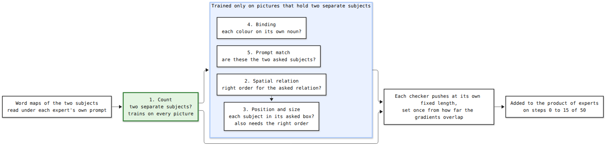
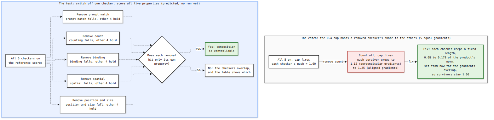
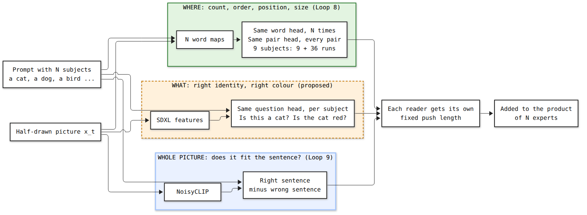

# Design: checkers for properties that hold across concepts (step U3)

Can small checkers that read only where each word landed teach SDXL to draw two separate subjects, on subjects they never trained on? This page says what Session 8 builds and runs to find out, in order, with every bar written before any run. The [reading table](01-reading/reading-table.md) holds the evidence from 25 papers, and the [score view](02-score-view.md) holds the mathematics this design depends on.

## Table of contents

- [The design on one page](#the-design-on-one-page)
- [Words this uses](#words-this-uses)
- [What Session 8 runs, in order](#what-session-8-runs-in-order)
- [What every checker shares](#what-every-checker-shares)
- [Step V2: does a checker learn plurality on unseen digits](#step-v2-does-a-checker-learn-plurality-on-unseen-digits)
- [Step V3: does its gradient compose unseen digits](#step-v3-does-its-gradient-compose-unseen-digits)
- [Step V4: does it work on SDXL's unseen objects](#step-v4-does-it-work-on-sdxls-unseen-objects)
- [Step V5: remove one checker at a time](#step-v5-remove-one-checker-at-a-time)
- [Two extensions with no step yet](#two-extensions-with-no-step-yet)
- [What this design cannot say](#what-this-design-cannot-say)

## The design on one page

Each row is one checker on SDXL. All five read the word maps described under [what every checker shares](#what-every-checker-shares), and all five are tested on the same six object pairs, after training only on animal pairs.

| Property | What it reads beyond the two subject maps | What it trains on | Guard against word leakage | Unseen-concept test | Bar |
|---|---|---|---|---|---|
| **1. Count:** two separate subjects? | nothing | The animal list step M5 passes to D3. Label 1: `positive` and `wrong pair` tiles, which hold two bodies. Label 0: `single` and `hybrid`. `damaged` is left out | No subject word or embedding enters the checker. `wrong pair` counts as 1 here, so the label cannot depend on species | Six object pairs, labelled by the blind count rubric | Balanced accuracy over steps 0 to 15 at least 0.75 and within 0.05 of held-out animal pairs |
| **2. Spatial relation:** right order? | a 4-way code for the asked relation | Pictures with count 1. The relation comes from the two word maps at $t \le 200$ on the finished picture | The same picture appears with its true relation (label 1) and a wrong one (label 0), Learn-to-Steer's fix ([p. 4](https://arxiv.org/pdf/2509.02295#page=4)) | Same six pairs, relation read by eye | Same bar, and at least 0.75 on right against wrong relation |
| **3. Position and size:** each subject in its asked box? | two box masks, 32 by 32 | Pictures with count 1 and the right order. Boxes come from each word's map at $t \le 200$ | The same picture appears with its true boxes (label 1, overlap at least 0.5) and shifted boxes (label 0, overlap at most 0.2) | Same six pairs, boxes checked by eye | Same bar, and at least 0.75 on true against shifted boxes |
| **4. Binding:** each colour on its own noun? | the two colour-word maps | Pictures with count 1, each subject recoloured to a known colour in pixels and re-encoded | The same picture is read under the right colours (label 1) and the colours swapped (label 0) | Same six pairs, recoloured the same way | Same bar, and at least 0.75 on right against swapped colours |
| **5. Prompt match:** are these the two asked subjects? | nothing | Pictures with count 1. Label 1: `positive`. Label 0: `wrong pair`, and the same picture read under another pair's prompts that share no word | The other-pair reading is the guard, the same neither-subject negative D3 uses | Same six pairs, read under their own and under other pairs' prompts | Same bar, and at least 80% of neither-subject readings rejected, D3's rule |

## Words this uses

**Checker.** A small trained classifier whose gradient pushes the sampler.

**Word map.** Where one word's cross-attention lands on the picture at one step.

**Push length.** The size of one checker's push, as a fraction of the size of the product's noise prediction at that step.

**Balanced accuracy.** The mean of the share of label-1 and the share of label-0 examples called correctly, from 0 to 1, where 0.5 is chance.

**Canvas.** A 32 by 64 pixel image of pasted digits from [step V1's environment](04-environment/design.md).

**Seen and unseen.** Seen concepts appear in the checker's training data. Unseen concepts appear in no training example.

## What Session 8 runs, in order

Each step starts only when the one before it passes. A miss stops the chain and goes to the owner through `progress_board.py ask`.

| Step | Question | The one varied axis | Bar | Budget |
|---|---|---|---|---|
| V2 | Does a checker on maps learn plurality on unseen digits? | what the checker reads: maps or the raw noisy canvas | on unseen pairs over steps 0 to 15: balanced accuracy at least 0.75, within 0.05 of seen pairs, and at least 0.75 on `apart` against `wrong` | 1 GPU-hour |
| V3 | Does its gradient compose unseen digits? | the push: none, checker or same-size random | beats the plain product by more than 1.96 standard errors, and the random push does not | 1 GPU-hour |
| V4 | Does it work on SDXL's six unseen object pairs? | the push: none, checker or same-size random | beats plain PoE by at least 3 of 48 faithful pairs and more than 1.96 standard errors | 6 GPU-hours |
| V5 | On digits, does each of three checkers control only its own property? | which checker is removed | [the digit rehearsal's bars](#the-digit-rehearsal) | 2 GPU-hours |

V2 to V5 total about 10 GPU-hours of Loop 8's 30, on top of about 0.2 for V1. V5 runs after V3, and the SDXL version of the removal test is decided once V4 has passed (board question 56). These are budgets, and each smoke run replaces them with measured times.

## What every checker shares

### What it reads on the digit toy

For a noisy canvas $x_t$ and an asked pair $(a, b)$, the frozen canvas model gives $\epsilon_a$, $\epsilon_b$ and $\epsilon_\varnothing$. The two input channels are

$$
m_a = \frac{|\epsilon_a - \epsilon_\varnothing|}{\sum_p |\epsilon_a - \epsilon_\varnothing|_p}, \qquad m_b = \frac{|\epsilon_b - \epsilon_\varnothing|}{\sum_p |\epsilon_b - \epsilon_\varnothing|_p}
$$

The sum runs over pixels, so each map adds to 1. The checker receives these two channels and the timestep, and it receives no digit label.

### What it reads on SDXL

Each subject word's map is read under that expert's own prompt, as `2-classifier-guidance/scripts/rung2/attention_push.py` does. SDXL has 100 maps per word on the 64 by 64 grid and 1,200 on the 32 by 32 grid ([the ladder's counted numbers](../../../../2-classifier-guidance/artifacts/scenes/word-map-checker/numbers/numbers.json)). The input keeps the two grids apart:

1. Average over heads and layers within each grid, which gives one 64 by 64 and one 32 by 32 map per word.
2. Shrink the 64 by 64 map to 32 by 32 with **area pooling**.
3. Divide each map by its own sum.

Learn-to-Steer's released code shrinks with `F.interpolate` and no antialiasing, which on a 64 to 16 resize reads only the middle 4 of every 16 cells ([the code walk](../../../../2-classifier-guidance/artifacts/scenes/word-map-checker/3-code/walk-learn-to-steer.md)). Area pooling reads all of them.

The time input is one learned embedding for each of the 16 pushed steps. Learn-to-Steer's code snaps its time input to 5, 10, 15, 20, 25 or 49, so its steps 0 to 4 all use the row for step 5, and our push runs in exactly that range.

Every run logs the overlap of the two maps' top 10% and each word's peak value at each pushed step. The earlier 0-of-8 attention push recorded its pictures and not whether the maps separated, so it cannot say which of the two failed. It also does not show that attention losses cannot move SDXL: InfSplign's hand-written centroid loss lifts SDXL's VISOR uncond score (percent of images with the correct relation) from 45.10 to 76.91 ([p. 18](https://arxiv.org/pdf/2512.17851#page=18)). The peak matters because Attend-and-Excite raises the weakest word's peak ([p. 4](https://arxiv.org/pdf/2301.13826#page=4)) and our correlation push had no such term.

### The network

The digit checker copies `PixelHead` in `2-classifier-guidance/scripts/mnist/pixel_checker.py`, with its two map channels in place of the one image channel and its pair input removed. It trains with binary cross-entropy on logits, 4,000 updates at batch 256, the file's defaults.

The SDXL checker copies `PairHead` in `2-classifier-guidance/scripts/rung2/train_readout_pair.py`, taking the map channels at 32 by 32 in place of SDXL's features. It trains for 2,000 updates at the batch settings of that file.

### How the push is computed

The gradient of each checker's logit is scaled to a fixed length, and the lengths are added:

$$
\hat\epsilon_t = \epsilon_{\text{product}} - \lVert\epsilon_{\text{product}}\rVert \sum_{k} b\,\frac{\nabla_{x_t}\ell_k}{\lVert\nabla_{x_t}\ell_k\rVert}
$$

$\ell_k$ is checker $k$'s logit and $b$ is the push length. With one checker, $b = 0.4$. The kept recipe uses 0.4 as an upper limit, and here it is the exact length. Fixing each length means removing one checker leaves the others unchanged, and it makes the log-probability and log-odds forms of the push identical (the [score view, Step 8](02-score-view.md#step-8-the-cap-couples-the-checkers)).

**Setting $b$ for several checkers.** A budget of $0.4/5 = 0.08$ per checker can never pass the kept cap, but if the five gradients are perpendicular the total is only 0.179, under half the kept push. So $b$ is calibrated once, before any comparison, on seen pairs only. Measure the mean pairwise cosine $\bar\rho$ of the checkers' gradients over steps 0 to 15, clip it at 0, and set

$$
b = \frac{0.4}{\sqrt{K\,\big(1 + (K-1)\,\bar\rho\big)}}
$$

| Mean cosine $\bar\rho$ | $b$ for 5 checkers | Total length with all five on average |
|---:|---:|---:|
| 0 (perpendicular) | 0.179 | 0.4 |
| 0.25 | 0.126 | 0.4 |
| 0.5 | 0.103 | 0.4 |
| 1 (aligned) | 0.080 | 0.4 |

No shared cap runs. Each row logs its total length per step, and a row is void if the total passes 0.6 of the product's norm on more than 5% of pushed steps, because that row has left the range the kept recipe tested.

## Step V2: does a checker learn plurality on unseen digits

**Group.** Runs that try a new idea (group 2).

**Varied axis.** What the checker reads: the two maps, or the raw noisy canvas with the asked pair (`PixelHead` with `pair_aware`). Data, labels, loss, updates and noise levels are the same.

**Cost.** Two trainings of 4,000 updates, with three model calls per training example for the map reader, budgeted at 1 GPU-hour in total including the variations below. **Buys.** Step V2, and whether reading maps is what makes the checker transfer.

**Data.** `train`, `seen_test` and `unseen_test` from step V1. Each training example draws a canvas and one of the 16 timesteps `ddim_timesteps(50)[:16]`, which run from 999 to 693, and noises the canvas to it.

**Ladder.** Smoke test, overfit 16 canvases to at least 15 right, 1% of the data, then the controls and the comparison.

**Control.** The layout-only rule in `blind_reader.py` scores 0.5 on `apart` against `wrong`, so a checker above 0.75 there is using more than layout.

**Results, at the 16 steps with 4 noise draws per canvas.**

| Result | What it takes |
|---|---|
| Support | Map reader on `unseen_test`: balanced accuracy over steps 0 to 15 at least 0.75 and within 0.05 of `seen_test`, and at least 0.75 on `apart` against `wrong` |
| Null | The overfit rung passes and the frozen configuration misses any of those three |
| Inconclusive | The overfit rung fails, or the map reader scores below 0.55 on `seen_test` at every step, because then it has not learned the task at all |

**What would surprise.** The raw-canvas reader matching the map reader on `unseen_test`. That would mean the maps are not what makes the checker transfer.

**Named variations, tried only if the first configuration misses on the inner test.** Before opening `unseen_test`, train on the pairs among digits 0 to 3 and test on the pairs holding digit 4. That inner test picks among the base input and these three:

1. Add each map's log total as two extra numbers, because normalising removes how strongly the model responded to the asked digit.
2. Use the signed differences $\epsilon_a - \epsilon_\varnothing$ and $\epsilon_b - \epsilon_\varnothing$ in place of their absolute values.
3. Train for 12,000 updates.

The chosen configuration retrains on digits 0 to 4 and reads `unseen_test` **once**.

## Step V3: does its gradient compose unseen digits

**Group.** Runs that try a new idea (group 2).

**Varied axis.** The push: none, the checker's, or a random one of the same length.

**Cost.** Four rows of 320 canvases on the tuning and test sets, budgeted at 1 GPU-hour. **Buys.** Step V3.

**Pairs and seeds.** The push length and step window are checked on the 10 seen pairs at seeds 0 to 31, among $b$ of 0.1, 0.2 and 0.4. The frozen choice runs once on the 10 unseen pairs at seeds 1000 to 1031, 320 canvases per row.

**Rows.**

| Row | What it controls for |
|---|---|
| Plain product | the baseline, the same sampler with no push |
| Checker push, steps 0 to 15 | the method |
| Random push of the same length, per sample and step | a push that fails while the checker's works cannot have failed for being too small |
| Best of 4 starting seeds, picked by the checker's score on the finished canvas | selection with no gradient. Correcting Diffusion's best of 15 with no resampling reached 0.744 object occurrence, read from its Figure 4 ([p. 6](https://arxiv.org/pdf/2312.06038#page=6)), so the push must be read beside it |

**Sampler call.** Use `canvas_unet.sample` with a `push_fn` returning the fixed-length push, and `cap=1.0` so its own per-sample cap cannot fire.

**Score.** `2-classifier-guidance/scripts/mnist/judge.py`'s top rung, two clear, right digits. The judge never trains on canvases and never pushes. Standard errors come from 10,000 bootstrap resamples of the 10 pairs.

| Result | What it takes |
|---|---|
| Support | The checker's push beats the plain product by more than 1.96 standard errors, and the random push does not |
| Null | The checker's push does not beat the plain product by that margin |
| Inconclusive | The zero push differs from plain by 1e-5 or more, or the random push also beats plain by that margin |

**Named variation, tried on seen pairs only if V3 misses there.** Push only on the steps where the checker's balanced accuracy on `seen_test` is at least 0.6. A checker reading at chance has a gradient made of noise, and scaling it to a fixed length enlarges that noise (the [score view, Step 9](02-score-view.md#step-9-what-a-checker-on-attention-maps-differentiates-through)).

## Step V4: does it work on SDXL's unseen objects

**Group.** Generalization (group 9): animals to objects, chosen before any run.

**Varied axis.** The push: none, the count checker's, or a random one of the same length.

**Cost.** One training at a budgeted 2.5 GPU-hours, and three new rows of 48 pictures plus 192 plain draws for best of 4, about 3.5 GPU-hours. **Buys.** Step V4, and the first SDXL evidence on whether a word-map checker transfers.

**Checker.** The count checker from the table above, trained on the animal list step M5 passes to D3, with every picture naming an object removed. The `(stature rule)` kinds count as their base kind, and `rung 2 negative`, `pair-prompt failure` and `damaged` tiles are left out. Label 1 assumes `wrong pair` tiles hold two bodies, so check 32 of them by eye at full size before training. Candidate C in [the D3 comparison](../reproductions/checker/design.md#the-three-candidates) reads the same maps with the three old outputs. When D3 has landed, report C's count beside this one. No result from it changes this bar.

**First check, before any render.** Balanced accuracy per step on held-out animal pairs. If the mean over steps 0 to 15 is below 0.75, stop and report it. Detector Guidance's word-map detector falls to mAP@0.5 of 18.0 of 100 at $t = 800$ ([p. 14](https://arxiv.org/pdf/2306.02236#page=14)), and 10 of our 16 pushed steps sit above $t = 800$.

**Test.** The six object pairs at seeds 6001 to 6008, 48 pictures per row: plain PoE, the checker's push, a same-length random push, and the best of 4 plain draws by the checker's score. The zero push must reproduce plain PoE to under 1e-5, and the checker must reject at least 80% of 200 neither-subject pictures, D3's rule.

**A leak to report around.** Lighthouse × sailboat is one of the six test pairs and also one of D3's 12 tuning pairs at the same seeds, so an architecture chosen by D3 was selected partly on it. V4 reports its counts **on all six pairs and on the five without it**, and the bar is judged on all six as the brief states.

**Score.** The [blind count rubric](../method-search/01-beat-the-baseline/blind-count-rubric.md) at full size, with the method names hidden. No detector or CLIP model scores these pictures, because GLIDE's CLIP guidance raised a score from a second CLIP network while people rated the pictures lower ([pp. 8, 9](https://arxiv.org/pdf/2112.10741#page=8)).

| Result | What it takes |
|---|---|
| Support | The push leads plain PoE by at least 3 of 48 faithful pairs and by more than 1.96 standard errors over 10,000 bootstrap resamples of the six pairs |
| Null | It has no such lead |
| Inconclusive | The zero-push check fails, or the random push leads plain PoE by the same margin |

**What would surprise.** A push that separates the two maps at every step and still draws no more faithful pairs. That would mean separated maps do not cause two subjects on SDXL.

## Step V5: remove one checker at a time

This is the owner's main experiment. The question is whether composition is controllable: does removing one checker damage only its own property? The digit rehearsal below is step V5 on the board, and the five-checker SDXL version after it is decided once V4 has passed.

**Group.** Ablation (group 7), one component per row with everything else held.

**Varied axis.** Which checker is off.

### The digit rehearsal

**What the canvas can express.** Three of the five properties exist on a 32 by 64 digit canvas. Every digit is 28 pixels, so two separate digits leave 8 pixels of free width and 4 of height, and position and size have no room to vary. The digits are grey and carry no attribute, so binding does not exist here.

| Property | Checker's training label | How a finished canvas is scored by `judge.py` |
|---|---|---|
| Count | all canvases: `apart` and `wrong` are 1, and `single`, `overlaid` and `same_half` are 0 | share of canvases with two separate digits, neither fused |
| Right digits | canvases with two separate digits: `apart` is 1 and `wrong` is 0 | of the canvases that pass count, the share holding both asked digits |
| Order | `apart` canvases, each read with its true order (1) and the flipped order (0), through a 2-way order input | of the canvases holding both asked digits, the share in the asked order |

The three scores multiply to the share of canvases that are fully right, the same chain the checkers train on. Each column is scored only on canvases that passed the column before it, because an unconditional order score would fall whenever count fell.

**Model.** The model V3 passed on: `share-0.0` if Test 1 passed, and `share-0.01` if only Test 2 did. If V3 passed on neither, V5 does not run.

**Push.** The three checkers' lengths come from the calibration under [how the push is computed](#how-the-push-is-computed), with $K = 3$, on the 10 seen pairs at seeds 0 to 31. Each canvas asks for one order, with the lower digit on the left for even seeds and on the right for odd seeds.

**Rows.** Eleven rows on the 10 unseen pairs at seeds 1000 to 1031, 320 canvases per row: the plain product, all three checkers, each checker removed (3), each removed with a same-length random push in its place (3), and each checker alone (3).

**Cost:** three small trainings and 3,520 canvases, about 2 GPU-hours. **Buys:** step V5, the first measured answer to whether one checker controls one property.

| Result | What it takes |
|---|---|
| Support | All three checkers together beat the plain product on the full chain by more than 1.96 standard errors. Each removal lowers its own column by at least 6.25 percentage points and more than 1.96 standard errors, its random-push row falls by the same rule, and no other column moves by both more than 4.2 points and more than 1.96 standard errors |
| Partial | At least one property meets that rule and at least one does not |
| Null | No removal lowers its own column by that margin |
| Inconclusive | Any zero-push check fails, a row is void by the 0.6 total-length rule, or a cell the verdict needs holds fewer than 40 canvases |

The margins of 6.25 and 4.2 points are the SDXL table's 3 and 2 of 48. Standard errors come from 10,000 bootstrap resamples of the 10 pairs.

**What this rehearsal cannot show.** It says nothing about binding, position or size. Its order property is left or right only, because a 32-pixel canvas has no room for one 28-pixel digit above another.

### The rows on SDXL

| Rows | Count | What it answers |
|---|---:|---|
| Plain product | 1 | the floor |
| All five checkers | 1 | the reference every removal is read against |
| All five minus one | 5 | does each removal lower its own property? |
| All five minus one, with a random push of the same length in its place | 5 | is the fall caused by that checker's direction, or by there being less total push? |
| Each checker alone on the plain product | 5 | does a property need a second checker, and does adding checkers help at all? Dynamic CFG's one summed-gradient test scored below one evaluator alone, Gecko alignment 45.3 against 46.1, higher is better ([p. 8](https://arxiv.org/pdf/2509.16131#page=8)) |

**Strength dial, after the table.** For each checker that passes, set its length to half and double while the others stay fixed, and read whether its property rises with the dial.

### The SDXL table to fill

Each cell is the count of pictures out of 48 with that property correct, scored blind by eye, and no checker's output is used to score.

| Row | Count | Spatial | Position and size | Binding | Prompt match |
|---|---:|---:|---:|---:|---:|
| Plain product | XX | XX | XX | XX | XX |
| All five | XX | XX | XX | XX | XX |
| Minus count | **XX** | XX | XX | XX | XX |
| Minus spatial | XX | **XX** | XX | XX | XX |
| Minus position and size | XX | XX | **XX** | XX | XX |
| Minus binding | XX | XX | XX | **XX** | XX |
| Minus prompt match | XX | XX | XX | XX | **XX** |

### The bars for the removal test

| Result | What it takes |
|---|---|
| Support: composition is controllable | All five checkers beat the plain product on their own property. Each removal then lowers its own column by at least 3 of 48 and more than 1.96 standard errors, leaves the other four within 2 of 48, and its random-push row also falls by at least 3 of 48, which shows the fall came from losing that checker's direction and not from less total push |
| Partial | At least one property meets that rule and at least one does not. The table names which |
| Null | No removal lowers its own column by that margin |
| Inconclusive | Any zero-push check fails, or a row is void by the 0.6 total-length rule |

The margin of 3 of 48 is the tie rule Session 8's brief already uses, because a pushed SDXL render is not bit-reproducible.

**What would surprise, and what it would mean.** Spatial relation and position may fall together even with chained training, because a relation is a function of two positions. That would be a measured overlap, reported as the table shows it. The chain makes the test fair: an unconditional spatial checker carries the counting gradient inside it, so removing count would look harmless ([the score view, Step 7](02-score-view.md#step-7-the-chain-rule-removes-the-assumption)).

### Labels for the four new checkers

No new diffusion model is trained, no API tokens are spent, and no benchmark prompt set is touched.

**Relation and boxes.** Taken from the word maps of the finished picture at $t \le 200$, where Detector Guidance's detector reads best (mAP@0.5 of 58.4 of 100 at $t = 200$, [p. 14](https://arxiv.org/pdf/2306.02236#page=14)). Before training, check 64 labels by eye at full size. If fewer than 90% are right, stop and report it.

**Colours.** Recolour each subject's region to one of 8 colours in pixel space, then re-encode with SDXL's VAE. Look at 32 recoloured pictures at full size before training, because a recolouring artefact would be something a checker could learn.

## Two extensions with no step yet

Neither extension runs until the owner approves a board step. Both wait for the results of V3 and of Loop 9's reading test (W2), because those results decide which properties still need them.

### The question head: binding and the right identity

**Why it exists.** CO3 already draws two bodies in all 96 tuning pictures, and its failures are borrowed parts, wrong species and extra subjects. Those failures are about what each subject is, and word maps mostly hold where it is. This head is a second route to binding and prompt match, compared with the word-map versions in the table at the top.

**What it reads.** SDXL's frozen middle and first two up-block features at 32 by 32, read under the empty prompt as Readout Guidance does ([p. 4](https://arxiv.org/pdf/2312.02150#page=4)), plus the timestep. A question such as "Does the cat have any features of a dog?" enters through SDXL's frozen CLIP-L text encoder. Two cross-attention layers let the question's tokens read the feature grid, and one linear layer gives a yes-or-no logit.

**What it trains on.** The finished pictures in the animal list step M5 passes to D3. A local vision-language model labels them with four question templates: "Is there a {A}?", "Is there a {B}?", "Does the {A} have any features of a {B}?" and "Is the {A} {colour}?". The teacher reads clean pictures only and no gradient passes through it. It may not be BLIP, BLIP-VQA, ImageReward, CLIP or GenEval's detector, because those grade the benchmarks. Check 64 of its labels by eye at full size, and stop if fewer than 90% are right.

**Guard against word leakage.** Each picture is also asked about a noun from another pair that shares no word with it, so the answer has to come from the picture. Yes and no are balanced within each pair. Neither-subject pictures are in the negatives, because a guiding classifier trained without them called a fridge a cat.

**Unseen-concept test.** Train on animals and test on the six object pairs, labelled by the blind count rubric.

**When it pushes.** Only on steps where its balanced accuracy on held-out animal pairs is at least 0.6. Identity may become readable later than layout (inferred), so this window may start after step 0 and run past step 15.

| Result | What it takes |
|---|---|
| Reads | On the object pairs, balanced accuracy over its readable steps is at least 0.75 and within 0.05 of held-out animal pairs, at least 0.75 on right against wrong nouns, and at least 80% of neither-subject pictures are rejected |
| Steers | CO3 with the head leads CO3 alone by at least 5 of 96 faithful pairs and more than 1.96 standard errors on the 12 tuning pairs, the random push does not, and damaged pictures rise by at most 5 of 96 |
| Null | It misses either row |

The damage limit exists because training presence labels on every pair cut faithful cat and dog pairs from 35 to 24 of 128 and raised damaged pictures from 11 to 20.

**Cost:** about 8.5 GPU-hours as budgeted: 1.5 for the teacher's labels, 2.5 for one training and 4.5 for three rows of 96 pictures. **Buys:** whether a trained head can fix the failures CO3 still makes.

### Scaling from two objects to nine

**The problem.** The checkers above take exactly two subject maps, so they cannot read a prompt with more subjects.

**The fix.** Two small heads are trained only on two-subject pictures and reused for every word and every pair of words:

$$
\log C_{\text{layout}} = \frac{1}{N}\sum_{i=1}^{N} \log C_{\text{word}}(m_i) + \frac{2}{N(N-1)}\sum_{i<j} \log C_{\text{pair}}(m_i, m_j)
$$

$m_i$ is subject $i$'s word map and $N$ is the number of subjects. The word head asks whether this word landed on exactly one blob. The pair head asks whether these two words landed on separate blobs in the asked order. Each sum is averaged and given its own fixed push length, so the push does not grow with $N$.

| Subjects $N$ | Word-head runs | Pair-head runs |
|---:|---:|---:|
| 2 | 2 | 1 |
| 4 | 4 | 6 |
| 6 | 6 | 15 |
| 9 | 9 | 36 |

**Why it might carry over.** On location-conditioned CLEVR, models trained on 1 to 3 objects reached between 2 and 7 objects, and 9 once their scores were forced to be local ([Local Mechanisms, p. 3](https://arxiv.org/pdf/2509.16447#page=3)). The same paper finds conditional locality mostly absent in SDXL's pixels and present in its features ([p. 1](https://arxiv.org/pdf/2509.16447#page=1)), so this transfer to SDXL is untested.

**Test.** Train on two-subject pictures only. Then run CO3 alone and CO3 with the heads at $N$ of 3, 4, 6, 8 and 9, on subject words outside the training list, at 48 pictures per cell, and count blind at full size how many named subjects are present as separate bodies.

| Result | What it takes |
|---|---|
| Scales to $N$ | At that $N$, pictures with every named subject present lead CO3 alone by at least 3 of 48 and more than 1.96 standard errors |
| Largest $N$ | The largest $N$ for which that holds at $N$ and at every smaller tested value |
| Null | It fails at $N = 3$ |

**Limits to expect.** A 32 by 32 map gives nine subjects about 114 cells each, and one SDXL pass with gradients on nine prompts may not fit in memory, so the smoke rung measures both. The CLEVR benchmark's prompts stay out of this test.

**Cost:** about 10 GPU-hours as budgeted, for 480 pictures with more expert passes per step. **Buys:** a measured answer to how far the checkers scale past two subjects.

## What this design cannot say

**No checker exists yet.** Every statement about what these checkers will do is a prediction, and no part of this design has run.

**The chain is partly an approximation.** Spatial relation, binding and prompt match each condition on count only, so the design assumes they are independent of each other given two subjects. V5's table measures how far that holds.

**Word maps may be unreadable this early.** If so, V2 or V4's first check stops the chain, and that is the answer to this idea on the early steps.

**Maps carry little appearance.** A checker on maps alone may separate two blobs and still be unable to say they are the right two subjects. The `apart` against `wrong` bar and prompt match test exactly this.

**The SDXL removal test is not approved yet.** It needs about 40 GPU-hours as budgeted: five trainings at 2.5 hours (12.5) and 816 pictures at an assumed 2 minutes each with up to five gradients per step (27.2). The strength dial adds up to 16 more. That exceeds Loop 8's limit of 30, so the owner decides it once V4 has passed.
