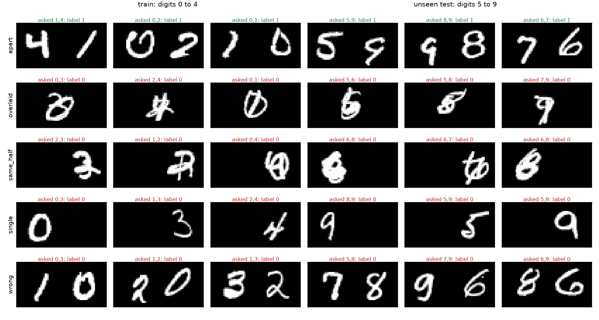
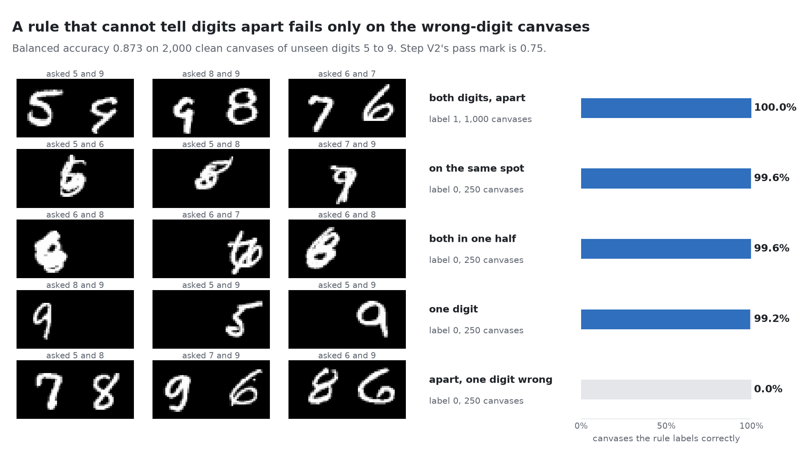

# Is the small digit environment repeatable, and can its labels be trusted?

Later steps test whether a checker can learn plurality: are the two asked digits both on the canvas, apart? Those tests need labels that are exact, data anyone can rebuild byte for byte, and a sampler where a zero push changes nothing. All three hold: two rebuilds give the same data hash on the laptop and on the cluster, and a zero push leaves every pixel unchanged on all 20 digit pairs at 8 seeds (W&B run `xv6mbklb`).

## What is in here

Two figures: one sheet of example canvases and one figure scoring a rule that cannot tell digits apart. One JSON file, `digit-blind-reader.json`, holds that rule's numbers. `design.md` and `review.md` hold the stage's design and its verdict.

## The figures

### canvas-kinds

**What it shows**

A sheet of 30 canvases in 5 rows and 6 columns. Each tile is one canvas, a 32 by 64 pixel greyscale image holding pasted 28 by 28 MNIST digits. Each row is one kind of canvas, top to bottom: `apart` (both asked digits, one per half), `overlaid` (both on the same spot), `same_half` (both in one half), `single` (one asked digit) and `wrong` (one asked digit and a different digit, one per half). The left three columns come from the training split, digits 0 to 4, and the right three from the unseen test split, digits 5 to 9. Each tile's title gives its asked pair and its label, green for label 1 and red for label 0. Only the top row is green. Compare the top and bottom rows: both hold two digits apart, and only the asked pair in the title makes the bottom row label 0.

**How we got this image**

`2-classifier-guidance/scripts/abstract_checkers/build_env.py` draws it with its `--sheet` option while it builds the data. The full stage of `v1.sbatch` (job 93686 on `mscluster79`, from the code snapshot of commit `6dc426a2`) writes it to `/datasets/mmolefe/poe_repair_min/loop-8/v1/canvas-kinds.png`, and the laptop build in the review writes the same sheet. Which of the two copies this file is, and how the example canvases were picked, is not recorded.

**What it lets you say**

Every asked pair gets five kinds of canvas and only `apart` is label 1. A `wrong` canvas looks like an `apart` canvas, so only the asked pair decides its label, and a checker that ignores the asked pair cannot score above chance on it.

**What it cannot say**

It shows 30 of 24,000 canvases; the counts per split and kind are in [the V1 review](review.md) (20,000 training, 2,000 seen test and 2,000 unseen test, with 4 of every 8 canvases `apart`). Pasted canvases differ from what a sampler draws, so a checker that reads them well may still read sampled canvases badly. A sound environment says nothing about whether any checker can learn plurality.

**Where it came from and what judged it**

The data is at `/datasets/mmolefe/poe_repair_min/loop-8/v1/data/`, data hash `f70b0fb362e13e255ad332ba14ca93dfb5cf051a5dfd3c86eb30482931d5a5f3`, identical on two rebuilds and to the laptop. [The V1 review](review.md) judges the step as passed. It is embedded in [the finding on whether the small environment is repeatable](../../../../../2-classifier-guidance/report/abstract-checkers-on-digits/is-the-small-environment-repeatable.md).

### digit-blind-reader

**What it shows**

Left, 15 canvases of digits 5 to 9, three per kind, each titled with its asked pair. Right, one horizontal bar per kind giving the share of that kind's canvases a layout-only rule labels correctly, on an axis from 0% to 100%. Both digits apart, label 1, 1,000 canvases: 100.0%. On the same spot, label 0, 250 canvases: 99.6%. Both in one half, 250 canvases: 99.6%. One digit, 250 canvases: 99.2%. Apart with one digit wrong, 250 canvases: 0.0%, drawn as an empty grey bar. The subtitle gives balanced accuracy 0.873 on 2,000 clean canvases of unseen digits and step V2's pass mark of 0.75. The eye should land on the empty bottom bar.

**How we got this image**

`2-classifier-guidance/scripts/abstract_checkers/blind_reader.py` computes the numbers from the V1 build and draws the figure. The rule predicts label 1 when two groups of inked columns have an empty column between them, and never looks at the asked pair or at which digits are present. Its example canvases are the first three of each kind in the build's fixed shuffle. Which copy of the build it read is not recorded.

**What it lets you say**

A rule blind to digit identity reaches balanced accuracy 0.873 on clean unseen canvases and 0.871 on the seen test split, a gap of 0.002, so it would clear V2's overall test of at least 0.75 and within 0.05 of the seen pairs. It scores 0.5 on `apart` against `wrong`, which is why V2 also needs at least 0.75 on that comparison (board question 55).

**What it cannot say**

The rule is measured on clean canvases only. V2 reads noisy canvases at sampler steps 0 to 15, where this rule has not been measured. It is a fixed rule with no training, so it says nothing about what a trained checker learns.

**Where it came from and what judged it**

The numbers are in `digit-blind-reader.json` beside it, keys `unseen_test.balanced_accuracy` and `seen_test.balanced_accuracy`, with per-kind counts and shares for all three splits. [The V1 review](review.md) reads it. It is embedded in [the finding on whether the small environment is repeatable](../../../../../2-classifier-guidance/report/abstract-checkers-on-digits/is-the-small-environment-repeatable.md).
