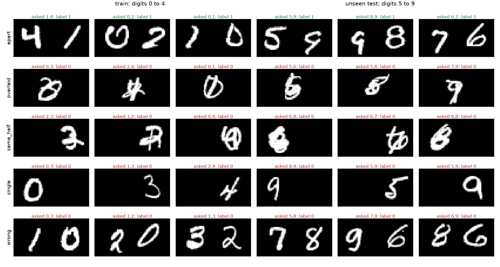
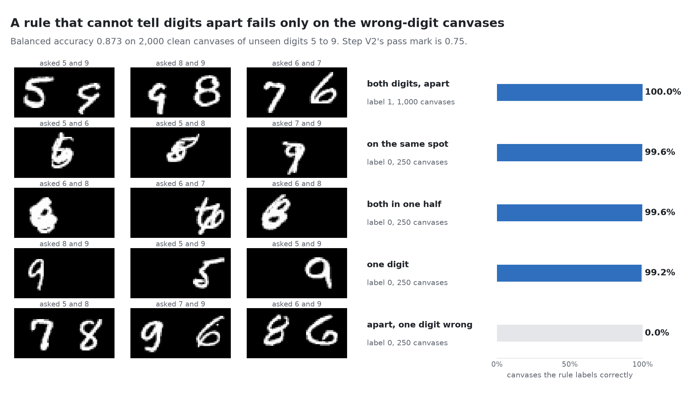

# Review: the small repeatable environment (step V1)

**Status: passed.** Two rebuilds give the same data hash on the laptop and on the cluster, and a zero push leaves every pixel unchanged
on all 20 digit pairs at 8 seeds. W&B run `xv6mbklb`.

| Check | Bar | Result | Where it ran |
|---|---|---|---|
| Two rebuilds give the same data hash | identical | **identical**, `f70b0fb362e13e255ad332ba14ca93dfb5cf051a5dfd3c86eb30482931d5a5f3` | laptop, NumPy 2.5.5 |
| The same hash on the cluster, built twice | identical | **identical**, the same hash | job 93686, `mscluster79` |
| Plain sampler against zero push, largest absolute pixel difference | under 1e-5 | **0.0** | job 93686, RTX 3090, float32 |
| Plain sampler against itself, largest absolute pixel difference | under 1e-5 | **0.0** | job 93686, RTX 3090, float32 |

## The data

<a href="canvas-kinds.png"></a>

Each row is one kind of canvas. The left three columns come from the training split and the right three from the unseen test split.
Green titles are label 1 and red titles are label 0.

| Split | Canvases | Pairs | `apart` | `overlaid` | `same_half` | `single` | `wrong` |
|---|---|---|---|---|---|---|---|
| `train`, digits 0 to 4 | 20,000 | 10 | 10,000 | 2,500 | 2,500 | 2,500 | 2,500 |
| `seen_test`, digits 0 to 4 | 2,000 | 10 | 1,000 | 250 | 250 | 250 | 250 |
| `unseen_test`, digits 5 to 9 | 2,000 | 10 | 1,000 | 250 | 250 | 250 | 250 |

The build's audit passed on all three splits. Every asked pair is positive on exactly half its canvases, every pasted image's MNIST
label matches its stored digit, and no split holds a digit outside its range.

The 1% build, 160 training canvases and 80 in each test split, also gave identical hashes on two rebuilds:
`9b70760ad5bed2f8d1b9a0dc6714bbf37f256a9d3486f498b4e4b601278b1b0b`.

The command, run from the repository root on the laptop:

```bash
~/.claude/venvs/figures/bin/python 2-classifier-guidance/scripts/abstract_checkers/build_env.py \
  --mnist /home/molef/PhD/replications/original-superdiff/data/MNIST/raw --out <output folder> --twice --sheet <png>
```

## What a reader that cannot tell digits apart scores

<a href="digit-blind-reader.png"></a>

The rule predicts label 1 when two groups of inked columns have an empty column between them. It never looks at the asked pair or
at which digits are present. On the 2,000 clean unseen canvases its balanced accuracy, the mean of the share of label-1 canvases
and the share of label-0 canvases it gets right, is 0.873 on a 0-to-1 scale. It scores 0.871 on the seen test split, so its gap
between seen and unseen digits is 0.002.

Step V2's overall test, at least 0.75 and within 0.05 of the seen pairs, is one this layout rule would clear on clean canvases. V2
measures noisy canvases at sampler steps 0 to 15, where this rule has not been measured. V2 therefore also has to reach balanced
accuracy of at least 0.75 on `apart` against `wrong` canvases of unseen pairs over the same steps (board question 55). Layout gives
no help on that comparison, and this rule scores 0.5 on it.

The numbers are in `digit-blind-reader.json`, and `2-classifier-guidance/scripts/abstract_checkers/blind_reader.py` computes them
and draws the figure. Its example canvases are the first three of each kind in the build's fixed shuffle.

## The runs

Both jobs ran from the code snapshot of commit `6dc426a2`, at `/datasets/mmolefe/poe_repair_min/loop-8/code/6dc426a2/`, on `mscluster79`
with an RTX 3090.

| Job | Stage | What it covered | Data hash | Largest pixel difference, zero push | Time |
|---|---|---|---|---|---|
| 93685 | `ladder` | 1% of the data, digits 5 and 6 at 2 seeds | `9b70760a...`, identical on two rebuilds and to the laptop | 0.0 | 3 min 23 s |
| 93686 | `full` | all the data, 20 pairs at 8 seeds | `f70b0fb3...`, identical on two rebuilds and to the laptop | 0.0 | 5 min 1 s |

The data is at `/datasets/mmolefe/poe_repair_min/loop-8/v1/data/`, and the zero-push numbers per pair are in `v1/zero-push.json` beside it.

```bash
sbatch --export=ALL,SNAP=/datasets/mmolefe/poe_repair_min/loop-8/code/6dc426a2 v1.sbatch ladder
sbatch --export=ALL,SNAP=/datasets/mmolefe/poe_repair_min/loop-8/code/6dc426a2 v1.sbatch full
```

GPU-hours spent so far: 0.14 of 30.
