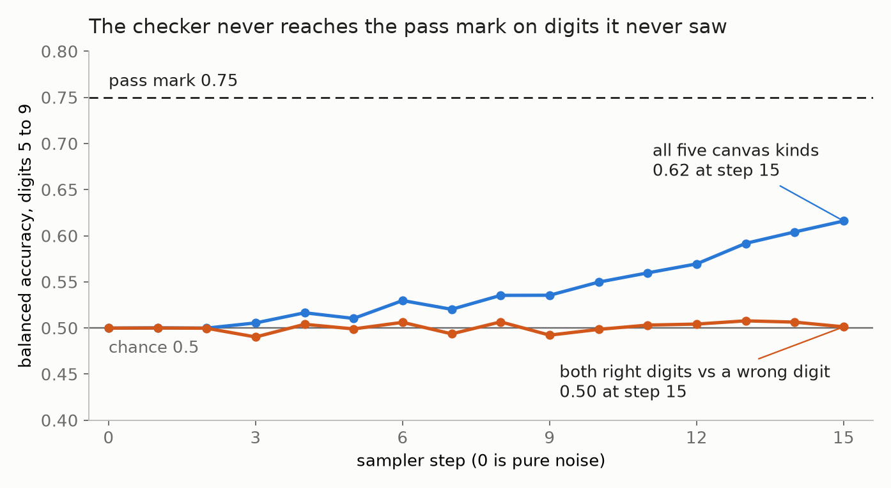
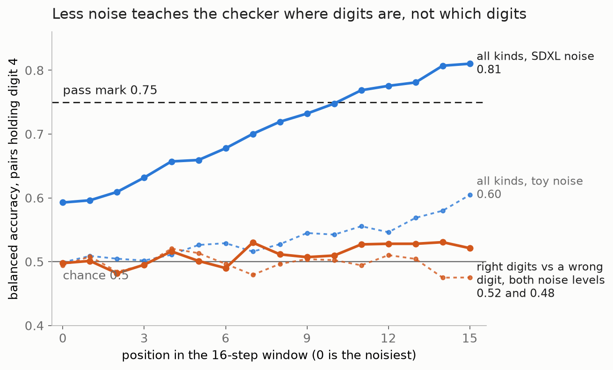

# Does a checker learn plurality on digits it never trained on?

Step V2 asks whether a small checker that reads only where each asked digit acts on a noisy canvas can tell whether both asked digits sit apart, training on digits 0 to 4 and testing on digits 5 to 9. The step is done by the count checker, which scores balanced accuracy 0.791 on digits 5 to 9 against 0.782 on digits 0 to 4 (W&B run `tyhrpyov`); that read has no picture in this folder. No checker here tells which digits are present: the identity checker reads 0.555 on the pairs holding digit 4, against a pass mark of 0.75.

## What is in here

Two line plots of balanced accuracy against noise level. One shows the single checker that had to read both layout and digit identity, at the toy's own early sampler steps. The other shows the rehearsal at noise levels matched to SDXL's. `design.md` and `review.md` hold the stage's design and its verdicts.

## The figures

### balanced-accuracy-by-step

**What it shows**

Y is balanced accuracy on digits 5 to 9, the mean of the share of label-1 canvases and the share of label-0 canvases called correctly, where 0.5 is chance. X is the sampler step from 0 (pure noise) to 15. One point is the frozen map reader's balanced accuracy at one sampler step, over 2,000 canvases of digits 5 to 9 with 4 noise draws each. The blue line pools all five canvas kinds and rises from 0.50 to 0.62 at step 15. The orange line is `apart` against `wrong` (both right digits against a wrong digit) and stays flat near 0.50, ending at 0.50. A dashed line marks the pass mark at 0.75 and a grey line marks chance at 0.5. Neither line reaches the pass mark.

**How we got this image**

It is plotted from `/datasets/mmolefe/poe_repair_min/loop-8/v2/full/final.json`, written by job 93905 on `mscluster63` in 39 minutes 50 seconds. The reader is the configuration the inner test's rule froze, **log totals added**, retrained on digits 0 to 4 and read once on digits 5 to 9. The script that drew the plot is not recorded; `v2_learn.py` writes no file of this name.

**What it lets you say**

The single map reader, read at the toy's sampler steps 0 to 15, misses the bars on digits 5 to 9: balanced accuracy 0.540 against a bar of 0.75, and 0.501 on `apart` against `wrong`. The verdict is null by the written rule (W&B run `a562r799`).

**What it cannot say**

The gap of 0.0002 between seen and unseen digits does not show transfer, because the reader is at chance on `apart` against `wrong` for both. The raw reader, the comparison that reads the noisy canvas itself, did not train: its final loss is 0.6931 and it answers label 0 on every read, so the map-against-raw comparison has no result, and the `raw_matches_map_on_unseen: true` flag in `final.json` does not show the surprise the design describes. The toy's steps 0 to 15 are timesteps 999 to 693 and are much noisier than SDXL's steps 0 to 15: the signal-to-noise ratio is 144 times higher for SDXL at step 0 and 13.7 times higher at step 15. Only toy steps 14 and 15 overlap SDXL's window, so this null says nothing direct about SDXL's early steps. Equal signal share in pixels and in SDXL's latents is also not equal difficulty (inferred). The step's pass comes from the count checker at other noise levels, and this plot does not show that read.

**Where it came from and what judged it**

Job 93905, `final.json` above. [The V2 review](review.md), section "The result", judges it. It is embedded in [the finding on whether a checker learns plurality on unseen digits](../../../../../2-classifier-guidance/report/abstract-checkers-on-digits/does-a-checker-learn-plurality-on-unseen-digits.md).

### two-noise-levels

**What it shows**

Y is balanced accuracy on the pairs holding digit 4, which the reader never trained on, where 0.5 is chance. X is the position in a 16-step noise window, 0 the noisiest. One point is the map reader's balanced accuracy at one position in the window. Solid lines are the rehearsal at the 16 toy timesteps whose signal share matches SDXL's first 16 steps, 712 down to 480. Dashed lines are the base map reader at the toy's own early noise, timesteps 999 down to 693. Blue pools all canvas kinds: solid rises from 0.59 to 0.81 and crosses the 0.75 pass mark near position 10, dashed ends at 0.60. Orange is right digits against a wrong digit: it ends at 0.52 solid and 0.48 dashed, near chance at both noise levels. The eye should land on the gap between the two blue lines and the flat orange pair below them.

**How we got this image**

The solid lines are plotted from `/datasets/mmolefe/poe_repair_min/loop-8/v2/sdxl-window/rehearse.json`, written by job 94080 on `mscluster42` in 32 minutes 48 seconds from the code snapshot of commit `6ad01702`. The dashed lines are the base map reader's row in the first inner test (job 93702, `/datasets/mmolefe/poe_repair_min/loop-8/v2/full/inner.json`). Both trained on the pairs among digits 0 to 3; digits 5 to 9 were not read. The number of canvases behind each point and the script that drew the plot are not recorded.

**What it lets you say**

At noise matched to SDXL's, the map reader learns where the digits sit, and its score on which digits are present stays near chance. Over the window it scores 0.704 on all kinds and 0.511 on `apart` against `wrong`, so the verdict is a miss by the written rule. The raw reader, which is told the asked digits, scores 0.514 on `apart` against `wrong`, so a reader given the digit names does no better than one reading the maps.

**What it cannot say**

The labels "SDXL noise" and "toy noise" state as fact an equivalence the review marks as inferred: the toy timesteps match SDXL's steps by signal share, from 0.0058 to 0.0949, and equal signal share in pixels and in SDXL's latents is not equal difficulty. [The 2026-11-24 reviewer pass](../../reviewer/2026-11-24-review.md) flags this label. The blue solid line crosses 0.75 at single positions, while the pooled score over the window is 0.704. Reading the same run as a two-digits-apart counter gives 0.766, but that reading was not planned before the run and supports no claim. Wrong-digit canvases are 1 in 8 of the training mix, and the other three label-0 kinds can be told apart by layout alone. It is a rehearsal on the pairs holding digit 4 and says nothing about digits 5 to 9.

**Where it came from and what judged it**

Job 94080, `rehearse.json` above, beside job 93702's `inner.json`. [The V2 review](review.md), section "The rehearsal at SDXL's noise level", judges it. It is embedded in [the finding on whether a checker learns plurality on unseen digits](../../../../../2-classifier-guidance/report/abstract-checkers-on-digits/does-a-checker-learn-plurality-on-unseen-digits.md).
