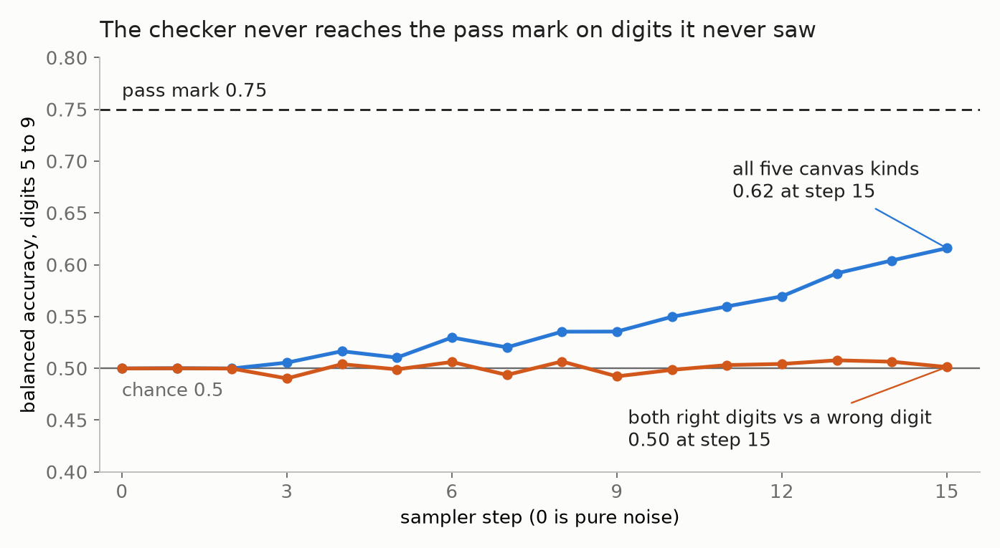

# Review: does a checker learn plurality on unseen digits (step V2)

**Status: null.** The map reader misses two of V2's three bars on digits 5 to 9. W&B run `a562r799`. Steps V3, V5 and V4 wait on the owner's answer to board question 64.

## The result

Each point is the frozen map reader's balanced accuracy at one sampler step, over 2,000 canvases of digits 5 to 9 with 4 noise draws each. The numbers are in `/datasets/mmolefe/poe_repair_min/loop-8/v2/full/final.json`, from job 93905 on `mscluster63`, which took 39 minutes 50 seconds.

| Score over steps 0 to 15, 0.5 is chance | Bar | Map reader | Met | Raw reader |
|---|---|---|---|---|
| Balanced accuracy on digits 5 to 9 | at least 0.75 | **0.540** | no | 0.500 |
| Gap to digits 0 to 4, which scored 0.540 | at most 0.05 | **0.0002** | yes | 0.000 |
| `apart` against `wrong` on digits 5 to 9 | at least 0.75 | **0.501** | no | 0.500 |
| `apart` against `wrong` on digits 0 to 4 | none | 0.504 | | 0.500 |

The verdict is null by the written rule: the overfit rung passed and the frozen configuration missed a bar. The small gap between seen and unseen digits does not show transfer, because the reader is at chance on `apart` against `wrong` for both.

**The raw reader did not train.** Its final loss is 0.6931, the loss of a constant guess, and it answers label 0 on every read: 0.00 right on `apart` and 1.00 on the other four kinds. The map-against-raw comparison therefore has no result. `final.json` holds `raw_matches_map_on_unseen: true` only because 0.500 is within 0.05 of 0.540, so that flag does not show the surprise the design describes.

**The toy is noisier than SDXL at the same step numbers.** The toy's steps 0 to 15 run from timestep 999 to 693, where the signal share of the noisy image ($\bar\alpha$) goes from 0.00004 to 0.0076. SDXL's scheduler, a scaled-linear schedule with leading spacing, runs from timestep 981 to 681, where it goes from 0.0058 to 0.0946. The signal-to-noise ratio is 144 times higher for SDXL at step 0 and 13.7 times higher at step 15. SDXL's window has the same $\bar\alpha$ as the toy's timesteps 712 to 480, which are toy sampler steps 14 to 25, so only steps 14 and 15 of this test overlap it. This null therefore says nothing direct about SDXL's early steps. Equal $\bar\alpha$ in pixels and in SDXL's latents is also not equal difficulty (inferred).

## The ladder

Job 93691 on `mscluster83` ran from the code snapshot of commit `34750ade` and took 18 minutes 6 seconds. Its outputs are in `/datasets/mmolefe/poe_repair_min/loop-8/v2/ladder/`.

| Rung | What it checks | Map reader | Raw reader | Result |
|---|---|---|---|---|
| Smoke test | 20 updates run and the loss is finite | 455 ms per update | 15 ms per update | passed |
| Overfit | 16 fixed examples, at least 15 right | 16 of 16 | 16 of 16 | passed |
| 1% of the data | balanced accuracy on the 80-canvas seen test split, steps 0 to 15, 0.5 is chance | 0.530 | 0.513 | ran |
| 1% of the data | the same score on `apart` against `wrong` canvases | 0.505 | 0.502 | ran |

The 1% run trains on 160 canvases for 1,000 updates, so it checks that the pipeline runs and carries no verdict. Its scores are close to chance for both readers. The map reader's balanced accuracy by step runs from 0.50 at step 0 to 0.58 at step 15, with a high of 0.61 at step 14.

## The inner test

Job 93702 on `mscluster83` took 2 hours 41 minutes. It trained on the pairs among digits 0 to 3 and scored both those pairs and the pairs holding digit 4, which it never saw. All scores are balanced accuracy over steps 0 to 15, where 0.5 is chance. The full results are in `/datasets/mmolefe/poe_repair_min/loop-8/v2/full/inner.json`.

| Configuration | Trained pairs | Pairs holding 4, bar 0.75 | Gap, bar 0.05 | `apart` against `wrong`, trained pairs | `apart` against `wrong`, pairs holding 4, bar 0.75 | All bars |
|---|---|---|---|---|---|---|
| Base map reader | 0.542 | 0.535 | 0.006 | 0.499 | 0.497 | missed |
| Log totals added | 0.542 | 0.535 | 0.007 | 0.499 | 0.500 | missed |
| Signed differences | 0.544 | 0.531 | 0.013 | 0.502 | 0.495 | missed |
| 12,000 updates | 0.545 | 0.537 | 0.008 | 0.503 | 0.498 | missed |

No configuration separates `apart` from `wrong`, on the pairs it trained on or on the pairs it never saw. The miss is in learning which digits are present, before any question of carrying over to new digits. Balanced accuracy over all canvas kinds rises from 0.50 at step 0 to between 0.60 and 0.61 at step 15 on the pairs holding digit 4.

The written rule freezes the configuration with the highest smaller value of the two scores on the pairs holding 4, which is **log totals added** at 0.4999. The four values span 0.4946 to 0.4999, so this choice separates configurations that are all at chance.

GPU-hours spent so far: 3.78 of 30 (0.14 on step V1, 0.30 on this ladder, 2.68 on the inner test and 0.66 on the final read).
