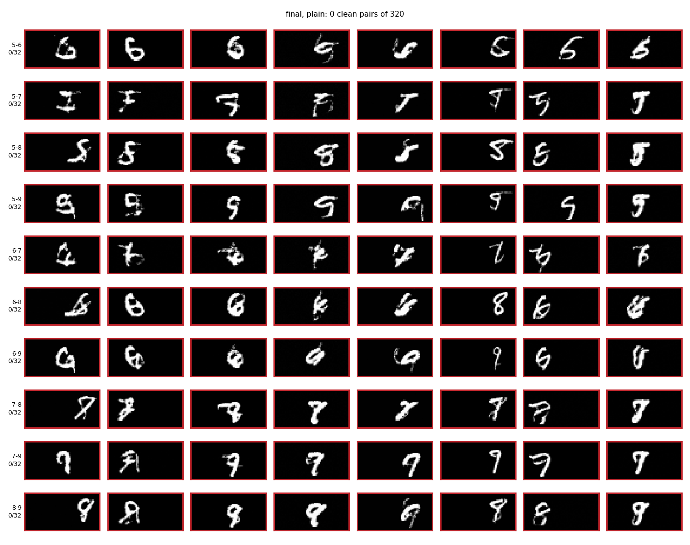
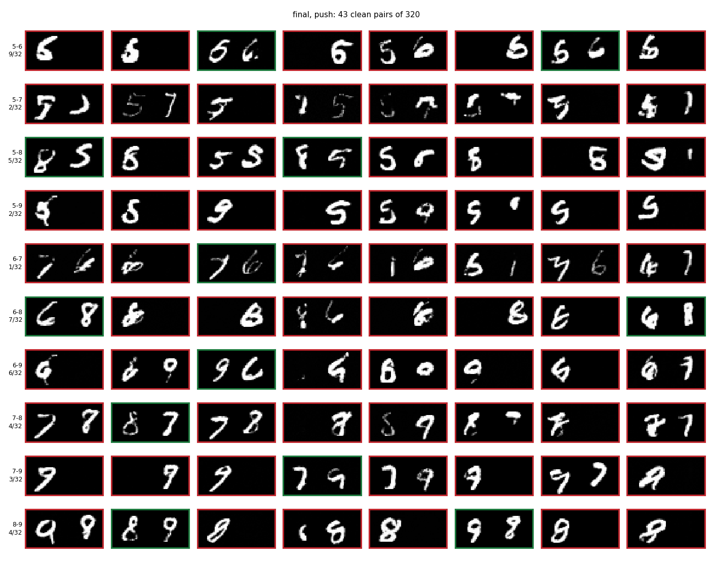
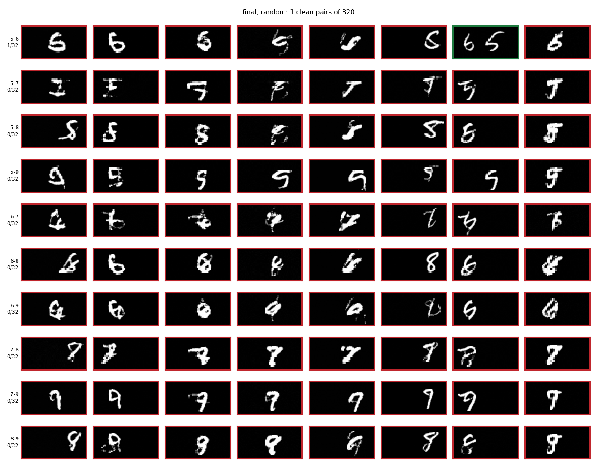
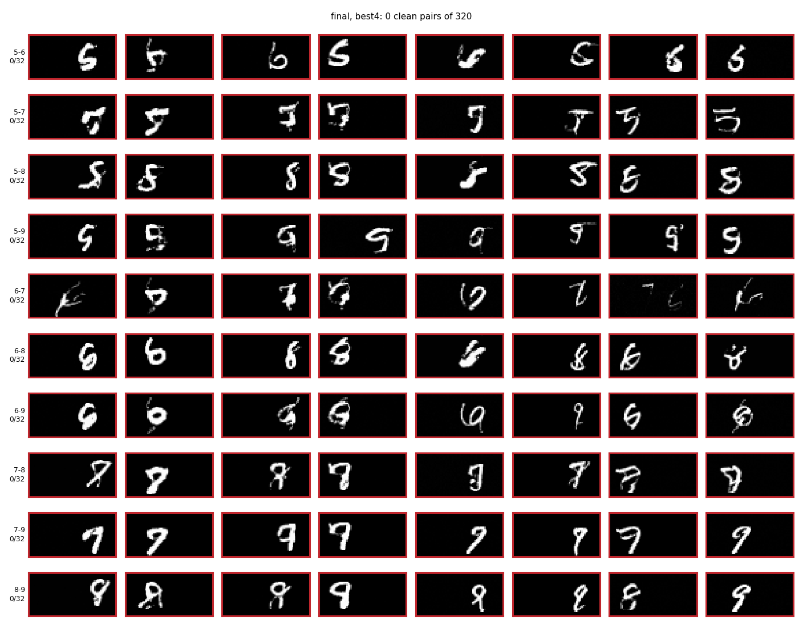
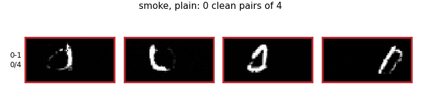
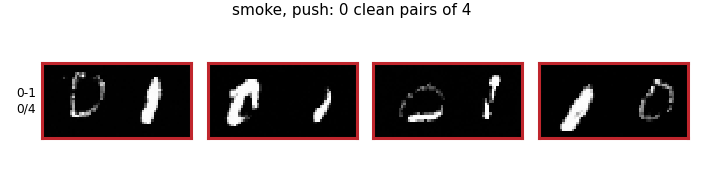

# Does the count checker's push make unseen digits compose?

Step V3 adds the count checker's gradient to the plain product of the two asked digit labels while sampling, and asks whether the digit model then draws two separate, right digits on the 10 pairs among digits 5 to 9, which the checker never trained on. It does: the push turns the plain product's 0 clean pairs of 320 into 43, a lead of 5.7 times its standard error, while a random push of the same length gives 1 and picking the best of 4 seeds gives 0 (W&B run `qhusod91`).

## What is in here

Six sheets of finished digit canvases. Four come from the one run on the unseen pairs, one sheet per row of the comparison: the plain product, the checker's push, a random push and the best of 4 seeds. Two come from the smoke test on the seen pair 0 and 1, plain and pushed. `design.md` and `review.md` hold the stage's design and its verdict.

**How to read a sheet.** Each tile is one finished 32 by 64 canvas from one starting seed. Each line is one asked pair, labelled on the left with the pair and its clean count, and the sheet's title gives the row and its total. A green frame means the digit judge (`judge-v3/judge.pt`, through `two_experts.call_two`) calls the canvas clean: two blobs, each a confident single digit, the two asked digits, one per half. A red frame means any other call. On the unseen sheets the same starting seed sits in the same place on the plain, push and random sheets.

## The four sheets on unseen digits

All four come from job 94134 on `mscluster79`, 2 minutes 55 seconds from the code snapshot of commit `ae80cee6`, with `2-classifier-guidance/scripts/abstract_checkers/v3_compose.py` run as `v3.sbatch final`. The model is `share-0.0/unet.pt`, which never saw two digits on one canvas, sampled with DDIM at 50 steps and eta 0, guidance 1, and the sampler's own cap off. The push acts on sampler steps 15 to 25 (timesteps 693 down to 489), the noise levels the checker trained on, with push length b = 0.4. The run covers seeds 1000 to 1031 on each of the 10 pairs, 320 canvases per row, and each sheet shows the first 8 of the 32 seeds. The script writes each sheet as `sheets/final-<row>.png` under `/datasets/mmolefe/poe_repair_min/loop-8/v3/test-1/`, and the numbers are in `final.json` there.

### unseen-plain

**What it shows**

Ten lines, one per unseen pair from 5 and 6 down to 8 and 9, of eight canvases each, drawn by the plain product with no push. Every tile holds one fused glyph, every frame is red, every line reads 0/32, and the title reads "final, plain: 0 clean pairs of 320".

**How we got this image**

The plain row of job 94134, described above the four sheets. It is the script's `sheets/final-plain.png`.

**What it lets you say**

With no push, the product of the two digit labels draws one fused glyph on these pairs: 0 clean pairs of 320. The judge calls 297 canvases one blob, 20 both in the same half and 3 two digits not both clear and right. A rerun on another node matched this row exactly.

**What it cannot say**

The sheet shows 80 of the 320 canvases. The clean count rests on the judge's confidence threshold of 0.9. These are 32 by 64 pixel digit canvases, and step V4 tests the same question on SDXL's objects.

**Where it came from and what judged it**

Job 94134, `final.json` above. [The V3 review](review.md) judges the step as support. It is embedded in [the finding on whether the count checker's push composes unseen digits](../../../../../2-classifier-guidance/report/abstract-checkers-on-digits/does-the-count-checkers-push-compose-unseen-digits.md).

### unseen-push

**What it shows**

The same ten pairs and the same seeds in the same places, drawn with the count checker's push. Many tiles now hold two separate digits, one per half. Twelve of the 80 shown are framed green. The line labels read 9, 2, 5, 2, 1, 7, 6, 4, 3 and 4 of 32 for pairs 5 and 6 through 8 and 9, and the title reads "final, push: 43 clean pairs of 320". Compare a tile here with the tile in the same place on the plain sheet.

**How we got this image**

The pushed row of job 94134, described above the four sheets. The push is the checker's gradient with respect to the noisy canvas, scaled to 0.4 of the product's noise prediction per canvas and added to it. It is the script's `sheets/final-push.png`.

**What it lets you say**

The checker's push raises clean pairs from 0 to 43 of 320, a lead of 43 with a standard error of 7.58 over 10,000 bootstrap resamples of the 10 pairs, which clears 1.96 standard errors. Every pair gains, and the gain is uneven. The judge calls 43 canvases clean, 118 two digits not both clear and right, 3 both in the same half, 144 one blob and 12 damaged, so the push splits the fused glyph into two digits on half the canvases (161 of 320), and about a quarter of those carry both asked digits clearly.

**What it cannot say**

The checker reads only where two digits sit; the product's two labels decide which digits appear, and the failures show a wrong digit, a repeated digit or a stroke too faint for the judge. A pushed render is not bit-reproducible across nodes: job 94161 reran this row on `mscluster81` and got 41 clean pairs of 320 in place of 43, with per-pair counts moving by up to 4 (5 and 6: 5 against 9; 8 and 9: 1 against 4; 5 and 7: 5 against 2). The clean count rests on the judge's confidence threshold of 0.9, so a faint but correct digit counts as not clean, and the 161 separate-digit count carries no bar. Sheet-scale calls can overcount: [the 2026-11-24 reviewer pass](../../reviewer/2026-11-24-review.md) flags the third tile of the 5 and 6 line, framed green, as reading like two 6s at sheet scale (inferred, low confidence, not checked at full resolution). The push window's noise levels match SDXL's by signal share, which is inferred and not measured as equal difficulty. b = 0.4 was the largest of the three lengths tried, so a longer push was not tested. The model never saw two digits on one canvas, and SDXL is untested here.

**Where it came from and what judged it**

Job 94134, `final.json` above; the rerun's record is `/datasets/mmolefe/poe_repair_min/loop-8/v3/trace/trace.json`. [The V3 review](review.md) judges the step as support. It is embedded in [the finding on whether the count checker's push composes unseen digits](../../../../../2-classifier-guidance/report/abstract-checkers-on-digits/does-the-count-checkers-push-compose-unseen-digits.md).

### unseen-random

**What it shows**

The same layout with a random push of the same length per canvas and step. Nearly every tile holds one fused glyph, much like the plain sheet. One tile, seventh in the 5 and 6 line, is framed green, and the title reads "final, random: 1 clean pairs of 320".

**How we got this image**

The random row of job 94134, described above the four sheets. It is the script's `sheets/final-random.png`.

**What it lets you say**

A push of the same size in a random direction gives 1 clean pair of 320 (lead 1, standard error 0.96), which does not clear 1.96 standard errors. The checker's push therefore did not work by its size alone.

**What it cannot say**

The sheet shows 80 of the 320 canvases. The random row was not rerun on another node, so how much it moves across nodes is not recorded. The clean count rests on the judge's confidence threshold of 0.9.

**Where it came from and what judged it**

Job 94134, `final.json` above. [The V3 review](review.md) judges the step as support. It is embedded in [the finding on whether the count checker's push composes unseen digits](../../../../../2-classifier-guidance/report/abstract-checkers-on-digits/does-the-count-checkers-push-compose-unseen-digits.md).

### unseen-best4

**What it shows**

The same ten pairs, where each tile is the one of four plain samples the checker scored highest. Nearly every tile holds one glyph, every frame is red, every line reads 0/32, and the title reads "final, best4: 0 clean pairs of 320".

**How we got this image**

The best-of-4 row of job 94134, described above the four sheets. For each canvas the plain product draws four samples from four starting seeds, and the checker picks the one with the highest logit on the finished canvas noised to timestep 480. It is the script's `sheets/final-best4.png`.

**What it lets you say**

Picking the best of four plain samples by the checker's own score finds no clean pair (0 of 320; 2 canvases with two separate digits). The gain on the pushed sheet comes from the gradient during sampling, and selection among plain samples does not reproduce it.

**What it cannot say**

It tests four tries per canvas only, scored at one noise level, timestep 480. The sheet shows 80 of the 320 canvases. This row was not rerun on another node.

**Where it came from and what judged it**

Job 94134, `final.json` above. [The V3 review](review.md) judges the step as support. It is embedded in [the finding on whether the count checker's push composes unseen digits](../../../../../2-classifier-guidance/report/abstract-checkers-on-digits/does-the-count-checkers-push-compose-unseen-digits.md).

## The two smoke-test sheets

Both come from job 94132, the smoke stage of `v3.sbatch` (`v3_compose.py smoke`), on the seen pair 0 and 1 at 4 seeds with every row and the zero-push check. The smoke stage fixes the push length at 0.4 in the script. The script writes them as `sheets/smoke-<row>.png` under `/datasets/mmolefe/poe_repair_min/loop-8/v3/test-1/`. The node and the code commit of job 94132 are not recorded.

### smoke-plain

**What it shows**

One line of four canvases asked for 0 and 1, drawn by the plain product with no push. Each holds one faint or fused mark, every frame is red, and the title reads "smoke, plain: 0 clean pairs of 4".

**How we got this image**

The plain row of job 94132, described above the two smoke sheets.

**What it lets you say**

The sampler and the judge run end to end on one seen pair, and with no push the product draws one mark per canvas.

**What it cannot say**

Four canvases of one seen pair carry no verdict. The smoke test checks that every row runs and that the zero push changes nothing (largest pixel difference 0.0).

**Where it came from and what judged it**

Job 94132. [The V3 review](review.md), section "The ladder", records it. It is embedded in [the finding on whether the count checker's push composes unseen digits](../../../../../2-classifier-guidance/report/abstract-checkers-on-digits/does-the-count-checkers-push-compose-unseen-digits.md).

### smoke-push

**What it shows**

The same four seeds with the count checker's push. Each canvas now holds two separate marks, one per half, none is framed green, and the title reads "smoke, push: 0 clean pairs of 4".

**How we got this image**

The pushed row of job 94132, described above the two smoke sheets.

**What it lets you say**

On the seen pair 0 and 1, the push gives two separate digits on 4 of 4 canvases and no clean pair.

**What it cannot say**

Four canvases of one seen pair carry no verdict. The push length here is the smoke stage's fixed 0.4 and was not chosen by the tuning rule on the seen pairs. Pushed renders are not bit-reproducible across nodes, so these four canvases may differ on another node.

**Where it came from and what judged it**

Job 94132. [The V3 review](review.md), section "The ladder", records it. It is embedded in [the finding on whether the count checker's push composes unseen digits](../../../../../2-classifier-guidance/report/abstract-checkers-on-digits/does-the-count-checkers-push-compose-unseen-digits.md).
