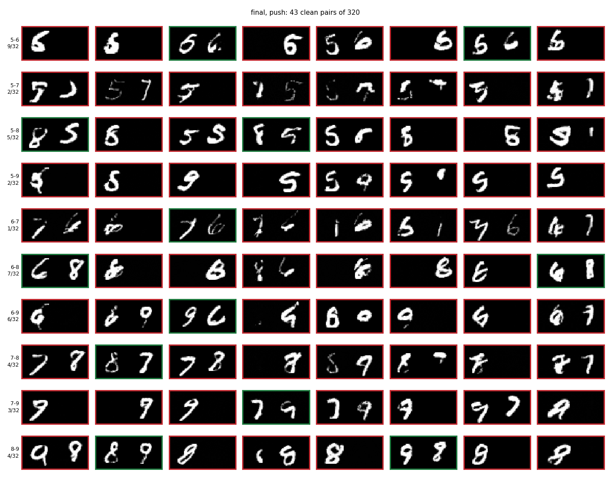

# Review: does the count checker's push compose unseen digits (step V3)

**Status: support.** On the 10 pairs among digits 5 to 9, which the count checker never trained on, its push turns the plain product's 0 clean pairs of 320 into 43. The lead is 5.7 times its standard error, and the random push of the same size gives 1. W&B run `qhusod91`. Test 2 does not run.

## The result

| Plain product, digits 5 to 9 | With the count checker's push |
|---|---|
|  |  |
| 0 clean pairs of 320; 297 canvases hold one blob | 43 clean pairs of 320; 161 hold two separate digits |

Each sheet shows the first 8 of 32 seeds for each of the 10 pairs, framed green when the judge calls the canvas clean. The same starting seed sits in the same place on both sheets. The numbers are in `/datasets/mmolefe/poe_repair_min/loop-8/v3/test-1/final.json`, from job 94134 on `mscluster79`, which took 2 minutes 55 seconds from the code snapshot of commit `ae80cee6`.

| Row, 320 canvases over 10 unseen pairs | Clean pairs | Two separate digits, any identity | Lead over plain | Standard error | Clears 1.96 standard errors |
|---|---|---|---|---|---|
| Plain product | 0 | 3 | | | |
| Count checker's push, b = 0.4 | **43** | 161 | **43** | 7.58 | **yes** |
| Random push of the same length | 1 | 4 | 1 | 0.96 | no |
| Best of 4 starting seeds, picked by the checker | 0 | 2 | | | |
| Zero push against plain, largest pixel difference | 0.0, bar under 1e-5 | | | | |

The verdict is support by the written rule: the checker's push beats the plain product by more than 1.96 standard errors, the random push does not, and the zero push changes nothing. Picking the best of four plain samples by the checker's own score finds no clean pair, so the gain comes from the gradient during sampling and not from choosing among samples.

## What the push does to a canvas

| Judge's call, 320 canvases | Plain | Push |
|---|---|---|
| Two clear, right digits, one per half | 0 | 43 |
| Two digits, not both clear and right | 3 | 118 |
| Both in the same half | 20 | 3 |
| One blob | 297 | 144 |
| Damaged | 0 | 12 |

The push splits the fused glyph into two digits on half the canvases, and about a quarter of those carry both asked digits clearly. The rest show two digits of which one is the wrong digit, a repeated digit or a stroke too faint for the judge's confidence of 0.9. This matches what the checker reads: where two digits sit, and not which digits they are. The plain product's two labels decide identity, and on these pairs they supply both right digits about one time in four.

Clean pairs by unseen pair: 5 and 6: 9, 5 and 7: 2, 5 and 8: 5, 5 and 9: 2, 6 and 7: 1, 6 and 8: 7, 6 and 9: 6, 7 and 8: 4, 7 and 9: 3, 8 and 9: 4. Every pair gains, and the gain is uneven.

## Choosing the push length

Job 94133 ran the push on the 10 seen pairs among digits 0 to 4 at seeds 0 to 31. Clean pairs of 320 rose with the length: 0 with no push, 8 at b = 0.1, 20 at b = 0.2 and 40 at b = 0.4. The rule froze b = 0.4, the largest of the three choices, so a longer push was not tried.

## The ladder

| Rung | Job | Result |
|---|---|---|
| Smoke test, pair 0 and 1 at 4 seeds | 94115 | failed in the sheet code, which indexed a one-row grid as two-dimensional; fixed in commit `ae80cee6` |
| Smoke test, rerun | 94132 | every row ran; zero push 0.0; the push gave two separate digits on 4 of 4 and no clean pair |
| Choosing b on the seen pairs | 94133 | b = 0.4 |
| The unseen pairs, once | 94134 | support |

## What this cannot say

The model here never saw two digits on one canvas, and the push still draws them, so the product's support was enough for a gradient to reach. Step V4 asks the same question on SDXL, whose word maps are read differently and whose test pairs are objects.

The clean count rests on the judge's confidence threshold of 0.9, so a faint but correct digit counts as not clean. The 161 separate-digit count carries no bar and is reported for what it shows about layout.

GPU-hours spent so far: 5.72 of 30 (5.62 through step V2, and 0.10 on this step's five jobs).
