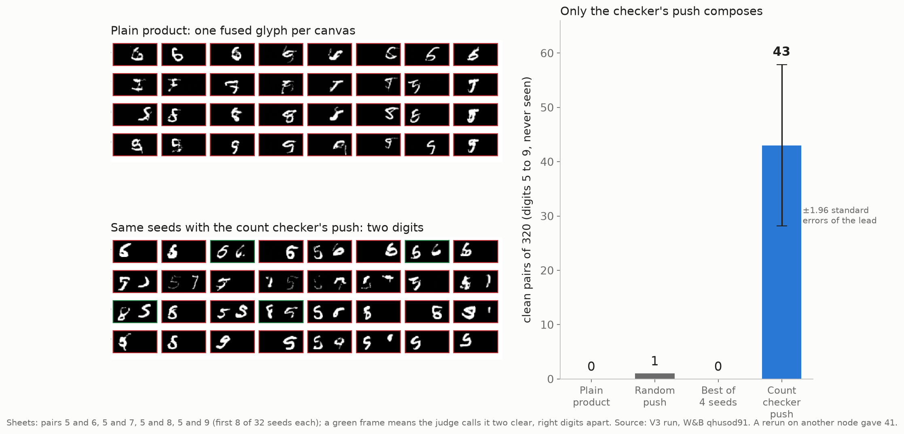
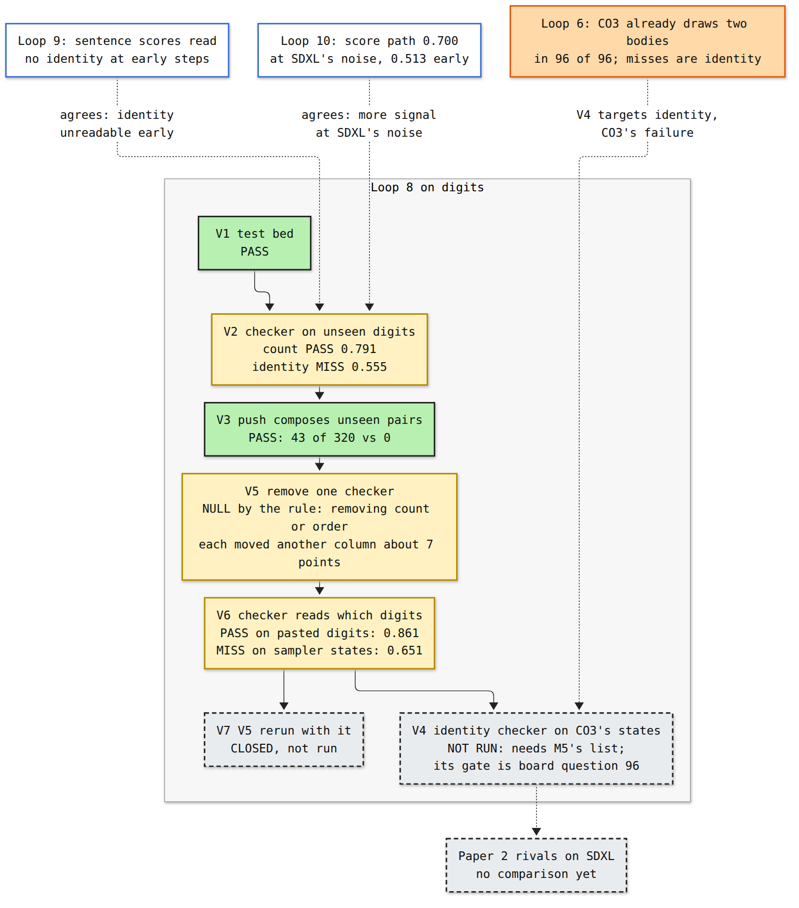

# Loop 8 in one page: can a checker trained on one set of concepts make the model draw two things it never trained on?

**On digits, yes for counting, and yes for reading which digits are present on pasted canvases. Not yet tested against any published rival, and not yet on SDXL.** A small checker that reads only *where* each asked digit acts learned "two digits sitting apart" from digits 0 to 4. On digits 5 to 9, which it never saw, its push turns the plain product's 0 clean pairs of 320 into 43. A second checker reads *which* digits are present on digits 5 to 9 at 0.861 when it sees all ten labels' noise predictions at later noise levels, but it reads the sampler's own states at only 0.651. Identity is the part SDXL's strongest rival gets wrong.

## What was found

| Question | Answer | Evidence | Conclusive? |
|---|---|---|---|
| Can a checker learn "two digits apart" on digits it never saw? | **Yes** | balanced accuracy 0.791 on digits 5 to 9 against 0.782 on digits 0 to 4, pass mark 0.75 (0.5 is chance) | **yes**, by a bar written before the run |
| Can a checker learn *which* digits are present? | **Yes on pasted digits; not on the sampler's own states** | the ten-label signature at later noise levels: 0.861 on digits 5 to 9, where the model alone reads 0.539; two maps at the early noise levels read 0.555. On the sampler's states it reads 0.651 (area under the curve 0.78), and retrained on 2,036 states it reads 0.552; pass mark 0.75 | **yes** for pasted digits, by a bar written before the run; **a miss** on sampler states |
| Does its push make two separate, right digits? | **Yes** | 43 clean pairs of 320 against 0 plain; random push 1; best of 4 seeds 0; lead 5.7 standard errors | **yes**; a rerun on another machine gave 41 |
| Does each checker control only its own property? | **Mostly, for 2 of 3** | removing count drops count 38% to 10%; removing order drops order 88% to 48%; each of those two also moves one other score about 7 points; removing right digits barely moves anything, and that checker read near chance (0.556) | **no**: null by the written rule; the rerun with the newer identity checker (V7) is closed as not run, since that checker does not read sampler states |
| Does any of this work on SDXL, against the rivals? | **Unknown** | step V4, an identity checker pushing on CO3 and judged against CO3 alone, has not run | **not tested** |

The explanations, figures and run records are in the stage reviews: [the test bed](../04-environment/review.md), [learning on unseen digits](../05-does-it-learn/review.md), [composing unseen digits](../06-does-it-compose/review.md), [removing one checker](../08-remove-one-checker/review.md) and [reading which digits](../10-reading-identity/review.md), with [the review of the two sampler-state misses](../10-reading-identity/method-review.md).

## Against the rivals

**On digits, we beat the simple baselines.** The plain product, a random push of the same size and best-of-4 selection all stay at 0 or 1 clean pairs of 320, where the checker's push reaches 43. These are the baselines a reviewer asks for first, and the gain comes from the gradient during sampling, because picking the best of four samples by the checker's own score finds nothing.

**Against published rivals, there is no comparison yet.** Every Paper 2 target is on SDXL or CLEVR, and Loop 8 has run neither:

| Benchmark | Rival | Rival's printed score | Ours |
|---|---|---|---|
| T2I-CompBench Color | CoMat | 0.7827 | not run |
| T2I-CompBench Shape | ToMe | 0.6051 | not run |
| T2I-CompBench Texture | ToMe | 0.6894 | not run |
| T2I-CompBench Complex | Rectify Then Diffuse | 0.4661 ImageReward | not run |
| GenEval, two objects | FKC | 0.78 | not run |
| CLEVR, objects composed | Bradley's local model | 5 objects | not run |

A qualitative grid of the kind "the rival fuses, ours draws two" exists only on digits (the figure above). It does not yet exist against any rival.

## How it lines up with the other loops

**Loops 9 and 10 agree with Loop 8.** Loop 9 found that no sentence score reads counting, prompt match or left-right order at the earliest 16 steps (best 0.56 against a bar of 0.75). Loop 10's score path reads 0.700 at SDXL's noise level and 0.513 at the toy's earliest steps. Three different readers find the same thing: at the noisiest steps, layout is readable and identity is not.

**Loop 6 marks the main risk.** On SDXL, the kept push added to CO3 gave 7 faithful pairs of 96 against CO3's 11, and CO3 already draws two separate bodies in all 96 of its tuning pictures. Its failures are wrong species, borrowed parts and extra subjects, which are identity errors. Loop 8's count checker supplies count, which CO3 already has. Its identity checker reads pasted digits and misses on sampler states, and V4 tests the SDXL version of it on CO3's own states.

## Is the loop getting there?

| Step | State |
|---|---|
| V1 test bed | done |
| V2 a checker learns on unseen digits | done, with the count checker |
| V3 its push composes unseen digits | done, support |
| V5 remove one checker at a time | done, null by the written rule |
| V6 a checker reads which digits are present | done, support on pasted digits; misses on sampler states |
| V7 V5 rerun with the identity checker | closed as not run: no checker reads sampler states, and no SDXL removal test is left for it to feed |
| V4 an identity checker on CO3's states, against CO3 alone | not run: needs Loop 6's M5 list, and its first check's gate is board question 96 |

Five of seven steps are done and one is closed, using about 14 of the loop's 30 GPU-hours. The digit questions are answered. The question that matters for the paper, whether this beats a rival on SDXL, starts with V4.

## What would change the picture

**A checker that reads the sampler's own states.** On digits, the checker that reads pasted canvases ranks the sampler's states (area under the curve 0.78) while its cutoff drifts, and a checker trained on 2,036 states memorised them. On SDXL, Loop 9's readout reads sampler states better than noised pictures (0.696 against 0.637), so V4's first check on CO3's states is the measurement that decides whether V4 pushes.

**Ranking against the cutoff.** A push along the normalised gradient uses only how the checker ranks states. Whether the area under the curve or the balanced accuracy at zero gates V4 is board question 96.

**V4 judged against CO3 alone.** V4 is judged by Paper 2's bar against CO3 alone, so a checker that adds nothing to CO3 shows as a null.

**A like-for-like CLEVR test.** Loop 6's CLEVR Stage 2 uses models told *which* objects, not *where*, the same setting as ours. Loop 8 has asked Loop 6 to add a count-checker row and a Du-sampler row there.

## What this summary cannot say

Every result here is on 32 by 64 pixel digit canvases with one diffusion model. Pushed renders are not bit-reproducible across machines (43 against 41 on the same seeds), so per-pair counts carry more noise than the bootstrap errors show. Nothing here supports a claim about SDXL or about any published rival.
