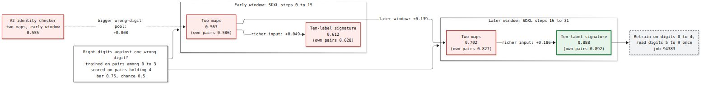

# Can a checker read which digits are present (step V6): review

**Status: the grid supports it; the read of digits 5 to 9 is running (job 94383).** One of the four checkers, the ten-label signature read in the later window, tells two right digits from one right and one wrong digit at 0.888 balanced accuracy on the pairs holding digit 4, which it never trained on. The bar, written before the run, is 0.75; 0.5 is chance. The design is [the V6 design](design.md).

## Contents

- [The grid](#the-grid)
- [What the grid shows](#what-the-grid-shows)
- [Digits 5 to 9](#digits-5-to-9)
- [The runs](#the-runs)
- [What this cannot say](#what-this-cannot-say)

## The grid

Each cell trained on the 6 pairs among digits 0 to 3 (15,000 canvases, half `apart` and half `wrong`, pool hash `2f6cc975...`) and was scored on V1's `seen_test` canvases: 500 on the 4 pairs holding digit 4 (400 `apart`, 100 `wrong`) and 750 on the trained pairs, each read at its window's 16 timesteps with 4 noise draws. The numbers are in [the result files](grid-files/), copied from `/datasets/mmolefe/poe_repair_min/loop-8/v6/`.

| Input | Window | Learned 16 fixed examples | Pairs holding 4, bar 0.75 | Trained pairs | Gap | `apart` right, pairs holding 4 | `wrong` right, pairs holding 4 |
|---|---|---|---|---|---|---|---|
| Two maps | early, t 712 to 480 | 16 of 16 | 0.563 | 0.586 | 0.023 | | |
| Two maps | later, t 466 to 263 | 16 of 16 | 0.702 | 0.827 | 0.125 | 0.716 | 0.687 |
| Ten-label signature | early | 16 of 16 | 0.612 | 0.628 | 0.015 | | |
| Ten-label signature | later | 16 of 16 | **0.888** | 0.892 | 0.004 | 0.926 | 0.850 |

Every cell learned its 16 fixed examples, so the design's table reads **support**: a cell reaches 0.75 on the pairs holding digit 4.

## What the grid shows

**The window matters more than the input, and the two add up.** With two maps, the later window adds 0.139 over the early one. With the early window, the signature adds 0.049 over two maps. Together they add 0.325. The bigger wrong-digit pool (7,500 against V2's 1,004) adds 0.008 over V2's 0.555 in the early window, so the pool size was not what held V2 back.

**The passing cell reads unseen pairs as well as its own.** Its gap is 0.004. The two-map cell in the later window fits its own pairs at 0.827 and reaches 0.702 on the pairs holding 4, so it learned partly which digits it trained on.

**It improves through the window.** On the pairs holding 4 it reads 0.80 at t 466 (SDXL's step 16), 0.88 by t 409, and 0.92 at t 263 (step 31).

## Digits 5 to 9

Job 94383 retrains the passing cell on the 10 pairs among digits 0 to 4 with the same recipe, saves it as `/datasets/mmolefe/poe_repair_min/loop-8/v6/identity-head.pt`, and reads V1's `unseen_test` digits 5 to 9 once. Its result fills this section.

## The runs

| Job | What | Node | Time | Result |
|---|---|---|---|---|
| 94335 | smoke test, all four cells on 1% of the pool, 20 updates | mscluster87 | 2 min | every cell learned its 16 fixed examples |
| 94336 | two-map cells | mscluster87 | 27 min | 0.563 and 0.702 |
| 94337 | both signature cells | mscluster60 | 38 min | ran out of memory scoring 512 canvases at once (eleven U-Net calls each), after training the first cell; no score |
| 94352 | signature, early window | mscluster60 | 44 min | 0.612 |
| 94353 | signature, later window | mscluster87 | 48.5 min | 0.888 |

Commit `ba6d84da` scores the signature's U-Net calls in pieces of 128, the size training uses, and gives each signature cell its own job. The grid used 2.66 GPU-hours, the failed job included. Loop 8 has used about 10.0 of its 30.

## What this cannot say

This is one unseen digit, 4, on pasted canvases. Whether the checker reads digits 5 to 9 is the next section's job. Whether its push makes the sampler draw the right digits is step V7. The later window is SDXL's steps 16 to 31, where the layout may already be fixed, so a push there may fix identity without moving merged digits apart.

On SDXL the signature has no fixed list of labels: "the other eight digits" becomes a chosen set of other prompts, and that choice could move the score. Step V4 has to fix that set before it runs. Each cell trained once, with one seed.
