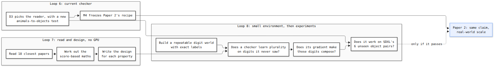
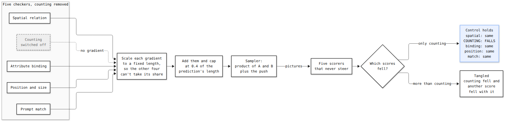

# Can a checker trained on one set of concepts make the model draw two things it never trained on?

On digits, a checker that reads only where each asked digit acts learns "two digits sitting apart" on digits it never trained on, and its push turns the plain product's 0 clean pairs of 320 into 43. The same checker cannot tell which digits are present at the noise levels it works at, and the test that removes one checker at a time is null by its written rule. Step V4, the same question on SDXL's object pairs, has not run.

## What is in here

Two diagrams sit at this level, each a Mermaid source (`.mmd`) with its PNG and SVG renders. Three stage folders carry their own picture cards: [the digit test bed](04-environment/README.md), [learning on unseen digits](05-does-it-learn/README.md) and [composing unseen digits](06-does-it-compose/README.md). The other numbered files and folders hold the reading, the design and each stage's review.

## The diagrams

### how-the-loops-fit

**What it shows**

A flow diagram with no axes, read left to right. Three grey boxes hold one loop each. Loop 7 ("read and design, no GPU") runs from "Read 18 closest papers" to "Work out the score-based maths" to "Write the design for each property". Loop 8 ("small environment, then experiments") runs from "Build a repeatable digit world with exact labels" to "Does a checker learn plurality on digits it never saw?" to "Does its gradient make those digits compose?" to "Does it work on SDXL's 6 unseen object pairs?". Loop 6 ("current checker") runs from "D3 picks the reader, with a new animals-to-objects test" to "M4 freezes Paper 2's recipe". Loop 7's design feeds Loop 8's plurality step, D3 feeds the SDXL step, and M4 feeds the blue box "Paper 2: same claim, real-world scale". The eye should land on the dotted arrow labelled "only if it passes", which is the one route from Loop 8 to the paper.

**How we got this image**

It is a Mermaid diagram rendered from `how-the-loops-fit.mmd` beside it, to this PNG and to `how-the-loops-fit.svg`. The rendering tool is not recorded.

**What it lets you say**

Loop 8's four steps run in order, and Loop 8 reaches Paper 2 only if the SDXL step passes.

**What it cannot say**

It draws a plan and carries no result. It does not show step V5, the removal test, as [the Loop 8 page](../score-space/02-the-loops/loop-8-test-abstract-checkers.md) notes. The arrow from D3 to the SDXL step reads as a dependency, while [the design's V4 section](03-design.md#step-v4-does-it-work-on-sdxls-unseen-objects) has D3's candidate reported beside the count checker and says no result from it changes V4's bar. [The 2026-11-24 reviewer pass](../reviewer/2026-11-24-review.md) flags that same reading on `09-summary/where-loop-8-stands.png`; it does not name this picture.

**Where it came from and what judged it**

The source is `how-the-loops-fit.mmd`. No review judges it, because it draws the plan of the work. [The Loop 8 page](../score-space/02-the-loops/loop-8-test-abstract-checkers.md) embeds it. No finding under `2-classifier-guidance/report/abstract-checkers-on-digits/` embeds it.

### remove-one-checker

**What it shows**

A flow diagram with no axes, read left to right. A grey box holds five checkers: spatial relation, counting, attribute binding, position and size, and prompt match. Counting is greyed and dashed, labelled "switched off", with a dotted "no gradient" arrow. The other four feed "Scale each gradient to a fixed length, so the other four can't take its share", then "Add them, with no shared cap; a row is void if the total passes 0.6 of the prediction's length", then "Sampler: product of A and B plus the push". Its pictures go to "Five scorers that never steer" and a diamond, "Which scores fell?". If only counting fell, the path ends in the blue box "Control holds", which lists spatial: same, COUNTING: FALLS, binding: same, position: same, match: same. If more than counting fell, it ends in "Tangled: counting fell and another score fell with it". The eye should land on the blue box.

**How we got this image**

It is a Mermaid diagram rendered from `remove-one-checker.mmd` beside it, to this PNG and to `remove-one-checker.svg`. The rendering tool is not recorded.

**What it lets you say**

The removal test switches one checker off, holds each remaining checker's push at a fixed length, and reads which of five scores fall. The control holds only when the removed checker's own score is the one that falls.

**What it cannot say**

It draws the five-checker SDXL version of the test, which has not run; [the removal design](08-remove-one-checker/design.md) says the SDXL version waits for the owner's decision after V4 passes. It shows one removal, counting. The digit run, step V5, has three checkers (count, right digits and order), because binding, position and size do not exist on a 32 by 64 digit canvas. That run is null by the written rule ([the removal review](08-remove-one-checker/review.md)): removing count or removing order each lowers its own property by far more than the margin, and each also moves one other column by about 7 points, past the 4.2-point limit. Removing right digits lowers its own column by 2.6 points.

**Where it came from and what judged it**

The source is `remove-one-checker.mmd`, and its box on adding the pushes matches [the design's section on how the push is computed](03-design.md#how-the-push-is-computed): "No shared cap runs", and a row is void if its total passes 0.6 of the product's norm on more than 5% of pushed steps. [The 2026-11-24 reviewer pass](../reviewer/2026-11-24-review.md) looked at it at full size and found no problems. It is embedded in [the finding on whether removing one checker removes its property](../../../../2-classifier-guidance/report/abstract-checkers-on-digits/does-removing-one-checker-remove-its-property.md) and on [the Loop 8 page](../score-space/02-the-loops/loop-8-test-abstract-checkers.md).
