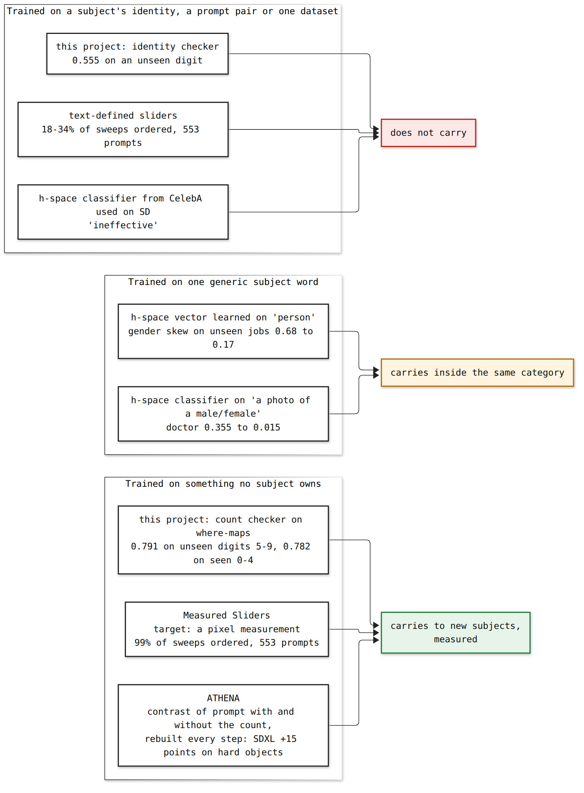

# Directions that generalise: what makes a learned direction steer, and when it carries to new subjects

Board step H1, Loop 15 (`s15`). Twenty-eight papers were read for this page, each from its PDF, plus
the project's own findings. Every page number is a PDF page.

**The answer.** A direction carries to subjects it never trained on when what it was trained to point
at belongs to no subject: a measured image quantity, a count read off where-maps, or a contrast rebuilt
from the prompt at every step. Directions trained on one generic subject word ("person") carry to other
members of that category and are not shown to carry further. Directions trained on a prompt pair, an
identity or one dataset keep their order on only a third of new prompts or less, and fail across a
dataset change. Being readable is not enough: scene relations such as shadow and support are linearly
readable from Stable Diffusion's features at an area under the curve of 92 to 99.6 out of 100, yet no
paper read here steers a picture with such a probe. For counts, only pushes rebuilt per sample
(ATHENA), layouts written into the starting noise, and this project's own count checker on digits
carry; a fixed count vector moved accuracy by 4 points. No direction read here binds an attribute to
its object, or makes two subjects co-occur, and carries to new subjects.

*The eight directions with a measured transfer number, grouped by what they were trained to point at.
Drawn from [the diagram source](01-what-a-direction-is-trained-on.mmd); every number is sourced in the
tables below.*

## Table of contents

- [Words this uses](#words-this-uses)
- [The main table: which kinds carry, and why](#the-main-table-which-kinds-carry-and-why)
- [1. Classifier gradients: robust and perceptually aligned](#1-classifier-gradients-robust-and-perceptually-aligned)
- [2. Concept sliders and text-token directions](#2-concept-sliders-and-text-token-directions)
- [3. Directions inside the U-Net's middle block](#3-directions-inside-the-u-nets-middle-block)
- [4. Scene relations and counts as probes or directions](#4-scene-relations-and-counts-as-probes-or-directions)
- [5. What this project already measured](#5-what-this-project-already-measured)
- [What follows for the dials](#what-follows-for-the-dials)
- [Where the sources disagree](#where-the-sources-disagree)
- [Still open](#still-open)
- [Where this came from](#where-this-came-from)

## Words this uses

**Direction.** A vector added to something the model computes (its weights, a text token, the U-Net's
middle-block output, the noisy picture) so the picture changes in one meaningful way. A classifier's
gradient is a direction recomputed at every step.

**Carries.** The direction still does its job on a subject, prompt or category that played no part in
learning it. Only a number on held-out subjects counts as measured; a gallery of pictures counts as
shown, not measured.

**Ordered sweep.** Turning the strength up step by step moves the measured outcome the same way at every
step (Measured Sliders' "monotone" share).

**h-space.** The output of the diffusion U-Net's middle block, the one layer with no skip connection
around it (Asyrp, p. 18).

**Read marks.** *read from the paper*: the PDF was opened at that page in this pass. *shown only*: the
paper gives pictures and no number. *inferred*: this page's reasoning, with what it rests on.

## The main table: which kinds carry, and why

| Kind of direction | Trained to point at | Carries to new subjects? | Best measured number | Why it carries or stops | Mark |
|---|---|---|---|---|---|
| Measured slider (LoRA trained to move a pixel measurement) | a closed-form image measurement such as left-right lighting | **yes, measured** | 98.9% of sweeps ordered over 553 GenEval prompts, rank correlation 0.995 (Measured Sliders, Table 1, p. 8) | the target is the same quantity on every subject; swapping a text target for the measurement on matched FLUX training takes ordered sweeps from 9.6% to 99.8% (p. 9) | read from the paper |
| Prompt contrast rebuilt every step | $\epsilon(p) - \epsilon(\hat p)$, the prompt with and without its count | **yes, measured** | SDXL exact count 19.7 to 34.7 on a set of hard object categories, settings tuned on another benchmark (ATHENA, Table 2, p. 8; p. 7) | nothing is learned per subject; the direction is recomputed from the prompt | read from the paper |
| Layout written into the starting noise | boxes for each object in the initial noise, FLUX fine-tuned to follow them | **yes, measured** | exact count on five held-out categories from about 21% to 32 to 39% (Numerosity, Table 5, p. 16) | the starting noise sets the count whatever the prompt says (Fig. 8, p. 7) | read from the paper |
| This project's count checker on where-maps | "two digits sitting apart", from maps of where each asked digit acts | **yes, measured** | 0.791 balanced accuracy on unseen digits 5 to 9 against 0.782 on seen 0 to 4; its push turns 0 of 320 clean pairs into 43 | its input never says which digit is present | read from the project's findings ([section 5](#5-what-this-project-already-measured)) |
| Vector added to the middle block, learned on one subject word | images of "a woman" against the model told "a person" | **inside the category, measured** | gender skew on unseen professions 0.68 to 0.17 (0 balanced, 1 all one gender) (Li et al., Table 1, p. 6) | the generic word covers every job title; across species only pictures (Fig. 8, p. 8) | read from the paper |
| Classifier on the middle block, used as guidance | "a photo of a male/female" | **inside the category, measured; fails across datasets** | doctor 0.355 to 0.015 fairness gap (Parihar, Table 6, p. 8); a CelebA-trained one is "ineffective" on SD (p. 8) | dataset shift breaks it | read from the paper |
| Text-token direction (on the subject's own token) | "old person" minus "person", or its distilled version | **shown only** across nouns and models | subject-specificity 3.35 in two-subject prompts (Baumann, Table 1, p. 6) | lives on the noun's token, so it applies per subject; spatial relations work "only (very) rarely" (p. 13) | read from the paper |
| Concept slider (LoRA from a prompt pair) | text difference between two prompts | **no**, when measured by an outside study | 33.5% of sweeps ordered over 553 prompts (Measured Sliders, Table 1, p. 8); the original reports no per-subject number (Concept Sliders, p. 5) | the text target drifts with the prompt | read from the paper |
| Adversarially robust classifier gradient | ImageNet class labels | **not tested** | FID 2.97 to 2.85 over a plain classifier on class-conditional ImageNet (Kawar, Table 1, p. 7) | adds only features the classifier learned (Santurkar: "horse" tied to blue sky, pp. 6 to 7) | read from the paper |
| Open-vocabulary robust gradient | CLIP image-text similarity, adversarially fine-tuned | **yes in kind, held-out split not separated** | retrieval precision 2% to 19% with no augmentation (CLIPAG, Table 1, p. 7) | the guide itself takes any prompt | read from the paper |
| Linear probe for a scene relation | shadow, support, occlusion, depth, material | **not tested** across scenes, and never used to steer | test AUC 99.6 depth, 95.4 shadow, 92.1 support, 84.8 occlusion (Zhan, Table 4, p. 9) | readable is not steerable | read from the paper |
| This project's identity checker | which digits are present | **no, measured** | 0.555 on an unseen digit | identity is the subject itself | read from the project's findings |

## 1. Classifier gradients: robust and perceptually aligned

"Robust" means two things in these papers. Kawar, Ganz, Santurkar, the counterfactual paper and CLIPAG
mean adversarially trained. GradCheck and its follow-up mean only "trained on the diffusion model's noisy
inputs", which Dhariwal and Nichol already required.

| Paper | The direction | Steers: number and page | Carries to new subjects | Where it breaks | Mark |
|---|---|---|---|---|---|
| Kawar, Ganz, Elad, "Enhancing Diffusion-Based Image Synthesis with Robust Classifier Guidance", arXiv 2208.08664, TMLR 2023 | gradient of a timestep-aware classifier on noisy $x_t$, adversarially trained (radius 0.5, 7 steps), pp. 7 to 8; plain cross-entropy leaves input gradients unconstrained (p. 5) | ImageNet 128: FID 5.91 unguided, 2.97 plain classifier, 2.85 robust; precision 0.70, 0.78, 0.82 (Table 1, p. 7); robust preferred on 61.5% of pairs against 31.5% (Table 2, p. 9) | not tested: all 1,000 classes are training classes; summing gradients for several classes is claimed, no experiment (p. 10) | recall falls at every scale (Table 6, p. 20); CIFAR-10 gain 7.62 to 7.58 FID (Table 5, p. 19) | read from the paper |
| Ganz, Kawar, Elad, "Do Perceptually Aligned Gradients Imply Adversarial Robustness?", arXiv 2207.11378, ICML 2023 (published title drops "Adversarial") | cross-entropy plus a cosine penalty pulling the input gradient toward the diffusion model's class score minus its unconditional score (pp. 4 to 5) | no metric for alignment itself (p. 3); robust accuracy at L2 radius 0.5 rises 0% to 55.39% as alignment weight goes 0 to 2 (Table 1, p. 7; Fig. 5, p. 8) | not tested | CIFAR-100 clean accuracy 55.94% against 74.36% (Table 2, p. 7) | read from the paper |
| Santurkar et al., "Image Synthesis with a Single (Robust) Classifier", arXiv 1906.09453, NeurIPS 2019 | gradient ascent on one class score of a robust classifier, no diffusion model (pp. 3 to 4) | Inception Score 259.0 against BigGAN 233.1, but FID 36.0 against 7.4 (Table 1, p. 5) | shown only: sketches to animals, feature units that are not classes (Fig. 7, p. 8; p. 9) | can only add what the classifier relies on: "horse" tied to blue sky (pp. 6 to 7, Fig. 11, p. 17) | read from the paper |
| Dhariwal and Nichol, "Diffusion Models Beat GANs on Image Synthesis", arXiv 2105.05233, NeurIPS 2021 | gradient of a classifier trained on the same noising (p. 8) | unconditional ImageNet 256: FID 26.21 unguided, 33.03 at scale 1, 12.00 at scale 10; recall 0.63 to 0.44 (Table 4, p. 9) | not tested | at the theory's scale of 1 the push does not steer (p. 8) | read from the paper |
| Ma et al., "Elucidating The Design Space of Classifier-Guided Diffusion Generation", arXiv 2310.11311 | off-the-shelf ResNet read on the one-step clean estimate, Softplus activations, separate temperatures, a sine schedule (pp. 4 to 8) | calibration error tracks FID: 0.51 and 8.27, 0.35 and 7.17, 0.28 and 6.94 (Table 2, p. 4); clean estimate 7.17 against noisy input 8.61 (Table 3, p. 5); ImageNet 128 class-conditional 2.97 to 2.19 (Table 7, p. 9) | CLIP on open prompts, a curve with no table (Fig. 7, p. 12) | every ImageNet result sits on a class-conditional model (p. 9) | read from the paper |
| Vaeth et al., GradCheck, arXiv 2406.17399 (workshop), and "Diffusion Classifier Guidance for Non-robust Classifiers", arXiv 2507.00687 | clean-only classifier read on the clean estimate, gradients smoothed across steps | 4 classes: noise-aware FID 26.6 and 96.9%; clean-only 126.5 and 15.6%; clean-only with fixes 24.3 and 85.9% (Table 1, p. 3); unsmoothed steps are near orthogonal (Fig. 1, p. 3) | not tested | accuracy is scored by the guiding classifier itself; 64 samples (2024) | read from the paper |
| Augustin et al., "Diffusion Visual Counterfactual Explanations", arXiv 2210.11841, NeurIPS 2022 | robust classifier's gradient kept inside a 30° cone around a plain classifier's (pp. 5 to 6) | target confidence 0.932, FID 17.6 against 25.6 and 27.9 (Table 1, p. 8); 62.0% of edits rated meaningful (p. 8) | across architectures, not across classes (p. 8, Fig. 5) | plain classifiers give almost no visible change even on the clean estimate (p. 5) | read from the paper |
| Ganz and Elad, "CLIPAG: Towards Generator-Free Text-to-Image Generation", arXiv 2306.16805 | gradient of image-text similarity from an adversarially fine-tuned CLIP (pp. 5 to 6) | retrieval precision 2% to 19% and 1% to 32% under two judges (Table 1, p. 7); COCO zero-shot FID 42.3 (Table 2, p. 8) | open vocabulary by construction; held-out concepts not separated from the fine-tuning data | no diffusion model guided; with augmentation 70% to 72% only (Table 1, p. 7) | read from the paper |

**What this family says (inferred from the rows).** A classifier gradient points at class-relevant
changes when the classifier is smooth in its input: adversarial training, alignment to the diffusion
score, Softplus, or reading the one-step clean estimate all give that. None of the class-label papers
tests a class outside the label set, so carrying to new subjects is untested for this whole family.
The only open-vocabulary guide (CLIPAG) is the one that reaches arbitrary prompts. This matches the
project's own reviewer, who found that a clean-image classifier reads noisy pictures at 26.65% on four
classes (the GradCheck note, [the reading table](../abstract-checkers/01-reading/reading-table.md)).

## 2. Concept sliders and text-token directions

| Paper | The direction | Steers: number and page | Carries to new subjects | Where it breaks | Mark |
|---|---|---|---|---|---|
| Gandikota et al., "Concept Sliders: LoRA Adaptors for Precise Control in Diffusion Models", arXiv 2311.12092, ECCV 2024 | LoRA trained so the model on the target prompt gives $\epsilon(c_t) + \eta\sum_p[\epsilon(c_+,p) - \epsilon(c_-,p)]$, with preservation prompts $p$ (Eq. 7 to 8, p. 4); strength is the LoRA scale | age: CLIP change 3.93, LPIPS 0.06 (Table 1, p. 5); 15 sliders at scales from −3 to +3 on a min-max axis with no units: sliders with an antonym rise roughly steadily, "dirty room" and "cooked" peak near +2, glasses and beard stay flat below 0 (Fig. 14, p. 12) | "tested on doctor, man, woman, barista" with no separate number (p. 5) | 10% of 2,500 age edits still change race or gender, 36% without preservation prompts (Table 3, p. 8); stacking 50 sliders shown only (Fig. 7, p. 6) | read from the paper |
| Gandikota et al., "SliderSpace", arXiv 2502.01639, ICCV 2025 | PCA over CLIP embeddings of about 5,000 samples of one prompt, one rank-1 LoRA per component (Eq. 5, p. 4) | art-style FID 19.12 against 32.86 for Concept Sliders (Fig. 5, p. 7) | sliders found on "person" shown on "police", "athlete" and "dog", no number (pp. 6 to 7; Fig. 8, p. 8) | directions inherit the encoder's bias (p. 7) | read from the paper |
| Baumann et al., "Continuous, Subject-Specific Attribute Control in T2I Models by Identifying Semantic Directions", arXiv 2403.17064, CVPR 2025 | a vector added only to the subject noun's token (Eq. 3, p. 4), plain or distilled from noise differences (Eq. 4, p. 4) | "expensive car" CLIP gap moves about −4.2, −2.8, −2.3, −1.5 at strength 0, 1, 2, 3, read by eye (Fig. 6, p. 5): each step adds less; subject-specificity 3.35 against 2.38 for the plain difference (Table 1, p. 6) | trained on man, woman and person, shown on child, doctor, firefighter and names (p. 13); to four other models, shown only (p. 8) | token space jumps between distant subjects (Fig. 2, p. 3); colour leaks (p. 12); "man: on the right" works "only (very) rarely" (p. 13) | read from the paper |
| Sridhar et al., "Prompt Sliders", arXiv 2409.16535, ECCV 2024 workshop (non-archival) | one learned token embedding scaled by α (Eq. 5, p. 6) | SDXL CLIP 30.00 against 28.90 base (Table 1, p. 8) | across models measured: trained on SDXL, used on SD1.5, CLIP 23.97 against 23.93 trained there (Table 1, p. 8) | some concepts do not move with α (Fig. 4, p. 7); at high α the concept takes over (pp. 10 to 11) | read from the paper |
| Chiu et al., "Text Slider", arXiv 2509.18831, WACV 2026 | rank-4 LoRA in the text encoders (Eq. 2 to 3, p. 4) | SDXL age CLIP change 2.904 against 2.012 for Concept Sliders (Table 1, p. 5); close to a straight line over 5 scales (Fig. A8, p. 18) | one base prompt only; other models shown only (p. 7) | higher rank shrinks the usable range: 0 to 0.4 at rank 4, 0 to 0.1 at rank 16 (Fig. 10, p. 8) | read from the paper |
| Ye et al., "All-in-One Slider", arXiv 2508.19195 | a sparse autoencoder on text-encoder states; an attribute's direction is its decoded code (Eq. 6, p. 5) | quality score flat near 4.0 to 4.25 up to λ 0.25, then "old" falls to about 2.9 at 0.30, read by eye (Fig. 11, p. 8); linearity R² 0.973 (Fig. 14, p. 13) | unseen attributes shown only; faces only (Fig. 7, p. 7) | a cliff for "old" past 0.25 (p. 8) | read from the paper |
| Chen et al., "Measured Sliders", arXiv 2609.05234 | rank-4 LoRA trained to move one closed-form pixel measurement while others stay still (Eq. 6, p. 7); a measurement is kept only if its range over its preview error exceeds 1 (Eq. 3, p. 6) | lighting direction rank correlation 0.995, 98.9% of sweeps ordered over 553 prompts (Table 1, p. 8) | the same test on published text sliders: Concept Sliders 0.122 and 33.5% ordered, Attribute Control −0.112 and 18.4%, Text Slider −0.077 and 21.3% (Table 1, p. 8) | sharpness failed the pre-test (0.419) and came out reversed (Fig. 3, p. 10); stacked pairs pass every limit in 45.2% of cases, triples 15.1% (pp. 10 to 13) | read from the paper |

**What this family says (inferred from the rows).** Where the direction sits (weights, a token, the text
encoder) matters less than what it was trained toward. A text target gives a dial that keeps its order
on a third of new prompts or less; a measured target keeps it on 99%. Every slider bends at high
strength. No slider read here controls a count, two things together, or binding; Concept Sliders' "fix
hands" slider, which cut hands rated flawed from 62% to 22% (p. 14), is the nearest to a count.

## 3. Directions inside the U-Net's middle block

| Paper | The direction | Steers: number and page | Carries to new subjects | Where it breaks | Mark |
|---|---|---|---|---|---|
| Kwon, Jeong, Uh, "Diffusion Models Already Have a Semantic Latent Space" (Asyrp), arXiv 2210.10960, ICLR 2023 | a change to the middle-block output from a small per-attribute network, trained with a CLIP direction loss on 100 images (p. 26); applied from $T$ to an edit time set per attribute (p. 5) | 80 raters prefer it over DiffusionCLIP 94.92% on seen attributes, 63.13% on unseen ones (Table 1, p. 8); same edit on other faces shown only (Figs. 6 and 10, pp. 8 to 9) | within one model's domain only; "unseen" means an unseen attribute | the authors keep a per-sample network because h "is not completely independent to the conditions" (p. 26); edit time ranges 515 to 321 of 1,000 (Table 2, p. 21) | read from the paper |
| Haas et al., "Discovering Interpretable Directions in the Semantic Latent Space of Diffusion Models", arXiv 2303.11073, FG 2024 | PCA, Jacobian SVD, or the mean difference of labelled images then projected (Eq. 11 to 12, p. 6) | raw glasses direction moves age 0.68 and gender 0.66; after projection 0.13 and 0.07 (Table I, p. 8) | faces only, shown only (Fig. 5, p. 5) | raw directions entangled (Table I, p. 8); church and bedroom directions "less interpretable" (p. 7) | read from the paper |
| Park et al., "Understanding the Latent Space of Diffusion Models through the Lens of Riemannian Geometry", arXiv 2307.12868, NeurIPS 2023 | singular vectors of the map from the noisy picture to the middle block (pp. 3 to 4) | tangent spaces of 15 samples closest at $t = T$, drifting apart toward 0 (Fig. 7, p. 8, read off the plot) | moved to other samples: works at $T$, fails at $0.6T$ (Fig. 8, p. 8); 0.14 transfer success in LOCO's test (LOCO, Table 1, p. 13) | the beard direction turns women into men (Fig. 11a, p. 10) | read from the paper |
| Li et al., "Self-Discovering Interpretable Diffusion Latent Directions for Responsible Text-to-Image Generation", arXiv 2311.17216, CVPR 2024 | one vector per concept added to SD 1.4's middle block at every step, learned with the denoising loss (Eq. 2, p. 4) | inappropriate images on I2P 0.41 to 0.27 (Table 2, p. 7); strength 0.2 to 0.8 changes smoothly (Fig. 6, p. 7) | **measured**: gender vectors trained on "person" on unseen professions, CEO 0.92 to 0.06, average 0.68 to 0.17 (Table 1, p. 6); "running" learned on dogs shown on cats and people (Fig. 8, p. 8) | interpolation needs averaging because "manipulating a single attribute precisely using a linear vector is challenging" (p. 15); stacking 7 vectors pushes FID toward 40 (Fig. 10, p. 15) | read from the paper |
| Parihar et al., "Balancing Act: Distribution-Guided Debiasing in Diffusion Models", arXiv 2402.18206, CVPR 2024 | gradient of a linear classifier on the middle block, trained on about 2,000 labelled vectors (p. 5) | gender fairness gap 0.317 to 0.024, FID unchanged (Table 6, p. 8) | **measured across prompts**: doctor 0.355 to 0.015 (Table 6, p. 8); **fails across datasets**: CelebA-trained classifier "ineffective" on SD (p. 8) | early steps too noisy for the classifier; late pushes distort (p. 4) | read from the paper |
| Chen et al., "Exploring Low-Dimensional Subspaces in Diffusion Models for Controllable Image Editing" (LOCO Edit), arXiv 2409.02374, NeurIPS 2024 | Jacobian of the clean-estimate predictor, not the middle block; included for its transfer test | edit success 0.80 against Asyrp 0.47 (Table 1, p. 13) | **measured**, face to face, 90 cases: LOCO 0.91, NoiseCLR 0.66, Asyrp 0.58, Park 0.14 (Table 1, p. 13; p. 38) | the local linear picture holds for $t$ in 0.2 to 0.7 and fails outside (p. 7, p. 11); middle-block Jacobian directions gave "hardly notable" edits (p. 38) | read from the paper |

**What this family says (inferred from the rows).** The two measured carries are inside one category
(people). Middle-block directions pick up the dataset's correlations (beard with gender, glasses with
age, a centred face's layout, Li p. 19). None of them encodes a relation, a count or a layout. Timing
matters on both sides: a direction is most shared across samples near the start (Park), but a
classifier on the middle block cannot read the attribute until it has formed (Parihar).

## 4. Scene relations and counts as probes or directions

| Paper | The direction or probe | Number and page | Carries to new subjects | Where it breaks | Mark |
|---|---|---|---|---|---|
| Zhan, Zheng, Xie, Zisserman, arXiv 2310.06836 (now titled "A General Protocol to Probe Large Vision Models for 3D Physical Understanding") | linear classifier on the difference of two regions' SD U-Net features; best layer the third decoder block, timestep 20 to 360 (Table 2, p. 8) | test AUC out of 100: depth 99.6, same plane 96.3, shadow 95.4, support 92.1, perpendicular plane 86.0, occlusion 84.8, material 83.6 (Table 4, p. 9) | not tested: train and test from one dataset per relation (Table 1, p. 4); **never used to steer** | occlusion and material not linearly readable well (p. 9); inpainting gives a cat a second tail across an occluder (p. 18) | read from the paper |
| Sarkar et al., "Shadows Don't Lie and Lines Can't Bend!", arXiv 2311.17138 | classifiers on geometry taken from finished pictures, not a direction in the model (pp. 4 to 5) | real against generated AUC 0.72 to 0.97 (pp. 5 to 6) | across generators measured: trained on Kandinsky, SDXL indoor 0.84, 0.80, 0.68 (Fig. 7, p. 8) | chance on DeepFloyd (p. 8) | read from the paper |
| Boo et al., "CountSteer", arXiv 2511.11253, AAAI 2026 | mean cross-attention query state of right-count pictures minus wrong-count ones, steps 1 to 10 of 50 (pp. 2 to 4) | SD 1.5 exact count 50.0% to 54.0% on 100 pictures (Table 1, p. 4), about one standard error (inferred, binomial) | prompts disjoint, categories may overlap (p. 3) | counts 1 to 4 only (p. 6); pictures already right broken (p. 9) | read from the paper |
| Zhao et al., "Demystifying Numerosity in Diffusion Models", arXiv 2510.11117 | layout boxes written into the starting noise, FLUX fine-tuned to follow (p. 8) | exact count 20.0% to 85.3% (Table 2, p. 8); listing each instance in the prompt only 25.8% | **held-out categories measured**: about 21% to 32.0 to 39.4% (Table 5, p. 16) | each noise seed has its own preferred count (Fig. 8, p. 7); still 12.4% above 30 objects (Table 2, p. 8) | read from the paper |
| Binyamin et al., "Make It Count", arXiv 2406.10210, CVPR 2025 | SDXL self-attention at up-block layer 52, $t = 500$, separates instances; a trained network adds or removes one (pp. 3 to 5) | SDXL exact count 26% to 54% by human raters (Table 1, p. 8) | not tested as held out | several instances in one blob (p. 9) | read from the paper |
| Sepehri et al., "ATHENA", arXiv 2603.19676 | $\epsilon(p) - \epsilon(\hat p)$, strength adapted to the detected count error, early steps only (pp. 5 to 6) | exact count SDXL 31.7 to 54.0 on CoCoCount, SD3.5 58.4 to 78.3 (Table 2, p. 8) | settings tuned on one set carry to hard categories: SDXL +15.0 points (pp. 7 to 8) | overshoot when too strong (p. 6); accuracy falls as the count rises (Fig. 6, p. 8) | read from the paper |
| Xing et al., "LumiNet", arXiv 2412.00177 | a 16-number lighting code fed through cross-attention after fine-tuning, not a direction in a frozen model (p. 5) | RMSE 0.310 against 0.384 unedited (Table 1, p. 7) | across scenes measured (p. 7) | misses small lamps (p. 9) | read from the paper |

**What this family says (inferred from the rows).** Shadow, support and depth are written in Stable
Diffusion's features in a form a straight line can read, yet SDXL's own pictures still break shadow
geometry (Sarkar). Count is set by the starting noise and the first steps; the fixed count direction
moved accuracy by 4 points, near noise, while methods that rebuild the push per sample or place the
layout in the noise carried to new categories.

## 5. What this project already measured

| Finding | Number | Source | Mark |
|---|---|---|---|
| A checker that reads only where each asked digit acts learns "two digits apart" on 0 to 4 and keeps it on 5 to 9 | balanced accuracy 0.791 unseen against 0.782 seen; a checker for which digits are present reads 0.555 on an unseen digit | [the unseen-digit finding](../../../../2-classifier-guidance/report/abstract-checkers-on-digits/does-a-checker-learn-plurality-on-unseen-digits.md), W&B `tyhrpyov` and `a562r799` | read from the project's findings |
| That checker's push composes digit pairs it never saw | 0 of 320 clean pairs to 43 on the 10 pairs among 5 to 9; random push of the same length 1; lead 5.7 standard errors | [the count push finding](../../../../2-classifier-guidance/report/abstract-checkers-on-digits/does-the-count-checkers-push-compose-unseen-digits.md), W&B `qhusod91` | read from the project's findings |
| The LoRA adapter trained densely on the dropped term draws two animals on pairs it never trained on | 58 of 64 pictures of eight unseen pairs at training step 60,000 (line 3); the 58 includes elephant and penguin, a control pair that composes with no adapter (line 129). 30 of the 53 held-out pairs share an animal with a training pair (the brief; not on that page) | [the unseen-pair finding](../../../../1-lora-correction/report/does-the-fix-reach-unseen-pairs/does-one-pooled-adapter-compose-on-pairs-it-never-trained-on.md) | read from the project's findings; the 30 of 53 read from a summary |
| Readers of which animal is where score below knowing the pair | pair lookup 0.757 balanced accuracy on fresh seeds; readers 0.632 to 0.688 | [the reviewer's last identity reader section](../reviewer/2026-11-24-review.md) | read from the project's findings |
| A low-rank interaction head reaches a held-out cell; with no low-rank structure it cannot | share 0.844 against the true joint's 0.924; 0.120 when the interaction is full-rank | [the unseen-pair toy](../../../results/can-a-classifier-reach-an-unseen-pair/README.md) | read from the project's findings |

The project's results line up with the literature's split (inferred). "Two digits apart" is a property
no digit owns, and it carried. "Which digit" and "which animal is where" are identity, and they did not.

## What follows for the dials

These are inferences for steps H3 and H4, resting on the rows above.

1. **A count or co-occurrence dial should be trained toward a measured quantity, not a text contrast.**
   Measured Sliders' matched comparison (9.6% against 99.8% ordered sweeps, p. 9) is the clearest
   evidence in this reading that the target decides whether a dial keeps its order on new prompts. For
   the owner's dials the measurement could be a detector's instance count or the where-map overlap of
   two subjects.
2. **Its input should name no subject.** The project's where-map checker carried and its identity
   checker did not; the literature's carries are all on generic targets.
3. **It has to act early.** Count and layout are set by the starting noise and the first steps
   (Numerosity Fig. 8, p. 7; Make It Count p. 3; ATHENA p. 6), which is also where the project's kept
   push works (steps 0 to 15).
4. **A push rebuilt per sample carries further than a fixed vector.** ATHENA's prompt contrast
   carried with settings tuned elsewhere; CountSteer's fixed vector moved 4 points.
5. **Binding is the open case.** No direction read here binds an attribute to its object and carries;
   Baumann's per-token direction is closest and its colour leaks when pushed (p. 12).

## Where the sources disagree

- **Whether the clean estimate rescues a plain classifier.** Ma et al. find an off-the-shelf ResNet read
  on the clean estimate beats a noise-trained one on class-conditional ImageNet (Table 7, p. 9).
  Augustin et al. find plain ImageNet classifiers give almost no visible change even on the clean
  estimate (p. 5). Ma et al. guide a class-conditional model and Augustin et al. edit with no class
  conditioning, which may explain it (inferred). Not resolved here.
- **The digit push's lift.** The H1 brief says the abstract "two digits" push lifted composition by 36
  pairs; the report page gives 43 of 320 against 1 for the random push (41 on a rerun on another node,
  kept as noise by the page). This page cites 43. Reported to the manager, not resolved.

## Still open

- **Not opened:** Practical Plug-and-Play (arXiv 2212.05973), FreeSliders (2511.00103), SliderEdit
  (2511.09715), CompSlider (id not looked up), LightIt and Latent Intrinsics (2405.21074), CountCluster
  (2508.10710), Zhang et al. (2310.09912). Counting Guidance (Kang et al.) is in
  [Loop 7's reading table](../abstract-checkers/01-reading/reading-table.md) and was not reread.
- **No paper measures a robust classifier's guidance on classes outside its label set.** The gap itself
  is the finding for that family.
- **No paper steers with a scene-relation probe.** Whether pushing along Zhan's shadow or support probe
  changes the picture is untested.
- **Venues not confirmed:** Ma et al. 2310.11311, Measured Sliders, All-in-One Slider, Numerosity,
  ATHENA, LumiNet and Sarkar et al. print none.

## Where this came from

Four reading passes on 2026-11-25, each opening the PDFs with `pdftotext` and counting pages by form
feed. Their page-tagged notes are kept beside this page:
[the classifier-gradient notes](01-reading/robust-reader-notes.md),
[the slider notes](01-reading/sliders-reader-notes.md),
[the middle-block notes](01-reading/hspace-reader-notes.md) and
[the scene-relation notes](01-reading/scene-reader-notes.md). Every arXiv id was checked against its
title on arXiv. The three titles the brief gave from memory are confirmed: Kawar, Ganz and Elad
(2208.08664), Gandikota and colleagues (2311.12092), Kwon, Jeong and Uh (2210.10960). NoiseCLR's
figures come from [Loop 10's NoiseCLR note](../score-space/01-reading/noiseclr.md) through LOCO's
table and were not reread.
