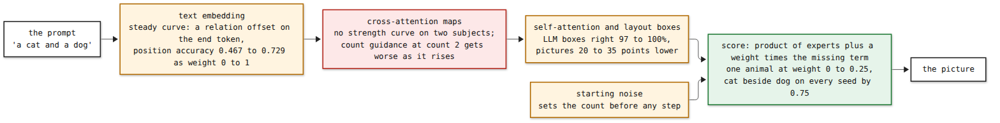

# Shared representations: where text, latents and scores share structure that a dial could act on

Board step H2, Loop 15 (`s15`). Thirteen papers were read for this page from their PDFs, 27 more are
cited from the project's own notes without rereading, and the sampler results come from the project's
sampler scope (16 review files and 15 finding pages). Every page number is a PDF page.

**The answer.** A text-to-image model shares structure across five places a dial could act: the text
embedding, the cross-attention maps, the self-attention and layout, the starting noise, and the score.
Only the score has shown a weight that turns one subject into two as it rises: adding back a fraction of
the term a composition rule drops gives one animal at weights 0 and 0.25 and a cat beside a dog on every
seed by 0.75, so it behaves as a switch more than a slope. The text embedding holds the only smooth
published curve for a relation (Relation Rectification: position accuracy 0.467 to 0.729 as its weight
goes from 0 to 1, with FID rising from 83.73 to 110.01). No cross-attention method has a strength curve
on two different subjects, and the one count curve recorded there gets worse as its strength rises.
Score algebra beyond AND (contrast, harmonic mean, logic) is exact only where the concepts already share
support, which an unseen pair does not. Sampler machinery (Langevin correctors, Feynman-Kac steering,
twisted sequential Monte Carlo, noise search) moved plain product-of-experts pictures nowhere in this
project and helped only once the score correction was already present.

*The five places a dial could act, in the order the prompt reaches them, each with its best measured
strength result. Green: a weight that moves two subjects together. Amber: a steady curve for something
nearby (a relation, a layout), or a lever with no curve. Red: no curve, or the curve goes the wrong way.
Drawn from [the diagram source](02-where-a-dial-could-act.mmd).*

## Table of contents

- [Words this uses](#words-this-uses)
- [The main table: five places a dial could act](#the-main-table-five-places-a-dial-could-act)
- [1. The text embedding](#1-the-text-embedding)
- [2. Cross-attention maps](#2-cross-attention-maps)
- [3. Self-attention, layout and symbolic plans](#3-self-attention-layout-and-symbolic-plans)
- [4. Score arithmetic, logic and energy composition](#4-score-arithmetic-logic-and-energy-composition)
- [5. The sampler mathematics of composition](#5-the-sampler-mathematics-of-composition)
- [What follows for the dials](#what-follows-for-the-dials)
- [Where the sources disagree](#where-the-sources-disagree)
- [Still open](#still-open)
- [Where this came from](#where-this-came-from)

## Words this uses

**Dial.** A single number that, turned up, should move one property of the picture (how strongly two
subjects co-occur, a count, how firmly an attribute sits on its object) and leave the rest alone.

**Steady.** The measured outcome moves the same way at every step of the strength sweep. A **switch**
moves from one state to another between two settings with nothing in between measured.

**The missing term.** For two concepts A and B at one noise level, the exact joint score is the product
of experts' score plus $\nabla_x \log \frac{p_t(A,B \mid x)}{p_t(A \mid x)\,p_t(B \mid x)}$; this
project calls that term $r_t$, the interaction term
([the ratio classifier idea](../manager/ratio-classifier-idea.md)).

**End token.** The text encoder's end-of-text position (EOT in the papers), which in SDXL carries most
of the prompt's meaning (Padding Tone, p. 12).

**Read marks.** *read from the paper*: the PDF was opened at that page for this page. *read from the
project's note*: the number is copied from the note named in the row, which records its page.
*inferred*: this page's reasoning.

## The main table: five places a dial could act

| Place | What it shares across subjects | Steady strength curve shown? | Count | Two subjects together | Attribute binding | Where it breaks | Mark |
|---|---|---|---|---|---|---|---|
| Text embedding | the end token sets layout for any subject pair; a learned token can carry a count for any class | **yes, for a relation**: position accuracy 0.467, 0.564, 0.646, 0.697, 0.729 at weight 0, 0.2, 0.4, 0.6, 1 (Relation Rectification, Table 1, p. 7) | a learned count token: 45.61% exact up to 9 objects, and tokens reused across animal groups lose little (MAE 6.11 within group against 6.61 across, p. 7) | small moves only: fused creatures 9.5% to 8.5% (A Cat Is A Cat, p. 8) | small: TTS 0.817 to 0.838 (FRAP, Table 1, p. 9) | meaning is spread over several tokens, so one token is a weak lever (Get What You Want, p. 4); stacked offsets on the end token interfere (Relation Rectification, p. 15) | read from the paper and the project's notes |
| Cross-attention maps | one map per word over the canvas; overlap of two subjects' maps predicts failure | **no** on two subjects; the count curve goes the wrong way: normalised count error about 0.47 unguided, 0.485 at strength 0.3, 0.56 at 3.0 (Counting Guidance, Fig. 7c, p. 13) | see left | both present 52% for same-category pairs against 61% unrelated, falling as map overlap rises (DAAM, p. 7) | proper binding 94.76% against 59.05% on one set (SynGen, Table 2, p. 7), strength shown only in pictures | early steps only; artifacts after step 25 of 50 (CONFORM, p. 12) | read from the project's notes |
| Self-attention, layout and symbolic plans | boxes written by a language model name any object | **rises then falls**: LLM-grounded Diffusion's attention-transfer weight 0 to 4 gives 70.8, 75.0, 76.5, 77.3, 75.0% (Table D.3, p. 23) | layouts right 97 to 100%, pictures 39% to 86% (LLM-grounded Diffusion, Tables 1 and 2, pp. 9 to 10) | similar-animal preference 0.85 (Bounded Attention, Table 2, p. 9) with boxes given | colour binding 52% to 69% (LLM-grounded Diffusion, Table 1, p. 9) | the renderer loses 20 to 35 points from layout to picture | read from the paper |
| Starting noise | each noise seed has a preferred count whatever the prompt asks | not a dial; a layout written into the noise lifts held-out categories from about 21% to 32 to 39% (Numerosity, Table 5, p. 16, in [the H1 page](01-directions-that-generalise.md)) | yes, the main lever | not measured | not measured | search over nearby noises does not compose plain product of experts (project, 1 of 8 at spread 0.1) | read from the paper and the project's findings |
| Score | the product of experts drops the same term for every pair; adding it back is subject-free | **a switch**: SuperDiff's own missing term at weight 0, 0.25, 0.5, 0.75: one animal at 0 and 0.25 on every seed, two by 0.75 on every seed (project finding) | Composable Diffusion accuracy falls 86.42%, 59.20%, 31.36% with 1, 2, 3 positions (Table 1, p. 11) | the project's adapter supplies the term and composes unseen pairs; the switch sits between weights 0.25 and 0.75 | Concept Algebra and Logical Guidance have no binding number | the weight washes out when the correction is moved into another sampler, from 0.5 (project finding) | read from the project's notes and findings |

## 1. The text embedding

| Paper | What it adds or reweights | Strength against outcome | Count, relation or binding | Where it breaks | Mark |
|---|---|---|---|---|---|
| Wu et al., "Relation Rectification in Diffusion Model", arXiv 2403.20249, CVPR 2024 | a small graph network's offset $h$ added to the end token, $V^*_{eot} = V_{eot} + \lambda h$ (Eq. 5, p. 5), trained per relation from one object-swapped prompt pair and 3 to 5 images, SD 2.1 | **steady to 0.6**: position accuracy by Qwen-VL 0.467, 0.564, 0.646, 0.697, 0.729 at λ 0, 0.2, 0.4, 0.6, 1; action accuracy 0.399, 0.469, 0.492, 0.500, 0.490; FID 83.73, 89.13, 94.73, 100.78, 110.01 (Table 1, p. 7) | relation: the end tokens of "A on B" and "B on A" have cosine near 1, which is the cause (p. 4); unseen objects shown only (p. 7) | needs a larger λ when the model lacks the concept, costing quality (p. 13); stacked offsets degrade (p. 15) | read from the paper |
| Yu et al., "Uncovering the Text Embedding in Text-to-Image Diffusion Models", arXiv 2404.01154 | scales one word's embedding (Eq. 2, p. 4), blends two words $w[\text{dog}] + (1-w)[\text{cat}]$ (Fig. 7, p. 7), directions from the embedding's SVD (Fig. 13, p. 8), SD 1.4 | no curve: picture rows only (Fig. 8, p. 7) | not tested | removing any single word's embedding barely changes the picture, apart from the start token (p. 4), so one word is a weak lever (inferred) | read from the paper |
| Li et al., "Get What You Want, Not What You Don't", arXiv 2402.05375, ICLR 2024 | shrinks the singular values of the unwanted word's and the end tokens' embeddings, $\hat\sigma = e^{-\gamma\sigma}\sigma$ (Eq. 2, p. 6) | **a switch**: the object disappears only past some γ (Fig. 16, p. 19, pictures); detector score for the unwanted object 0.4509 to 0.1321 (Table 1, p. 7) | removes a named object; no count or relation | zeroing the word alone fails, zeroing the end tokens alone fails, only both works (p. 4); long prompts leak it back, 0.084 to 0.427 with 32 extra words (Table 4, p. 19) | read from the paper |
| Toker et al., "Padding Tone", arXiv 2501.06751 | analysis, no dial | in SDXL the padding carries almost nothing: the end token alone gives CLIP score 0.30 against 0.34 for the full prompt (Table 4, p. 12); SD2 KID 0.02 from prompt tokens against 31.09 from padding (Table 1, p. 5) | none reported per category | FLUX and SD3 do use the padding (Table 3, p. 7) | read from the paper |
| Jiang et al., "FRAP: Faithful and Realistic T2I Generation with Adaptive Prompt Weighting", arXiv 2408.11706, TMLR 2025 | per-token weight $\phi c_y + (1-\phi)c_\varnothing$ (Eq. 2, p. 4), updated every step, bounded to 0.6 to 1.4 (p. 19) | a fixed weight 1.4 trades realism for alignment: text alignment 0.815 to 0.841, realism 0.746 to 0.694 (Table 9, p. 25) | binding 0.817 to 0.838 (Table 1, p. 9); counting "still an open challenge" (p. 31) | static weights degrade the image (p. 25) | read from the paper |
| Zafar et al., "Detection-Driven Object Count Optimization", arXiv 2408.11721 | one appended token optimised per class and count against a counter (pp. 4 to 5) | no dial: one token per count | 45.61% up to 9 objects against SDXL 28% (Table 1, p. 6); tokens reused across animal groups MAE 6.11 within against 6.61 across (Fig. 8, p. 7) | needs a token per count, so no single "more" direction (inferred) | read from the paper; also in [Loop 7's note](../abstract-checkers/01-reading/iterative-object-count-optimization.md) |
| Linear Spaces of Meanings, arXiv 2302.14383 | a prompt embedding as a sum of one vector per factor value (Prop. 4, p. 3) | no curve | inferred from its Lemma 2 (p. 3): an additive embedding's swap difference does not depend on the nouns, so it cannot carry binding or left-right order | exact only if factors are independent given the image (Prop. 7, p. 5) | read from [the project's note](../noise-text-critic/01-reading/linear-spaces-of-meanings.md) |
| Magnet (2409.19967), A Cat Is A Cat (2410.00321), Structure Diffusion Guidance (2212.05032) | binding vectors on object tokens; pull each object token toward its solo embedding; per-phrase averaging | no curve in any | A Cat Is A Cat: fused creatures 9.5% to 8.5%, both present 14.5% to 15.0% (Table 4, p. 8); Magnet: attribute alignment 74.0 against 66.2 (Table 2, p. 6) | Magnet does nothing on adjective-free animal pairs (inferred) | read from the project's notes ([Magnet](../leakage/01-reading/magnet.md), [A Cat Is A Cat](../leakage/01-reading/a-cat-is-a-cat.md), [Structure Diffusion](../leakage/01-reading/structured-diffusion-guidance.md)) |

## 2. Cross-attention maps

| Paper | What it reweights | Strength against outcome | Count, two subjects or binding | Where it breaks | Mark |
|---|---|---|---|---|---|
| Hertz et al., "Prompt-to-Prompt Image Editing with Cross Attention Control", arXiv 2208.01626, ICLR 2023 | multiplies one token's attention column by $c$ from −2 to 2 (p. 8) | no curve: picture rows for adjectives (Fig. 9, p. 10; Fig. 15, p. 19) | not tested | "cannot be used to spatially move existing objects" (p. 11) | read from the paper |
| Attend-and-Excite, 2301.13826 | raises the weakest subject's peak, first 25 of 50 steps | fixed schedule, no curve | animal pairs: caption similarity 0.806 against SD 0.767 (Table 1, p. 7) | no term pushes two maps apart (p. 4) | read from [the project's note](../abstract-checkers/01-reading/attend-and-excite.md) |
| SynGen, 2306.08877 | pulls each modifier's map onto its noun, pushes it from others | larger α separates more "only to a point", blur above about 20 (p. 15, pictures) | proper binding 74.90 against 52.47 for Attend-and-Excite (Table 2, p. 7) | nothing to do on "a cat and a dog", which has no modifier (p. 5) | read from [the project's note](../abstract-checkers/01-reading/syngen-linguistic-binding.md) |
| Counting Guidance, 2306.17567 | a counter's gradient on the decoded estimate | **wrong way** at count 2: about 0.47 unguided, 0.50 at 0.1, 0.485 at 0.3, 0.545 at 1.0, 0.56 at 3.0 normalised count error (Fig. 7c, p. 13) | two object types: CLIP similarity only, 0.329 against 0.330 (Table 1c, p. 8) | early estimates too poor to count (p. 5) | read from [the project's note](../abstract-checkers/01-reading/counting-guidance.md) |
| Divide and Bind (2307.10864), CONFORM (2312.06059), Self-Cross Guidance (2411.18936) | spread each map, contrast maps, or penalise one subject's cross-attention inside the other's self-attention | none has a curve | animal pairs TIFA about 0.70 over SD (Divide and Bind, Fig. 6, p. 8); 0.95 against 0.68 (CONFORM, Table 2, p. 7); not-a-mixture 92.94 against 84.22 (Self-Cross, Table 4, p. 7) | cannot recover an object missing from the first map (CONFORM, p. 8) | read from the project's notes ([Divide and Bind](../leakage/01-reading/divide-and-bind.md), [CONFORM](../leakage/01-reading/conform.md), [Self-Cross](../leakage/01-reading/self-cross-guidance.md)) |
| DAAM, 2210.04885 | read-out only | an association, not a dial: both present 71.7%, 19.3%, 9.75% for same-category pairs at low, middle and high map overlap (Fig. 6, p. 7, read from the plot) | same-category 52% against 61% unrelated (p. 7) | overlap is read from the picture whose failure is scored (inferred) | read from [the project's note](../leakage/01-reading/daam.md) |

## 3. Self-attention, layout and symbolic plans

| Paper | What it acts on | Strength against outcome | Count, relation, binding | Where it breaks | Mark |
|---|---|---|---|---|---|
| Lian et al., "LLM-grounded Diffusion", arXiv 2305.13655 | a language model writes boxes; each box drawn alone with a cross-attention energy, then composed with attention transfer weight λ (Eq. 2 to 3, p. 6; Eq. 7, p. 7) | **rises then falls**: λ 0 to 4 gives 70.8, 75.0, 76.5, 77.3, 75.0%; background weight 1, 2, 4, 8 gives 72.3, 75.8, 76.5, 72.5% (Table D.3, p. 23) | counts 39% to 62% to 86% for SD, LMD, LMD+; colour binding 52, 65, 69; left-right 28, 79, 67 (Table 1, p. 9); the layouts alone 97, 100, 99 (Table 2, p. 10) | the controller, not the plan, is the bottleneck (p. 10) | read from the paper |
| Feng et al., "LayoutGPT", arXiv 2305.15393, NeurIPS 2023 | CSS-style boxes from GPT, rendered by GLIGEN or ReCo | no weight | count layout 86.33%, picture 51.20% against SD 32.22% (Table 2, p. 6); colour binding 18.68% against 12.84% (Table 3, p. 7) | counts over two categories drop to 66.60% (Table 10, p. 19) | read from the paper |
| Cho et al., "Visual Programming for Text-to-Image Generation and Evaluation", arXiv 2305.15328, NeurIPS 2023 | a fine-tuned language model writes objects, counts and boxes; GLIGEN at a fixed grounding strength 0.3 (p. 19) | no curve | count, spatial, scale 72.2, 56.1, 26.3% against SD 47.4, 22.9, 11.9 (Table 1, p. 7); unseen subjects shown only (Fig. 10, p. 16) | layouts right 92%, pictures 65% on 50 open prompts (p. 17); no depth relations (p. 19) | read from the paper |
| Christopher et al., "Neuro-Symbolic Generative Diffusion Models for Physically Grounded, Robust, and Safe Generation", arXiv 2506.01121, NeuS 2025 | projects the sample onto a hand-written constraint at every step (p. 6) | no strength: hard constraint; violations 0.0% against 100.0% under Moon gravity, FID 22.5 to 26.5 (p. 23) | position of an object in synthetic frames only (p. 23) | every constraint needs a computable test and a projection; none exists for "two animals present" (pp. 22 to 24) | read from the paper |
| Bounded Attention (2403.16990), Be Decisive (2505.21488), Make It Count (2406.10210) | mask attention per subject box; layout from the noise; cluster instances in self-attention | ablations, not curves | similar-animal preference 0.85 (Bounded Attention, Table 2, p. 9); count 2 about 86% (Make It Count, Fig. 10, p. 14) | needs boxes; 77 s and 36 GB against 7 s and 8 GB (Be Decisive, p. 12) | read from the project's notes ([Bounded Attention](../leakage/01-reading/bounded-attention.md), [Be Decisive](../leakage/01-reading/be-decisive.md), [Make It Count](../abstract-checkers/01-reading/make-it-count.md)) |

## 4. Score arithmetic, logic and energy composition

| Paper | What it adds | Strength against outcome | Count, relation, two subjects, binding | Where it breaks | Mark |
|---|---|---|---|---|---|
| Garipov et al., "Compositional Sculpting of Iterative Generative Processes", arXiv 2309.16115, NeurIPS 2023 | a classifier on which model made $x_t$, its gradient added for harmonic-mean and contrast operators (Eq. 8 to 9, p. 6), α-weighted (Eq. 11, p. 6) | no curve; error to the exact composition on a grid 0.071 harmonic, 0.086 contrast, 0.167 contrast at α 0.05 (p. 29) | none: attribute sets on coloured MNIST (p. 14) | the harmonic mean is "undefined when p1 and p2 have disjoint supports" (p. 6), which is the unseen pair; one classifier per set of models | read from the paper |
| Composable Diffusion, 2206.01714 | weighted sum of conditional-minus-unconditional predictions; negation (Eq. 11, p. 7; Eq. 15, p. 8) | no curve | positions 86.42%, 59.20%, 31.36% at 1, 2, 3; relations 60.40%, 21.84%, 2.80% (Tables 1 and 2, pp. 11 to 12) | fuses objects into one hybrid when centred (p. 13) | read from [the project's note](../score-space/01-reading/composable-diffusion.md) |
| Reduce, Reuse, Recycle, 2302.11552 | score sum plus Langevin or Hamiltonian steps at each noise level (Alg. 1, p. 5) | the dial is compute: 5-cube accuracy about 51% to 66% as Metropolis-adjusted steps per level go 0 to 25 (Fig. 5, p. 7, read from the plot) | 91.6% at 1 cube to 72.7% at 5 (Table 2, p. 6) | the summed score is not the noised product's score at $t > 0$ (p. 4); fails when supports do not overlap (pp. 17 to 18) | read from [the project's note](../score-space/01-reading/reduce-reuse-recycle.md) |
| SuperDiff, 2412.17762 | weighted average of scores, weights from tracked densities (Eq. 13, p. 6) | no curve for AND | AND draws one animal mixing both (p. 2) | weights sum to 1, so it averages (p. 6) | read from [the project's note](../score-space/01-reading/superdiff.md) |
| CFGComposer, 2611.15101 | λ times (joint model minus product) every step (Eq. 11 to 12, p. 4) | **steady**: gesture recall about 0.915 at λ 0, 0.9916 at 0.7, about 0.987 at 1 (Fig. 4, p. 8) | motion only | needs a model trained on joint data (pp. 5 to 6) | read from [the project's note](../noise-text-critic/01-reading/cfgcomposer.md) |
| Projective Composition (2502.04549), Concept Algebra (2302.03693), Local Mechanisms (2509.16447) | unit-weight sums of differences; projection onto a concept subspace; local scores | none has a curve; the theory covers weight 1 only | "a dog" plus "a horse" fails on SDXL (Projective, Fig. 7, p. 10); enforcing local scores lifts the largest count from 2 to 9 (Local Mechanisms, p. 3) | needs disjoint feature blocks (Projective, Thm. 5.3, p. 6) | read from the project's notes ([Projective](../noise-text-critic/01-reading/projective-composition.md), [Concept Algebra](../noise-text-critic/01-reading/concept-algebra.md), [Local Mechanisms](../noise-text-critic/01-reading/local-compositional-generalization.md)) |
| Logical Guidance (2602.05549), Lift Scores (2505.13740) | summed noisy-classifier gradients; a reject rule on per-concept lift | no dial; AND scores 80.4%, identical to the constant-weight baseline (Table 2, p. 5) | no interaction term in either | exact only when the posteriors factor given $x_t$ (Prop. 3.1, pp. 3 to 4) | read from [the reviewer's section](../reviewer/2026-11-24-review.md), "The ratio classifier, 2026-11-25" |

## 5. The sampler mathematics of composition

All from this project's sampler scope, `1-lora-correction/plans/06-is-the-gap-the-samplers-or-the-models/`.
Paths below are to the finding pages in
[the sampler findings folder](../../../../1-lora-correction/report/is-the-gap-the-samplers-or-the-models/does-superdiff-compose-at-its-own-defaults.md)'s
directory.

| What was asked | What came back | Finding | Mark |
|---|---|---|---|
| Does SuperDiff compose at its own settings, and what is it missing? | null at 200 steps; adding back λ times its own missing term $\varepsilon_J - \varepsilon_M$ turns one animal into two between λ 0.25 and 0.75 on every seed: cat and dog 0 of 4 at 0.25, 4 of 4 by 0.75; butterfly and meadow 4 of 4 by 0.25 (lines 9 to 10, 52 to 63) | [SuperDiff at its defaults](../../../../1-lora-correction/report/is-the-gap-the-samplers-or-the-models/does-superdiff-compose-at-its-own-defaults.md) | read from the project's findings |
| Does the product-of-experts correction carry into SuperDiff? | null, it hurts: never separates on 12 of 12 seeds; degrades from λ 0.25, washes out from 0.5 | [the correction in SuperDiff](../../../../1-lora-correction/report/is-the-gap-the-samplers-or-the-models/does-the-poe-trained-correction-carry-into-superdiff.md) | read from the project's notes |
| Does a Langevin corrector remove part of the correction? | inconclusive at step sizes 30, 3 and 0.3 (the two largest step counts differ by 6.7%, 21% and 38% against a 5% bar); a corrector alone gives 0 of 8 two-animal pictures | [the corrector finding](../../../../1-lora-correction/report/is-the-gap-the-samplers-or-the-models/does-a-langevin-corrector-remove-part-of-the-correction.md), [corrector alone](../../../../1-lora-correction/report/is-the-gap-the-samplers-or-the-models/does-a-corrector-alone-produce-two-animals.md) | read from the project's notes |
| Twisted sequential Monte Carlo on a learned twist | inconclusive: twist validation 0.5625 against a 0.60 bar; 0.0 composed | [selection among proposals](../../../../1-lora-correction/report/is-the-gap-the-samplers-or-the-models/does-selecting-among-poe-proposals-compose.md) | read from the project's notes |
| Feynman-Kac steering on plain product of experts | null: 0 of 128 particles composed | [steering on the scorer](../../../../1-lora-correction/report/is-the-gap-the-samplers-or-the-models/does-steering-on-the-scorer-find-a-composing-proposal.md) | read from the project's notes |
| Feynman-Kac steering on top of the rank-32 correction | support at λ 0.5: 8 of 8 against 3 of 8 for the correction alone, but best of 16 unweighted draws is also 8 of 8 | [steering the corrected sampler](../../../../1-lora-correction/report/is-the-gap-the-samplers-or-the-models/does-steering-the-corrected-sampler-produce-clean-pairs.md) | read from the project's notes |
| Search over nearby starting noises, plain product | null in substance: 1 of 8 at spread 0.1 (one body with two heads), 0 of 8 at 0.3 | [noise search](../../../../1-lora-correction/report/is-the-gap-the-samplers-or-the-models/does-searching-over-the-initial-noise-compose.md) | read from the project's notes |
| Do other models and settings still fuse? | PixArt-alpha with no CLIP: product 0 of 8 clear pairs, joint prompt 7 of 8; SDXL at PixArt's sampler settings: 0 of 8, joint 8 of 8 | [no-CLIP model](../../../../1-lora-correction/report/is-the-gap-the-samplers-or-the-models/does-a-clip-free-model-hybridise.md), [SDXL at PixArt's settings](../../../../1-lora-correction/report/is-the-gap-the-samplers-or-the-models/does-sdxl-compose-at-pixarts-settings.md) | read from the project's notes |
| An energy penalty on the adapter's correction | null, it hurt: shrinking the correction moved renders toward plain product, compose 7 to 6 (W&B `2cfdtdnl`) | [the energy penalty review](../../../../1-lora-correction/plans/01-showcase-the-trained-lora/review/22-charge-the-adapter-for-its-energy.md) | read from the project's notes |
| Is the gap the sampler's or the model's? | no overall verdict; review 03 calls the two "inseparable at high noise by construction"; the lower bound on the model's share (review 01) has not run | the scope's review files | read from the project's notes |

The published methods behind these rows are already read: Feynman-Kac Correctors (arXiv 2503.02819)
and Thornton et al. (arXiv 2502.12786) are in the paper-scout profile's known list and the scope's
review 07; they are cited, not reread.

## What follows for the dials

Inferences for H3 and H4, from the rows above.

1. **A co-occurrence dial belongs in the score.** It is the only place where a weight has moved two
   subjects together, on every seed, and the term it scales is the same for every pair. Its curve is a
   switch between 0.25 and 0.75, so a dial from 1 to 10 needs a mapping that spreads the switch, or a
   measurement that changes inside it (an overlap of the two subjects' attention maps, which DAAM shows
   falls steadily with success).
2. **A count dial belongs in the starting noise and the first steps,** with the target read off a
   detector or instance clusters, not off a text token: reweighting fixed nothing (FRAP, p. 31), the
   cross-attention count curve goes the wrong way, and layouts in the noise carry to new categories.
3. **A binding dial is the least supported.** The text side has the only steady relation curve
   (Relation Rectification), learned from 3 to 5 images per relation and costing 26 FID points across
   its range; cross-attention binding (SynGen) has only pictures for its strength.
4. **Plans written as boxes are near perfect and the renderer loses 20 to 35 points.** Any dial that
   acts through a layout inherits that gap.
5. **Sampler machinery is not a dial on its own here.** Correctors, steering and noise search moved
   nothing on the plain product and help only once the score correction is present.

## Where the sources disagree

Reported, not resolved.

- **Stale review headers in the sampler scope.** Reviews 05 and 07 (SuperDiff) still read "Nothing has
  run yet", and the scope's master plan lists steps 28 and 49 as not started, while the finding pages
  hold verdicts verified 2026-09-05. The position tables in reviews 02 to 04 still say "the verdict: not
  yet run" under headlines that report results. Sent to the manager.
- **The rank-32 adapter at λ 1.2 on cat and dog:** 7 of 8 in review 11's free row (seed 14 fails), 6 of
  8 through review 12's sampler (seeds 11 and 14 one animal).
- **Stable Diffusion's baseline on two-animal prompts:** TIFA about 0.70 in the Divide and Bind note (from
  a bar chart, version not printed) and 0.68 in the CONFORM note (SD 1.5).
- **A Cat Is A Cat's both-present rate on SD 1.4:** 12.25% and 11.75% in its Table 1 (p. 4) against
  14.5% in its Table 4 (p. 8), both as the project's note records them.

## Still open

- **Not opened:** Tiramisu (arXiv 2401.03349, a probabilistic circuit for inpainting only), CountCluster
  (2508.10710).
- **No paper sweeps a strength against "two subjects together" on a text-to-image model.** The
  project's SuperDiff residual sweep is the only such curve found, with 4 seeds per pair and four
  settings, so where inside 0.25 to 0.75 the switch sits is not known.
- **Whether a weighted score correction carries across samplers** is open: the product-of-experts
  correction hurt inside SuperDiff, while SuperDiff's own term worked.

## Where this came from

Three passes on 2026-11-25. Two read new papers from their PDFs with `pdftotext`, keeping
[the text and attention notes](02-reading/text-reader-notes.md) and
[the symbolic composition notes](02-reading/symbolic-reader-notes.md). One read the project's 27 paper
notes, the reviewer's ratio classifier section, the sampler scope's 16 reviews and master plan, and its
finding pages, without fetching any paper. Every arXiv id read in this pass was checked against its
title. SynGen (2306.08877) and Detection-Driven Object Count Optimization (2408.11721) were opened again
by the new readers although the project already holds notes on them; the rows cite both.
