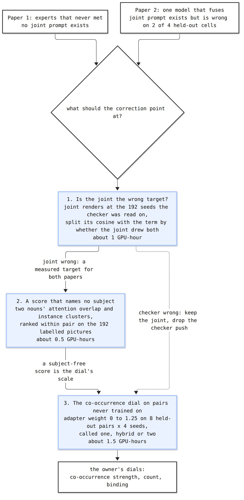

# Limits and what to test: what is learnable, what the project's approaches cannot do, and three experiments that link the papers

Board step H4, Loop 15 (`s15`). This page draws on [the H1 page](01-directions-that-generalise.md),
[the H2 page](02-shared-representations.md) and [the H3 page](03-dials.md), the reviewer's sections on
the ratio classifier and the last identity reader, the unseen-pair toy, and Loop 6's check of which way
the kept checker's push points (step M13). It reads no new paper. Paper 1 composes diffusion models
trained apart, so no joint prompt exists for the pair; Paper 2 corrects how one frozen model draws two
subjects, where a joint prompt exists ([the two-paper route](../../../../plans/route-two-papers.md)).

**The answer.** On a pair no data holder saw, the dropped interaction term is not learnable from data:
the data says the pair does not happen. It is reachable only through an assumed structure, and the
project's toy shows a low-rank one reaches the held-out cell (share 0.844 against the true joint's 0.924)
where a full-rank one does not (0.120). Properties no subject owns (where things are, how many, whether
they are apart) are learnable and carry to new subjects; identity ("which animal is where") did not, in
the literature or in this project. The project's approaches have each hit one of these limits: a
data-faithful ratio pushes away from the unseen pair, the checker's push cannot split one hybrid body and
points against the dropped term, identity readers score below knowing the pair, and sampler machinery
does not move the plain product. The joint prompt is itself wrong on some seeds, so a correction trained
toward it learns its failures, and Loop 6's finding that the checker's push opposes the joint-minus-product
term fits a checker that is right where the joint is wrong as well as a checker that is wrong. The three
ranked experiments test those two readings first, then a score that names no subject, then whether
co-occurrence strength behaves as a dial on pairs never trained on. Together they cost about 3 GPU-hours.

*The three experiments in their order. A solid arrow is the path if experiment 1 finds the joint is the
wrong target; the dashed arrow is the path if it finds the checker is wrong. Drawn from
[the diagram source](04-three-experiments.mmd).*

## Table of contents

- [Words this uses](#words-this-uses)
- [What is learnable in principle](#what-is-learnable-in-principle)
- [What the project's approaches cannot do](#what-the-projects-approaches-cannot-do)
- [What changes when the joint itself is wrong](#what-changes-when-the-joint-itself-is-wrong)
- [Three experiments, ranked](#three-experiments-ranked)
- [The board question](#the-board-question)
- [Where the sources disagree](#where-the-sources-disagree)
- [Still open](#still-open)

## Words this uses

**The dropped term, $r_t$.** For two concepts A and B at one noise level, the exact joint score is the
product of experts' score plus $\nabla_x \log \frac{p_t(A,B \mid x)}{p_t(A \mid x)\,p_t(B \mid x)}$. In
noise-prediction units the project measures it as
$r_t = \varepsilon(\text{joint}) - (\varepsilon(A) + \varepsilon(B) - \varepsilon(\varnothing))$
([the ratio classifier idea](../manager/ratio-classifier-idea.md)).

**The joint prompt.** One prompt naming both subjects ("a cat and a dog"). Its prediction is what $r_t$
measures the product against, and what the project's adapter is trained toward.

**The kept checker.** Loop 6's readout checker on SDXL features, whose gradient is the push the project
kept (steps 0 to 15, cap 0.3).

**Two clear.** A blind reviewer's call that a picture shows both asked subjects, each clearly itself.

**Within-pair AUC.** Over every two pictures of the same pair where one is two clear and the other is not,
how often a score ranks the two-clear one higher; 0.5 is chance, and a score that knows only the pair
gets exactly 0.5 ([the reviewer's last identity reader section](../reviewer/2026-11-24-review.md)).

**Read marks.** *read from the project's findings*: copied from the file named; *read from a summary*:
from a note that summarises a source this page did not reopen; *inferred*: this page's reasoning.

## What is learnable in principle

| Claim | Why | Source | Mark |
|---|---|---|---|
| On a pair no data holder saw, the interaction term is not learnable from data | the data's own ratio there is zero, so a classifier faithful to the data learns "avoid this pair" and pushes away from it | the reviewer's ratio classifier section, Question 3; the toy: the data-faithful push scores share 0.000 at every held-out cell | read from the project's findings |
| It is reachable through an assumed low-rank structure, and only when the true interaction is low rank | a pair score built from a row part and a column part never sees the unseen pair and is set by the parts alone | the toy: low-rank push 0.844 against the true joint's 0.924; 0.120 when the true interaction is full rank ([the toy's card](../../../results/can-a-classifier-reach-an-unseen-pair/README.md)) | read from the project's findings |
| A rank-r interaction needs enough seen cells spread over rows and columns | on 10 by 10 cells, about 36 seen for rank 1, 51 for rank 2, 64 for rank 3 (a necessary count from parameters, not a guarantee) | the reviewer's ratio classifier section, Question 3 | read from the project's findings (the count itself inferred there) |
| Properties no subject owns are learnable and carry; identity is not | a checker on where-maps for "two digits apart" kept 0.791 on unseen digits against 0.782 on seen; an identity checker read 0.555; in the literature, directions trained on a measurement carry, directions trained on a text pair or one dataset do not | [the unseen-digit finding](../../../../2-classifier-guidance/report/abstract-checkers-on-digits/does-a-checker-learn-plurality-on-unseen-digits.md); [H1's main table](01-directions-that-generalise.md#the-main-table-which-kinds-carry-and-why) | read from the project's findings and the papers |
| Readable is not steerable | shadow and support are linearly readable from SD features at AUC 95.4 and 92.1 of 100 (Zhan et al., Table 4, p. 9) and no paper read steers with such a probe | [H1, section 4](01-directions-that-generalise.md#4-scene-relations-and-counts-as-probes-or-directions) | read from the paper |
| A dial keeps its order on new prompts when its target is measured | 9.6% against 99.8% of ordered strength sweeps, text target against measurement target, matched FLUX training (Measured Sliders, p. 9) | [H1, section 2](01-directions-that-generalise.md#2-concept-sliders-and-text-token-directions) | read from the paper |

## What the project's approaches cannot do

| Approach | What it cannot do | Number | Source | Mark |
|---|---|---|---|---|
| A ratio classifier trained on the data | reach a pair no holder saw: it learns the pair's absence | share 0.000 at every held-out toy cell | the toy's card | read from the project's findings |
| The kept checker's push | split one hybrid body on plain product of experts; it also spoils pictures already right | 0 of 12 plain-product failures made two clear (random push 0); 4 of 8 CO3 draws already right spoiled | [Z8's review](../leakage/08-first-correction-test/review.md), lines 3 and 19 | read from the project's findings |
| The same push | point where the dropped term points | median cosine with $r_t$ on CO3 −0.105, −0.043, −0.053, −0.042 at steps 0, 5, 10, 15; on plain product −0.075 to −0.025; random about 0.000 with spread 0.003 to 0.005 | [M13's review](../method-search/09-gradient-direction-check/review.md) | read from the project's findings |
| Readers of which animal is where | beat knowing only the pair | pair lookup 0.757 balanced accuracy on fresh seeds; readers 0.632 to 0.688; the per-place reader 0.427 to 0.512 within pair, around chance | [the reviewer's last identity reader section](../reviewer/2026-11-24-review.md) | read from the project's findings |
| Correctors, Feynman-Kac steering, twisted sequential Monte Carlo, noise search | move the plain product toward two animals | 0 of 8, 0 of 128 particles, 0.0, 1 of 8 | [H2, section 5](02-shared-representations.md#5-the-sampler-mathematics-of-composition) | read from the project's findings |
| A correction trained for one sampler | carry into another | the product-of-experts correction never separates inside SuperDiff, 12 of 12 seeds; washes out from λ 0.5 | [H2, section 5](02-shared-representations.md#5-the-sampler-mathematics-of-composition) | read from the project's findings |
| The instance-count scorer | tell a cat and a dog from two dogs | cat and dog, seed 10, counted 2, shows two dogs | [the compose rate page](../../../../context/world/compose-rate.md) | read from the project's findings |
| Any count dial built on the text | set a count by the number word; the word's attention is diffuse, and "a times b" phrasing halves accuracy | FLUX 1.1 0.38 to 0.16 (T2ICountBench, Table 3, p. 11) | [H3, section 2](03-dials.md#2-count) | read from the paper |

## What changes when the joint itself is wrong

**The joint prompt fails on some seeds.** On the held-out cells of the cat-and-dog adapter page, the
joint render draws two dogs at cat and dog seed 10 and an elephant with no penguin at elephant and
penguin seed 9, two of four cells, while the adapter draws a cat and a dog at seed 10
([which adapter composes cat and dog](../../../../1-lora-correction/report/the-adapter-on-cat-and-dog/which-adapter-composes-cat-and-dog.md),
lines 48 to 54, read from the project's findings). A project memory note records the joint prompt
drawing one of each animal on 6 of 17 cached cat-and-dog seeds; no report page holds that count, so it is
read from a summary and asked of the manager. In the literature, the first-named animal is drawn alone in
46.00% of SD 1.4 pictures (A Cat Is A Cat, Table 1, p. 4, from
[the project's note](../leakage/01-reading/a-cat-is-a-cat.md)), and same-category pairs show both in 52%
against 61% for unrelated ones (DAAM, p. 7).

**Three things change.**

1. **The term $r_t$ carries the joint's failures.** Where the joint draws two dogs, joint minus product
   points toward two dogs, so a correction trained toward the joint (the ICLR adapter) learns that
   failure on those seeds, and a dose curve scored by counting animals rewards it.
2. **Distances to the joint render stop meaning anything on those seeds.** Any bar that measures how close
   a render comes to the joint's picture fails where the joint is wrong; the blind calls that judge a
   render against the prompt are unaffected.
3. **Paper 1 and Paper 2 meet.** Paper 1 has no joint at all, so it needs a target that is measured from
   the picture. If the joint is also the wrong target in Paper 2, both papers need the same kind of
   target, and H1 says that kind (a measurement no subject owns) is the kind that carries.

**Loop 6's direction check, read both ways.** The kept checker's push points against $r_t$, and on CO3 the
pictures later called two clear lean further against it at step 0 (−0.139 against −0.088; M13's review).

| Reading | What it predicts | What already bears on it | Mark |
|---|---|---|---|
| The checker is wrong | the push opposes $r_t$ equally on seeds where the joint draws both subjects and where it does not; pushing hurts | Z8: no plain-product failure fixed, 4 of 8 right CO3 draws spoiled; M13's cosine mixes bodies and background, so it may hide agreement on the bodies | read from the project's findings; the prediction inferred |
| The joint is the wrong target | the push opposes $r_t$ mostly where the joint itself fails; there, a push against $r_t$ moves away from the joint's error | two-clear pictures lean further against $r_t$ (−0.139 against −0.088); the joint fails on 2 of 4 held-out cells on the adapter page | read from the project's findings; the prediction inferred |

The two readings make different predictions on the same states, which is experiment 1.

## Three experiments, ranked

Ranked by how much each decides for both papers per GPU-hour, cheapest decisive first. None is run by
this loop. Costs are estimates from the nearest finished runs and are marked inferred.

| Rank | Experiment | First small test | Cost | What its result decides | Links the papers by |
|---|---|---|---|---|---|
| **1** | **Is the joint the wrong target?** | Render the joint prompt alone from the same starting noise at the 192 CO3 seeds M13 read (12 pairs, seeds 6001 to 6016), have two blind reviewers call each render two clear or not, then split M13's saved cosines (`m13/cosines.jsonl`) by that call. No new cosine is computed. | about 1 GPU-hour for 192 renders, inferred from M13's 48 plain-product trajectories drawn in 21.5 minutes; one blind call of 192 pictures | If the push opposes $r_t$ mainly on seeds where the joint fails, the joint is the wrong target where it fails, and both papers move to a target measured from the picture (experiment 2). If it opposes $r_t$ equally on both, the checker is wrong, the checker push is dropped, and the joint stays the teacher. It also gives the joint prompt's own two-clear rate on 12 pairs, which no report page holds. | Paper 2's teacher is the joint; Paper 1 has none; one answer sets the target for both |
| **2** | **A score that names no subject** | On the same 192 labelled CO3 pictures, at steps 5, 10 and 15, read each noun's cross-attention map and cluster self-attention into instances (as Make It Count and ISAC do), then score overlap of the two nouns' maps and the instance count per noun. Score with the reviewer's within-pair rule, pairs held out, beside a shuffled control. No training. | about 0.5 GPU-hours, inferred from the per-place reader's 2,304 SDXL passes in 14 minutes 31 seconds | Whether SDXL holds a subject-free measurement of "two separate subjects" that ranks pictures inside a pair, which no reader has done at steps 5 to 15 (the blind judge on the decoded picture reaches a within-pair AUC of 0.744 at step 15 and 0.805 only by step 25). If yes, it is the target experiment 1 points to and the scale for the co-occurrence and count dials. If no, the where-map result stays a digits-only result. | It is the SDXL counterpart of the digit where-map checker that carried to unseen digits in Paper 1's setting |
| **3** | **The co-occurrence dial on pairs never trained on** | Add the pooled adapter's correction at weight 0, 0.25, 0.5, 0.75, 1 and 1.25 on 8 held-out pairs that share no animal with a training pair, 4 seeds each, and have two blind reviewers call every picture one subject, hybrid, or two clear. Plot each share against the weight. | about 1.5 GPU-hours for 192 renders, inferred from M13's plain-product drawing rate with the adapter attached | Whether co-occurrence strength is a dial on new pairs (hybrids fall and two-clear rises steadily, so a 1-to-10 strength can be mapped through the curve) or a switch, as SuperDiff's own term was between 0.25 and 0.75. It is the first such curve that separates a hybrid from two subjects. | The adapter is a low-rank correction trained on seen pairs, the structure the toy says reaches unseen cells, which is Paper 1's claim; the dial is Paper 2's |

**Not ranked, and why.** A count dial by scaling a noun's attention map ("dog times 2") is untested in
every paper read ([H3, section 2](03-dials.md#2-count)), so it is open; it links the papers less
directly, and experiment 2 already reads the instance count it would act on. Board question 108's
Colored MNIST test (Loop 12's step Z9) already tests the low-rank interaction head on unseen
combinations, so no experiment here repeats it.

## The board question

Filed as **board question 112** with `python3 scripts/progress_board.py ask` by Loop 15 (`s15`), holding H4, with the default set to
running the three in order and stopping after experiment 1 if it says the checker is wrong. The model the
dials target is already the owner's board question 104 and is not asked again.

## Where the sources disagree

- **The joint prompt's base rate on cat and dog.** A project memory note gives 6 of 17 seeds; no report
  page holds it. The adapter page gives 2 of 4 held-out cells wrong. Not resolved; asked of the manager.
- **The digit push's lift.** The H1 brief says 36 pairs; the report page gives 43 of 320 (41 on a rerun).
  Already sent to the manager with H1.

## Still open

- **Whether M13's cosine hides agreement on the bodies.** A whole-latent cosine mixes bodies and
  background (M13's review, "What it cannot say"); experiment 1 does not split it by region.
- **Whether the low-rank structure that reaches unseen cells in the toy holds on SDXL's pairs.** Thirty of
  the 53 held-out pairs share an animal with a training pair, so experiment 3 picks from the 23 that share
  none (counts from a project memory note on the held-out pairs, read from a summary).
- **Binding strength has no agreed measure** ([H3](03-dials.md#3-binding-strength)), so no experiment
  here can test a binding dial yet.
