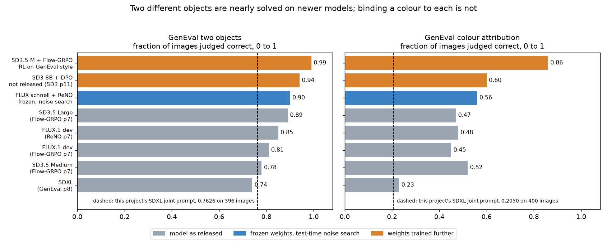

# Is drawing two subjects still an open problem worth Paper 2?

**Partly.** On newer models, drawing two different everyday objects is close to solved: public SD3.5 and
FLUX models draw both objects of a GenEval pair in 78% to 89% of images, a frozen model with test-time
noise search reaches 90%, and further training reaches 94% to 99%. What stays open is two subjects that
look alike (a duck and a goose, a cat and a dog): plain SD3 draws both on 53% of images and the best
frozen-model fix on it reaches 69%. The recommendation at the end is to narrow Paper 2 to look-alike
subject pairs.

## Table of contents

- [Words this uses](#words-this-uses)
- [The numbers by model](#the-numbers-by-model)
- [Where the problem is still open](#where-the-problem-is-still-open)
- [How far published methods get on each kind of pair](#how-far-published-methods-get-on-each-kind-of-pair)
- [Do CO3 or ToMe already claim Paper 2's contribution](#do-co3-or-tome-already-claim-paper-2s-contribution)
- [Where the sources disagree](#where-the-sources-disagree)
- [Does the missing interaction term change Paper 2's case](#does-the-missing-interaction-term-change-paper-2s-case)
- [Recommendation](#recommendation)
- [What this cannot tell you](#what-this-cannot-tell-you)
- [How this was read](#how-this-was-read)

## Words this uses

**GenEval two objects.** 99 prompts of the form "a photo of a [object A] and a [object B]" with objects
drawn at random from the 80 COCO class names (GenEval p. 4), scored by an object detector as the fraction of
images where both objects are found, 0 to 1 (Table 1, p. 5; 553 prompts in all, four images per prompt, p. 7).

**GenEval colour attribution.** 100 prompts of the form "a photo of a [colour A] [object A] and a [colour B]
[object B]", correct when both objects are found with the right colour each (GenEval p. 5, Table 1).

**T2I-CompBench colour and shape.** 300 test prompts per category, such as "a red flower and a yellow vase",
scored by BLIP-VQA, a visual question answering model asked whether each object has its attribute, 0 to 1
(T2I-CompBench++ p. 4, p. 9, 10 images per prompt).

**Look-alike pair.** Two subjects similar in shape and appearance, such as a bear and a panda, where the
model tends to draw two of one or one hybrid (the MMDiT similar-subjects paper, p. 2, p. 4, as read in
[Loop 12's note](../leakage/01-reading/mmdit-similar-subjects.md)).

**Frozen.** The model's weights are not changed; only the sampling, the noise or the text input is.

**Marks.** Each number is **read** (read from the paper at the page given), **summary** (read from another
loop's note, which gives the page) or **inferred** (this page's reasoning).

## The numbers by model

Each bar is one model's GenEval score as printed in the paper named under it (x: fraction of images judged
correct, 0 to 1). Grey is the model as released, blue keeps the weights frozen, orange trains them further.
The chart is drawn by [its script](two-object-and-colour-by-model.py) from the table below.

| Model | Frozen or trained | GenEval two objects | GenEval colour attribution | T2I-CompBench colour | T2I-CompBench shape | Count behind it | Source | Mark |
|---|---|---|---|---|---|---|---|---|
| SDXL | as released | 0.74 | 0.23 | 0.5879 | 0.4687 | GenEval 553 prompts × 4 images; CompBench 300 prompts × 10 images | GenEval Table 2, p. 8; T2I-CompBench++ Table XIII, p. 12 | read |
| SDXL, this project's joint prompt | as released | 0.7626 | 0.2050 | 0.6007 | 0.4683 | 396, 400, 200, 200 images; seeds 9 to 12 and 9 to 10 | [the standard benchmarks page](../../../../1-lora-correction/report/against-other-methods/how-does-the-adapter-score-on-the-standard-benchmarks.md) | read |
| SDXL + FKC | frozen, sampler correction | 0.78 | not reported here | not reported here | not reported here | 553 prompts; images and seeds not stated | FKC Table A4, p. 39, as in [the benchmark spec](../benchmark-spec.md) | summary |
| SDXL + ToMe | frozen, text-side edit | not reported | not reported | 0.7656 | 0.6051 | 300 prompts; images not stated | ToMe Table 1, p. 8 ([note](notes/tome.md)) | read |
| SDXL + CoMat | trained | not reported | not reported | 0.7774 | 0.5262 | not stated | ToMe Table 1, p. 8 (CoMat's own Table 1, p. 7, prints colour 0.7827 per the benchmark spec) | read |
| SD3 Medium (2B) | as released | unknown | unknown | 0.8132 | 0.5885 | 300 prompts × 10 images | T2I-CompBench++ Table XIII, p. 12 (it prints "Stable v3"; which size is not stated) | read |
| SD3 8B (depth 38), 1024 px, with DPO | trained (preference tuning), not released | 0.94 | 0.60 | unknown | unknown | not stated in the SD3 paper | SD3 paper (arXiv 2403.03206) Table 5, p. 11 | read |
| SD3 8B without DPO, 512 px | as trained by the authors, not released | 0.84 | 0.43 | unknown | unknown | not stated | SD3 paper Table 5, p. 11 | read |
| SD3.5 Medium | as released | 0.78 | 0.52 | 0.7994 | 0.5669 | taken by Flow-GRPO from earlier papers; count not stated | Flow-GRPO (arXiv 2505.05470v5) Table 1, p. 7; Table 3, p. 10 | read |
| SD3.5 Large | as released | 0.89 | 0.47 | unknown | unknown | as above | Flow-GRPO Table 1, p. 7 | read |
| SD3.5 Medium + Flow-GRPO | trained (online RL on GenEval-style prompts) | 0.99 | 0.86 | 0.8379 | 0.6130 | not checked | Flow-GRPO Table 1, p. 7; Table 3, p. 10 | read |
| FLUX.1 dev | as released | 0.81 (Flow-GRPO) or 0.85 (ReNO) | 0.45 or 0.48 | 0.7407 (see disagreements) | 0.5718 | ReNO: 552 prompts, four seeds | Flow-GRPO Table 1, p. 7; ReNO (arXiv 2406.04312v2) Table 3, p. 7, seeds p. 25 | read |
| FLUX.1 schnell | as released | 0.80 | 0.43 | 0.7407 (see disagreements) | 0.5718 | GenEval 552 prompts, four seeds; CompBench 300 × 10 | ReNO Table 3, p. 7; T2I-CompBench++ Table XIII, p. 12 | read |
| FLUX.1 schnell + ReNO | frozen, reward-guided noise search | 0.90 | 0.56 | unknown | unknown | 552 prompts, four seeds | ReNO Table 3, p. 7; p. 25 | read |

**What the table says (inferred from it).** GenEval two objects rises from 0.74 on SDXL to 0.78 to 0.89 on
the released SD3.5 and FLUX models, so the headroom left on released newer models is 0.11 to 0.22, and a
frozen noise search already takes FLUX schnell to 0.90. Colour attribution stays at 0.43 to 0.60 on every
released or frozen model and reaches 0.86 only after RL training. T2I-CompBench colour and shape are near
0.74 to 0.81 and 0.57 to 0.59 on SD3 and FLUX, well above SDXL's 0.59 and 0.47, with shape the least
solved.

**The trained 0.99 is close to in-distribution (inferred).** Flow-GRPO trains on prompts made by GenEval's
own scripts and removes from training only test prompts that differ by object order (p. 6, read). It does
show gains on unseen object classes (Table 4, p. 10, read) and on T2I-CompBench++ (Table 3, p. 10, read).

## Where the problem is still open

**Look-alike subject pairs on the newest models (summary).** These rows come from Loop 12's reading notes,
which give the page for each.

| Setting | Number | Count | Source |
|---|---|---|---|
| Plain SD3 Medium, two look-alike subjects, both present by Grounding DINO | 53.1% | 30 prompts × 100 seeds | [MMDiT similar subjects](../leakage/01-reading/mmdit-similar-subjects.md), Table 1, p. 8 |
| Same, judged by GPT-4o-mini | 68.2% | 30 prompts × 50 images | same, Table 1, p. 8 |
| Best frozen fix on SD3 (that paper's attention losses), Grounding DINO | 68.8% | as above | same, Table 1, p. 8 |
| Plain SD3.5 Medium, two look-alike subjects, Grounding DINO | 52.0% | as above | same, Table 4, p. 14 |
| Plain SD3, three look-alike subjects, Grounding DINO | 37.9% | as above | same, Table 1, p. 8 |
| FLUX.1 dev, images of look-alike animal pairs showing leakage after human checking | 23% weighted average | 200 prompts × 5 seeds | [DeLeaker](../leakage/01-reading/deleaker.md), p. 36 |
| Plain SD 2.0, same-category pairs with both objects shown, against unrelated pairs | 52% against 61% | 1,000 prompts | [DAAM](../leakage/01-reading/daam.md), p. 7, as in the [mechanism table](../leakage/01-reading/mechanism-table.md) |

So a model that draws two different COCO objects in 85% to 89% of images draws two look-alike subjects in
about 52% to 53% of them, and the best published frozen fix leaves about 31% failing (inferred, from
53.1% and 68.8% on the same 30 prompts). GenEval's random COCO pairs are mostly unlike each other, which is
why its two-object score hides this (inferred: GenEval draws its object names at random from the 80 COCO classes, p. 4).

**This project's own pairs are look-alike pairs (inferred).** Paper 2's cases are animal pairs such as cat
and dog and cheetah and cougar ([Paper 2's design](../manager/paper2-four-way-design.md), first test). On
cat and dog, frozen SDXL's joint prompt draws a clean pair on 57 of 128 seeds and CO3 on 89 by the
automatic scorer ([the report index](../../../../report/00-INDEX.md), the kept push comparison).

**Binding a colour to each object (read, from the table).** Colour attribution is 0.43 to 0.60 on every
released and frozen model. This is open, but it is ToMe's and CoMat's problem rather than Paper 2's, and
CO3 loses to the attention methods on it (CO3 Table 1, p. 7, read).

**Not covered by any paper read here.** No paper reports SD3.5 or FLUX on this project's animal pairs, so
whether the joint prompt on FLUX still fuses cat and dog at SDXL's rate is unknown. This session runs no
model, so the number stays unknown.

## How far published methods get on each kind of pair

Paper 2's larger test covers four kinds of pairs: two animals, an animal and an object, two objects, and
two subjects with attributes; three or more subjects and relations are out of its scope
([Paper 2's design](../manager/paper2-four-way-design.md)). The only published table split this way is
CO3's run on Attend-and-Excite's prompts (66 animal pairs, 144 animal and object, 66 object pairs with a
colour on each object, 64 seeds each per Attend-and-Excite p. 6, as in
[Loop 7's note](../abstract-checkers/01-reading/attend-and-excite.md)). Its scores are BLIP-VQA, 0 to 1,
all on SDXL unless named (CO3 Table 1, p. 7, read).

| Kind of pair | Plain SDXL | Best frozen method on SDXL | Best on any model in that table | Newer models |
|---|---|---|---|---|
| Two animals | 0.6950 | CO3 0.7441 | CO3 0.7441 | unknown split; look-alike pairs 52% to 53% on SD3 and SD3.5 (summary, above) |
| An animal and an object | 0.8654 | CO3 0.8878 | CO3 0.8878 | unknown |
| Two objects, a colour on each | 0.4926 | ToMe 0.6440 | SynGen on SD1.5, 0.6595 | GenEval colour attribution 0.43 to 0.60 released, 0.86 after RL (read, above) |
| Two subjects with attributes, T2I-CompBench colour | 0.5879 (T2I-CompBench++) | ToMe 0.7656 (ToMe p. 8) | Flow-GRPO on SD3.5 Medium 0.8379, trained (p. 10) | SD3 0.8132, FLUX 0.7407 (p. 12) |

**What it shows (inferred).** An animal and an object is close to solved even on SDXL, at 0.87 to 0.89.
Two animals leave the most room among the plain-noun kinds, at 0.69 to 0.74, and are the kind where the
look-alike failure lives. Two objects with a colour each are the weakest kind on every model, but that
failure is attribute binding, which ToMe and CoMat already target. No paper read here splits SD3, SD3.5 or
FLUX results by these four kinds, so the newer-model column is mostly unknown.

**Complex prompts, out of Paper 2's scope.** T2I-CompBench++'s complex category (prompts mixing attributes,
relations and several objects, scored by its 3-in-1 metric, 0 to 1, 10 images per prompt) reads 0.3237 on
SDXL, 0.3771 on SD3, 0.3703 on FLUX and 0.3773 on DALL-E 3 (Table XIII, p. 12, read). On SDXL, CO3 lifts
its ImageReward from 0.3083 to 0.4406 (CO3 Table 2, p. 7, read) and Rectify Then Diffuse reaches 0.4661
(benchmark spec, its Table 2, p. 6, summary). With three look-alike subjects plain SD3 succeeds on 37.9%
of images and four on 33.1% (MMDiT similar-subjects paper, Table 1, p. 8, summary). Complex prompts are
still far from solved on every model read here, so G3 ranks them as an open problem.

## Do CO3 or ToMe already claim Paper 2's contribution

**Neither does.** Paper 2 claims that one classifier trained afterwards on the frozen model, reading "two
separate things in frame" from the noisy latent, lifts several samplers: plain PoE, the joint prompt and
CO3 ([Paper 2's design](../manager/paper2-four-way-design.md)).

| Paper | What it changes | Learned part | Models run | Combined with other samplers | Claims Paper 2's contribution |
|---|---|---|---|---|---|
| [CO3](notes/co3.md) | the sampler: a weighted sum of denoised estimates in the first 20% of steps | none | SDXL only (p. 6) | no; it is one of Paper 2's base samplers; its appendix changes the ODE solver only (p. 17) | no |
| [ToMe](notes/tome.md) | the text embedding, plus two losses on cross-attention in the first 20% of steps | none | SDXL only (p. 7, p. 16) | no | no |

**What CO3 does take (inferred).** CO3 states Paper 2's problem with the same "a cat and a dog" example on
the same model (CO3 p. 1, read). Paper 2 can claim the learned checker and the cross-sampler lift, and
cannot claim the problem.

**What a reviewer will say about ToMe (inferred).** It acts in the same early window with the model frozen
and trains nothing. Paper 2 has to show its checker helps where ToMe does not: CO3's run of ToMe on animal
pairs scored below plain SDXL on BLIP-VQA, 0.6257 against 0.6950 (CO3 Table 1, p. 7, read), which suggests
animal pairs are such a place.

## Where the sources disagree

Reported, not resolved.

- **FLUX.1 dev on GenEval two objects:** 0.81 in Flow-GRPO Table 1 (p. 7), which says its non-SD3.5 rows
  come from earlier papers, and 0.85 in ReNO Table 3 (p. 7). Colour attribution 0.45 against 0.48.
- **Which FLUX the T2I-CompBench++ row is:** T2I-CompBench++ names the model "FLUX.1 [schnell]" in its text
  (p. 9) and prints colour 0.7407 in Table XIII (p. 12). Flow-GRPO prints the same 0.7407, 0.5718 and
  0.6922 as "FLUX.1 Dev" (Table 3, p. 10).
- **SDXL on T2I-CompBench colour:** 0.5879 in T2I-CompBench++ (p. 12), 0.6369 in ToMe (p. 8), 0.6007 in
  this project's 200-image run.
- **SD3 two objects:** the SD3 paper's numbers are for an 8B model that was not released (p. 11). The
  released SD3 Medium has no GenEval two-object number in any paper read here.

## Does the missing interaction term change Paper 2's case

The owner links the two papers through one idea: a product of separately trained experts keeps what both
agree on (the floor and the light, or the ribs and lungs) and has no term for effects that need both
subjects at once (one object's shadow on the other, a nearer object hiding a farther one). That missing
part is the interaction term ([the product of experts miniature](../../../../context/methods/01-the-product-of-experts/03-the-miniature.md);
[the manager's picture](../manager/experts-interact.png)). This is recorded as a finding and a
recommendation only; adopting it in the problem statements is the owner's decision.

**It sharpens Paper 2's case for one of its three bases and not the other two (inferred).**

| Base sampler | Has a model seen both subjects together? | What the failure is | Does the missing interaction term explain it? |
|---|---|---|---|
| Plain PoE, "a cat" times "a dog" | no: each expert is the same model told one subject | a hybrid, or one subject | yes: the product has no term for two subjects in one frame, which is the ICLR work's correction |
| Joint prompt, "a cat and a dog" | yes: one model, one prompt | a dropped or look-alike merged subject | no: the model has the interaction; it loses a subject through attention overlap and encoder confusion (MMDiT similar-subjects paper p. 2, p. 4; DeLeaker; summary) |
| CO3 | yes: it sums the joint prompt with single-subject terms | borrowed parts, two of one subject | partly: CO3 subtracts single-subject terms, which removes some of what the joint model knew about the pair (CO3 p. 4, read; inferred) |

So the link holds most strongly for plain PoE, where Paper 2's correction would supply exactly what the
product leaves out. On the joint prompt, the correction would be fixing leakage, not a missing term. If
the owner adopts the link, Paper 2's PoE row becomes the row that tests it, and the joint-prompt row tests
a different claim (inferred).

**Is the framing published?** Whether any paper already frames composition failures as a missing
interaction term, or measures cross-object effects such as shadows and occlusion, is searched in step G2,
where Paper 1's reviewer questions need the same answer. G2 reports it.

## Recommendation

**Narrow Paper 2 to look-alike subject pairs, where the gap is still large on SD3 and FLUX.**

- **Why not continue as designed (inferred).** Framed as "two subjects in one picture", Paper 2 will be
  answered by the table above: a reviewer can point to 0.85 to 0.94 on two objects for newer models and
  0.90 from a frozen noise search, and ask why the paper works on SDXL.
- **Why not change direction (inferred).** The look-alike case is open on every model in the record: about
  53% on plain SD3 and SD3.5, 69% at best with a frozen fix, and 23% leakage on FLUX. This project's pairs
  are already look-alike animal pairs, its scorer and judge already read "two clear subjects", and the
  four-way test needs no change of pairs.
- **What the narrowing asks of the paper (inferred).** The benchmark rows move from GenEval two objects to a
  look-alike set: the MMDiT similar-subjects set (90 prompts, 30 with two subjects) and DeLeaker's SLIM
  pairs are published ones. Plain SD3.5 or FLUX should be run on Paper 2's own pairs as a reference row, so
  the paper can say how much of the SDXL gap survives on a newer model. That is a measurement for a running
  loop, not for this session.

**The owner's choice inside this.** Which model generation Paper 2 targets decides whether the correction
must be rebuilt for a transformer model. The kept push reads SDXL's U-Net decoder features, and every
paper read here that fixes look-alike pairs on SD3 or FLUX works through the joint attention of a
transformer model (Loop 12's notes on the MMDiT paper and DeLeaker). Filed as a board question holding G1,
with the default: keep SDXL as the model Paper 2's method runs on, narrow its claim to look-alike pairs,
and add one reference row of plain SD3.5 Medium or FLUX.1 dev on the same pairs.

## What this cannot tell you

- Whether FLUX or SD3.5 fuses this project's animal pairs as often as SDXL: no read paper ran them.
- Whether GenEval's two-object prompts contain many look-alike pairs: the split by similarity is inferred,
  not counted.
- Whether the four-way test's result would hold on a transformer model: nothing in the record tests the
  kept push outside SDXL.
- FKC's 0.78 is copied from the benchmark spec, not reread here, and was not reproduced
  ([the reviewer's section](../reviewer/2026-11-24-review.md), "Is the contribution new").

## How this was read

Read from full PDFs for this page: GenEval (arXiv 2310.11513, on the shelf), T2I-CompBench++ (arXiv
2307.06350, `~/PhD/replications/t2i-compbench/paper/`), CO3 and ToMe (on the shelf), the SD3 paper (arXiv
2403.03206v1), Flow-GRPO (arXiv 2505.05470v5) and ReNO (arXiv 2406.04312v2), the last three fetched from
arXiv. Every page number was found by locating the line in the extracted text and counting page breaks.
Cited from other loops' notes without rereading: the MMDiT similar-subjects paper (arXiv 2411.18301),
DeLeaker (arXiv 2510.15015), DAAM, and FKC (arXiv 2503.02819). Seven papers read for this page, four
cited from notes.
