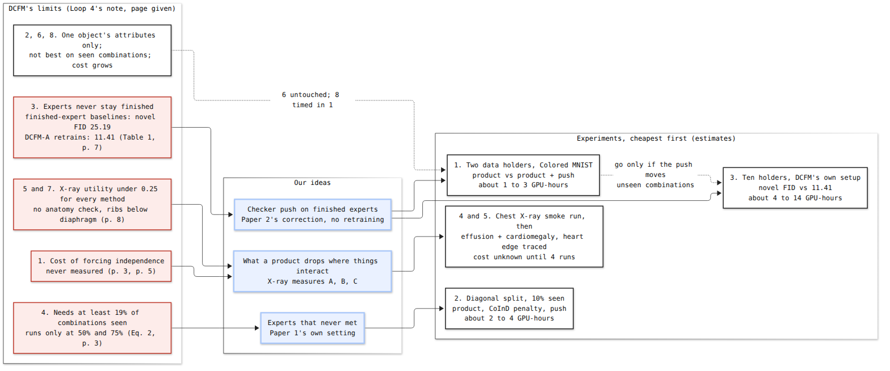
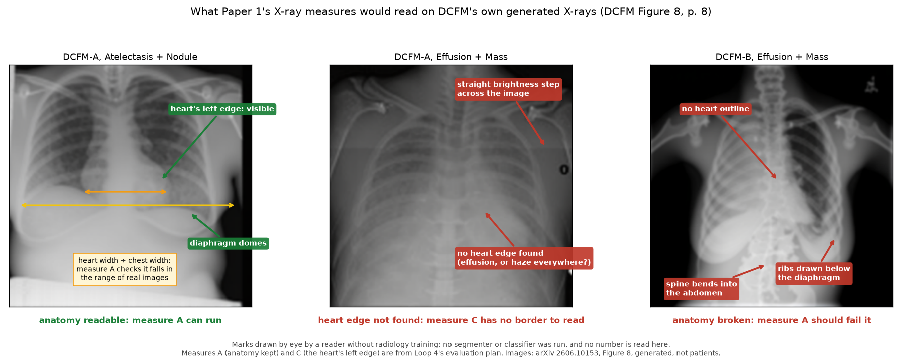

# Where this project's ideas attack DCFM's gaps

DCFM (Morshed and Boddeti, arXiv 2606.10153, ICML 2026) is the published work nearest Paper 1: models
trained on separate data silos, asked for attribute combinations no silo saw. This page takes each of the
eight limits in [Loop 4's DCFM note](../targets/dcfm-compositional-flow-matching-from-separate-silos.md#what-dcfm-leaves-open)
and names the idea of ours that attacks it, the picture that would show it, the number that would score it
against DCFM's printed one, the data and code needed, and the cost. Three leads are read closely after the
table, and the experiments end in cost order. Nothing here has run.

Red boxes are DCFM's limits, blue boxes the ideas of ours that attack them, and white boxes the experiments,
numbered cheapest first; a dashed arrow is a condition or a limit no experiment answers. Its source is
[the diagram file](dcfm-limits-to-experiments.mmd).

**DCFM's code is not public.** The paper carries no code link (full-text search), the arXiv record lists
none, and no repository under the first author's GitHub account or the lab's (`human-analysis`) matches
DCFM, checked 2026-11-25. Its splits are described in the paper only: Colored MNIST over 10 clients with
half the 100 combinations seen, a Dirichlet split with alpha 0.1 for the non-IID case (p. 6, p. 7, read),
and NIH ChestX-ray14 over 4 clients (p. 8, read). The independence penalty DCFM carries across clients is
CoInD's, and CoInD's code is public at `github.com/sachit3022/compositional-generation` (its ICLR 2025
README, read). So DCFM's own rows can only be its printed numbers, and any rerun of DCFM is a
reimplementation.

## Table of contents

- [Words this uses](#words-this-uses)
- [One row per limit](#one-row-per-limit)
- [Lead 1: finished experts without retraining](#lead-1-finished-experts-without-retraining)
- [Lead 2: below DCFM's minimum share of seen combinations](#lead-2-below-dcfms-minimum-share-of-seen-combinations)
- [Lead 3: chest X-ray utility under 0.25, with no anatomy check](#lead-3-chest-x-ray-utility-under-025-with-no-anatomy-check)
- [The experiments, cheapest first](#the-experiments-cheapest-first)
- [What this cannot tell you](#what-this-cannot-tell-you)

## Words this uses

**Silo, or client.** One data holder in DCFM; each trains on its own images only.

**Finished experts.** Models trained once on their own silo and then composed only while sampling, never
retrained. Paper 1's experts are finished experts.

**Novel FID.** DCFM's Fréchet Inception distance on combinations no silo saw (lower is better; sample count
not stated, p. 7).

**Utility.** DCFM's chest X-ray score: a ResNet-18 trained on generated images only, tested on real ones,
averaged over 54 disease combinations as the recall of each exact combination, 0 to 1 (p. 8, Eq. 18, read).

**The checker push.** This project's correction: a small classifier trained on the experts' samples reads
"both things present" from the noisy image, and its gradient is added to the composed prediction while
sampling ([the problem statements](../problem-statements.md)). Paper 1 adds it to a product where each
expert draws its own region; Paper 2 adds it to a single model's product early in sampling.

**Cost.** GPU-hours. The basis is measured: one of the project's small 64-pixel experts (EDM2 xs) trained on
2,000,896 images in 77 minutes on one RTX PRO 6000 Blackwell card, and four took about 6 GPU-hours with
start-up ([the CLEVR paste step's review](../method-search/01c-clevr-paste-first/review.md), lines 59 and
63). A 28-pixel digit expert is taken to cost at most that (inferred). Every cost below is an estimate.

## One row per limit

| # | DCFM's limit (Loop 4's note, with its page) | Our idea that attacks it | The picture that would show it | The number against DCFM's printed one | Data and code | Cost |
|---|---|---|---|---|---|---|
| 1 | What forcing independence costs is never measured (p. 3, p. 5, p. 6) | Paper 1's interaction measures: a product should keep what both experts share and needs a term for what needs both (G2, question 8); Paper 2's correction supplies that term for plain PoE | An effusion-with-cardiomegaly X-ray from a DCFM-style penalised model beside ours and beside a real one, the heart's left border traced on each | X-ray measure C, border contrast against real images holding both findings ([Loop 4's plan](../targets/paper-1-evaluation-plan.md#chest-x-ray-measures)); DCFM prints no such number, so ours stands alone beside its utility | NIH ChestX-ray14 (public); CoInD's penalty code as the stand-in for DCFM's local penalty; an anatomy segmenter | not costed until an X-ray smoke run exists |
| 2 | Attributes of one thing, three small datasets, nothing above 256 pixels (p. 6 to p. 8) | Paper 1 composes separate objects (two-colour CLEVR); Paper 2 composes subjects on SDXL at 1,024 | DCFM's Figure 5 digit grid (p. 6) beside a two-colour CLEVR grid of separate objects | none against DCFM: its tasks have no separate objects | existing CLEVR experts from the two-colour test | none new: the two-colour test is already planned |
| 3 | The experts never stay finished; the finished-expert baselines fail on novel combinations (p. 4, p. 7) | The checker push on finished experts, no retraining | Novel-combination digits from finished experts, plain product beside product with the push, beside DCFM's Figure 5 samples | Novel FID on Colored MNIST, IID split, against DCFM-A's 11.41 and Decentralized Diffusion Models' 25.19 (Table 1, p. 7) | Colored MNIST built to DCFM's description; our digit checker code | [lead 1](#lead-1-finished-experts-without-retraining) |
| 4 | Not tested below its minimum share of seen combinations (p. 3, Definition 3.1) | Paper 1's setting: experts that never met | Digits from a diagonal split, where each digit was seen in one colour only, asked in a colour no silo pairs with it | Novel FID and a digit-and-colour classifier's accuracy, product against product with the push; DCFM prints nothing there | as row 3, a new split | [lead 2](#lead-2-below-dcfms-minimum-share-of-seen-combinations) |
| 5 | No sample counts, no seen-against-unseen X-ray FID, no per-combination result, no anatomy check (p. 7, p. 8) | Paper 1's X-ray measures A and B, read per image and per combination with counts stated | A per-combination table with one example X-ray per row, anatomy mask overlaid | Measure A's pass rate and measure B's per-finding recall, plus utility beside DCFM's Figure 9 points (under 0.25, read from the plot) | as row 1 | as row 1 |
| 6 | Not best on seen combinations; non-IID FID lower than IID, unexplained (p. 7, p. 8) | none of our questions | none | a seen-combination FID row in our Colored MNIST table, reported for completeness | as row 3 | included in lead 1 |
| 7 | Its own figures show a malformed digit and, by eye, ribs below the diaphragm (p. 6, p. 8) | X-ray measure A's anatomy check | DCFM's Figure 8 tile beside ours, segmenter masks overlaid, failures marked | measure A pass rate | as row 1 | as row 1 |
| 8 | Cost grows with the number of attributes: about four forward passes a training step (p. 9, Table 4) | The push adds one classifier gradient per sampling step whatever the number of experts (inferred from the problem statement's formula) | Seconds per sample against the number of experts composed, two to four, for product, product with push | sampling seconds per image; DCFM prints training passes, not sampling time | as row 3 | under 0.5 GPU-hours on top of lead 1 (inferred) |

## Lead 1: finished experts without retraining

**What DCFM shows (read, p. 4 and p. 7).** In its toy, finished experts composed by Decentralized Diffusion
Models fail to reach the missing combination (Figure 3, p. 4). On Colored MNIST the two finished-expert
baselines print novel FID 25.19 and 29.71 on the IID split and 17.98 and 38.27 on the non-IID split, against
DCFM-A's 11.41 and 9.29, which retrains its experts after exchanging them (Table 1, p. 7).

**Our attack (inferred).** Colored MNIST puts a digit and a colour on one digit, so Paper 1's method of
giving each expert its own region cannot run there; the benchmark spec already places Colored MNIST as
context for that reason ([the benchmark spec](../benchmark-spec.md), "What the rivals leave out"). What can
run is the push without regions: the finished experts' plain product (DCFM's Eq. 4, p. 3) plus a checker
trained on the experts' own samples to read "this digit in this colour". That is Paper 2's correction moved
onto finished experts. If it brings novel FID from about 25 toward DCFM-A's 11.41 with no retraining, it
attacks DCFM's central claim that the experts must be retrained.

**What it needs.** Colored MNIST built to DCFM's description, 10 silos with half the combinations seen
(p. 6); one finished expert per silo; the checker; FID on novel combinations at a stated sample count. The
split's random draw is not published, so the comparison with DCFM's printed numbers is partly matched and
says so.

**Cost (inferred).** Ten experts at most 1.3 GPU-hours each on the Blackwell card, about 3 to 13 GPU-hours
depending on how many images each needs; the checker and sampling under 1 more. A cheaper first look uses 2
silos and the plain product against the push, about 1 to 3 GPU-hours, which shows whether the push moves
novel combinations at all before the 10-silo match.

## Lead 2: below DCFM's minimum share of seen combinations

**What DCFM requires (read, p. 3).** Every attribute value must be seen on some silo, and the share of seen
combinations must reach C_min = (1 + Σ(|Y_i| − 1)) / |Y| (Definition 3.1, Eq. 2). For Colored MNIST that is
(1 + 9 + 9) / 100 = 0.19 (inferred, computed from Eq. 2). DCFM runs at 0.5 on Colored MNIST and 0.75 on
robot planning (p. 6, p. 7).

**Our attack (inferred).** A diagonal split, where digit d appears only in colour d, has every value seen and
10 of 100 combinations, a share of 0.10, below DCFM's minimum. It is the Colored MNIST form of Paper 1's
setting: each silo has seen its own pairing and none other. DCFM's guarantee does not cover it and DCFM
prints nothing there. Our comparison: plain product, product with CoInD's local penalty (its code is
public), and product with the push, all on the same finished experts.

**What it would show.** A positive result is a novel combination drawn below the share DCFM says it needs. A
null is still a finding: the minimum share binds for every method tried.

**Cost (inferred).** New experts for the new split, about 1 to 3 GPU-hours at 2 to 10 silos of the diagonal
(the diagonal needs as many silos as pairings kept apart), plus under 1 for the checker and sampling.

## Lead 3: chest X-ray utility under 0.25, with no anatomy check

**What DCFM shows (read, p. 8).** Utility for every method sits below 0.25 in Figure 9, read from the plot,
so a classifier trained on any method's images finds the exact combination in under a quarter of real
cases. No table, no per-combination result, no anatomy check, and Figure 8's tiles carry no marking (Loop 4's
note, "What DCFM leaves open").

**Our attack (inferred).** Two finished experts, one per finding (effusion, cardiomegaly), composed by plain
product and by product with the push, read by measures A (anatomy kept), B (both findings present) and C
(the heart's left border), with DCFM's utility computed beside them. If the product keeps anatomy, as the
owner's hypothesis expects, measure A says so; if DCFM-style independence erases the border effect,
measure C says so on a reimplemented penalty.

What measures A and C would read on three of DCFM's own generated X-rays (Figure 8, p. 8). The marks are
drawn by eye by a reader without radiology training, and no segmenter or classifier was run: one tile has
readable anatomy, one has no heart edge for measure C to read, and one has anatomy measure A should fail.
[Its script](dcfm-xrays-read-by-measure-a.py) crops the tiles from the DCFM PDF and redraws the figure.

**What it needs.** NIH ChestX-ray14 (public, over 100,000 images, 14 labels, p. 8); whether DCFM's 54 kept
combinations include effusion with cardiomegaly is not printed (Loop 4's note). An anatomy segmenter and a
finding classifier trained on real images. No X-ray data or expert exists in the project yet
([Loop 4's plan](../targets/paper-1-evaluation-plan.md#chest-x-ray-measures)).

**Cost.** Not estimated here: no measured X-ray run exists to scale from, and DCFM gives cost in passes, not
hours (p. 9). A smoke run of one finding expert at 256 pixels is the step that would price it.

## The experiments, cheapest first

| # | Experiment | Attacks limits | What decides it | Cost |
|---|---|---|---|---|
| 1 | Two-silo Colored MNIST: plain product of two finished experts against product with the push, on combinations neither saw | 3, 8 | whether the push lowers novel FID and raises a digit-and-colour classifier's accuracy on unseen combinations by the project's margin | about 1 to 3 GPU-hours (inferred) |
| 2 | Diagonal split, below DCFM's minimum share: product, product with CoInD's local penalty, product with the push | 4 | whether any method draws unseen combinations below the share DCFM requires | about 2 to 4 GPU-hours (inferred) |
| 3 | Ten-silo Colored MNIST to DCFM's description, finished experts with the push, against DCFM-A's printed 11.41 and the finished-expert baselines' 25.19 | 3, 6, 8 | novel FID against DCFM's printed numbers, marked partly matched | about 4 to 14 GPU-hours (inferred) |
| 4 | Chest X-ray smoke run: one finding expert at 256 pixels on ChestX-ray14 | 1, 5, 7 | the measured cost that prices the X-ray experiments | unknown: no measured X-ray run exists |
| 5 | Chest X-ray effusion and cardiomegaly: two finished experts, product and push, measures A to C and DCFM's utility | 1, 5, 7 | measures A to C against paste and the product; utility beside DCFM's Figure 9 | not costed until experiment 4 |

Experiments 1 to 3 total about 7 to 21 GPU-hours (inferred); 4 and 5 are priced by 4. Each is over or near
the 3 GPU-hour line, so each needs the owner's yes; the board question filed with this page lists them.

## What this cannot tell you

- Whether DCFM's authors would release code or splits on request; this page found none public.
- Whether our push lowers novel FID on Colored MNIST: nothing has run, and the digit runs that exist compose
  separate digits on halves of a canvas, not a digit and its colour.
- The cost of any X-ray experiment.
- How many images a 28-pixel digit expert needs; the cost ranges assume between a quarter and all of the
  64-pixel CLEVR expert's 2 million.
