# Paper 1 against DCFM: what crosses between data holders, and when

One high-level design of two ways to compose generative models trained on separate data. It answers the
owner's question: "the full system diagram of Paper 1's method against DCFM: what crosses between data
holders and when".

**Referred to from** [the DCFM attack plan](../04-exploiting-dcfm.md), under its opening diagram.

codex stills: not answered

## Paper 1 against DCFM, side by side

**What it shows.** Two groups lined up by time: data on the top row, training on the second and third,
sampling on the fourth, scoring on the last. Every solid arrow says what crosses (model weights, the
distilled student, generated samples, an expert's prediction, the checker's gradient, or nothing) and
when (training time, after training, sampling time). The dashed arrow at the bottom marks the one assumption
that separates the methods: every DCFM penalty forces the attributes to be conditionally independent, which
removes effects needing both (a shadow on the other object, one X-ray finding hiding the heart's edge), and
those are what Paper 1's evaluation measures. 12 boxes, 13 arrows.

**How we got it.** Read in full: [Loop 4's DCFM note](../../targets/dcfm-compositional-flow-matching-from-separate-silos.md),
the Paper 1 section of [the problem statements](../../problem-statements.md), and
[the DCFM attack plan](../04-exploiting-dcfm.md). DCFM's pages 5, 6, 7 and 9 were checked in
[the PDF](../../targets/pdfs/2606.10153.pdf): the allgather of weights in DCFM-A and its 1 to 3 rounds (p5,
p9), the model upload to a trusted server in DCFM-B and the student sent back to every peer (p5, p6, p9,
Table 3), and Table 1's 11.41 and 25.19 (p7). The spec is
[the spec file](paper-1-against-dcfm-high-level-design-explainer.json), drawn with the hld-diagram skill's
`draw_hld.py` and published as a private page:
[the published design](https://claude.ai/artifact/HSR8gNE2ccSsqe8ZZ8ymqb).

**What it lets you say.** In DCFM, model weights cross between data holders during training (1 to 3 rounds
peer to peer in DCFM-A, once to a server and once back in DCFM-B), and the experts are retrained or replaced.
In Paper 1 nothing crosses between data holders during training: the experts stay finished, and the only new
training is a small checker on samples the experts generate.

**What it cannot say.** Whether DCFM's penalty actually removes the shadow or the heart-border effect: the
DCFM note infers it from Eqs. 7 and 12, and DCFM never tests it. It carries no Paper 1 number, because the
attack plan's experiment 1 (two-silo Colored MNIST, plain product against product with the push) has not
run. It does not draw who holds the two finished models when they are composed; the problem statement allows
the two trained models to whoever composes and says no more. The FID sample count behind 11.41 and 25.19 is
not stated in DCFM (p7).

**Where it came from.** Drawn by the hld-cadence agent on 2026-11-25 at the owner's request, in the
hld-diagram skill's default mode, as a plain page: no runbook or environment facts cover these boxes, so no
scene and no clickable panels were built.

### Versions

- **Version 1, 2026-11-25**: first drawing, 12 boxes and 13 arrows: DCFM's silos, Stage I experts, DCFM-A
  and DCFM-B branches with their sampling and scores; Paper 1's holders, finished experts, checker, merge and
  push, and scores; the dashed independence assumption between the two score boxes.
