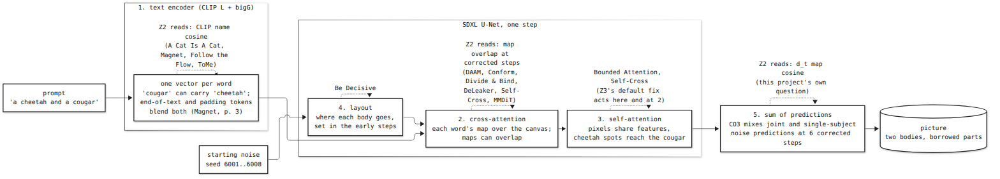

# Mechanism table: where do papers say one subject's parts leak into the other?

This table holds one row for each of 13 papers read from the full PDF with appendices for step Z1 of Loop 12: the 5 named in [the loop's brief](../../prompts/session-12-where-co3-leaks.md) and 8 found by [the search for leakage papers](search-for-leakage-papers.md). Six more papers that Loops 4, 5 and 7 already read are cited from their notes. Each row links to its note, and every claim in a note carries its page.

The picture places each paper by where it says leakage enters. Its source is [the diagram file](../where-leakage-could-enter.mmd).

## Table of contents

- [Words this uses](#words-this-uses)
- [What the reading changes for this loop](#what-the-reading-changes-for-this-loop)
- [The table](#the-table)
- [Papers read by other loops and cited here](#papers-read-by-other-loops-and-cited-here)
- [Closer papers these cite, not read](#closer-papers-these-cite-not-read)
- [Where sources disagree](#where-sources-disagree)
- [How the rows were checked](#how-the-rows-were-checked)

## Words this uses

Navigation: [Table of contents](#table-of-contents)

**Leakage, or borrowing.** One subject in the picture carries a part of the other: a face, a beak, fur, markings. In this project's hand labels (W2d), a picture with two separate subjects where one carries a clear part of the other is called `borrowed`. The papers use "semantic leakage", "subject mixing" and "attribute leakage" for overlapping things, and each note says which one its paper means.

**Cross-attention.** The U-Net layers where each position on the canvas looks at the prompt's words. Each word gets a map over the canvas.

**Self-attention.** The U-Net layers where each position on the canvas looks at every other position, so features can travel between the two subjects' regions.

**Sum of scores.** How noise predictions for different prompts are added or mixed. CO3 acts here.

## What the reading changes for this loop

Navigation: [Table of contents](#table-of-contents)

**One paper measures, across many pairs, what predicts a failed two-subject picture, and the answer is attention overlap.** [DAAM](daam.md) ran 1,000 prompts of the form "a(n) X and a(n) Y" on SD 2.0, half with both nouns from the same category (p. 7). Same-category pairs showed both objects in 52% of images against 61% for unrelated pairs, and their attention maps overlapped more, an IoU of 46.7 against 22.9 on a 0 to 100 scale. Within same-category pairs, images whose maps overlapped little were correct 71.7% of the time and images whose maps overlapped a lot 9.75% (Figure 6, read from the page image). So overlap sorted the pictures better than category did. Two limits: DAAM counts a missing object as the failure, so a borrowed part counts as correct, and its overlap is summed over all 30 steps of the same image it scores. No paper measures which pairs borrow parts and why. The search on 2026-11-24 found none, and none of the 13 notes reports one. The other measurements cover a handful of prompts or a different kind of leak:

- [Seeing Double](seeing-double.md) counts leaks on DALLE-2 for 10 prompt pairs. "An armadillo and an elephant" gave the elephant a shell in 12 of 12 images, while "a rhino and an elephant" leaked in 0 of 12 (p. 7). Across the pairs, 92.5% of test images leaked against 6.6% of controls (p. 4). The leak followed a distinctive part that could move to the other animal.
- [A Cat Is A Cat](a-cat-is-a-cat.md) swaps the order of the two animals in 400 prompts on SD1.4. The animal named first is drawn alone in 46.00% of images, and in 21.75% when it is named second (p. 4, Table 1). The paper traces this to CLIP's causal mask, which copies the first-named subject into the second subject's token (pp. 4 and 5).
- [Follow the Flow](follow-the-flow.md) patches the text encoder's output. One item's tokens drew a second item from the prompt in 1,699 of 15,950 item pairs (10.65%) on FLUX-schnell (p. 6). Its leaks are mostly a word read in the wrong sense, and it reports no such rate for SDXL's encoder.
- [The MMDiT similar-subject paper](mmdit-similar-subjects.md) uses an overlap ratio of the subjects' attention at step 5 to predict a failed picture on SD3, and restarts the sample when it fires (p. 13).

**Every place except the sum of scores has papers blaming it, and most of the evidence is examples.** Four papers blame the text encoder (Structured Diffusion Guidance blames cross-attention as well), four cross-attention, two cross-attention and self-attention together, and two the layout read with attention. Seeing Double leaves the place open. None blames the sum of scores, and CO3 is the only paper that acts there. Only five rows rest on a measurement over many prompts: DAAM's overlap on 1,000 prompts, A Cat Is A Cat's order swap, Follow the Flow's patching, [DeLeaker's](deleaker.md) ablation on its pair images, and the MMDiT paper's overlap ratio. The rest argue from attention maps of single prompts.

**This project's own data already disagrees with the commonest explanation.** [DeLeaker](deleaker.md) says leakage is "primarily driven by the visual similarity of the entities" (p. 14), and [A Cat Is A Cat](a-cat-is-a-cat.md) ties mixing to similar text embeddings. Neither tests it pair by pair. Under CO3, crow and raven borrow on 0 of 8 seeds while cheetah and cougar borrow on 7 of 8.

**For Z2, the predictor step (inferred):**

- Compute the text cosine twice: for the two names encoded alone, and for the two subject tokens inside the joint prompt, which is what A Cat Is A Cat's Table 5 measures (average 0.454).
- Define cross-attention overlap as DAAM does (each map upscaled, summed over heads and layers, thresholded at 0.4 of its maximum, then IoU), read at CO3's corrected steps instead of over all steps, so the number has a published counterpart and is read before the picture is decided. DAAM found the first 15 of 30 steps give 60.3 of its full 60.7 segmentation score (Figure 11, p. 11).
- Two optional columns the reading suggests: the overlap of the two subjects in the end-of-text and padding tokens' attention ([Magnet](magnet.md), [Bounded Attention](bounded-attention.md) p. 14), and a word-order swap that shows whether the borrowing follows the order of the names.
- Score borrowing by eye. DeLeaker found CLIP and BLIP crop scores uncorrelated with leakage labels (Spearman ρ between −0.027 and 0.027).

**For Z3, the one-fix step (inferred):** [Bounded Attention](bounded-attention.md) as published needs one box per subject from the user (p. 7). Its guidance runs from t = T to 0.7T with 5 forward and backward passes per step, about 75 extra passes per image, on SDXL layers 70 to 81 (pp. 14 and 15). [Be Decisive](be-decisive.md) supplies those boxes from the starting noise on SDXL at 50 steps, but trains a readout network and costs 77 seconds and 36 GB per image against 7 seconds and 8 GB (p. 12). Loop 6's M9 box reader failed 11 of 24 reads. Two fixes need no boxes and no extra U-Net passes: [A Cat Is A Cat's](a-cat-is-a-cat.md) embedding edit (9.14 against 8.21 seconds per image on SD1.4, p. 12) and [Follow the Flow's](follow-the-flow.md) token swap. CO3 already encodes each subject alone, so the swap's inputs exist.

## The table

Navigation: [Table of contents](#table-of-contents)

One row per paper read in full for this step. Every cell's page links open the PDF at that page.

| Where leakage enters | Paper | The paper's place, and its evidence | What it changes there | Training and inputs it needs | Model | Similar subjects | Which pairs leak and why | When in sampling | Cost |
|---|---|---|---|---|---|---|---|---|---|
| Text encoder | [A Cat Is A Cat (Not A Dog!): Unraveling Information Mix-ups in Text-to-Image Encoders through Causal Analysis and Embedding Optimization](a-cat-is-a-cat.md), arXiv 2410.00321, 20 pages | a combination: text encoder (causal self-attention mask), showing up as overlapping cross-attention maps. measurement on 400 two-animal prompts, SD1.4: order swap flips which animal appears alone (46.00% vs 20.00%, swapped 21.75% vs 47.00%); masking animal tokens leaves them drawn from special tokens; token-map link argued ([p. 4](https://arxiv.org/pdf/2410.00321#page=4)) | optimizes each object token's text embedding once before sampling: closer to its embedding from 'a photo of a <obj>', further from other tokens (cosine loss, at most 20 iterations) ([p. 6](https://arxiv.org/pdf/2410.00321#page=6)) | nothing trained; no boxes, masks or LLM; needs object token positions and one extra text-encoder call per object ([p. 6](https://arxiv.org/pdf/2410.00321#page=6)) | SD1.4 (CLIP ViT-L/14, PNDM, 50 steps, CFG 7.5) for all main results; supplement adds SD1.5+ELLA, SDXL-Turbo, SD3 on T2I-CompBench colour set | 400 prompts over 17 animals, SD1.4, OWL-ViT boxes overlapping >90% = fused: only-fused 9.5% -> 8.5%, both present 14.5% -> 15.0%, info bias 2.65 -> 1.39 (1 = balanced); on Attend-and-Excite only-fused 11.5% -> 7.5%; mixed-category spatial set only-fused 0.2% ([p. 8](https://arxiv.org/pdf/2410.00321#page=8)) | single-word CLIP cosine 0.24 (panda-mouse) to 0.60 (frog-turtle); text says similar embeddings give overlapping cross-attention maps and mixture; first-named subject dominates; no per-pair leakage rate against similarity ([p. 9](https://arxiv.org/pdf/2410.00321#page=9)) | not measured; map distances taken 'in the early denoising steps' without naming them ([p. 9](https://arxiv.org/pdf/2410.00321#page=9)) | no extra UNet passes; 8.21 s/image SD1.4 vs 9.14 s/image with TEBOpt on one RTX 3090 ([p. 12](https://arxiv.org/pdf/2410.00321#page=12)) |
| Text encoder | [Magnet: We Never Know How Text-to-Image Diffusion Models Work, Until We Learn How Vision-Language Models Function](magnet.md), arXiv 2409.19967, 27 pages | text encoder: the end-of-text and padding embeddings blend all concepts, and through cross-attention their maps cover both objects. one embedding measurement (60 objects x 7 colours, word vs end-of-text cosine) plus image demonstrations: embedding swaps, end-of-text-to-padding cosine falling from 1.0 to about 0.7, padding attention covering both objects; the link to leakage is argued from single examples ([p. 3](https://arxiv.org/pdf/2409.19967#page=3)) | each object's word embedding before sampling: c_hat = c + alpha * v_pos - beta * v_neg, vectors averaged over the 5 nearest neighbour nouns, strengths from the end-of-text vs last-padding cosine; used at every step ([p. 4](https://arxiv.org/pdf/2409.19967#page=4)) | nothing trained; needs the Stanza dependency parser for adjective-noun pairs and a 614-noun candidate list made with ChatGPT and checked by hand; no boxes, masks or reference image ([p. 18](https://arxiv.org/pdf/2409.19967#page=18)) | SD1.4 (CLIP ViT-L/14), 50 steps, guidance 7.5; FID on SD2.1; one qualitative image each on SD2.1, SDXL, PixArt | no per-type result: CC-500 subset built as 80 prompts each of two living, one living one non-living, two non-living objects (240 prompts), but tables pool them; two-animal prompts shown only as single images ([p. 5](https://arxiv.org/pdf/2409.19967#page=5)) | noun-noun CLIP word-embedding cosine is computed only to pick 5 neighbour nouns and is never related to binding failure; the paper ties failure to attribute bias and to drift between the end-of-text and last padding embedding (omega peaks at 0.66 and 0.71 over 19,648 prompts), without counting failures against either ([p. 17](https://arxiv.org/pdf/2409.19967#page=17)) | not measured; the limitations guess that the colour layout is determined in the early stage ([p. 21](https://arxiv.org/pdf/2409.19967#page=21)) | no extra UNet passes; 6.81 s per image against 6.62 s for SD1.4 (+2.9%); neighbour step adds 0.25 s per image at K = 5 ([p. 6](https://arxiv.org/pdf/2409.19967#page=6)) |
| Text encoder | [Follow the Flow: On Information Flow Across Textual Tokens in Text-to-Image Models](follow-the-flow.md), arXiv 2504.01137, 19 pages | text encoder. Measurement: images generated from an item's contextual tokens alone (others set to pad outputs) show another item in 10.65% of 15,950 item pairs on FLUX-schnell; on 110 misread prompts the item's own contextual tokens already draw the wrong sense in 93% of cases. ([p. 7](https://arxiv.org/pdf/2504.01137#page=7)) | Replaces the misread item's text-encoder output tokens with the encoding of the item plus its local modifiers alone; all other tokens keep the full-prompt encoding; acts on the conditioning for every step (inferred). ([p. 7](https://arxiv.org/pdf/2504.01137#page=7)) | Nothing trained for the patch; needs the item and its modifiers marked (GPT-4o / o3-mini-high item extraction in the paper); no boxes or masks. A separate one-layer redundancy classifier (25 epochs) is trained for the token-pruning result only. ([p. 7](https://arxiv.org/pdf/2504.01137#page=7)) | FLUX-schnell and FLUX-dev (T5-XXL), SDXL-Turbo (CLIP), SANA 1.6B (Gemma); leakage fix tested on FLUX only | No similar-subject split and no two-animal prompts; cross-item flow in 1,699 of 15,950 item pairs (10.65%) on FLUX-schnell. ([p. 6](https://arxiv.org/pdf/2504.01137#page=6)) | Flow in about 11% of item pairs, often with no syntactic link; harmful flow concentrates on polysemous words; one-directional in causal encoders (SANA 17.45% vs FLUX 10.45%); 6.5% unintended after removing perceptually bound pairs; on Nano-Banana leakage rises to 42% when the item follows its cue. ([p. 15](https://arxiv.org/pdf/2504.01137#page=15)) | not measured (text encoder output only, fixed across steps) ([p. 2](https://arxiv.org/pdf/2504.01137#page=2)) | Not printed; one extra text-encoder pass per patched item and no extra denoiser passes (inferred); whole study about 480 GPU hours on eight A100s. ([p. 14](https://arxiv.org/pdf/2504.01137#page=14)) |
| Text encoder | [Training-Free Structured Diffusion Guidance for Compositional Text-to-Image Synthesis](structured-diffusion-guidance.md), arXiv 2212.05032, 21 pages | a combination: text encoder (causal mask lets a later token absorb earlier tokens' meaning) and, as a second cause, cross-attention maps that spill one subject's token onto the other. argument plus two single-image demonstrations: a token swap gives a red apple a green patch (Fig. 11 left), and the token 'bird' attends to a bear's mouth, which grows a beak (Fig. 11 right); p. 14 contradicts the second cause ([p. 16](https://arxiv.org/pdf/2212.05032#page=16)) | every cross-attention layer at all 50 steps: attention map from the full prompt's keys, output averaged over values from the full prompt and from each separately encoded noun phrase, O_t = (1/(k+1)) sum_i M_t V_i ([p. 4](https://arxiv.org/pdf/2212.05032#page=4)) | nothing trained; needs a constituency parser (Stanza) or scene-graph parser to extract noun phrases; no boxes, masks, LLM or reference image ([p. 13](https://arxiv.org/pdf/2212.05032#page=13)) | SD1.4, 50 PLMS steps, guidance 7.5; resolution not printed | no similar-subject split; CC-500 pools all two-object prompts of the form 'a [colorA] [objectA] and a [colorB] [objectB]' ([p. 7](https://arxiv.org/pdf/2212.05032#page=7)) | argued from token position: the later subject token carries the earlier one's meaning through CLIP's causal mask; nothing measured per pair, noun-noun text similarity not measured ([p. 3](https://arxiv.org/pdf/2212.05032#page=3)) | not measured; attention maps shown from step 50 to step 1 for two prompts, with the method forming the clock region's attention earlier (Fig. 9) ([p. 15](https://arxiv.org/pdf/2212.05032#page=15)) | no extra UNet passes; k extra text encodings per prompt and k extra value products per cross-attention layer; no seconds printed here (Magnet's paper measured 7.94 s against 6.62 s for SD1.4, +20.0%) ([p. 9](https://arxiv.org/pdf/2212.05032#page=9)) |
| Cross-attention | [CONFORM: Contrast is All You Need For High-Fidelity Text-to-Image Diffusion Models](conform.md), arXiv 2312.06059, 27 pages | cross-attention. argument from visualised maps on single prompts: overlapping bear and elephant maps give only elephants (Fig. 2a), attribute maps scatter over steps (Fig. 3); no measurement across prompts ([p. 2](https://arxiv.org/pdf/2312.06059#page=2)) | InfoNCE loss on cosine similarity of 16x16 cross-attention maps (attract a subject to its attributes and its own step t+1 map, repel other subjects), one gradient step on z_t with alpha 20, tau 0.5, iterations 0 to 25 of 50, repeated at 0, 10, 20 ([p. 4](https://arxiv.org/pdf/2312.06059#page=4)) | nothing trained; needs the token indices of each subject and its attribute words (grouping source not stated); no boxes, masks, LLM or reference image ([p. 11](https://arxiv.org/pdf/2312.06059#page=11)) | SD1.5 and Imagen (T5-XL); resolution and sampler not printed; claimed model-agnostic; no SDXL | Animal-Animal (66 prompts x 64 seeds), SD1.5: TIFA 0-1 higher better 0.95 vs D&B 0.93, A&E 0.92, SD 0.68; text-text CLIP 0.82 vs D&B 0.81, SD 0.76; user votes 72% vs A&E 14.75%; Imagen TIFA 0.84 vs 0.84 (no gain); all metrics score presence, none scores part borrowing ([p. 7](https://arxiv.org/pdf/2312.06059#page=7)) | not measured per pair; argues overlapping subject maps let one subject take over, and cites DAAM for co-hyponyms (same-category words) entangling cross-attention features ([p. 3](https://arxiv.org/pdf/2312.06059#page=3)) | not measured as a number; attribute attention scatters over backward steps (Fig. 3); optimising after iteration 25 of 50 gave artifacts; a poor initial attention map limits recovery (Fig. 8a) ([p. 12](https://arxiv.org/pdf/2312.06059#page=12)) | about 20 s per prompt (reads as per image) on an NVIDIA L4, SD1.5, 50 iterations; per optimised step one extra UNet backward plus forward, repeats at iterations 0, 10, 20; no plain-SD time printed ([p. 11](https://arxiv.org/pdf/2312.06059#page=11)) |
| Cross-attention | [Divide & Bind Your Attention for Improved Generative Semantic Nursing](divide-and-bind.md), arXiv 2307.10864, 15 pages | cross-attention. argument with visualised maps on one prompt: overlapping single peaks let one object token take over the other's region, giving a missing object or a dog-turtle hybrid (Fig. 3); no measurement across prompts ([p. 2](https://arxiv.org/pdf/2307.10864#page=2)) | gradient step on z_t minimising -min_s TV(A_s) plus lambda * JSD(attribute map \|\| object map) on 16x16 cross-attention maps, steps 50 to 25 of 50 (first half), lambda 1 with attributes else 0 ([p. 5](https://arxiv.org/pdf/2307.10864#page=5)) | nothing trained; needs object and attribute token indices, by hand or extracted by GPT-3 with in-context examples; no boxes, masks or reference image ([p. 6](https://arxiv.org/pdf/2307.10864#page=6)) | SD (version, resolution and sampler not printed), 50 steps; no transfer claim; no SDXL | Animal-Animal (66 prompts), SD: TIFA 0-1 higher better +32% over SD vs A&E +31% (SD about 0.70, read from bars); text-text CLIP 0.81 vs A&E 0.80, SD 0.77; CLIP min-object 0.246 vs A&E 0.249, SD 0.220; paper calls it on-par with A&E ([p. 8](https://arxiv.org/pdf/2307.10864#page=8)) | not measured per pair; argues token competition grows with prompt complexity and a single attention peak can be taken over by the competing token ([p. 5](https://arxiv.org/pdf/2307.10864#page=5)) | not measured; cites other work that semantics are set in the initial denoising steps and optimises steps 50 to 25 of 50 for that reason ([p. 6](https://arxiv.org/pdf/2307.10864#page=6)) | about 17 s per image against 13 s for plain SD on a V100 at 50 steps (about 1.3x); one extra backward and forward per optimised step ([p. 15](https://arxiv.org/pdf/2307.10864#page=15)) |
| Cross-attention | [DeLeaker: Dynamic Inference-Time Reweighting for Semantic Leakage Mitigation in Text-to-Image Models](deleaker.md), arXiv 2510.15015, 41 pages | cross-attention (image-to-text attention inside FLUX's joint attention); text-to-text and image-to-image matter less. measurement: ablation on 840 SLIM pair images; removing the own-word boost drops major improvement to 0.54 of full, text-to-text suppression worsens results by 9% to 20%, image-to-image alone gives 11.90% major improvement against 46.07% ([p. 9](https://arxiv.org/pdf/2510.15015#page=9)) | pre-softmax scores: other subject's words set to -inf for a subject's pixels, own words multiplied by alpha 1.2, pixel-to-pixel scores between subjects above mean + 2 std set to -inf; masks from image-to-word scores above mean + 0.9 std; blocks 57 to 741 of 1,140 (about steps 1 to 13 of 20) ([p. 4](https://arxiv.org/pdf/2510.15015#page=4)) | nothing trained; no boxes, masks, LLM or reference image; needs the token indices of each subject in the prompt ([p. 9](https://arxiv.org/pdf/2510.15015#page=9)) | FLUX.1-dev (20 steps, guidance 3.5) and SANA; never run on a UNet model | SLIM pairs of visually similar animals, 840 images, automatic 5-way label: major improvement 46.07% and minor 9.76% against 35.60% and 11.07% for an entity-description prompt; human study 67.8% improved ([p. 7](https://arxiv.org/pdf/2510.15015#page=7)) | argued, not measured per pair: leakage primarily driven by visual similarity, acute within fine-grained categories; fruit pairs rarely leak but triplets do ([p. 14](https://arxiv.org/pdf/2510.15015#page=14)) | qualitative: subject masks clean at step 1 (block 50) and blended by step 12 of 20 (block 660) in leaking images; no window experiment ([p. 15](https://arxiv.org/pdf/2510.15015#page=15)) | no extra passes (masks from the same pass, scores edited in place); no runtime printed ([p. 1](https://arxiv.org/pdf/2510.15015#page=1)) |
| Cross-attention | [What the DAAM: Interpreting Stable Diffusion Using Cross Attention](daam.md), arXiv 2210.04885, 13 pages | cross-attention: the two nouns' summed attention maps overlap more for same-category (WordNet cohyponym) pairs and for failed images. correlational measurement on 1,000 'a(n) X and a(n) Y' prompts: DAAM map mIoU 46.7 cohyponym vs 22.9 non-cohyponym; overlap read from the same image whose failure is scored, summed over all 30 steps, so cause is argued, not tested ([p. 7](https://arxiv.org/pdf/2210.04885#page=7)) | nothing; DAAM sums bicubically upscaled cross-attention maps over heads, all layers (16, 32, 64 resolution) and all 30 steps, then thresholds at 0.4 of the max; adjective probe fixes attention maps to a seed prompt (Prompt-to-Prompt) ([p. 3](https://arxiv.org/pdf/2210.04885#page=3)) | nothing trained; needs only the prompt and the word index; no boxes, masks, LLM or reference image (WordNet ontology and CoreNLP parser used only to choose word pairs for the studies) ([p. 4](https://arxiv.org/pdf/2210.04885#page=4)) | SD2.0 base, 512x512, 30 steps, DPM solver, guidance 7.5 (no other model tested) | both objects present in 52% of cohyponym-pair images vs 61% of non-cohyponym (1,000 prompts, exact test 99%); map mIoU 46.7 vs 22.9 (0-100); within cohyponyms 71.7% correct at low overlap vs 9.75% at high; failure scored is omission, not attribute borrowing; no per-pair numbers ([p. 7](https://arxiv.org/pdf/2210.04885#page=7)) | same WordNet category raises map overlap (correct images 43.5 vs 5.43 mIoU) and failure; within a category, low attention overlap (IoU at most 0.4) predicts success (71.7% vs 9.75% at IoU at least 0.6); text embeddings, appearance, token position not measured ([p. 7](https://arxiv.org/pdf/2210.04885#page=7)) | not measured for the cohyponym study; segmentation ablation shows the first 15 of 30 steps give about 60.3 of the full 60.7 mIoU80 and the first step alone about 46.5 (read from Figure 11; direction of 'first' not stated) ([p. 11](https://arxiv.org/pdf/2210.04885#page=11)) | no extra passes or timings printed; maps are read from the ordinary forward pass (inferred) ([p. 3](https://arxiv.org/pdf/2210.04885#page=3)) |
| Cross-attention and self-attention | [Be Yourself: Bounded Attention for Multi-Subject Text-to-Image Generation](bounded-attention.md), arXiv 2403.16990, 18 pages | a combination: cross-attention and self-attention, reinforced by conjunction/number tokens and the first [EoT] padding token. measurement shown as PCA scatter plots of cross-attention queries (mixed for kitten+puppy, hamster+squirrel) and self-attention maps (crab eye attends to frog eye); no statistic ([p. 4](https://arxiv.org/pdf/2403.16990#page=4)) | adds a 0/-inf mask to the attention logits so each subject's pixels and tokens see only themselves and the background; early latent guidance with a masked box-localisation loss; box masks replaced by self-attention KMeans segments after guidance ([p. 5](https://arxiv.org/pdf/2403.16990#page=5)) | nothing trained; needs one bounding box per subject from the user (no automatic layout), subject token spans, and a POS tagger to drop conjunctions and numbers ([p. 5](https://arxiv.org/pdf/2403.16990#page=5)) | SD (version not printed) for all numbers; SDXL qualitative only; 50 steps; layers 12-19 (SD) and 70-81 (SDXL) | user study on 5 ChatGPT-chosen visually similar animal pairs x 4 layouts, 32 users, 330 responses: probability a picked image is BA's 0.85 vs Layout-guidance, 0.72 vs BoxDiff, 0.95 vs MultiDiffusion (0-1, 0.5 = parity); model not named ([p. 9](https://arxiv.org/pdf/2403.16990#page=9)) | argument plus PCA plots: semantic similarity gives close cross-attention queries at all decoder layers; texture similarity gives overlap only at the 64x64 layer; no number linking similarity to leakage ([p. 5](https://arxiv.org/pdf/2403.16990#page=5)) | not measured; cites prior work that subject outlines are set in the initial steps and fine-detail leaks emerge late; guidance limited to t in [T, 0.7T] ([p. 7](https://arxiv.org/pdf/2403.16990#page=7)) | run time per image not printed; 5 gradient-descent iterations (UNet forward+backward) per guidance step over the first 30% of 50 steps, about 75 extra passes (inferred); KMeans on GPU every 5 steps ([p. 15](https://arxiv.org/pdf/2403.16990#page=15)) |
| Cross-attention and self-attention | [Self-Cross Diffusion Guidance for Text-to-Image Synthesis of Similar Subjects](self-cross-guidance.md), arXiv 2411.18936, 17 pages | a combination: self-attention (a subject's patches attending to the other subject's region) measured against cross-attention. Argument plus qualitative figures: Fig. 2 shows one bear-and-elephant seed where cross map of one subject overlaps the aggregated self map of the other; Fig. 7 shows mixing persists with 1 or 16 patches on 3 prompts. No number ties overlap size to mixing. ([p. 2](https://arxiv.org/pdf/2411.18936#page=2)) | Gradient steps on the latent against g(i,j) = sum min(A^s_i, A^c_j) + sum min(A^c_i, A^s_j) plus Attend-and-Excite's existence term, over the first 25 of 50 steps, refinement at steps 10 and 20, plus INITNO starting-noise search ([p. 4](https://arxiv.org/pdf/2411.18936#page=4)) | Nothing trained; needs the subject token indices in the prompt; no boxes, masks or LLM ([p. 12](https://arxiv.org/pdf/2411.18936#page=12)) | SD1.4, SD2.1, SD3-medium (PNDM, CFG, 50 steps, native resolution); SDXL not tested | SD1.4 GPT-4o not-a-mixture rate (0-100, higher better): SSD-2 similar pairs 86.45 vs 79.70 INITNO vs 77.47 plain; Animal-Animal 92.94 vs 84.22 CONFORM. SD2.1 alone loses to CONFORM (78.79 vs 92.49 Animal-Animal); SD3 SSD-3 77.15 vs 70.08 ([p. 7](https://arxiv.org/pdf/2411.18936#page=7)) | Not measured per pair; argued that similar-looking subjects with shared structure and different details (leopard and tiger) mix more, and that mixing survives in hair, teeth and feet when only the peak patch is guided ([p. 5](https://arxiv.org/pdf/2411.18936#page=5)) | Not measured; guidance limited to the first half (25 of 50 steps) because early attention maps are 'known to be semantically meaningful' ([p. 4](https://arxiv.org/pdf/2411.18936#page=4)) | No timings printed; at least one backward pass per step over the first 25 of 50 steps, plus refinement iterations and the INITNO noise search (inferred from Algorithm 1) ([p. 5](https://arxiv.org/pdf/2411.18936#page=5)) |
| Layout, with attention | [Be Decisive: Noise-Induced Layouts for Multi-Subject Generation](be-decisive.md), arXiv 2505.21488, 14 pages | a combination: cross-attention and self-attention, gated by a layout that must stay stable across early steps. argument carried from Bounded Attention that attention layers blend similar subjects (p3), plus one qualitative example where a dove on an oscillating cluster boundary inherits a parrot's tail (Fig 5b); no measurement ([p. 3](https://arxiv.org/pdf/2505.21488#page=3)) | Bounded Attention masks in cross- and self-attention built from a predicted noise-induced layout, plus 5 gradient steps on the latent per step in the first 15 of 50 steps to keep each subject's region stable (loss = 0.3 L_cross + 0.21 L_var + 0.49 L_dice) ([p. 5](https://arxiv.org/pdf/2505.21488#page=5)) | a readout network on SDXL decoder attention features is trained with a triplet loss on about 1,500 SDXL images segmented by GroundedSAM, 5,000 steps; no boxes, masks, LLM or reference image at sampling, but the subject nouns and count k must be known ([p. 12](https://arxiv.org/pdf/2505.21488#page=12)) | SDXL (50 steps, DDPM, CFG 7.5; resolution not printed) | user study, 25 prompts of 3 to 4 visually similar animals, 192 responses from 32 participants: probability a chosen image is this method's (0 to 1, 0.5 parity) 0.74 vs SDXL, 0.87 vs LLM+BA, 0.96 vs RPG, 0.89 vs Ranni, 0.9 vs LMD+; no two-animal split ([p. 7](https://arxiv.org/pdf/2505.21488#page=7)) | not measured; only the argument from Bounded Attention that features of semantically similar subjects are blended in attention ([p. 3](https://arxiv.org/pdf/2505.21488#page=3)) | not measured with numbers; argued that the initial noise fixes the layout (p1), shown qualitatively (Fig 2), subjects named after the first step and guidance confined to the first 15 of 50 steps ([p. 12](https://arxiv.org/pdf/2505.21488#page=12)) | about 77 s and 36 GB VRAM per image on an A100 against 7 s and 8 GB for plain SDXL; 5 gradient iterations per step for 15 steps (about 75 extra forward and backward passes, inferred) ([p. 12](https://arxiv.org/pdf/2505.21488#page=12)) |
| Layout, with attention | [Enhancing MMDiT-Based Text-to-Image Models for Similar Subject Generation](mmdit-similar-subjects.md), arXiv 2411.18301, 18 pages | a combination: cross-attention in early blocks 5-8, the text encoder (CLIP and T5 disagree on a word's location), and layout (similar subjects' attention gathers at the same location). Qualitative: one prompt and seed per cause, attention maps at step 5 of 28 (Fig. 3); the ablation measures the fixes (three-subject Grounding DINO success 37.9% to 46.2% with block alignment, +8.6 with overlap loss, 57.3% with text-encoder loss) ([p. 4](https://arxiv.org/pdf/2411.18301#page=4)) | Gradient steps on the latent (alpha 30) against block-alignment, text-encoder-alignment and overlap losses on blocks 5-12 cross-attention, steps 1-14 of 28 with 15 iterations at steps 3-5; at step 5 a restart from the same noise blocks the worst subject from the overlap region ([p. 5](https://arxiv.org/pdf/2411.18301#page=5)) | Nothing trained; needs the subject words located in the CLIP and T5 token sequences; no boxes, masks or LLM (it names Bounded Attention as needing layout masks) ([p. 3](https://arxiv.org/pdf/2411.18301#page=3)) | SD3 Medium (2B), 28 steps, guidance 7.0; SD3.5 Medium in the appendix; MMDiT-specific, no UNet tested | Whole benchmark is similar subjects (90 prompts x 100 seeds). Success rate (all subjects present, %, higher better) by Grounding DINO on SD3: 68.8 vs 61.9 CONFORM vs 53.1 SD3 (two); 66.7 vs 57.1 vs 37.9 (three); 52.7 vs 42.4 vs 33.1 (four) ([p. 8](https://arxiv.org/pdf/2411.18301#page=8)) | Not measured per pair; argued from one example each: duck and goose gather attention in one place through shape and appearance, cat and dog split CLIP from T5, bear and panda stay mixed in blocks 5-8; dissimilar frog and bench separate from block 5 ([p. 4](https://arxiv.org/pdf/2411.18301#page=4)) | Step-5 (of 28) attention maps predict the final failure; overlap check at step 5 fires on 0.4%, 29.3%, 42.1% of two, three, four-subject images after the losses; widening the window to step 6 adds under 1 point ([p. 13](https://arxiv.org/pdf/2411.18301#page=13)) | 68.7 s per image vs 20.4 s plain SD3 on one A6000; 118.6 s when the restart fires; about 56 extra forward-and-backward iterations per image (inferred from Algorithm 1) ([p. 13](https://arxiv.org/pdf/2411.18301#page=13)) |
| Not located | [DALLE-2 is Seeing Double: Flaws in Word-to-Concept Mapping in Text2Image Models](seeing-double.md), arXiv 2210.10606, 13 pages | not located; text encoder or generative model left open. Argument only: the paper says future work must trace whether the flaw stems from text encoding, the generative model, or both, cites the hypothesis that CLIP embeddings do not bind attributes, and reads the second-order prompts as the model mapping entities to concepts before rendering. ([p. 2](https://arxiv.org/pdf/2210.10606#page=2)) | Nothing; diagnosis only, post-hoc mitigation left to future work. ([p. 5](https://arxiv.org/pdf/2210.10606#page=5)) | Nothing trained; images from the closed DALLE-2 product; no boxes, masks, parser or LLM; stimuli hand-written. ([p. 5](https://arxiv.org/pdf/2210.10606#page=5)) | DALLE-2 (DALLE-mini and Stable Diffusion, version not printed, in unquantified preliminary runs) | Two-animal prompts on DALLE-2, images showing one animal's property on the other out of 12: armadillo and elephant 12 vs rhino and elephant 0; fish and elephant 12 vs 0; leopard and a piece of cloth 11 vs leopard and a black towel 5; over 10 entity-to-property pairs 92.5% of images vs 6.6% for controls (higher is more leakage). ([p. 7](https://arxiv.org/pdf/2210.10606#page=7)) | Argued: the receiving entity is underspecified and the leaked property suits it (gold onto fish, stripes onto street as a crosswalk); naming a specific kind removes it; rhino and elephant, a look-alike pair, leak in 0 of 12 images. ([p. 4](https://arxiv.org/pdf/2210.10606#page=4)) | not measured ([p. 4](https://arxiv.org/pdf/2210.10606#page=4)) | not applicable (no method) ([p. 5](https://arxiv.org/pdf/2210.10606#page=5)) |

## Papers read by other loops and cited here

Navigation: [Table of contents](#table-of-contents)

| Paper | arXiv | Read by | Where it acts |
|---|---|---|---|
| [Attend-and-Excite](../../abstract-checkers/01-reading/attend-and-excite.md) | 2301.13826 | Loop 7 | cross-attention: raises the most neglected subject word's attention by a gradient on the latent |
| [Linguistic Binding in Diffusion Models (SynGen)](../../abstract-checkers/01-reading/syngen-linguistic-binding.md) | 2306.08877 | Loop 7 | cross-attention: pulls each noun's map toward its modifiers and away from other nouns |
| [Detector Guidance for Multi-Object Text-to-Image Generation](../../abstract-checkers/01-reading/detector-guidance.md) | 2306.02236 | Loop 7 | cross-attention, with a detector reading the predicted clean image to separate the subjects' maps |
| [Token Merging for Training-Free Semantic Binding (ToMe)](../../targets/reads/first/ToMe.notes.md) | 2411.07132 | Loop 4 | text encoder: merges each object's tokens into one composite token, then refines it in early steps |
| [Rectify Then Diffuse (RTD)](../../targets/reads/first/RTD.notes.md) | 2608.03135 | Loops 4 and 5 | layout: one norm-bounded update to the starting noise that reduces overlap between the concepts' attention maps |
| [Steer Away From Mode Collisions (CO3)](../../reproductions/CO3/design.md) | 2509.25940 | Loops 4 and 5 | the sum of scores: the only paper here that acts on how noise predictions are combined; it targets one concept dominating, not part borrowing |

## Closer papers these cite, not read

Navigation: [Table of contents](#table-of-contents)

| Paper | arXiv | Cited in | Why |
|---|---|---|---|
| Predicated Diffusion: Predicate logic-based attention guidance for text-to-image diffusion models |  | [a-cat-is-a-cat](a-cat-is-a-cat.md), p. 9 | training-free attention guidance splitting the prompt into independent objects to fix missing objects (CVPR 2024) |
| Grounded text-to-image synthesis with attention refocusing |  | [a-cat-is-a-cat](a-cat-is-a-cat.md), p. 9 | GPT-4 boxes plus attention losses keeping each object in its region (CVPR 2024) |
| Get what you want, not what you don't: Image content suppression for text-to-image diffusion models | 2402.05375 | [magnet](magnet.md), p. 12 | training-free edit of padded end-of-text embeddings; Magnet's source for padding embeddings carrying the prompt's semantics |
| Uncovering the text embedding in text-to-image diffusion models | 2404.01154 | [magnet](magnet.md), p. 13 | study of the text embedding for controlling objects in SD (p. 9) |
| When are lemons purple? The concept association bias of vision-language models |  | [magnet](magnet.md), p. 11 | CLIP attaching attributes to the wrong concept, the text-side half of leakage (inferred from title) |
| Dense text-to-image generation with attention modulation |  | [magnet](magnet.md), p. 13 | training-free attention change against leakage; needs a layout |
| Circuit mechanisms for spatial relation generation in diffusion transformers | 2601.06338 | [follow-the-flow](follow-the-flow.md), p. 8 | Reports T5 fusing several lexical items into single tokens, the same cross-item flow. |
| Improving compositional attribute binding in text-to-image generative models via enhanced text embeddings | 2406.07844 | [follow-the-flow](follow-the-flow.md), p. 9 | Cited as finding that attribute-binding failures originate in CLIP's text encoder, the encoder SDXL uses. |
| Padding tone: A mechanistic analysis of padding tokens in T2I models | 2501.06751 | [follow-the-flow](follow-the-flow.md), p. 2 | The pad-token masking framework this paper builds on; bears on whether padding positions carry subject information. |
| Does liking yellow imply driving a school bus? Semantic leakage in language models | 2408.06518 | [follow-the-flow](follow-the-flow.md), p. 6 | Source of the behavioural definition of semantic leakage, measured in text-only language models. |
| Compositional visual generation with composable diffusion models | 2206.01714 | [structured-diffusion-guidance](structured-diffusion-guidance.md), p. 11 | sums noise predictions of separate prompts as CO3 does; on CC-500 it left an object out in 69.7% of images against 65.5% for SD1.4 (p. 7, Table 2) |
| A-Star: Test-time attention segregation and retention for text-to-image synthesis | 2306.14544 | [conform](conform.md), p. 3 | training-free change that minimises overlap between concepts' attention maps |
| What the DAAM: Interpreting Stable Diffusion using cross attention | 2210.04885 | [conform](conform.md), p. 3 | reports co-hyponyms and adjectival modifiers entangle cross-attention features, an explanation for same-category leakage |
| DenseDiffusion: Dense text-to-image generation with attention modulation (Kim et al., ICCV 2023) |  | [conform](conform.md), p. 3 | training-free attention modulation per region; needs a user layout |
| What the DAAM: Interpreting Stable Diffusion using cross attention (Tang et al., ACL 2023) |  | [divide-and-bind](divide-and-bind.md), p. 2 | cited for the same token-competition and hybrid-object phenomenon; arXiv id not printed here (CONFORM prints 2210.04885) |
| Follow the flow: On information flow across textual tokens in text-to-image models | 2504.01137 | [deleaker](deleaker.md), p. 9 | cited as finding lexical leakage inside the text encoder; direct test of the CLIP text cosine predictor |
| DALLE-2 is seeing double: Flaws in word-to-concept mapping in Text2Image models |  | [deleaker](deleaker.md), p. 9 | first identification of semantic leakage in text-to-image models |
| Training-free regional prompting for diffusion transformers (RPF) | 2411.02395 | [deleaker](deleaker.md), p. 7 | training-free removal of attention across boxes; needs LLM boxes |
| Region-aware text-to-image generation via hard binding and soft refinement (RAG-Diffusion) | 2411.06558 | [deleaker](deleaker.md), p. 7 | training-free per-box attention restriction in early steps; needs boxes |
| Dynamic prompt learning: Addressing cross-attention leakage for text-based image editing |  | [deleaker](deleaker.md), p. 14 | names cross-attention leakage; fixes it by optimising prompt tokens at inference in editing |
| Cross-image attention for zero-shot appearance transfer | 2311.03335 | [bounded-attention](bounded-attention.md), p. 4 | self-attention features correspond across semantically similar objects: the self-attention leakage mechanism |
| LoCo: Locally constrained training-free layout-to-image synthesis | 2311.12342 | [bounded-attention](bounded-attention.md), p. 14 | training-free attention guidance; first [EoT] token attends to foreground subjects and can generate subjects alone |
| Multi-Concept T2I-Zero: Tweaking only the text embeddings and nothing else | 2310.07419 | [bounded-attention](bounded-attention.md), p. 14 | training-free text-embedding change for multi-concept prompts; padding tokens matter for the last-named subject |
| Localizing object-level shape variations with text-to-image diffusion models | 2303.11306 | [bounded-attention](bounded-attention.md), p. 7 | self-segmentation from self-attention; source for when subject outlines are set during sampling |
| Training-free layout control with cross-attention guidance | 2304.03373 | [bounded-attention](bounded-attention.md), p. 4 | Layout-guidance baseline whose cross-attention query separation is analysed for leakage |
| Localized text-to-image generation for free via cross attention control | 2306.14636 | [bounded-attention](bounded-attention.md), p. 3 | training-free masking of attention maps to boxes |
| Dense text-to-image generation with attention modulation |  | [bounded-attention](bounded-attention.md), p. 3 | training-free attention attenuation per segment (ICCV 2023) |
| Grounded text-to-image synthesis with attention refocusing | 2306.05427 | [bounded-attention](bounded-attention.md), p. 4 | losses on cross- and self-attention maps to separate subjects; pushing self-attention queries apart is criticised |
| INITNO: Boosting text-to-image diffusion models via initial noise optimization |  | [self-cross-guidance](self-cross-guidance.md), p. 3 | Self-attention conflict score between subjects plus starting-noise optimisation, training-free; closest prior to this loss |
| A-STAR: Test-time attention segregation and retention for text-to-image synthesis |  | [self-cross-guidance](self-cross-guidance.md), p. 3 | Training-free segregation loss on subjects' cross-attention overlap |
| Separate-and-Enhance: Compositional finetuning for text2image diffusion models |  | [self-cross-guidance](self-cross-guidance.md), p. 3 | Penalises cross-attention overlap between subjects, by fine-tuning |
| Grounded text-to-image synthesis with attention refocusing |  | [self-cross-guidance](self-cross-guidance.md), p. 15 | Attention-based mixing fix with an LLM layout; 93.80 not-a-mixture vs Self-Cross 92.94 on Animal-Animal |
| Multi-Concept T2I-Zero: Tweaking Only The Text Embeddings and Nothing Else | 2310.07419 | [be-decisive](be-decisive.md), p. 2 | training-free change to text embeddings for multi-subject prompts; tests whether a text-side fix stops borrowing |
| A-star: Test-time attention segregation and retention for text-to-image synthesis |  | [be-decisive](be-decisive.md), p. 2 | training-free guidance that separates different subjects' cross-attention maps; direct handle on the cross-attention overlap predictor |
| Object-conditioned energy-based attention map alignment in text-to-image diffusion models (EBAMA) |  | [mmdit-similar-subjects](mmdit-similar-subjects.md), p. 3 | Training-free attention alignment for subject neglect and mixing; strongest-cost baseline here (28.6 s) with 49.1% three-subject success on SD3 |
| A-STAR: Test-time attention segregation and retention for text-to-image synthesis |  | [mmdit-similar-subjects](mmdit-similar-subjects.md), p. 3 | Training-free loss reducing overlap of subjects' cross-attention maps |
| INITNO: Boosting text-to-image diffusion models via initial noise optimization |  | [mmdit-similar-subjects](mmdit-similar-subjects.md), p. 3 | Training-free starting-noise optimisation against attention losses |
| Enhancing semantic fidelity in text-to-image synthesis: Attention regulation in diffusion models |  | [mmdit-similar-subjects](mmdit-similar-subjects.md), p. 2 | Training-free attention edit for subject neglect |
| Separate-and-Enhance: Compositional finetuning for text-to-image diffusion models |  | [mmdit-similar-subjects](mmdit-similar-subjects.md), p. 3 | Reduces cross-attention overlap between subjects by fine-tuning |
| Hierarchical text-conditional image generation with CLIP latents (Ramesh et al. 2022) |  | [seeing-double](seeing-double.md), p. 2 | Hypothesises that CLIP embeddings do not bind attributes to objects, an explanation of attribute mixing. |
| A very preliminary analysis of DALL-E 2 (Marcus, Davis, Aaronson 2022) |  | [seeing-double](seeing-double.md), p. 2 | Reports a property given to one object appearing on the wrong object. |
| Underspecification in scene description-to-depiction tasks (Hutchinson et al. 2022) | 2210.05815 | [seeing-double](seeing-double.md), p. 2 | Underspecification, which this paper links to which entity receives leaked properties. |

## Where sources disagree

Navigation: [Table of contents](#table-of-contents)

Each row is a place where a paper contradicts itself or contradicts a claim this loop started from. None is resolved here.

| Paper | Claim | Source of the claim | What the paper says | Page |
|---|---|---|---|---|
| [A Cat Is A Cat (Not A Dog!): Unraveling Information Mix-ups in Text-to-Image Encoders through Causal Analysis and Embedding Optimization](a-cat-is-a-cat.md) | direction of the text-similarity / map-distance relation | the paper itself | text says 'a positive correlation between the similarity of text embeddings and the distance of the cross-attention maps', then that similar embeddings activate overlapping areas; Figure 6(b), ordered by descending similarity, shows distance rising as similarity falls (turtle-frog about 1.15, panda-bird about 2.45), i.e. a negative relation | 9 |
| [A Cat Is A Cat (Not A Dog!): Unraveling Information Mix-ups in Text-to-Image Encoders through Causal Analysis and Embedding Optimization](a-cat-is-a-cat.md) | SD1.4 baseline on the 400-prompt animal set | the paper itself | Tables 1 and 2 give both-present 12.25% and info bias 2.30; Table 4 gives 14.5% and 2.65 for the same described setup | 8 |
| [A Cat Is A Cat (Not A Dog!): Unraveling Information Mix-ups in Text-to-Image Encoders through Causal Analysis and Embedding Optimization](a-cat-is-a-cat.md) | brief: visual or name similarity alone cannot be the whole answer (crow and raven 0 of 8) | this brief | similar text embeddings contribute to object mixture; not a direct contradiction, since the paper never tests per-pair leakage against similarity, but its framing would predict crow and raven to leak if their text cosine is high | 9 |
| [Magnet: We Never Know How Text-to-Image Diffusion Models Work, Until We Learn How Vision-Language Models Function](magnet.md) | gain in GroundingDINO detection over StructureDiffusion | the paper itself (p. 6 text against Table 2) | text says 3.8% (Det.) improvement; Table 2 gives 76.5 against 72.1, a 4.4-point gap; 3.8 is the Conf. column gap (59.8 against 56.0) | 6 |
| [Magnet: We Never Know How Text-to-Image Diffusion Models Work, Until We Learn How Vision-Language Models Function](magnet.md) | memory overhead percentages | the paper itself (Table 2) | StructureDiffusion 7.0 GB against SD 6.1 GB is labelled +83.5% (it is +14.8%); Magnet 6.5 GB is labelled +1.0% (it is +6.6%) | 6 |
| [Magnet: We Never Know How Text-to-Image Diffusion Models Work, Until We Learn How Vision-Language Models Function](magnet.md) | size of the neighbour candidate list | the paper itself | gathered 614 object nouns, then says we compute 641 embeddings once per text encoder | 18 |
| [Magnet: We Never Know How Text-to-Image Diffusion Models Work, Until We Learn How Vision-Language Models Function](magnet.md) | StructureDiffusion improves on SD | StructureDiffusion paper (arXiv 2212.05032, Table 1) | Magnet's human study gives StructureDiffusion 12.28 against SD 10.29 for image quality on ABC-6K and says its results resemble SD | 7 |
| [Follow the Flow: On Information Flow Across Textual Tokens in Text-to-Image Models](follow-the-flow.md) | Cross-item flow rate on FLUX-schnell | paper itself | Table 3 gives 1,699 of 15,950 pairs, 10.65%; Appendix C.3 (p. 15) gives 10.45% for FLUX. | 6 |
| [Follow the Flow: On Information Flow Across Textual Tokens in Text-to-Image Models](follow-the-flow.md) | Direction split of the 1,699 flow pairs | paper itself | Source before reference 835 (49.15%) plus reference before source 823 (48.44%) sum to 1,658, leaving 41 pairs unassigned. | 6 |
| [Follow the Flow: On Information Flow Across Textual Tokens in Text-to-Image Models](follow-the-flow.md) | Unit of the 89% / 11% split | paper itself | Text says 89% of the tokens do not lead to images containing other items, while Table 3 counts item pairs. | 6 |
| [Follow the Flow: On Information Flow Across Textual Tokens in Text-to-Image Models](follow-the-flow.md) | Curated set holds only prompts where the model draws the wrong sense | paper itself | The set keeps prompts whose output contradicts the intended sense (p. 7), yet Table 4 reports initial leakage of 94% (FLUX-schnell) and 79% (FLUX-dev), below 100%; which model or seeds the curation used is not printed. | 8 |
| [Follow the Flow: On Information Flow Across Textual Tokens in Text-to-Image Models](follow-the-flow.md) | Brief: the literature calls one subject borrowing another subject's face, fur, beak or markings semantic leakage | brief | Its semantic leakage is behaviourally defined as an item misread in a clearly unambiguous case (zebra drawn as a zebra crossing), a word-sense error between items rather than part-borrowing between two drawn subjects. | 6 |
| [Training-Free Structured Diffusion Guidance for Compositional Text-to-Image Synthesis](structured-diffusion-guidance.md) | whether inaccurate cross-attention maps cause leakage | the paper itself (p. 14 against p. 16) | p. 14: inaccurate attention distributions contribute little to the final image content; p. 16: inaccurate attention maps lead to a beak-like mouth on the bear | 16 |
| [Training-Free Structured Diffusion Guidance for Compositional Text-to-Image Synthesis](structured-diffusion-guidance.md) | Eq. 6 of the multi-key variant | the paper itself | prints the sum over i of M_i V_k; the index on V reads as a typo for V_i (inferred) | 5 |
| [Training-Free Structured Diffusion Guidance for Compositional Text-to-Image Synthesis](structured-diffusion-guidance.md) | size of the ABC-6K win rate | the paper itself (p. 6 against p. 17) | Table 1 removes the 20% most similar image pairs before the vote, and p. 17 says the improvement could be compromised on the full set | 17 |
| [CONFORM: Contrast is All You Need For High-Fidelity Text-to-Image Diffusion Models](conform.md) | Divide & Bind's own text-text scores | Divide & Bind, arXiv 2307.10864, Table S.2 p. 14 | Table 1 copies Divide & Bind's comparison values but lists SD Animal-Animal as 0.76 and D&B Object-Object as 0.81, where Divide & Bind's own Table S.2 prints 0.77 and 0.82 for the same templates; the other values match exactly | 7 |
| [CONFORM: Contrast is All You Need For High-Fidelity Text-to-Image Diffusion Models](conform.md) | CONFORM's own limitation statement | this paper, p. 8 | after describing a failure of its method it says 'This issue does not apply to our method; others also encounter difficulties', which contradicts the sentence before it (a missing word is likely) | 8 |
| [Divide & Bind Your Attention for Improved Generative Semantic Nursing](divide-and-bind.md) | Divide & Bind beats Attend-and-Excite on Animal-Animal text-text similarity | this paper, Fig. 6 p. 8 and p. 7 against Table S.2 and text p. 13 | Fig. 6 labels A&E +5.6% and D&B +5.5% over SD on Animal-Animal text-text and p. 7 calls them on-par, while Table S.2 prints A&E 0.80 against D&B 0.81 and p. 13 says 'We outperform the other methods on both Animal-Animal and Color-Object' | 13 |
| [Divide & Bind Your Attention for Improved Generative Semantic Nursing](divide-and-bind.md) | Divide & Bind's text-text scores as reported by CONFORM | CONFORM, arXiv 2312.06059, Table 1 p. 7 | this paper's Table S.2 gives SD 0.77 on Animal-Animal and D&B 0.82 on Color-Object; CONFORM's Table 1 copies the other values exactly but prints 0.76 and 0.81 | 14 |
| [DeLeaker: Dynamic Inference-Time Reweighting for Semantic Leakage Mitigation in Text-to-Image Models](deleaker.md) | Eq. 3 implements the prose | the paper itself | printed Eq. 3 (and Eq. 11, p20) sets a subject's own text tokens to -inf and multiplies the other subject's text tokens by alpha, and its first case uses the same subject's image tokens; the prose says the reverse | 4 |
| [DeLeaker: Dynamic Inference-Time Reweighting for Semantic Leakage Mitigation in Text-to-Image Models](deleaker.md) | mask aggregation window | the paper itself | text says masks are aggregated from block 12 to block 171; Table 6 on the same page gives t_end-aggregation 456 | 19 |
| [DeLeaker: Dynamic Inference-Time Reweighting for Semantic Leakage Mitigation in Text-to-Image Models](deleaker.md) | more complex prompts elicit stronger leakage | the paper itself | rising DeLeaker mitigation rates (42.4%, 62.6%, 66.4%) are read as evidence (p9), but human-checked leakage rates fall with complexity: 33%, 27%, 25% of generated images (Table 17, p36) | 36 |
| [DeLeaker: Dynamic Inference-Time Reweighting for Semantic Leakage Mitigation in Text-to-Image Models](deleaker.md) | 29% reduction without image-text suppression | the paper itself | 29% is the sum of relative drops in the major (6.72%) and minor (21.95%) columns; total improved share goes 55.83% to 50.60%, a 9.4% relative drop (Table 15, Table 16, p29) | 9 |
| [DeLeaker: Dynamic Inference-Time Reweighting for Semantic Leakage Mitigation in Text-to-Image Models](deleaker.md) | DeLeaker beats the entity-description prompt on SANA with 15% degradation | the paper itself | Table 10 gives DeLeaker 64.01% improved, 18.69% degraded, and the entity-description prompt 64.14% improved, 15.86% degraded | 26 |
| [DeLeaker: Dynamic Inference-Time Reweighting for Semantic Leakage Mitigation in Text-to-Image Models](deleaker.md) | sample counts | the paper itself | pair subset is 840 (p7), 821 (p18) or 881 (p28); SANA set is 370 (p4) or 368 (p26, p36); animal triplets 116 (p36) or 244 (p28) | 7 |
| [DeLeaker: Dynamic Inference-Time Reweighting for Semantic Leakage Mitigation in Text-to-Image Models](deleaker.md) | prompt-based baselines degrade 24.2%, layout-based all over 50% | the paper itself | 24.2% matches only the human-study entity-description row (17.74% + 6.45%, p25); human-study RPF degradation is 45.61% (p25) | 8 |
| [DeLeaker: Dynamic Inference-Time Reweighting for Semantic Leakage Mitigation in Text-to-Image Models](deleaker.md) | visual or name similarity alone cannot be the whole answer (crow and raven borrow on 0 of 8 seeds) | brief | leakage is primarily driven by the visual similarity of the entities; stated as an argument with no per-pair measurement | 14 |
| [What the DAAM: Interpreting Stable Diffusion Using Cross Attention](daam.md) | DAAM segmentation range | the paper itself (p. 1 against p. 4 and Table 1) | abstract and introduction give 58.9-64.8 mIoU; results text and Table 1 give 57.9-64.8 mIoU80 | 1 |
| [What the DAAM: Interpreting Stable Diffusion Using Cross Attention](daam.md) | overlap of 'and'-joined nouns | the paper itself (p. 6 text against Table 2) | text says 38.7 mIoU; Table 2 row 5 (nconj:and) gives 38.2 | 6 |
| [What the DAAM: Interpreting Stable Diffusion Using Cross Attention](daam.md) | size of the cohyponym vocabulary | the paper itself (p. 7 against appendix C) | text says 28 objects with a cohyponym across 16 hypernyms; the printed ontology lists 42 leaf nouns under 15 lowest-level categories | 7 |
| [What the DAAM: Interpreting Stable Diffusion Using Cross Attention](daam.md) | full-sum segmentation score | the paper itself (Figure 11 against Table 1) | Figure 11's full-sum line is about 60.7 on an axis labelled mIoU80 COCO-Gen; Table 1 gives DAAM-0.4 mIoU80 64.8 and mIoU-infinity 60.7 on COCO-Gen | 11 |
| [What the DAAM: Interpreting Stable Diffusion Using Cross Attention](daam.md) | which Table 1 rows are DAAM | the paper itself (p. 4) | text says DAAM (rows 5-7); Table 1 lists DAAM as rows 8-10 | 4 |
| [Be Yourself: Bounded Attention for Multi-Subject Text-to-Image Generation](bounded-attention.md) | when shape is set during sampling | the paper itself | p. 2 says shape and visual details are determined only in later stages, citing [21]; p. 7 says subject outlines are roughly determined in the initial steps, citing the same [21] | 7 |
| [Self-Cross Diffusion Guidance for Text-to-Image Synthesis of Similar Subjects](self-cross-guidance.md) | SSD second-best not-a-mixture score | the paper itself | Text on p. 8 gives INITNO's SSD score as 70.70% and calls the set SSD-1; Table 4 (p. 7) gives INITNO 79.70 on SSD-2, and the stated 6.7-point gap matches 79.70 | 8 |
| [Self-Cross Diffusion Guidance for Text-to-Image Synthesis of Similar Subjects](self-cross-guidance.md) | SSD causes more mixing than the original sets for each method | the paper itself | p. 5 says each method mixes more on SSD, but plain SD1.4 scores 77.47 not-a-mixture on SSD-2 against 72.24 on Animal-Animal (Table 4, p. 7), partly because plain SD1.4 often drops a subject (Ext 30.77) | 7 |
| [Self-Cross Diffusion Guidance for Text-to-Image Synthesis of Similar Subjects](self-cross-guidance.md) | Method boosts any UNet or transformer model | the paper itself | p. 1 claims it boosts any model, but on SD2.1 Self-Cross alone scores 77.08 not-a-mixture on SSD-2 against 84.932 for plain SD2.1 and 89.76 for CONFORM (Table 5, p. 7); only CONFORM followed by Self-Cross wins | 7 |
| [Self-Cross Diffusion Guidance for Text-to-Image Synthesis of Similar Subjects](self-cross-guidance.md) | Text-text similarity is state of the art on all benchmarks | the paper itself | p. 8 claims this, but Table 3 (p. 6) has CONFORM at 85.21 above Self-Cross at 84.02 on SD2.1 Animal-Animal; only the combination is best | 6 |
| [Be Decisive: Noise-Induced Layouts for Multi-Subject Generation](be-decisive.md) | L_var promotes intra-cluster similarity | the paper itself | Eq. 2 sums sim^2(S[x_i], mu_j) and is minimised, which as printed would push features away from the cluster mean, while the text says the loss promotes intra-cluster similarity; probably a typo (inferred) | 5 |
| [Enhancing MMDiT-Based Text-to-Image Models for Similar Subject Generation](mmdit-similar-subjects.md) | SD3 success rate on similar subjects falls below 20% | the paper itself | p. 1 says the success rate drops to 'even less than 20%', but the lowest plain-SD3 rate in Table 1 (p. 8) is 22.5% (GPT-4o-mini, four subjects); it may refer to single prompts, which are not reported | 8 |
| [Enhancing MMDiT-Based Text-to-Image Models for Similar Subject Generation](mmdit-similar-subjects.md) | Contribution list names three novel losses | the paper itself | p. 2 lists 'three novel losses represented by block alignment loss, overlap online detection and back-to-start sampling strategy', one loss and two strategies; the three losses are block alignment, text-encoder alignment and overlap (pp. 4-5) | 2 |
| [Enhancing MMDiT-Based Text-to-Image Models for Similar Subject Generation](mmdit-similar-subjects.md) | Reject sampling adds no overhead | the paper itself | pp. 7-8 say rejection improves success 'without any additional overhead', but rejection only happens after a restart that raises time to 118.6 s (p. 13), and the paper does not say how rejected seeds enter the success rate | 8 |
| [DALLE-2 is Seeing Double: Flaws in Word-to-Concept Mapping in Text2Image Models](seeing-double.md) | Homonym duplication sample size | paper itself | Section 4.1 says 80.3% of the 216 images from 17 stimuli, but 17 stimuli at 12 images each is 204 images; Table 1 (p. 6) sums to 164 of 204, 80.4%. | 3 |
| [DALLE-2 is Seeing Double: Flaws in Word-to-Concept Mapping in Text2Image Models](seeing-double.md) | Control rates | paper itself | Tables 2 and 3 sum to 11 of 72 (15.3%) and 8 of 120 (6.7%); the text prints 15.2% and 6.6%, a rounding-down difference only. | 4 |
| [DALLE-2 is Seeing Double: Flaws in Word-to-Concept Mapping in Text2Image Models](seeing-double.md) | Brief: crow and raven look alike and do not borrow, so similarity alone cannot be the whole answer | brief | Agrees rather than contradicts: rhino and elephant leak in 0 of 12 images while armadillo and elephant and fish and elephant leak in 12 of 12. | 7 |

## How the rows were checked

Navigation: [Table of contents](#table-of-contents)

Each reader followed [the reader brief](tools/reader-brief.md) and wrote a row file under `rows/`. Every number in a row's headline and similar-subject cell, and its place, change, training and which-pairs claims, carries a verbatim quote. `tools/check_quotes.py` found all 321 quotes on their stated pages of the extracted text, 10 of them read from a page image. 263 PDF pages were read in all. The table is rebuilt by `python3 -I tools/build_table.py` from this folder.

