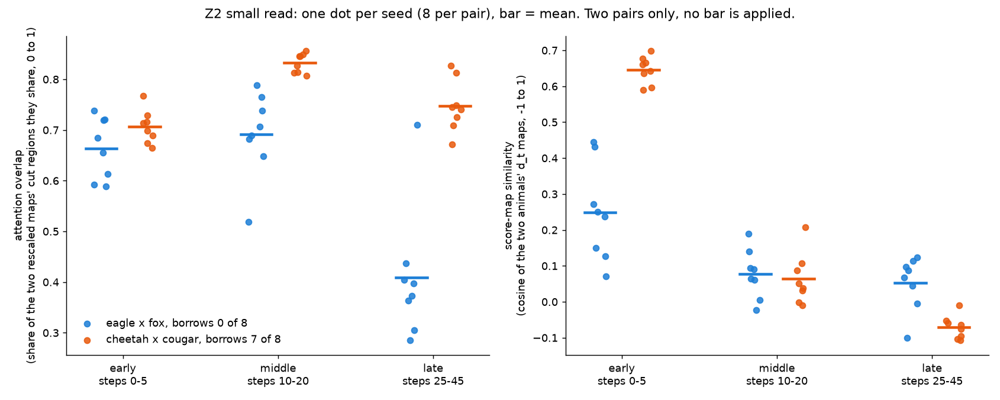

# Z2 small read: a pair that never borrows against one that borrows on 7 of 8 seeds

The small rung of [Z2's design](../design.md) read the three predictors on two pairs at the ends of the outcome: eagle × fox (W2d: `borrowed` on 0 of 8 seeds) and cheetah × cougar (7 of 8), at seeds 6001 to 6008. Two pairs carry no bar; this read checks that the readings vary and shows where to look in the full run.

Each dot is one seed's mean over a window's read steps; the bar is the pair's mean. The figure is drawn by `draw_small_read.py` from the per-picture records under `/datasets/mmolefe/poe_repair_min/loop-12/z2/small/` (Slurm job 94534, W&B `27u2m8sh`, code snapshot `44b51af4`).

## The numbers

Means over 8 seeds, with the range.

| Reading | Window | eagle × fox (0 of 8) | cheetah × cougar (7 of 8) |
|---|---|---|---|
| Text similarity, the two nouns inside the joint prompt (cosine, -1 to 1) | none | 0.165 | 0.251 |
| Attention overlap (DAAM's intersection over union after rescaling, 0 to 1) | early, steps 0-5 | 0.664 (0.588 to 0.738) | 0.706 (0.664 to 0.767) |
| | middle, steps 10-20 | 0.692 (0.518 to 0.788) | 0.832 (0.807 to 0.857) |
| | late, steps 25-45 | 0.409 (0.285 to 0.711) | 0.747 (0.671 to 0.827) |
| Score-map similarity (cosine of $d_t(A)$ and $d_t(B)$, -1 to 1) | early, steps 0-5 | 0.248 (0.071 to 0.445) | 0.646 (0.589 to 0.699) |
| | middle, steps 10-20 | 0.078 (-0.023 to 0.189) | 0.064 (-0.010 to 0.207) |
| | late, steps 25-45 | 0.053 (-0.101 to 0.123) | -0.071 (-0.108 to -0.010) |

## What the read shows

**The two pairs separate in two places, and they are different places.** The score maps separate in the early window only: every cheetah × cougar seed lies above every eagle × fox seed (lowest 0.589 against highest 0.445). The attention maps separate in the middle and late windows and not the early one. Eagle × fox's late overlap is low on 7 of 8 seeds; seed 6001 reads 0.711, inside the cheetah × cougar range.

**Two pairs cannot say whether these readings track borrowing or track how alike the two animals are.** Cheetah and cougar are two large cats; an eagle and a fox share little. Crow × raven, a similar pair that borrows on 0 of 8 seeds, is the case the full run needs: a reading that comes out high for crow × raven follows how alike the animals are (inferred).

## Checks

**The capture leaves the picture unchanged.** The smoke rung measured 0.0 of 255 between capture on and off on one card.

**Pictures that differ from M1's by more than 10 of 255 were checked by eye.** Cheetah × cougar matches M1 at 0.0 on all 8 seeds. Eagle × fox differs at seeds 6002 to 6007, by 10.4 to 27.4 of 255. All six show an eagle and a fox apart, each with its own parts, as W2d called M1's versions; the differences are feather texture, the fox's pose and the ground. Their readings are used.

**Each word's map overlaps itself at 1.0** on all 16 pictures. One picture takes a median of 48.8 seconds on the card used.
