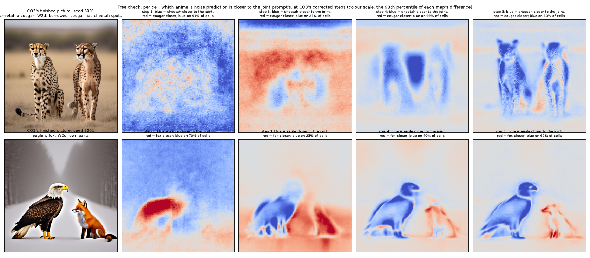

# Free check: does a per-place signal find the borrowing body?

The first stage of Z3, decided for the owner on board question 91 by the manager loop after [the reviewer's Loop 12 section](../../../reviewer/2026-11-24-review.md). It asks two things of records that already exist, with no GPU: does Z2's map of where each animal's push acts find the pairs that borrow, and does CO3's own signal, read cell by cell, find the borrowing body.

Each map is one cell per point of the 128 by 128 latent, at the last corrector pass of the step: the distance between the first animal's noise prediction and the joint prompt's, minus the same for the second animal, each distance taken over the latent's 4 channels. Blue cells are closer to the first animal, red to the second; each map's colour scale is its own 98th percentile. Drawn by `draw_per_place.py` from the CO3 capture run (Slurm job 94450, code snapshot `44b51af4`); the numbers are in `per-place-distance-maps.json`.

## What it finds

**The map of where each push acts does not find the pairs that borrow.** Z2 computed, per window, the cosine between the two animals' per-cell push lengths, and did not report it. Its Spearman $\rho$ with the borrowed count over the 12 pairs is 0.421 early, 0.171 middle and −0.068 late, and crow × raven, which never borrows, again reads highest in every window (0.97, 0.93, 0.91). Source: `2-classifier-guidance/scripts/leakage/z2_analyse.py` on the full run's records (W&B `llct9xp0`).

**CO3's own per-place signal does mark the borrowing body by step 5, on the one recorded seed of each pair.** On eagle × fox the joint prompt's prediction is closer to the eagle's on the eagle's body and to the fox's on the fox's body by steps 4 and 5; the eagle reads closer on 62% of all cells at step 5. On cheetah × cougar both bodies read closer to the cheetah's prediction at steps 4 and 5 (80% of all cells at step 5), so the body CO3 finishes as a cougar with cheetah spots is, cell by cell, being drawn as a cheetah. At step 1 neither map shows a body.

**The signal cannot say which body should be which.** On cheetah × cougar both bodies read "cheetah", so CO3's rule applied per cell (push harder away from the closer animal) would push the cheetah off its own body as well as off the cougar's. A layout is needed to tell the two bodies apart, which is what the drawn boxes in the next stage supply.

## The per-place rule, written down

**In each animal's region, push away from the other animal's prediction.** Inside the box drawn on the cougar, twice the joint prompt's guess minus the cheetah's guess is used, and the cougar's own guess gets weight 0; inside the box on the cheetah, the cougar's is subtracted; outside both boxes, CO3's own whole-canvas weights apply. This fixes the direction that the question and [the ideas note](../../ideas/what-co3-does-that-our-loops-did-not.md) described differently. The note's version (subtract the cheetah where the cougar is) is this rule; the question's version (CO3's distance per cell) is not used, because on the recorded seed it reads "cheetah" on both bodies.

## What this cannot say

One seed per pair: the capture run recorded seed 6001 only, and Z2's records hold each animal's push against the empty prompt, not against the joint prompt, so the per-cell distance to the joint prediction cannot be read on the other seeds without a new run.
