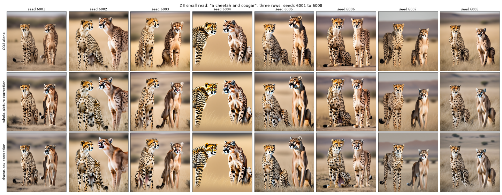
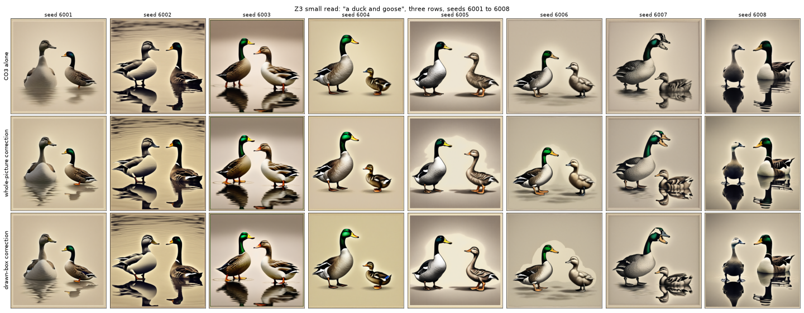

# Z3 small read: two pairs, three rows, eight seeds

The small rung of [Z3's design](../design.md): cheetah × cougar and duck × goose at seeds 6001 to 6008, with CO3 alone (Z2's full-run re-renders, Slurm job 94591), the whole-picture correction and the drawn-box correction at steps 15 to 30 (Slurm job 94647, code snapshot `f4bb39be`, W&B `x1gpc3pz`, median 49.2 seconds per picture on the card used). The pictures are looked at here; nothing is counted. The blind calls on all six pairs decide.

## What the pictures show, by eye

**On cheetah × cougar, both corrections change the cougar, and the whole-picture row changes it about as much as the drawn-box row.** The cougar carries fewer cheetah spots in both corrected rows on several seeds (6003, 6005, 6007 and 6008 most clearly). Seed 6004 keeps the spots in every row, and seed 6006 is two cheetahs in every row. This is what the whole-picture row exists to catch: if the blind counts agree, the extra correction late in sampling helps on this pair and the regions add little.

**On duck × goose, the three rows look much alike.** Mallard heads stay on goose-shaped bodies in every row.

These are impressions from one sheet per pair, with no count, and the reviewer of the blind calls does not see them.
