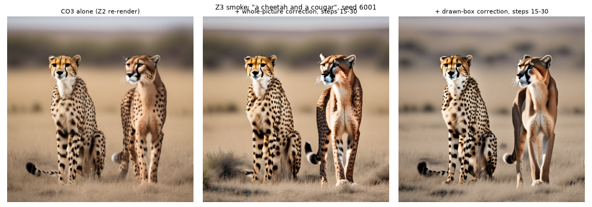

# Z3 smoke: one picture, three rows

"A cheetah and a cougar", seed 6001: CO3 alone (Z2's full-run re-render, Slurm job 94591), CO3 with one whole-picture corrector pass per step at steps 15 to 30, and CO3 with the drawn-box correction (Slurm job 94635, code snapshot `f4bb39be`, W&B `p3ydtazf`). Both controls passed: with empty boxes the region code gives the whole-picture row's picture pixel for pixel, and the latent entering step 15 is unchanged (largest absolute difference 0.0). About 48 seconds per picture on an RTX 3090.

By eye, on this one seed, the drawn-box row's cougar carries no cheetah spots, and the whole-picture row's cougar keeps spots on its chest and back legs. One picture carries no count; the small read and the blind calls decide.
