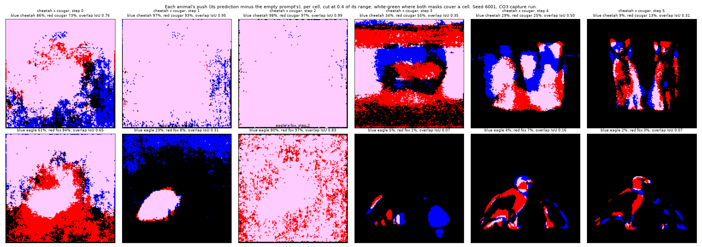

# Does each animal's own push pick out its own body? (the design audit's rerun 3, read from saved records)

Board question 97 (decided by the manager loop for the owner) asked for the audit's third rerun, the block-wise form of Loop 10's shared-space idea, to be read from Loop 12's saved CO3 records at no GPU cost, as a note on Loop 12's own data that reopens nothing. Loop 10 is closed.

Each mask is one animal's push (its noise prediction minus the empty prompt's) at the last corrector pass of a step, as a length over the 4 latent channels per cell, rescaled to run from 0 to 1 and cut at 0.4 (Z2's rule). M9's written rule calls a read failed when either mask covers at least 80% of the grid or the two masks overlap with intersection over union of at least 0.8. Records: the CO3 capture run (Slurm job 94450), seed 6001; script `read_push_regions.py`; numbers in `push-regions.json`.

## What it shows

**5 of the 12 reads fail M9's rule, all at steps 0 to 2,** where both pushes cover most of the canvas (cheetah and cougar 86% to 98% of the grid, overlap 0.76 to 0.99; eagle and fox fail at steps 0 and 2). M9's rule stops a route at more than 6 failures in 24 reads; this read has 12.

**By step 5 the masks are small and only partly on their own animals.** On cheetah × cougar at step 5 the cheetah's mask covers 8.8% of the grid with 62% of it inside the box drawn on the cheetah, and the cougar's covers 12.9% with 42% inside the box on the cougar; the two overlap at 0.31. On eagle × fox at step 5 the masks cover 2.4% and 3.2% and overlap at 0.07.

**As a note on the data (inferred):** at CO3's corrected steps each animal's push does not yet sit on its own body, and on the borrowing pair more than half the cougar's push falls outside the cougar's box. This agrees with the [free check](../03-one-fix/free-check/README.md), where the joint prompt's prediction reads "cheetah" on both bodies at step 5. One seed per pair.
