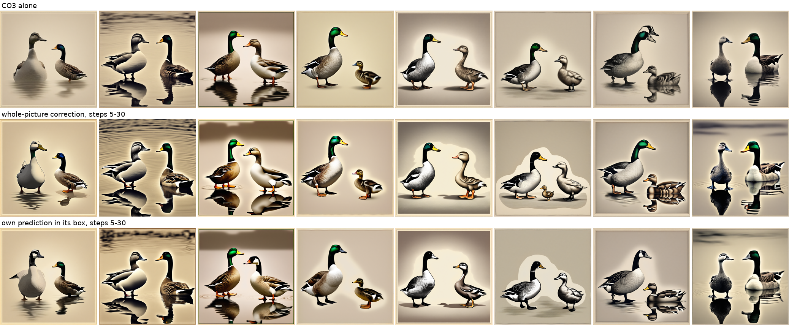

# Review: does each animal's own prediction, inside its own region, stop the borrowing? (step Z7)

**Null by the bar written before the run, and the nearest any Loop 12 fix has come.** Putting each animal's own prediction inside its hand-drawn box at sampler steps 5 to 30 gave 14 of 48 pictures with two clear subjects, against 8 for CO3 alone: a lead of 6, past the lead of 4 the bar asks for, with an exact one-sided McNemar p of 0.073 against the bar's 0.05. Most of the lead is one pair, duck × goose, 0 of 8 to 5 of 8. The free text-only check is null, so the text-encoder fix stays held. The design is [Z7's design](design.md).

## The numbers

Two blind reviewers called all 144 pictures under neutral ids, with the key held apart; they agreed on 132 of 144 (91.7%) on two clear, and a third blind reviewer settled the 12 splits. Calls, key and result are in [the blind folder](blind/) (`calls-1.csv` to `calls-3.csv`, `key.json`, `result.json`; in `result.json`, "boxes" names the own-prediction row, because the scorer is Z3's).

| Row | Two clear of 48 | Lead over CO3 alone (seeds won, lost) | Exact one-sided McNemar p | Broken |
|---|---|---|---|---|
| CO3 alone (Z2's full run, job 94591) | 8 | | | 2 |
| Whole-picture correction, steps 5 to 30 | 10 | 2 (6, 4) | 0.38 | 1 |
| Own prediction in its box, steps 5 to 30 | 14 | 6 (9, 3) | 0.073 | 0 |

The own-prediction row against the whole-picture row: lead 4 (11, 7), p 0.24.

**Per pair, two clear of 8:**

| Pair | CO3 alone | Whole picture | Own prediction |
|---|---|---|---|
| cheetah × cougar | 0 | 1 | 0 |
| duck × goose | 0 | 0 | 5 |
| puma × condor | 1 | 1 | 3 |
| boar × pheasant | 1 | 2 | 0 |
| bobcat × quail | 3 | 1 | 3 |
| seal × gull | 3 | 5 | 3 |

**Per subject, reported beside the bar with no bar of its own** (pictures where both reviewers marked that subject present once with none of the other's parts):

| Row | First-named animal clean | Second-named animal clean |
|---|---|---|
| CO3 alone | 30 | 13 |
| Whole picture | 31 | 18 |
| Own prediction | 38 | 18 |

The second-named animal is the one that borrows most, and it is cleaner under both corrections by the same amount; the own-prediction row's extra gain is on the first-named animal.

## What the pictures show

Duck × goose at seeds 6001 to 6008, one row per method. Under CO3 alone the goose is mostly a goose-shaped body carrying a mallard's green head (W2d's note on all eight). With each animal's own prediction in its box it becomes a Canada goose with a black neck and white cheek patch at seeds 6001, 6003, 6005, 6006 and 6007. The cheetah × cougar smoke sheet showed the same direction on one seed (the cougar's face cleaned, faint spots left), and cheetah × cougar still scores 0 of 8.

## The free text-only check

Null: the second-named animal's word-vector shift against W2d's borrowed counts over the 12 tuning pairs, Spearman ρ −0.023, one-sided p 0.54 (95% interval −0.62 to 0.56); the first-named animal's, reported only, ρ 0.125, p 0.35 ([the smoke card](smoke/README.md)). The text-encoder fix stays held.

## Controls

Both passed on cheetah × cougar seed 6001: the latent entering step 5 equals a plain CO3 render's to a largest difference of 0.0, and the own-prediction code with empty boxes gives the whole-picture picture to 0.0 pixels.

## Runs

| What | Where it ran | Record |
|---|---|---|
| text check and smoke | mscluster107 card 1 under board question 99, 2026-11-25 00:02 to 00:09 | W&B `ggne2va9`; log `/datasets/mmolefe/poe_repair_min/loop-12/logs/z7-shared-card-2.log` |
| full, 96 renders | Slurm job 94806 on mscluster60, 1 hour 31 minutes, median 55.5 seconds per picture | W&B `r3cnfqo1`; renders `/datasets/mmolefe/poe_repair_min/loop-12/z7/full/` |

## What this cannot say

Tuning pairs and seeds only, so no claim in either paper. The boxes were drawn from finished pictures, an upper bound on any reader of regions. A lead carried mostly by one pair is what a pair-specific effect looks like as well as a general one; this run cannot tell them apart. The reviewers noted that the brief's `faithful` and `damaged` definitions (drawing style ignored) differ from the rubric's; the bar uses only `two_clear` and `broken`, which both follow.

## Still open

- Whether the lead holds on more seeds: the same three rows on seeds 6009 to 6016 would put 96 pictures under the same bar (about 1.7 GPU-hours). This is a new run and the owner's call.
- Whether duck × goose's gain comes from the goose's own prediction carrying its species where the joint prediction carried the mallard's head, which the per-step maps of the CO3 capture run could show for one seed at no GPU cost.
