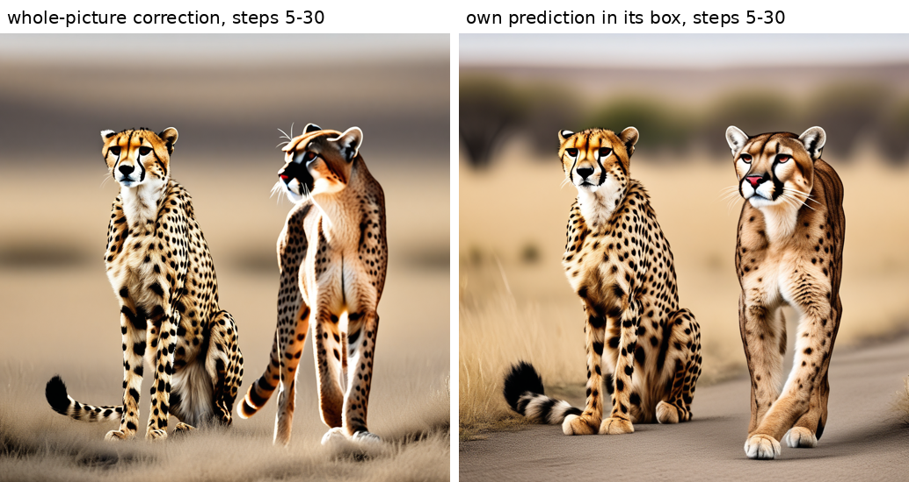

# Z7 smoke and text check

**The free text-only check is null.** Spearman ρ between the second-named animal's word-vector shift (one minus the cosine between its last token inside the joint prompt and alone, on the 2,048 numbers per token the U-Net receives) and W2d's borrowed count over the 12 tuning pairs is −0.023, one-sided permutation p 0.54, 95% interval −0.62 to 0.56. The first-named animal's shift, reported only, gives ρ 0.125, p 0.35. The text-encoder fix stays held, as [the design](../design.md) says. Numbers: `/datasets/mmolefe/poe_repair_min/loop-12/z7/textshift/text-shift.json`.

**Both controls pass** on cheetah × cougar at seed 6001: the latent entering step 5 with the added passes switched on equals a plain CO3 render's to a largest absolute difference of 0.0, and the own-prediction code with empty boxes gives the whole-picture picture to 0.0 pixels.

**Cheetah × cougar seed 6001, steps 5 to 30** ([the sheet](cheetah-cougar-6001.png)): left, one CO3 corrector pass per step everywhere; right, each animal's own prediction inside its drawn box. On the right the second animal has a cougar's face (plain tan muzzle, pink nose, no tear lines) and keeps faint spots on its body; on the left it is a twisted animal with a cheetah's face. One seed, not called blind, so no part of the bar.

**How it ran.** Both stages ran on mscluster107 card 1 under board question 99 (a shared card on another user's job 94699, with the owner's 30-second watchdog), from 00:02 to 00:09:37 on 2026-11-25; renders took about 62 seconds each. W&B run `ggne2va9`. Log: `/datasets/mmolefe/poe_repair_min/loop-12/logs/z7-shared-card-2.log`. A first launch at 00:00 stopped in the job's start-up checks before touching the card, because the code snapshot lacked `checker_choice/splits.json`; snapshots now carry the whole `2-classifier-guidance/scripts/` folder.
