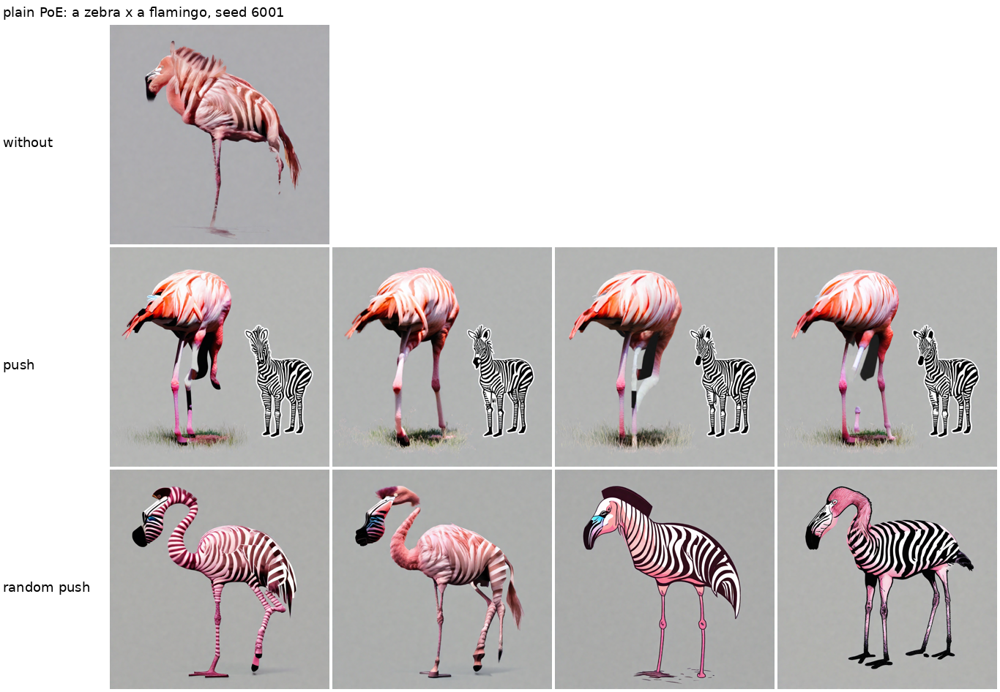
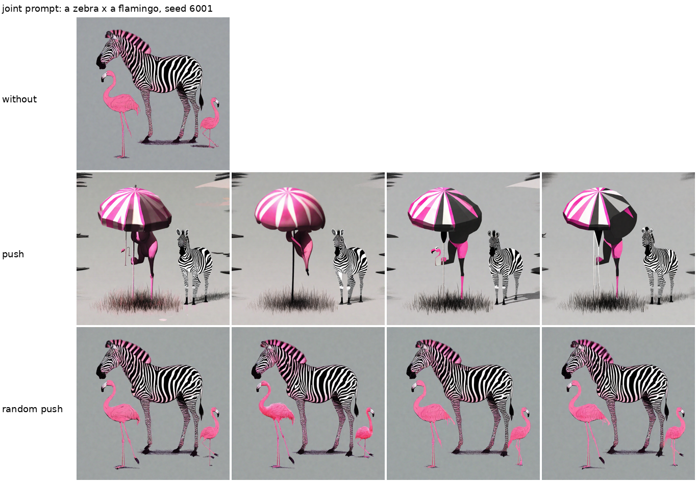
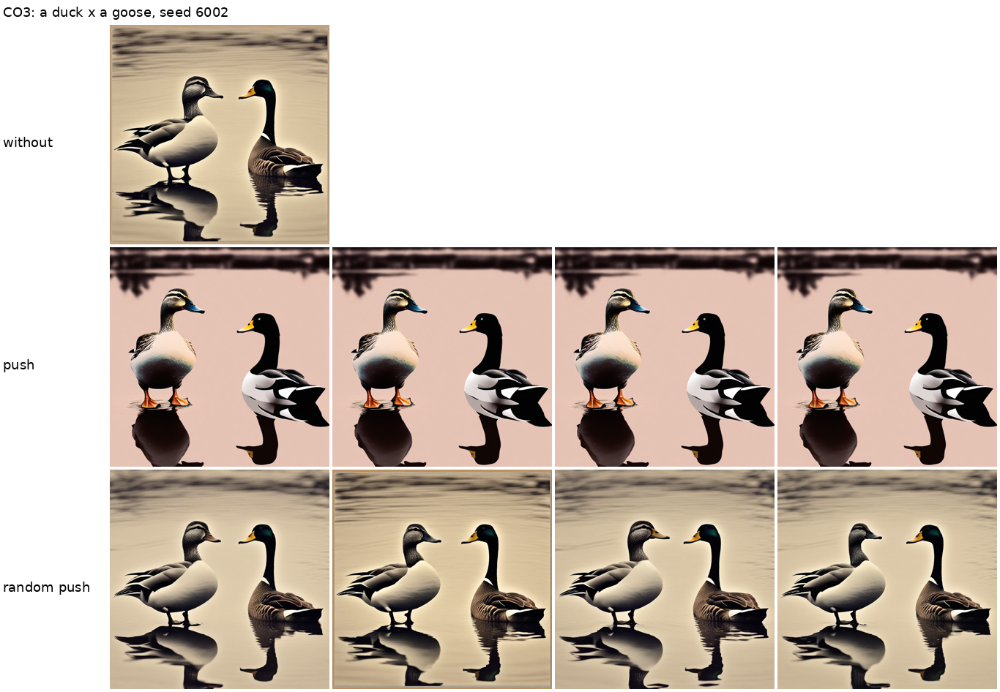
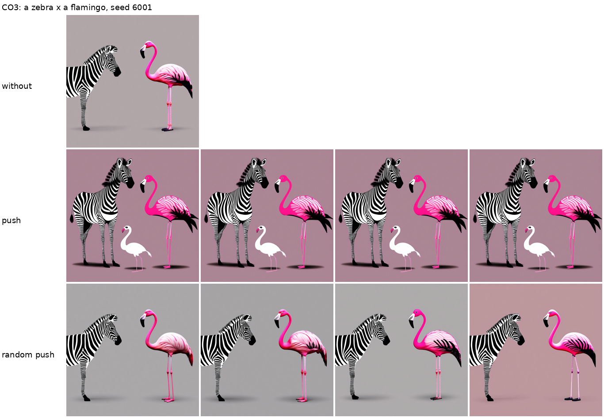

# Review: can the checker's push fix a known failure at all? (step Z8)

**Parked by the bar written before the run.** The kept early push fixed no plain-PoE failure (0 of 12 two-clear pictures, the random push of the same size 0) and two joint-prompt draws (2 of 12, random 0), short of the lead of 4 each base needed. It did pass on CO3 (8 of 12 against 0), but on the two cases CO3 already drew right it left 4 of 8 draws short of two clear against 1 for the random push. The go conditions needed plain PoE and the joint prompt to pass and the good cases to break no more often, so the correction is parked with the eleven grids below as the record. The design is [Z8's design](design.md).

## The numbers

Two blind reviewers called all 99 pictures under neutral ids, with the key held apart; they agreed on 90 of 99 (90.9%) on two clear, and a third blind reviewer settled the 9 splits. Calls, key and result are in [the blind folder](blind/); the thresholds are in `2-classifier-guidance/scripts/leakage/z8_blind.py`, committed before any call (commit `2013f02a`).

| Base | Two clear with the push, of 12 | With the random push, of 12 | Lead | Passes (lead of at least 4) | Broken with the push, random |
|---|---|---|---|---|---|
| Plain PoE | 0 | 0 | 0 | no | 8, 6 |
| The joint prompt | 2 | 0 | 2 | no | 6, 0 |
| CO3 | 8 | 0 | 8 | yes | 0, 1 |

None of the eight failure cases' "without" pictures was called two clear, as their picking intended.

**CO3 beside M1.** M1 put the same push on CO3 across all 96 tuning pictures, one draw each: 7 faithful with the push, 12 with the random push, 11 for CO3 alone ([M1's review](../../method-search/01-beat-the-baseline/review.md); `paper-2-blind-result.json`). Z8's 8 of 12 on CO3 comes from two cases that M1 also counted, where M1's push did not help on puma × condor or duck × goose (0 faithful each). On CO3 the four push draws of each case came out nearly identical, so Z8's CO3 row is closer to two pictures than to twelve; M1's 96 single draws are the wider measure of the same push on the same sampler.

**The two cases CO3 already drew right**, push against random push, short of two clear out of 8: 4 against 1.

## Per case, two clear of 4 draws

| Base | Case | Without (of 1) | Push | Random push | What the push did, by eye |
|---|---|---|---|---|---|
| Plain PoE | puma × condor 6001 | 0 | 0 | 0 | moved the layout to a perch; the main animal stayed a puma with a beak; grey flat patches |
| Plain PoE | zebra × flamingo 6001 | 0 | 0 | 0 | a flamingo beside a flat cutout zebra on all four draws; the flamingo kept faint stripes |
| Plain PoE | seal × gull 6001 | 0 | 0 | 0 | a second seal, never a gull |
| Joint prompt | puma × condor 6001 | 0 | 0 | 0 | took the puma's head off the bird; the bird read as a hawk-like bird, not a condor |
| Joint prompt | zebra × flamingo 6001 | 0 | 0 | 0 | a clean zebra and a flamingo broken into an umbrella shape |
| Joint prompt | seal × gull 6001 | 0 | 2 | 0 | a spotted seal and a separate gull on all four; two had a malformed bill |
| CO3 | cheetah × cougar 6001 | 0 | 0 | 0 | cleaned the cougar's face; cheetah spots stayed on its body |
| CO3 | puma × condor 6001 | 0 | 4 | 0 | took the puma's head off the bird |
| CO3 | duck × goose 6002 | 0 | 4 | 0 | the mallard-headed goose became a black-necked, yellow-billed goose |
| CO3, already right | zebra × flamingo 6001 | 0 | 0 | 3 | added a small white flamingo on all four draws |
| CO3, already right | eagle × fox 6001 | 1 | 4 | 4 | the fox picked up blue-white patches and dark legs, still called two clear |

CO3's zebra × flamingo "without" picture was called short of two clear because the zebra is cut off at the frame's left edge; W2d's label on it was about borrowed parts, which it has none of.

## The grids

Each grid is one case: the base alone (top), four pushes (middle), four random pushes of the same size (bottom).

All eleven are in [the grids folder](grids/).

## Runs

| What | Where it ran | Record |
|---|---|---|
| screening pass, 88 pictures, and the joint-prompt identity check (byte for byte) | mscluster107 card 1 under board question 103, 2026-11-25 04:46 to 05:16 | W&B `y5vq9ya7`; log `/datasets/mmolefe/poe_repair_min/loop-12/logs/z8-shared-card-2.log` |
| Z8 proper, 99 pictures | mscluster107 card 1 under board question 103, host job 94793, 05:20 to 06:19; plain PoE and the joint prompt 20.6 minutes, CO3 38.6 minutes | W&B `emcsgatg` (the blind verdict; the render script itself logged nothing to W&B); log `/datasets/mmolefe/poe_repair_min/loop-12/logs/z8-cases-card1.log`; pictures `/datasets/mmolefe/poe_repair_min/loop-12/z8/cases/` |

A first screening launch stopped itself at the identity check (the joint prompt through the three-entry product sampler differed from `run_cfg` by a mean of 3.2 grey levels); the joint-prompt base was moved to `z8_joint.py` and passed byte for byte before any screening picture.

## What this cannot say

Three cases per base, chosen as failures, so no rate; tuning pairs and seeds only. One push recipe (strength 30, cap 0.4, steps 0 to 15). On CO3 the four draws did not vary, so the CO3 pass is two cases deep.

## Still open

- Whether CO3's two fixed cases hold on other seeds of the same pairs: M1's 96 single draws say the push does not beat the random push on CO3 overall.
- Whether the push's damage on the already-right cases (an extra flamingo; patches on the fox) comes from the checker reading a sampler it was not trained on (inferred: its training tiles came from the plain-SDXL samplers of the checker loop, not from CO3; not checked here).
