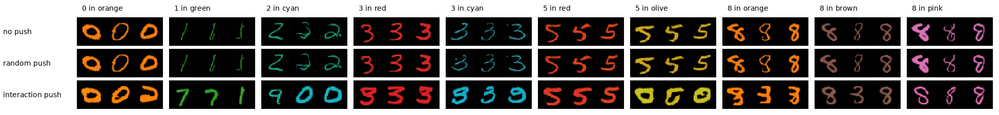

# Arm 3 did not pass its gate

**The interaction push failed on seen pairs it never trained on, so its run on unseen combinations is reported as not reached**, as [the design](design.md) fixes. On the 10 held-back seen pairs, 100 pictures each from the same seeds:

| Sampler | Digit and colour both right, of 1,000 |
|---|---|
| No push (arm 1's product) | 78.8% |
| Random push of the same length | 78.7% |
| Interaction push | 47.0% |

The interaction push won 57 matched pictures against the random push and lost 374 (exact one-sided McNemar p = 1.0); the gate asked for at least 5 points over the random push with p < 0.05. Job 95206, W&B `siwmn8gt`, `arm-3-held-back-result.json`.

**What the push does.** It keeps the asked colour and draws a bolder stroke, and it changes the digit to one the classifier trained on in that colour: 1 in green becomes 7, 2 in cyan becomes 9 or 0, 5 in olive becomes 0. Green 7, cyan 9 and 0, and olive 0 are all training pairs (`split.json`), while green 1, cyan 2 and olive 5 are held back. The pair softmax ran over training pairs only, yet the classifier still learned their absence through which pairs it scores highest, and the push pulls a picture toward the nearest pair it knows.

**The classifier could not read digits along the way.** Its digit head, read on the pushed pictures at every sampling step, stays between 9% and 24% right (chance is 10%), while its colour head rises from 10% at step 0 to 89% at step 49. An interaction score built on features that do not hold the digit has nothing to push toward except the colour's training pairs.
