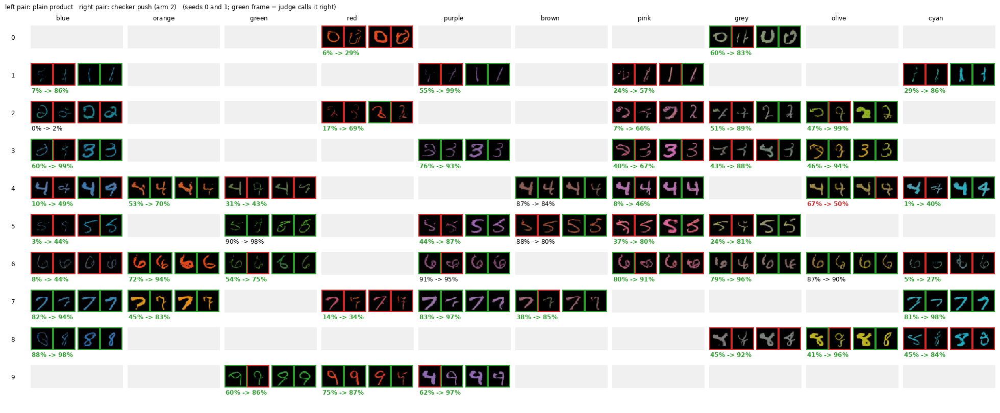

# Review: does a push on finished experts draw combinations no data holder saw? (step Z9)

**Yes, and the pair is not what does it.** On Colored MNIST with two data holders and finished experts that are never retrained, Paper 1's checker push raised the share of pictures with the asked digit in the asked colour, on the 50 combinations neither holder saw, from 46.9% to 76.0%, and halved novel FID from 25.87 to 12.63. That met the bar written before the run. Control a then showed that a push which names the digit and the colour separately, never told the pair, at the same length, does as well or better: 78.4%, FID 14.32. So arm 2's lift is attribute guidance, and its support for a pair-aware push does not stand. Both arms built to supply the term the product drops failed their gates on seen pairs they never trained on: the interaction push (arm 3) swapped digits for trained pairs, and the model of the dropped term (arm 4) passed its picture comparisons twice but missed its fit check twice. The design is [Z9's design](design.md).

## The numbers on the 50 novel combinations

5,000 pictures per row, 100 per combination from the same seeds; "right" is the judge's call of both digit and colour. The judge reads real novel-combination test digits right 97.9% of the time.

| Sampler | Right | Against the plain product: won, lost, p | Novel FID |
|---|---|---|---|
| 1. The plain product | 46.9% | | 25.87 |
| 2. The checker push (pair-aware) | 76.0% | 1,671, 216, p ≈ 10⁻²⁷⁸ | 12.63 |
| Control a: names-only push at arm 2's length | **78.4%** | 1,709, 137, p ≈ 0 | 14.32 |
| Arm 2 against control a | −2.3 points | 508 won, 625 lost, p = 0.9998 | |

The real-against-real FID floor is 2.31. On the seen combinations the plain product is right on 82.4% (FID 9.99), and each expert alone draws its own combinations right on 98% and 97% (control 3).

**Beside DCFM's numbers, as context only.** DCFM's table (Table 1, p. 7) prints novel FID 25.19 for its finished-expert baseline and 11.41 for DCFM-A, which retrains its experts. Our plain product lands at 25.87, beside its baseline. Both pushes, with no retraining, bring it to 12.63 and 14.32. The match is partial: two holders against DCFM's ten, our palette and picture size, and 5,000 pictures where DCFM states no count.

Plain product (left pair) against the checker push (right pair) in every novel cell. The push turns faint, broken strokes into solid digits in the asked colour: 1 in blue goes from 7% to 86%, 2 in olive from 47% to 99%. It does not fix 2 in blue (0% to 2%), lowers 4 in olive (67% to 50%), and red cells stay hardest, still drifting to orange. [The names-only push's sheet](before-after-plain-product-and-names-only-push.png) looks much the same.

## Arms 3 and 4: the term the product drops

| On the 10 held-back seen pairs | Right | Gate |
|---|---|---|
| No push (arm 1's product) | 78.8% | |
| Random push at arm 3's length | 78.7% | |
| Arm 3, interaction push | 47.0% (57 won, 374 lost against the random push) | fails: needed 5 points over the random push |
| Arm 4, first attempt (10,000 steps) | 89.2% (120 won, 16 lost against arm 1); twin 53.1% | fails: explained variance 0.224, needed 0.25 |
| Arm 4, second attempt (30,000 steps) | 92.2% (153 won, 19 lost against arm 1); twin 53.5% | fails: explained variance 0.217, needed 0.25 |

**Arm 3** keeps the asked colour and swaps the digit for one the classifier trained on in that colour (green 1 becomes 7, cyan 2 becomes 9 or 0, olive 5 becomes 0; all are training pairs). Its digit head reads 9% to 24% along the pushed pictures, its colour head 89% by the end ([arm 3's note](arm-3-not-reached.md)). The novel run was not reached.

**Arm 4** helps the held-back pictures more than anything else in Z9 (92.2% against the product's 78.8%), and its shuffled twin hurts them (53.5%), so the model learned something pair-specific about the product's error. But it explains under a quarter of that error's variance, and training three times longer did not raise the fit (0.224, then 0.217). The second attempt was the owner's choice after the first missed; both are recorded as not reached, and neither novel run was made ([first gate](arm-4-gate-result.json), [second gate](arm-4-second-attempt-gate-result.json), [held-back sheet](arm-4-held-back-seen-pairs.png)).

## Runs

| Job | What | Time | W&B |
|---|---|---|---|
| 95106 | first stage, stopped by a job-file ordering slip before any work | 1 s | |
| 95109 | judge and expert timing | 1 min 24 s | |
| 95113 | both experts, 20,000 steps each | 42 min | |
| 95175 | arm 1 | 14 min | `2m98c7oj` |
| 95187 | checker data, checker, arm 2 | 22 min | `msqrqntu` |
| 95206 | arm 3 classifier and its held-back gate | 6 min | `siwmn8gt` |
| 95211 | arm 4 trajectories, model, twin, gate | 35 min | `ae6sk6xv` |
| 95248 | control a | 18 min | `dr3zgnqh` |
| 95317 | arm 4 second attempt | 1 h 24 min | `2ikc5l77` |

All on `bigbatch` RTX 3090 cards; outputs under `/datasets/mmolefe/poe_repair_min/loop-12/z9/`. **In all 3.70 GPU-hours, over the 3.3 approved by about 0.4:** the second arm 4 attempt took 1.39 hours against an estimate of 0.6. Arm 3's novel run and control d (the pooled model) were not run, since arm 3 failed its gate.

## What this cannot say

Two holders, one split draw and one push setting; Colored MNIST puts both attributes on one digit, not two objects in one picture, Paper 1's own setting. The judge and both classifiers learned from real coloured digits, so accuracy could flatter any push toward real-looking digits; the FID drop, measured by an unrelated network, is the independent check, and it agrees. Nothing here tests below DCFM's minimum share of seen combinations (question 108's experiment 2).

## Still open

- Whether knowing the pair ever adds to naming its parts: the checker's FID is lower than the names-only push's (12.63 against 14.32) while its accuracy is not higher; a per-cell comparison of arm 2 and control a would show where, at no GPU cost.
- Whether arm 4's fit is limited by the model or by the target: per-step fit on the held-back trajectories would show which steps hold it under 0.25, at no GPU cost.
- Question 108's experiment 2, the split below DCFM's minimum share, now with the names-only push as the arm to beat.
