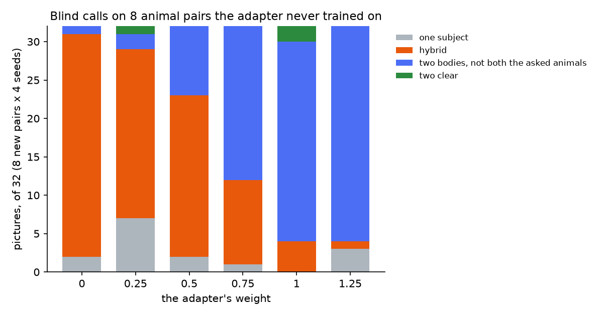
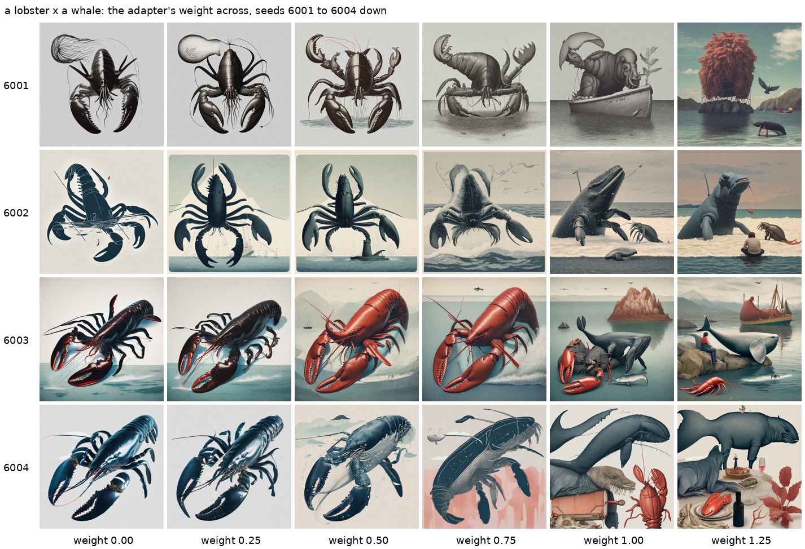
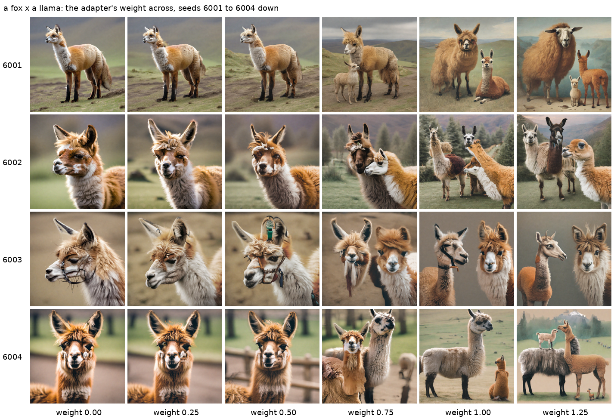

# Review: is the adapter's correction a dial or a switch on pairs it never saw? (step Z10)

**No effect on new pairs, by the bar written before the run: the adapter separates bodies, but almost never into the two animals asked for.** On eight animal pairs that share no animal with the adapter's training pairs, raising the adapter's weight from 0 to 1 turned hybrids into separate bodies steadily (29 of 32 pictures hybrid at weight 0, 4 at weight 1; separate bodies 1 to 28), but the second body was a wrong, duplicated or half-mixed animal, and two clear subjects rose only from 0 to 2 of 32 (exact one-sided McNemar p = 0.25, against a bar of a rise of 6 and p < 0.05). The design is [Z10's design](design.md).

## The numbers

192 pictures, 8 pairs by 4 seeds by 6 weights, called blind under neutral ids in four batches; two reviewers agreed on 177 of 192 calls (92%), and a third settled the 15 splits ([the blind records](blind/); the bar is computed by `2-classifier-guidance/scripts/leakage/z10_blind.py bar`, `blind/bar.json`).

| Weight | One subject | Hybrid | Two bodies, not both the asked animals | Two clear |
|---|---|---|---|---|
| 0 | 2 | 29 | 1 | 0 |
| 0.25 | 7 | 22 | 2 | 1 |
| 0.5 | 2 | 21 | 9 | 0 |
| 0.75 | 1 | 11 | 20 | 0 |
| 1 | 0 | 4 | 26 | 2 |
| 1.25 | 3 | 1 | 28 | 0 |

Weight 1 against weight 0 on the 32 matched pictures: two clear won 2, lost 0. The steps of two-clear between neighbouring weights from 0 to 1 are +1, −1, 0, +2. Since the effect condition fails, the dial-or-switch call does not apply to two clear subjects.

**What does move, read without a bar.** The hybrid-to-two-bodies change is gradual rather than a jump: hybrids fall 29, 22, 21, 11, 4 across weights 0 to 1, the largest single step (0.5 to 0.75) carrying 10 of the 25. On these pairs the adapter's weight works as a dial on separating bodies, and not on making the second body the right animal. The [smoke run's fox × llama strip](smoke-fox-llama-6001.png) shows the typical case: a fox-llama hybrid becomes two llamas.

**Control 3, a training pair** (badger × magpie, 4 seeds, the two reviewers agreeing on all 8): weight 0 gives 4 hybrids; weight 1 gives 3 two-body pictures and 1 one-subject, and no two clear. On these seeds the adapter does not draw two clear subjects even on a pair it trained on.

## The grids

One grid per pair, the six weights across and the four seeds down ([the grids folder](grids/)):

## Controls

| Control | Result |
|---|---|
| 1. Weight 0 is the plain product | passes in every job: largest pixel difference 0 against `run_cfg_poe`, and 0 for the original U-Net after the copy received the adapter |
| 2. The whole adapter is loaded | passes: 420 modules, 840 tensors, cross- and self-attention, rank 32 |
| 3. The adapter on a training pair | reported above, no bar |

## A finding on the adapter's off switch

With `v58-03-self` attached and switched off by `disable_adapters()`, SDXL does not draw the plain product: on fox × llama at seed 6001 the picture differs from the no-adapter product by a mean of 10.8 grey levels (largest 231), against 34.5 with the adapter on, while the plain and guided samplers agree exactly with no adapter ([`diagnose/diagnose.json`](diagnose/diagnose.json), job 95428). Any weighted run that takes "off" from the same U-Net with this checkpoint attached and switched off compares against about a third of the adapter. Z10 took "off" from an untouched U-Net and "on" from a copy carrying the adapter. Which recorded results used the leaky path with this checkpoint was not checked here.

## Runs

| Job | What | Time | W&B |
|---|---|---|---|
| 95424 | first smoke run, stopped by control 1 (the off-switch leak) | 2 min 34 s | |
| 95428 | the diagnostic | 3 min 50 s | |
| 95430 | smoke run with two U-Nets, both controls pass | 7 min 21 s | `o1s9xccr` |
| 95433 | fox × llama, butterfly × crab, control 3 | 44 min 47 s | one of `xhn9cqae`, `qjib9cy7`, `dgp81wl3`, `fv3cp2lw` |
| 95434 | lobster × whale, bee × owl | 38 min 56 s | as above |
| 95435 | landed on a card already in use; its guard refused in one second | 1 s | |
| 95436 | goat × rhinoceros, ladybug × octopus | 40 min 19 s | as above |
| 95441 | kangaroo × squid, flamingo × sloth (95435 resubmitted on a whole node) | 38 min 36 s | as above |

All on `bigbatch` RTX 3090 cards, every job refusing any other card type; pictures under `/datasets/mmolefe/poe_repair_min/loop-12/z10/full/renders/`. **2.94 GPU-hours in all**, against 2.83 approved for the full run; the extra 0.11 is the smoke and diagnostic runs that found the off-switch leak.

## What this cannot say

Eight pairs and four seeds. One adapter checkpoint. "New" here means no animal shared with the training pairs; how near the new animals sit to trained ones in SDXL's text space is not measured. The calls are by eye at full size, and the reviewers disagreed on 8% of pictures, mostly between hybrid and two bodies.
