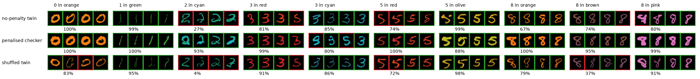
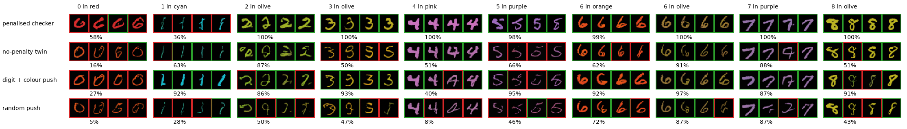

# Review: does a checker trained to push along the experts' own direction reach pairs it never saw? (step Z11)

**Support, by the bar written before the run.** On the 50 digit-and-colour combinations no expert saw, the checker trained with Ganz, Kawar and Elad's gradient-alignment penalty drew the asked digit in the asked colour on 88.8% of 5,000 pictures, against 63.1% for the same checker trained without the penalty and 73.8% for the separate digit and colour push at the same length, with the lowest FID of any row and fewer already-right pictures broken than a random push. The design is [Z11's design](design.md).

## The gate, on the 10 held-back seen pairs

| Checker | Right digit and colour (1,000 pictures) | Median cosine between the push and the target |
|---|---|---|
| Penalised | 95.4% | 0.514 |
| No-penalty twin | 78.6% | 0.064 |
| Shuffled-target twin | 73.6% | −0.034 |

Both parts pass: the cosine leads the twin by 0.45 against a bar of 0.10, and accuracy leads the twin by 16.8 points (200 won, 32 lost, exact one-sided McNemar p ≈ 3 × 10⁻³¹) and the shuffled twin by 21.8 (245 won, 27 lost, p ≈ 2 × 10⁻⁴⁵) against bars of 5 points and p < 0.05 ([`gate/held.json`](gate/held.json)). The shuffled twin's cosine sits at zero, so the gain comes from each pair's own direction, not from smoother gradients.

## The bar, on the 50 unseen combinations

| Push | Right digit and colour (5,000 pictures) | FID | Against the penalised push |
|---|---|---|---|
| **Penalised checker** | **88.8%** | **10.8** | |
| Digit and colour push at the same length (control a) | 73.8% | 15.3 | penalised leads by 15.0 points; 902 won, 153 lost; p ≈ 5 × 10⁻¹³⁰ |
| No-penalty twin | 63.1% | 17.0 | penalised leads by 25.7; 1,421 won, 134 lost; p ≈ 6 × 10⁻²⁷² |
| Random push at the same length | 47.0% | 26.1 | penalised leads by 41.8; 2,161 won, 72 lost |

Seen pictures the plain product drew right (4,121 of 5,000; 82.4% when redrawn on the pod) that a push turned wrong: 34 for the penalised push, 41 for the random push, against a bar of the random count plus 50. All four parts of the bar hold ([`unseen/novel.json`](unseen/novel.json)).

**Where it fails, read from the sheet without a bar.** On 4 of the 50 combinations the penalised push is right on fewer than half the pictures, and on 3 it is below the no-penalty twin. The sheet shows how: asked for 0 in red, it draws a red 6, and 6 in red is a seen pair; asked for 1 in cyan, it draws a hooked 1 that the judge reads as another digit. On those combinations the push pulls toward a seen pair that shares the colour, rather than composing the asked digit with it.

## What this cannot say

This is Colored MNIST at 32 pixels with two holders, one seed for each checker's training, and one judge. As the design says before the run, at an unseen combination no expert's two-label prediction exists, so the penalty never touched it: the checker reaches it only through its digit embedding plus its colour embedding, and the target on seen pairs is mostly the product averaging over a holder that lacks the picture, a federated effect with no counterpart on SDXL. A pass shows that a supplied direction can be trained into a classifier and survive to unseen combinations; it does not show that SDXL's interaction can be.

## Runs

| Stage | Where | Time | W&B |
|---|---|---|---|
| No-penalty twin (3,000 steps) | RunPod RTX 4090 | 3 min 10 s (13:24 to 13:27 UTC) | |
| Penalised checker | same | 29 min 17 s | |
| Shuffled-target twin | same | 29 min 41 s | |
| Gate (held-back pairs) | same | 3 min 2 s | |
| Unseen combinations with controls | same | 24 min 53 s | |
| Summary | logged from the cluster after the run, because the pod had no W&B key | | `zzsttdkd` |

Every output, with checksums, is under `/datasets/mmolefe/poe_repair_min/loop-12/z11/pod-run/`. All comparison rows were drawn on the same pod card. The full chain ran 1 h 30 min on the pod, after a first launch that stopped at the penalised checker's first step on the attention kernel; the pod then idled about 2 hours before the watcher caught the stop.
