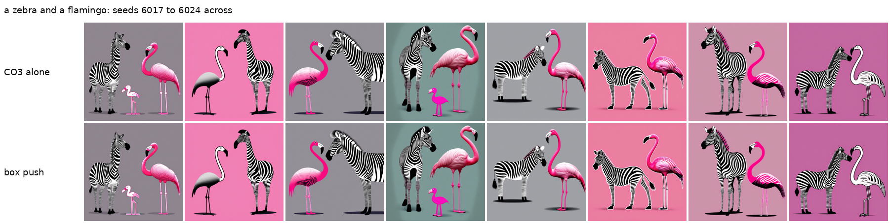

# Review: does each animal's own prediction, applied as a push inside its box, beat CO3 alone? (step Z12, stage A)

**Miss by the bar written before the run, and too weak to tell.** On the 12 tuning pairs at seeds 6017 to 6024, the box push drew 27 of 96 pictures with two clear subjects that keep their own parts, against 26 for CO3 alone: a lead of 1 (1 seed won, none lost, 1.0 standard errors), against a bar of 5 and 1.96. The push moved each picture by a median of 2.3 grey levels of 255 (largest 5.6), so the two rows are near copies, and a push that small cannot test whether each animal's own prediction in its box helps. The design is [Z12's design](design.md).

## The numbers

| Pair (8 seeds) | CO3 alone | Box push |
|---|---|---|
| lighthouse × sailboat | 6 | 6 |
| crow × raven | 5 | 5 |
| eagle × fox | 5 | 5 |
| giraffe × tortoise | 4 | 4 |
| seal × gull | 3 | 3 |
| boar × pheasant | 2 | 2 |
| puma × condor | 1 | 1 |
| zebra × flamingo | 0 | **1** |
| hippopotamus × swallow, bobcat × quail, duck × goose, cheetah × cougar | 0 each | 0 each |
| **All 96** | **26** | **27** |

Beside the bar and deciding nothing: broken 4 against 4; the first animal present once with its own parts 61 against 62 and the second 40 against 39; photograph-like two-clear pictures 12 against 12. Duck × goose, which carried Z7's lead, is at 0 in both rows. The bar's computation is `2-classifier-guidance/scripts/leakage/z12_blind.py bar`, committed before any call (`b7578677`); the records are under [the blind folder](blind/).

**The futility rule** (stop at a lead of 0 or less on the first 48) did not fire: the first half gave 9 against 8, all of it the zebra × flamingo seed. The rule was committed while the box-push jobs were drawing and before any box-push picture was looked at.

The grids, CO3 alone above the box push at all eight seeds, are in [the grids folder](grids/); giraffe × tortoise is held from display.

## Why the push could not tell

The push moved CO3's noise prediction by the median length of the box direction on 24 training trajectories, 0.8 at step 5 rising to 1.8 by step 23 in noise units (`lengths.json`), against a prediction whose length is in the hundreds; the 0.4 cap never fired. Inside each box, CO3's prediction is already close to that animal's own prediction, so the direction is short. Z7's own-prediction row, the same idea through an extra corrector pass, moved its pictures by a median of 21.4 grey levels (largest 30.3) on its 48, but Z7's whole-canvas row with no boxes moved them by 24.5, so most of Z7's movement came from the extra pass, not from what went inside the boxes (measured from saved pictures, no GPU). Neither run isolates the box content at a size that changes pictures.

## Controls and checks

| Control | Result |
|---|---|
| Empty boxes against CO3 alone | identical to the pixel, duck × goose at seed 6017 |
| Latent entering step 5 | identical |
| The push acts | it ran at all 25 steps of the window and changed the control picture by up to 249 grey levels in some pixel |
| Instrument boxes against Z3's eye boxes, 48 CO3 pictures | the same animal named on 46; matched boxes overlap with a median intersection over union of 0.978 |
| Pictures with no box | 0 of 96 test and 0 of 96 training pictures |

## How it was counted

The design asked for one shuffled batch of 192; the futility rule split it into two batches of 96, each holding both rows of six pairs, so every matched comparison sits inside one batch. Two blind Claude reviewers per batch, one from each end of the sheet, agreed on the rung for 86% of the first batch and 94% of the second, and a third settled the 13 and 6 splits. Both reviewers noticed the near-identical copies and called copies alike.

## What this means

By the design's rule a miss stops stage B and closes the box route on CO3 with Z7 and Z12 as its record; because the push was too small to change the pictures, this result says nothing about whether the box correction helps at a size that does. A rerun at a larger push length changes the design after a result and is the owner's call; stage B stays on hold.

## Runs

| Job | What | Time |
|---|---|---|
| 95492 | instrument boxes on Z2's 96 CO3 pictures, then the push lengths | ended 15:49 UTC |
| 95493 | CO3 alone, shard 0: died on a `/datasets` folder race (mscluster87) | 4 min |
| 95494, 95495, 95500 | CO3 alone, shards 1, 2, 0 | ended 15:46 to 15:50 |
| 95501 | instrument boxes on row 1, the controls | ended 15:53 |
| 95504, 95515 | box push, shard 2: died twice on mscluster79's stale view of `/datasets` | minutes |
| 95502, 95503, 95516 | box push, shards 0, 1, 2 | ended 16:25, 16:21, 16:28 |

All on `bigbatch` RTX 3090 cards, whole nodes; code snapshots `c1dbe7c4` and `51fc140a`; pictures under `/datasets/mmolefe/poe_repair_min/loop-12/z12/`. About 3.3 GPU-hours against about 3.1 approved, the difference the three failed jobs and their reruns. W&B group `loop-12-z12`. The push lengths, both box files and the control result are in [the records folder](records/).
