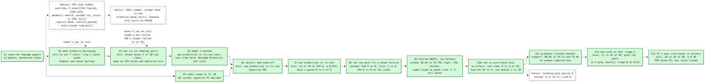

# Where Loop 12 ends: what it found about borrowing, and what the two papers take from it

Loop 12 asked where, with CO3 on SDXL, one subject borrows the other's parts, and what stops it. On SDXL it found no reading that predicts which pairs borrow and no fix that passes its bar. Each animal's own prediction inside its own box came nearest in Z7 (a lead of 6 two-clear pictures in 48 over CO3 alone, p = 0.073), and two later runs closed that route: applied as a push it was too small to change pictures (Z12), and with Z7's extra corrector pass held fixed it added 2 of 96 (Z13), while the extra pass itself lost pictures against CO3 alone. The steps that turned the question on the two papers' own methods found that the LoRA from Paper 1 separates bodies on new pairs but does not make them the right animals (Z10, and option A of the binding plan), and that on Colored MNIST a checker trained to push along the experts' own direction reaches combinations no expert saw, where naming the digit and the colour separately does not reach as far (Z11).

## Every step and its verdict

| Step | Question | Verdict against the bar written before it ran |
|---|---|---|
| Z1 | which papers say where leakage enters | 13 papers in [the mechanism table](01-reading/mechanism-table.md); none measures which pairs leak and why |
| Z2 | does any reading inside SDXL predict which pairs borrow | null on all seven tests: largest Spearman ρ 0.489 against a bar of 0.706 ([Z2's review](02-what-predicts-borrowing/review.md)) |
| Z3 | does subtracting the other animal's prediction in each box stop borrowing | null: 5 of 48 two clear, the same as CO3 alone ([Z3's review](03-one-fix/review.md)) |
| Z4 | Paper 2's method | [the method choice](04-paper-2-method.md) |
| Z5 | design issues in Loops 8 to 10 | [the design audit](05-design-audit.md), with [rerun 3](05-audit-rerun-3/) read from saved records |
| Z6 | the loop's verdict on mechanism and fix | [the verdict](06-verdict.md): mechanism unknown, three places ruled out as predictors |
| Z7 | does each animal's own prediction in its box stop borrowing | null by the bar, the nearest: 14 of 48 against 8, p = 0.073, mostly duck × goose ([Z7's review](07-own-prediction/review.md)) |
| Z8 | does the kept early push fix the failures of three samplers | parked: it passed on CO3 only, and broke good CO3 draws ([Z8's review](08-first-correction-test/review.md)) |
| Z9 | does Paper 1's checker push compose unseen digit-colour pairs | yes, 46.9% to 76.0%, but a push naming digit and colour separately does as well (78.4%), so the lift is attribute guidance ([Z9's review](09-dcfm-colored-mnist/review.md)) |
| Z10 | is the LoRA's correction a dial or a switch on new pairs | no effect on two clear (0 to 2 of 32); it separates bodies (hybrids 29 to 4) without naming them ([Z10's review](10-co-occurrence-dial/review.md)) |
| Z11 | does a checker trained to push along the experts' direction reach unseen pairs | **support**: 88.8% against 63.1% (no penalty) and 73.8% (digit and colour named separately), FID 10.8 against 17.0 ([Z11's review](11-gradient-trained-classifier/review.md)) |
| Z12 | does each animal's own prediction, applied as a push in its box, beat CO3 alone | null by the bar and too weak to tell: 27 against 26 of 96; the push moved pictures by 2.3 grey levels of 255 ([Z12's review](12-aligned-classifier-on-co3/review.md)) |
| Z13 | with Z7's extra pass held fixed, does the box content add two-clear pictures | null: 20 against 18 of 96 (p 0.39), CO3 alone 25; the box content moved pictures by 21.4 grey levels ([Z13's review](13-clean-up-pass-in-boxes/review.md)) |

## What Paper 1 takes from it (the LoRA correction)

The LoRA does one of the two jobs composition needs. Raising its weight separates a hybrid into two bodies on pairs it never trained on, but the bodies are rarely the two animals asked for: a fox-llama hybrid becomes two llamas. Its training target, the joint prompt's prediction minus the plain product's, is mostly "two things instead of one", so binding each body to its word is a weak signal inside it. Option A of [the binding plan](../../../../1-lora-correction/binding-plan.md) added each animal's own prediction in its box on top of the LoRA and failed its bar (4 of 32 two clear against 2 for the LoRA alone, [option A's review](../../../../1-lora-correction/binding/option-a-review.md)), so a loss that teaches the LoRA that same rule is not built; aligning each animal word's attention with its region acts elsewhere and is untested.

Z10 also found that with this checkpoint attached and switched off, SDXL does not draw the plain product (a mean of 10.8 grey levels away), so any earlier weighted run that took "off" from the same U-Net compared against about a third of the adapter. Which recorded results did so is not checked.

## What Paper 2 takes from it (classifier guidance)

Z9 showed that a checker told the pair does no better than a push told the digit and the colour separately; Z11 showed that training the checker so its push points along the experts' own direction does better than both, on combinations no expert saw. Where Z11's checker fails, it draws a seen pair that shares the asked colour (a red 6 for a red 0), the same kind of failure as the LoRA's two llamas. The target Z11 trained toward exists only because two holders each saw half the pairs. On SDXL the stand-in target, each animal's own prediction in its box, does not help at either size tried (Z12, Z13), so Z11's penalty has no SDXL target from this loop, and the stage that would train a classifier toward it on CO3 was not run.

## Still open

- Which earlier results used the LoRA's leaky off switch.
- Whether attention alignment, the binding plan's other loss term, makes the LoRA bind.
- Whether any box method helps at another window, or with each animal's prediction mixed rather than replaced inside its box.

## Compute

Z3 about 1.6 GPU-hours, Z9 3.70 (0.4 over its approval), Z10 2.94 (0.11 over), Z12 about 3.3 (0.2 over), Z13 4.5 (0.3 over), option A about 0.7, on `bigbatch` RTX 3090 cards; Z11 1 h 30 min on a RunPod RTX 4090, plus about 2 hours idle after its first launch stopped. Z2, Z7 and Z8's compute is in their reviews.
