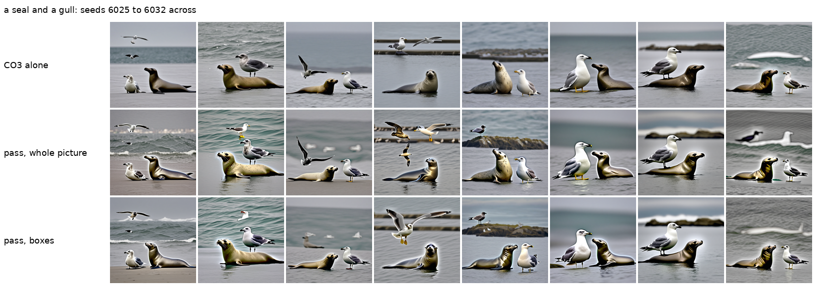

# Review: does Z7's clean-up pass with each animal's own prediction in its box beat the same pass over the whole picture? (step Z13)

**Null by the bar written before the run.** On the 12 tuning pairs at fresh seeds 6025 to 6032, Z7's extra corrector pass with each animal's own prediction inside its automatic box drew 20 of 96 pictures with two clear subjects that keep their own parts, against 18 for the same pass over the whole picture: a lead of 2 (7 seeds won, 5 lost, exact one-sided McNemar p = 0.39), against a bar of 5 and p < 0.05. CO3 alone, with no extra pass, drew 25, more than either. Unlike Z12, the box content moved the pictures: the boxed pass differs from the whole-picture pass by a median of 21.4 grey levels of 255, so this test could see an effect and found none. The design is [Z13's design](design.md).

## The numbers

| Row | Two clear of 96 | Broken | First animal with its own parts | Second animal with its own parts | Photograph-like two clear |
|---|---|---|---|---|---|
| CO3 alone | **25** | 2 | 65 | 36 | 11 |
| Pass, whole picture | 18 | 7 | 67 | 29 | 6 |
| Pass, each animal's own prediction in its box | 20 | 3 | 69 | 28 | 7 |

| Pair (8 seeds) | CO3 alone | Pass, whole | Pass, boxes |
|---|---|---|---|
| giraffe × tortoise | 5 | 5 | 5 |
| seal × gull | 5 | 1 | 3 |
| puma × condor | 4 | 2 | 3 |
| zebra × flamingo | 4 | 2 | 2 |
| eagle × fox | 3 | 4 | 3 |
| boar × pheasant | 2 | 0 | 0 |
| crow × raven | 1 | 2 | 0 |
| lighthouse × sailboat | 1 | 1 | 1 |
| duck × goose | 0 | 0 | 2 |
| bobcat × quail | 0 | 0 | 1 |
| cheetah × cougar | 0 | 1 | 0 |
| hippopotamus × swallow | 0 | 0 | 0 |

Reported beside the bar and deciding nothing: the whole-picture pass against CO3 alone, 18 against 25 (3 won, 10 lost); the boxed pass against CO3 alone, 20 against 25 (4 won, 9 lost). **The extra pass costs two-clear pictures, and the boxes win back only part of that.** The half-way count, the first six pairs, gave the boxed pass a lead of 4 (14 against 10); on the second six it trailed by 2 (6 against 8). Duck × goose, which carried Z7, gained 2 of 8 with the boxes. The bar's computation is `2-classifier-guidance/scripts/leakage/z13_blind.py bar`, committed before any call; the records are under [the blind folder](blind/).

The grids, three rows by eight seeds per pair, are in [the grids folder](grids/); giraffe × tortoise is held from display.

## How much each row moved the pictures

| Compared | Median change | Largest |
|---|---|---|
| Pass, whole picture, against CO3 alone | 22.3 grey levels | 39.7 |
| Pass, boxes, against CO3 alone | 20.3 | 32.3 |
| Pass, boxes, against pass, whole picture | 21.4 | 44.3 |

Mean absolute difference per picture over the 96, in grey levels of 255 ([the measurement](records/pixel-change.json)). Z12's box push moved its pictures by a median of 2.3; here the box content alone moves them by 21.4.

## Controls and checks

| Control | Result |
|---|---|
| Empty boxes, boxed pass against whole-picture pass | identical to the pixel, duck × goose at seed 6025 |
| Latent entering step 5 | identical in all three rows |
| Real boxes act | the boxed pass differs from the whole-picture pass by up to 255 in some pixel on the control picture |
| Pictures with no box | 0 of 96; the instrument kept two boxes in every CO3 picture ([the boxes](records/boxes.json)) |

## How it was counted

Two batches of 144 (all three rows of six pairs each), each called blind by two Claude reviewers from opposite ends of the sheet; they agreed on the rung for 94% of the first batch and 88% of the second, and a third settled 9 and 17 splits. Most calls short of two clear were a borrowed part (a mallard head on a goose, cheetah marks on a cougar, a feathered tail on a boar) or an extra subject; no picture in any row was called one subject or hybrid.

## What this means

The box route on CO3 closes, by the rule written before the run, with Z7, Z12 and Z13 as its record: putting each animal's own prediction inside its box does not add two-clear pictures once the extra corrector pass is held fixed, and the extra pass itself loses pictures against CO3 alone. Z7 measured the same two-pass comparison on 48 pictures at seeds 6001 to 6008: boxes 14 against whole picture 10, a lead of 4 (p 0.24, [Z7's review](../07-own-prediction/review.md)); its near miss against CO3 alone (14 against 8) was the pass and the boxes together. On fresh seeds and twice the pictures, the boxes' lead over the pass is 2 of 96, and the pass loses pictures against CO3 alone.

## Runs

| Job | What | Time (UTC, 2026-11-26) |
|---|---|---|
| 95796 to 95798 | CO3 alone, three shards | 22:30 to 23:07 |
| 95799 to 95801 | pass, whole picture, three shards | 22:53 to 23:41 |
| 95802 | instrument boxes on CO3 alone's pictures, controls | 23:16 to 23:24 |
| 95803 to 95805 | pass with boxes, three shards | 23:23 to 23:57 |

All on `bigbatch` RTX 3090 cards, whole nodes, faulted and stale nodes excluded; code snapshot `0088c962` (design `b61e9deb`, code `00969aba`). 4.5 GPU-hours from the jobs' own start and end lines, against 4.2 approved; the extra is the slower shards' longer runs. W&B group `loop-12-z13` (`u5picrcf`, `s0fmmyuj`, `6gk49rdc`, `1lav1eyv`, `7c17wto7`, `wsoc53yq`, `2e4jx8ky`, `fhlt6mnl`, `01n24ono`). Pictures under `/datasets/mmolefe/poe_repair_min/loop-12/z13/`.

## What this cannot say

Twelve pairs and eight seeds, one window (steps 5 to 30) and one way of using the box (the animal's own guess alone inside it). The boxes come from CO3's finished picture, a best case. The calls are by Claude reviewers, who disagreed on 6% and 12% of pictures, mostly over crow against raven and small borrowed parts.
