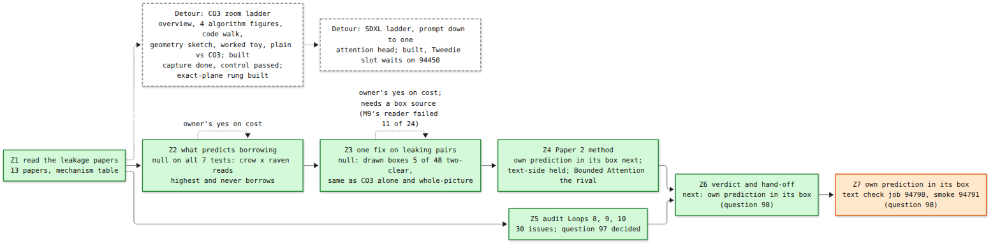

# Loop 12: where CO3's subjects borrow each other's parts

This folder holds Loop 12's work, run by [the session 12 brief](../prompts/session-12-where-co3-leaks.md): find where in SDXL with CO3 one subject borrows the other's parts, test one fix there, and choose Paper 2's method from what that shows.

## What is here

| File | What it is |
|---|---|
| `01-reading/mechanism-table.md` | Z1: 13 papers on where leakage enters, one row each, with the recorded search |
| `02-what-predicts-borrowing/design.md` | Z2: three early readings set against W2d's borrowed counts, with the bars |
| `04-paper-2-method.md` | Z4: the candidates, the owner's constraint, filled in after Z2 and Z3 |
| `ideas/what-co3-does-that-our-loops-did-not.md` | five ways CO3's corrector differs from every push the loops tried, each a design rule for Paper 2 or an audit row for Z5 |
| `ideas/a-checker-on-the-failure-signal.md` | a candidate method: a checker that reads only a sampler's own early failure signal |
| `where-leakage-could-enter.png` | the five places leakage could enter, with the papers that blame each |
| `loop-12-and-the-other-loops.png` | how Loop 12 meets Loop 10 |
| `mechanism-checker-idea.png` | the checker idea as a loop |

## What waits on what

- Z2's run waits on the owner's answer to board question 82. The owner chose on 2026-11-24 to read the whole sampling path in three windows (early 0 to 5, middle 10 to 20, late 25 to 45), and the design, bars and runner were changed to that before any run.
- **A zoom ladder on CO3 is being built** in `2-classifier-guidance/artifacts/scenes/co3-sampler/`, as the owner chose on 2026-11-24: an annotated overview of CO3's sampling loop, one in-depth figure each for the resampler, the corrector, equation 15's weights and the co3-hybrid schedule, and the authors' code under each equation, in the style of the owner's three reference figures in that folder's `reference/`. Its one worked case with a real latent waits for Z2's smoke run at `/datasets/mmolefe/poe_repair_min/loop-12/z2/smoke/`.
- **Z5 starts from** the five design issues in the brief, plus Loop 10's independent audit (`../score-space/12-independent-audit.md`, which re-assesses the score-space and shared-text-space ideas: closed as a new source of information, open as the coordinates to compose in, and the shared additive space open in its block-wise form after Bradley et al., Theorem 6.1) and each loop's own account in `../score-space/13-alignment-check.md`, as Loop 10 asked on 2026-11-24.
