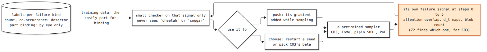

# A checker that reads a sampler's own failure signal

For each pretrained sampler, find the early reading that predicts its own failure, train a small checker on that reading alone, and use the checker to push or to choose while the sampler runs. The diffusion model is never trained. This note records the idea, what already supports it, and what would have to be true first. It is one of the candidates [Paper 2's method](../04-paper-2-method.md) weighs.

The picture's source is [the diagram file](../mechanism-checker-idea.mmd).

## The idea

**Each sampler fails in its own way, so each gets its own signal.** CO3 draws two bodies and swaps their parts. Plain SDXL and the product of experts more often lose one subject or fuse the two. Counting fails by the number of bodies. The signal for each is read where that failure starts, at the steps before the layout is settled.

**The checker reads the signal and nothing else.** It sees, for example, two attention maps and how much they overlap at step 3. It never sees the words "cheetah" or "cougar". So what it learns is a property of the sampling path, which is what lets it carry over to pairs it never trained on. The project's evaluation pairs share concepts with its training pairs, so a checker that reads pictures risks learning the concepts.

**It is used in one of two ways.** A push adds the checker's gradient to the sampler while it runs: classifier guidance with the classifier reading an internal signal. A choice uses the checker's reading to restart a seed or set one of the sampler's own settings, with no gradient.

## What supports it

**The same idea worked on digits.** In Loop 8, a checker that read only where each asked digit acts on the noisy canvas learned "two digits apart" on digits it never trained on, and its push composed unseen digits ([the count checker's push finding](../../../../../2-classifier-guidance/report/abstract-checkers-on-digits/does-the-count-checkers-push-compose-unseen-digits.md)).

**Early overlap tracks failure in the literature.** DAAM found that same-category pairs whose attention maps overlapped little drew both objects in 71.7% of images, against 9.75% when they overlapped a lot ([DAAM's note](../01-reading/daam.md), p. 7). The MMDiT similar-subject paper restarts a sample when its step-5 overlap ratio fires ([its note](../01-reading/mmdit-similar-subjects.md), p. 13).

## What has to be true first

**An early reading must predict the failure.** For CO3's part binding, step Z2 tests this ([the Z2 design](../02-what-predicts-borrowing/design.md)). The [directions map](../../../../ideas/which-directions-to-pursue/README.md) names the blocker for identity: a push must act at steps 0 to 10, where identity has not been readable. If no reading at steps 0 to 5 predicts borrowing, the idea has no signal to train on for CO3.

**A learned checker must beat a hand-written loss on the same signal.** If the signal is plain attention overlap, Conform and Bounded Attention already act on it with no training ([Conform's note](../01-reading/conform.md), [Bounded Attention's note](../01-reading/bounded-attention.md)). A checker earns its place only if it does better, for example by learning which overlap does harm: crow and raven look alike and never borrow under CO3.

**Pushing has a poor record on CO3; choosing has a better one.** The kept checker's push lowered CO3's faithful pairs from 11 to 7 of 96 (Loop 6's M1), and Loop 10's verdict is that a noise-aware score helps more by choosing than by pushing ([Loop 10's verdict](../../score-space/09-verdict.md)). The idea keeps both uses open.

## The labels are the cost

| Failure | Who labels the training pictures |
|---|---|
| Count, a subject missing | a detector can count the bodies |
| Two subjects fused into one | a detector, with a check by eye |
| Part binding, CO3's failure | by eye only: DeLeaker found CLIP and BLIP crop scores uncorrelated with leakage labels (Spearman ρ between −0.027 and 0.027), and its best automatic judge agrees with people at ρ 0.432 ([DeLeaker's note](../01-reading/deleaker.md)) |

## Across samplers

The same procedure could run on ToMe, plain SDXL and the product of experts, each with its own failure and signal. That is a study of its own, larger than Loop 12, and it is worth planning only once Z2 shows that one sampler's failure can be read early.
