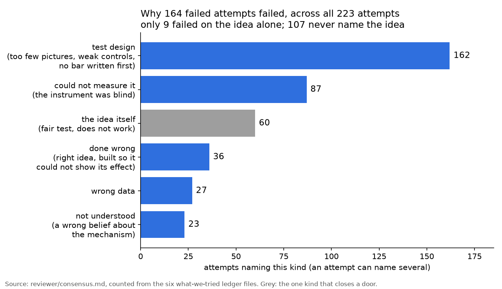

# 🧭 Briefing: where the PhD work stands

The one page to read. Loop 13 rewrites it every 6 hours, and at once when you say "updates", "brief me"
or "where are we". The full detail is on [the status page](status.md).

**Written:** 2026-11-26 02:20 (UTC+2). This is the final briefing: every loop is closed.

## Contents

- [Where we are](#where-we-are)
- [For you to decide](#for-you-to-decide)
- [What the manager does for you](#what-the-manager-does-for-you)

## Where we are

1. **Everything is shut down.** All loops are closed, every board step is finished or closed as not run,
   and nothing runs: no cluster jobs and no RunPod pods. You chose to stop both papers and start over.
2. **The starting point for the restart** is [the consensus](../reviewer/consensus.md): what is settled,
   the ideas worth retrying ranked by cost, the rules for every new design, and what each paper can claim.
   Behind it is [the what-we-tried ledger](../reviewer/what-we-tried/README.md), 223 attempts, each with
   its kind of failure and whether the idea is still alive. Every loop reads both before designing.
3. **Why things failed:** of 164 failed attempts, only 9 failed on the idea alone; test design (162
   mentions) and instruments that could not see the outcome (87) dominate. Most closed ideas were never
   fairly tested.
4. **The last two results.** Paper 1's two-colour block test: models trained apart and added together drew
   the right scene in 0 of 288 pictures by eye, a better sampler also 0, pasting 20.5%; neither count
   checker could read block counts (0.741 and 0.641 against 0.75). Paper 2's deciding box test: the boxed
   clean-up pass drew 20 two-clear pictures of 96, the same pass without boxes 18 and CO3 alone 25, so
   the box route on CO3 is shut.
5. **What stands:** on coloured digits, a classifier trained so its push points the right way beat every
   control (88.8% against 73.8%, 63.1% and 47.0%), because a model that had seen each combination
   supplied the right direction. The open question for any restart is where that direction comes from
   when no model has seen the combination.

## For you to decide

| # | The question | Recommended |
|---|---|---|
| none | When and how to restart | start from the consensus's retry list: the cheapest fair retests need about 1 GPU-hour together |
| 96, 104 | held earlier; moot after the shutdown | close when you restart |

## What the manager does for you

### Deciding questions

When a loop asks something whose every option is reversible, inside its budget and changes no recorded
bar or verdict, the manager runs the reviewer and decides, marked "Decided by Loop 13 for the owner".
Deletions, secrets, disagreeing records, runs over 3 GPU-hours and stopping a loop stay with you.

### Resources and finish times

Every hour the manager reads the queue, the finished jobs and the node states, compares our jobs with
the caps, flags waits over 2 hours, and tells a loop when the other partition has an idle card.

### Checking designs before they run

A new or changed design is read before its first run, for its data, its controls, whether its input
holds what it asks for, and its cost. A design likely to waste more than 3 GPU-hours reaches you.

### Things that may be wrong

Failed and slow jobs and steps with nothing running go on the status page. Two records that disagree go
to you. Two misses in a row from one loop earn it a method review request: it pauses and writes why.

### The reviewer

Once a day, and before any method review, the reviewer reads each loop against the 84 papers the
project has read and gives one verdict: continue, fix or stop. A stop reaches you as a board question.

### Nudges and re-routing

A loop gets one message when something it waits on changes or a request to it has waited 6 hours. A
request addressed to a stopped loop goes to the loop that now holds that work, or to you.

### Closing sessions

An idle session whose loop is finished or closed, or a second copy of a loop, is closed after its open
requests move on. A busy session never is, and a loop with steps left only with your yes.

### Briefing

This page, every 6 hours or when you ask.
