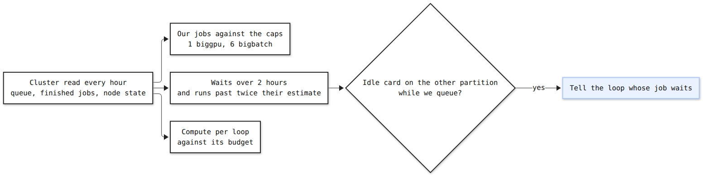
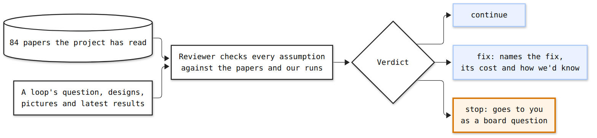
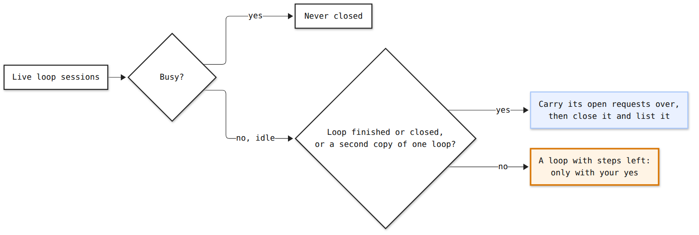
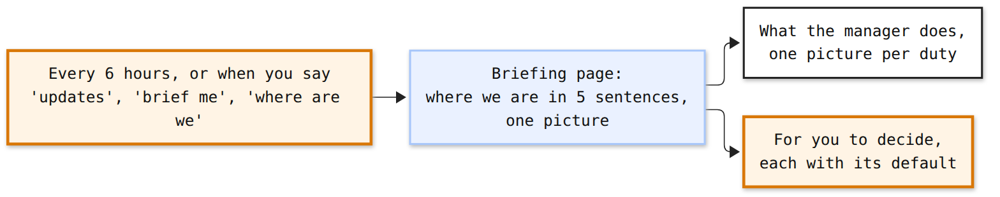

# 🧭 Briefing: where the PhD work stands

The one page to read. Loop 13 rewrites it every 6 hours, and at once when you say "updates", "brief me"
or "where are we". The full detail is on [the status page](status.md).

**Written:** 2026-11-24 16:56 (UTC+2).

## Contents

- [Where we are](#where-we-are)
- [For you to decide](#for-you-to-decide)
- [What the manager does for you](#what-the-manager-does-for-you)

## Where we are

1. **Paper 1** (experts that never met) is level with simply pasting the two experts' samples: 295 clean
   digit pairs of 320 against paste's 287. A CLEVR test where neither expert is told where to draw, now
   with a paste comparison, is rendering, so we will see whether paste can be beaten when it is not
   given positions.
2. **Paper 2** (better than CO3) has found that CO3 already draws both subjects in 96 of 96 test
   pictures; its real failure is borrowed parts and wrong identity. Loop 6 is checking whether its
   checker can even see that failure, a 1.2 GPU-hour read, before spending about 11 more GPU-hours.
   Loop 8's identity checker reads unseen digits at 0.861 against a 0.75 bar.
3. **What changed today:** the reviewer read Loops 6 and 8 against the project's 84 papers and asked
   both to fix their aim; both corrected their records within minutes. The manager decided four of
   your questions and closed five idle sessions of finished or duplicate loops.
4. **The cluster** has no idle node: 17 of 48 `bigbatch` nodes and 4 of 7 `biggpu` nodes are down or
   drained, so jobs wait for each other, not for us.
5. **You answered** at 16:55: Loop 6's checker is now judged on two clear subjects with drawing style
   ignored, Loop 8's SDXL test targets identity against CO3, and Loop 11 stops after its last two steps.
   Two questions still wait, below.

## For you to decide

Answer with `python3 scripts/progress_board.py answer <number> "<your answer>"`, or in this session.
Nothing changes while a question waits.

| # | The question | Default |
|---|---|---|
| 80 | Should a checker choose CO3's sharpness setting at each of its corrected steps? A first read costs about 3.1 GPU-hours | you chose to wait for Loop 6's per-step read of its checker on CO3; it comes back to you with that result |
| 79 | Loop 9's sentence-score test has two recorded verdicts (null, and inconclusive in a later fairness test). Which leads the report's title? | keep the test's own verdict, with the fairness test as its own finding |

Also yours, not on the board: Loop 10 is closed but four of its steps stay open on the board, so the
board counts it unfinished.

## What the manager does for you

### Deciding questions

When a loop asks something whose every option is reversible, inside its budget and changes no recorded
bar or verdict, the manager runs the reviewer and decides, marked "Decided by Loop 13 for the owner".
Deletions, secrets, disagreeing records, runs over 3 GPU-hours and stopping a loop stay with you.

### Resources and finish times

Every hour the manager reads the queue, the finished jobs and the node states, compares our jobs with
the caps, flags waits over 2 hours, and tells a loop when the other partition has an idle card.

### Checking designs before they run

A new or changed design is read before its first run, for its data, its controls, whether its input
holds what it asks for, and its cost. A design likely to waste more than 3 GPU-hours reaches you.

### Things that may be wrong

Failed and slow jobs and steps with nothing running go on the status page. Two records that disagree go
to you. Two misses in a row from one loop earn it a method review request: it pauses and writes why.

### The reviewer

Once a day, and before any method review, the reviewer reads each loop against the 84 papers the
project has read and gives one verdict: continue, fix or stop. A stop reaches you as a board question.

### Nudges and re-routing

A loop gets one message when something it waits on changes or a request to it has waited 6 hours. A
request addressed to a stopped loop goes to the loop that now holds that work, or to you.

### Closing sessions

An idle session whose loop is finished or closed, or a second copy of a loop, is closed after its open
requests move on. A busy session never is, and a loop with steps left only with your yes.

### Briefing

This page, every 6 hours or when you ask.
