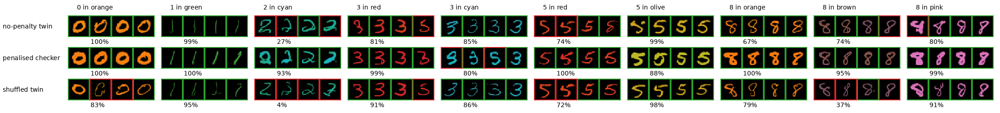
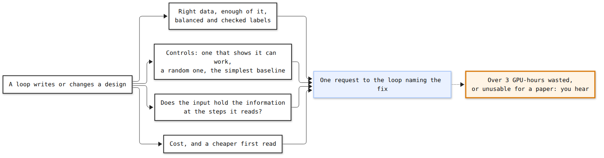

# 🧭 Briefing: where the PhD work stands

The one page to read. Loop 13 rewrites it every 6 hours, and at once when you say "updates", "brief me"
or "where are we". The full detail is on [the status page](status.md).

**Written:** 2026-11-25 17:05 (UTC+2).

## Contents

- [Where we are](#where-we-are)
- [For you to decide](#for-you-to-decide)
- [What the manager does for you](#what-the-manager-does-for-you)

## Where we are

1. **The first method that beats every control: a classifier trained so its push points the right way.**
   On the 50 digit-colour combinations neither expert saw, it gets 88.8% right against 73.8% for a push
   that only names the digit and colour at the same length, 63.1% for the same classifier trained
   without the alignment penalty, and 47.0% for a random push; FID 10.8 against DCFM's printed 11.41,
   which retrains (context only: two data holders against ten) ([its review](../leakage/11-gradient-trained-classifier/design.md)).
   Its push lines up with the target at 0.514 against 0.064 untrained. It is shown on digits only.
2. **Corrections carry "how many" to new pairs, not "which".** The trained correction (the ICLR LoRA)
   turned hybrids into two separate bodies on 8 new animal pairs as its strength rose (hybrids 29 to 4
   of 32), but the second body was the wrong animal: two clear rose only 0 to 2. The ICLR adapter's
   "58 of 64 on unseen pairs" was counted by a detector that counts bodies but cannot name animals, so
   it shows two bodies, not two correct animals. A test pairing the LoRA with each animal's own box is
   running.
3. **Paper 1's deciding test is training on RunPod.** Two CLEVR colour experts, each near the counter's
   ceiling at a quarter of training (0.81 and 0.83 right against 0.82 and 0.86); they finish about 17:35
   and 18:20, then the comparison with pasting and Bradley's rule.
4. **Closed today:** Paper 2's checker route (its push pointed the right way, +0.105, but too weakly to
   split a hybrid), the attention reader (CO3 already keeps the two words' attention apart, so borrowing
   comes from what each region draws), and the ratio classifier on unseen digits (it pushed toward pairs
   it knew).
5. **Running and spending.** Loops 6 and 12 and this manager; Loops 4 and 11 paused. RunPod: about R90
   spent of about R400; two pods left. The laptop restarted at 15:27 and damaged the git store; it is
   repaired, nothing lost.

## For you to decide

Answer with `python3 scripts/progress_board.py answer <number> "<your answer>"`, or in this session.

| # | The question | Default |
|---|---|---|
| none yet | Take the gradient-trained classifier to CO3, aligning its push to each animal's own box | the reviewer reads it first; about 5 GPU-hours, about R40 on RunPod |
| 96 | Judge checkers on ranking instead of their yes-or-no call? | moot for the closed checker route |
| 104 | Which model Paper 2 runs on | **held by you** until Paper 2 works on SDXL |

## What the manager does for you

### Deciding questions

When a loop asks something whose every option is reversible, inside its budget and changes no recorded
bar or verdict, the manager runs the reviewer and decides, marked "Decided by Loop 13 for the owner".
Deletions, secrets, disagreeing records, runs over 3 GPU-hours and stopping a loop stay with you.

### Resources and finish times

Every hour the manager reads the queue, the finished jobs and the node states, compares our jobs with
the caps, flags waits over 2 hours, and tells a loop when the other partition has an idle card.

### Checking designs before they run

A new or changed design is read before its first run, for its data, its controls, whether its input
holds what it asks for, and its cost. A design likely to waste more than 3 GPU-hours reaches you.

### Things that may be wrong

Failed and slow jobs and steps with nothing running go on the status page. Two records that disagree go
to you. Two misses in a row from one loop earn it a method review request: it pauses and writes why.

### The reviewer

Once a day, and before any method review, the reviewer reads each loop against the 84 papers the
project has read and gives one verdict: continue, fix or stop. A stop reaches you as a board question.

### Nudges and re-routing

A loop gets one message when something it waits on changes or a request to it has waited 6 hours. A
request addressed to a stopped loop goes to the loop that now holds that work, or to you.

### Closing sessions

An idle session whose loop is finished or closed, or a second copy of a loop, is closed after its open
requests move on. A busy session never is, and a loop with steps left only with your yes.

### Briefing

This page, every 6 hours or when you ask.
