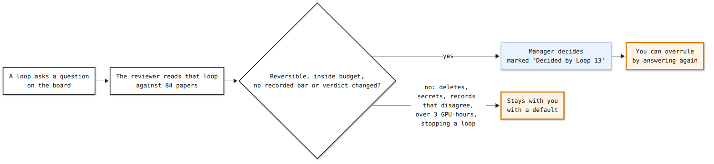

# 🧭 Briefing: where the PhD work stands

The one page to read. Loop 13 rewrites it every 6 hours, and at once when you say "updates", "brief me"
or "where are we". The full detail is on [the status page](status.md).

**Written:** 2026-11-25 07:02 (UTC+2).

## Contents

- [Where we are](#where-we-are)
- [For you to decide](#for-you-to-decide)
- [What the manager does for you](#what-the-manager-does-for-you)

## Where we are

1. **Paper 2's first real test is running.** It asks whether a correction that leaves SDXL
   unchanged can fix failures we already know, beyond what a random push of the same size does
   ([the design](paper2-four-way-design.md)). The first part, drawing plain PoE and the joint prompt
   to find their failures, is 39 of 88 pictures in on mscluster107's free card; the test itself
   follows in the queue. The answer should land in about 2 hours. The fix before it, each animal's
   own prediction inside its box, was a near miss: 14 pictures with two clear subjects of 48
   against CO3's 8, carried mostly by duck and goose.
2. **Paper 2 still has a problem worth solving.** Loop 14 found that newer models (SD3.5, FLUX)
   draw two different everyday objects in 78% to 89% of pictures, but two look-alike subjects in
   only about 53%, and the best published fix that leaves the model unchanged reaches 69%. On our
   tuning pairs CO3 rarely fuses animals. In 88 pictures, 33 give one animal the other's parts and
   20 add an extra animal ([the sheet](co3-failure-kinds.png)). CO3's own paper reports neither
   rate. A background search is checking whether any paper does.
3. **Paper 1 has measures where pasting can fail, and its closest rival.** Pasting separately drawn objects already
   places every object in 1,024 of 1,024 CLEVR images, so counting objects cannot show Paper 1 is
   better. Loop 4 drafted a plan with five measures pasting should fail or tie: which object hides
   which, one light for every object, one object's shadow on the other, seams, and colour staying
   with its object. You accepted the plan (question 105). Loop 6's two-colour CLEVR renders, the
   experiment it scores, are still running. DCFM (arXiv 2606.10153) composes models from separate
   hospitals' chest X-rays by forcing them to be independent; Loop 14 is turning its eight limits
   into experiments (step G4).
4. **Loop 6's session has stopped.** Its jobs keep running, but its identity reader (job 94807)
   finished at about 05:00 and nobody has read it. Restarting Loop 6 gets it read.
5. **Compute.** A RunPod RTX 4090 draws SDXL 2.5 times faster than a cluster RTX 3090 (5.96
   against 14.81 seconds a picture). Nothing runs on RunPod yet, because every deciding test fits
   the cluster; RunPod is for paper-sized runs after a "go".

## For you to decide

Answer with `python3 scripts/progress_board.py answer <number> "<your answer>"`, or in this session.

| # | The question | Default |
|---|---|---|
| 106 | Paper 2's first identity reader, which needs no training, is inconclusive (0.688 against a 0.75 bar). Next: a version that corrects for animals of very different sizes, a trained reader, pushing on it as it is, or stopping? | A: the size-corrected version on 8 fresh seeds per pair, about 1.2 GPU-hours |
| 107 | Add two points from DCFM, Paper 1's closest rival, to the X-ray part of the evaluation plan: NIH Chest X-ray 14 as the candidate dataset, and DCFM's classifier-recall score reported beside ours | the plan stays as accepted |
| 96 | Should Paper 2's checkers be judged on ranking good pictures above bad ones instead of their yes-or-no call at zero? | keep the yes-or-no gate, report ranking beside it |
| 104 | Which model Paper 2 runs on | **held by you** until Paper 2 works on SDXL and beats its rivals there |

**Restart Loop 6.** Open the 🧪 PhD Loop 6: Find The Best Method session and say
`Read artifacts/notes/progress/requests.md and continue step M12`. It reads its identity reader's
output and keeps the two-colour CLEVR renders moving.

## What the manager does for you

### Deciding questions

When a loop asks something whose every option is reversible, inside its budget and changes no recorded
bar or verdict, the manager runs the reviewer and decides, marked "Decided by Loop 13 for the owner".
Deletions, secrets, disagreeing records, runs over 3 GPU-hours and stopping a loop stay with you.

### Resources and finish times

Every hour the manager reads the queue, the finished jobs and the node states, compares our jobs with
the caps, flags waits over 2 hours, and tells a loop when the other partition has an idle card.

### Checking designs before they run

A new or changed design is read before its first run, for its data, its controls, whether its input
holds what it asks for, and its cost. A design likely to waste more than 3 GPU-hours reaches you.

### Things that may be wrong

Failed and slow jobs and steps with nothing running go on the status page. Two records that disagree go
to you. Two misses in a row from one loop earn it a method review request: it pauses and writes why.

### The reviewer

Once a day, and before any method review, the reviewer reads each loop against the 84 papers the
project has read and gives one verdict: continue, fix or stop. A stop reaches you as a board question.

### Nudges and re-routing

A loop gets one message when something it waits on changes or a request to it has waited 6 hours. A
request addressed to a stopped loop goes to the loop that now holds that work, or to you.

### Closing sessions

An idle session whose loop is finished or closed, or a second copy of a loop, is closed after its open
requests move on. A busy session never is, and a loop with steps left only with your yes.

### Briefing

This page, every 6 hours or when you ask.
